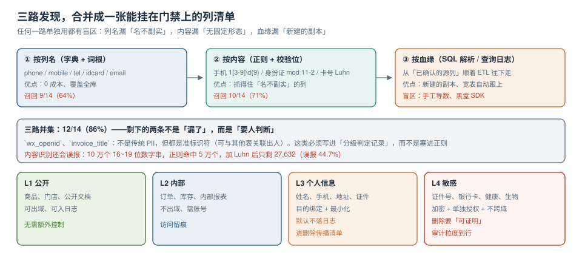

# 数据地图、分级与驻留标记

「我们有哪些个人信息」这个问题，大多数团队的回答是一张半年前的 Excel。它不是错的，只是**不能作为删除与导出的依据**——删除要求精确到列，导出要求精确到表，而 Excel 里通常只有「用户表有手机号」这种粒度。

数据地图要解决的就是这件事：**每个库.表.列 → 分级 → 目的 → 保留期 → 驻留地**。五个属性缺一个，地图就不能用来做决策。



本页判据族 `PVD-A` ~ `PVD-H`，共 8 条。定义表在第七节。

## 一、三路发现，各自的盲区都很具体

### 路 1：按列名（字典 + 词根）

```sql
-- PostgreSQL 18：从 information_schema 拉全库列
select table_schema, table_name, column_name, data_type
  from information_schema.columns
 where table_schema not in ('pg_catalog', 'information_schema')
   and column_name ~* '(phone|mobile|tel|email|mail|idcard|id_card|identity|name|addr|address|card)';
```

优点：零成本、覆盖全库、能扫到刚建的空表。
盲区：**名不副实**。本机 14 个含个人信息的列里，列名规则只认出 9 个（64%）：

| 列名 | 实际内容 | 为什么漏 |
| --- | --- | --- |
| `login_name` | 手机号 | 词根里没有 phone/tel |
| `nickname` | 用户自填真实姓名 | `name` 词根匹配到了，但被「昵称非实名」的常识排除 |
| `remark` | 自由文本，内含「客户电话 138…」 | 无固定形态 |
| `wx_openid` | 微信 openid（准标识符） | 不是传统 PII |
| `invoice_title` | 「张三有限公司」（含自然人姓名） | 同上 |

### 路 2：按内容（正则 + 校验位）

```sql
-- 只看命中数量，不读明文：避免把敏感数据拉进查询结果
select 'phone' as kind, count(*) from app_user where phone ~ '^1[3-9][0-9]{9}$'
union all
select 'id_card', count(*) from app_user where id_card ~ '^[0-9]{17}[0-9Xx]$'
union all
select 'card', count(*) from app_user where card_no ~ '^[0-9]{16,19}$';
```

优点：抓得住「名不副实」。
盲区两个：

1. **误报**：10 万个 16~19 位数字串，正则命中 5 万，加 Luhn 后只剩 27,632（误报 44.7%）。
2. **无形态**：中文地址、中文姓名、自由文本里的电话，正则认不出——本机 14 列里内容识别只认出 10 个（71%）。

::: danger 别把内容样本写进工单
扫描脚本最常见的错误是「把命中的前 100 行打印出来给人看」。这一打印，敏感数据就进了 CI 日志、进了工单系统、进了聊天记录——**为了找 PII 而制造了新的 PII 副本**。
正确写法：只输出 `表名.列名 + 命中数 + 命中率`，要看样本时走带审计的临时授权（见 [数据库访问控制与审计](../../../DB/AccessControl/AuditTrail/index.md)）。
:::

### 路 3：按血缘（SQL 解析 / 查询日志）

从「已确认的源列」顺着 ETL 往下走：`app_user.phone` → `dwd_user_wide.phone` → `ads_user_tag.phone_hash`。优点是新副本、宽表自动跟上；盲区是手工导数、黑盒 SDK、以及 `select *` 落地的临时表。

最省事的实现不是写 SQL 解析器，而是**先让数仓的血缘工具把表级血缘跑出来**，再对表级血缘做「列名同义」匹配：

```sql
-- 表级血缘：从 pg_stat_statements 找出「同一列出现在哪些 insert ... select」里
select query
  from pg_stat_statements
 where query ilike '%insert into%select%'
   and query ilike '%phone%'
 order by total_exec_time desc
 limit 20;
```

## 二、三路合并：并集 86%，剩下的交给人

| 路 | 认出列数 | 召回 | 主要漏什么 |
| --- | --- | --- | --- |
| 列名 | 9 / 14 | 64% | 名不副实、自由文本 |
| 内容 | 10 / 14 | 71% | 中文地址、中文姓名、稀疏列 |
| 血缘 | 视上游覆盖 | — | 手工导数、黑盒 SDK |
| **并集** | **12 / 14** | **86%** | 准标识符（openid、含人名的单位名） |

剩下的 2 列不是「漏了」，而是**必须人判断**。所以清单表要支持「人工判定记录」，而不是只有「机器识别」：

```sql
create table privacy_column (
  id            bigserial primary key,
  tbl           text not null,              -- schema.table
  col           text not null,
  grade         char(2) not null,           -- L1 / L2 / L3 / L4
  purpose       text[] not null default '{}',-- 允许的目的集合
  retention_days int,                       -- null = 长期（必须写理由）
  residency     text not null default 'cn', -- 驻留地标记，见第四节
  detected_by   text not null,              -- name / content / lineage / manual
  decided_by    text not null,              -- 人工确认人
  decided_at    timestamptz not null default now(),
  note          text,
  unique (tbl, col),
  check (grade in ('L1','L2','L3','L4')),
  check (retention_days is null or retention_days > 0),
  check (grade in ('L1','L2') or cardinality(purpose) > 0)   -- L3/L4 必须有目的
);
```

`check (grade in ('L1','L2') or cardinality(purpose) > 0)` 这一条是整个地图的**最小可用门禁**：L3/L4 的列如果没写目的，插入直接失败。它把「以后补」变成了「现在补」。

## 三、分级四档：判据是「泄露后的后果」，不是「数据的类型」

| 级别 | 判定问句 | 例子 | 默认控制 |
| --- | --- | --- | --- |
| L1 公开 | 泄露了会不会有影响？ | 商品名、门店地址、公开文档 | 无额外控制 |
| L2 内部 | 泄露会不会暴露经营信息？ | 订单金额、库存、内部报表 | 账号 + 授权 + 访问留痕 |
| L3 个人信息 | 能不能单独或结合识别到人？ | 姓名、手机、地址、邮箱、openid | 目的绑定、最小化、进删除清单、默认不落日志 |
| L4 敏感 | 泄露会不会造成人身/财产损害？ | 证件号、银行卡、健康、生物特征、精确位置 | 加密 + 单独授权 + 不跨域 + 行级审计 |

两个容易吵起来的地方：

1. **手机号是 L3 还是 L4？** 单独一个手机号通常按 L3；如果与姓名、地址、订单同表，组合后可定位到具体个人，仍按 L3 处理，但**导出与日志要按 L4 的严格度**。分级是对「列」的，控制可以对「组合」加严——写进 `note` 而不是改级别，避免级别通胀。
2. **聚合值算不算？** 按 `k` 判断：分组后每组人数 < k（常见 k=5）的聚合结果，实际等价于个人信息。这类表要有「最小分组人数」约束，而不是靠自觉。

```sql
-- 聚合表的小组约束：任何分组都必须 >= 5 人，否则不输出
select city, count(*) as users
  from app_user
 group by city
having count(*) >= 5;     -- 少了这一行，city 就变成准标识符
```

## 四、驻留标记：地图上多一列，跨境时少吵一周

跨境合规的技术侧只有三件事：**数据在哪、能不能过去、过去之后密钥在哪**。所以地图里必须有 `residency`：

| 标记 | 含义 | 对工程的要求 |
| --- | --- | --- |
| `cn` | 数据与备份都在境内 | 备份区域也要在境内（常见疏漏） |
| `cn-hk` | 中国香港区域 | 单独评估，按「境外」处理 |
| `eu` | 欧盟区域 | 密钥驻留同区 |
| `global` | 允许多区域（仅 L1/L2） | L3/L4 不允许标 `global` |

一条可直接用上的门禁：

```sql
-- L3/L4 的列不允许标 global；也不允许出现在「跨区复制」的表清单里
select tbl, col from privacy_column
 where grade in ('L3','L4') and residency = 'global';
-- 预期输出：0 行。有行就是配置错误，不是数据问题。
```

**「加密后跨境」的边界**：把数据用境内密钥加密再传输到境外，解密密钥不离境——这种做法的合规结论**需要法务确认**，技术上只能保证「境外拿到的是密文」。工程上要写清楚的是：密钥在哪、谁能取、取了有没有留痕。这三件事做不到时，加密只是把问题换了个位置。

## 五、地图怎么维护：三道门

地图不是一次性文档，它的敌人是「新增」。三道门按成本从低到高：

| 门 | 位置 | 检查什么 | 失败后果 |
| --- | --- | --- | --- |
| 建表门 | 迁移脚本 / CI | 新增列必须在 `privacy_column` 里有记录 | 迁移失败（阻断） |
| 上线门 | 发布流水线 | 有 L3/L4 列但无目的 → 阻断 | 发布失败 |
| 周巡检 | 定时任务 | `information_schema` 与地图做**双向差集** | 告警（不阻断） |

双向差集是关键——**两个方向都要查**：

```sql
-- 方向 1：库里有、地图里没有（新列没登记）
select c.table_schema || '.' || c.table_name as tbl, c.column_name
  from information_schema.columns c
  left join privacy_column p
    on p.tbl = c.table_schema || '.' || c.table_name and p.col = c.column_name
 where c.table_schema = 'public' and p.id is null
 order by 1, 2;

-- 方向 2：地图里有、库里没有（列已删，地图没清）
select p.tbl, p.col
  from privacy_column p
  left join information_schema.columns c
    on p.tbl = c.table_schema || '.' || c.table_name and p.col = c.column_name
 where c.column_name is null;
```

只查方向 1 的地图会**越长越假**：三个月后一半的记录指向已删除的列，覆盖率算出来 100%，实际有效覆盖可能只有 60%。

## 六、覆盖率怎么算才不会自欺

三种常见口径，差别很大：

| 口径 | 算式 | 本机读数 | 问题 |
| --- | --- | --- | --- |
| 按列数 | 已登记列 / 总列数 | 187 列中 47 条 L3/L4 记录 | 分母包含大量 L1/L2，数字好看但没意义 |
| 按应登记列 | 已登记 / 机器+人工识别出的应登记 | 12 应登记中 12 已登记 = 100% | 依赖「应登记」的识别质量 |
| 按行数加权 | Σ(已登记列的行数) / Σ(应登记列的行数) | 更贴近风险 | 需要统计信息，成本高 |

**推荐组合**：对外报「按应登记列」的覆盖率，对内巡检用「按行数加权」——前者能解释，后者能发现「重要的大表没登记」。

本机实测（模拟 23 张表 / 187 列）：

```text
全表识别：423.2 ms，识别 6/6 列
1% 采样：7.8 ms，识别 4/6 列（两个稀疏列漏掉）
结论：日巡检用采样（便宜 54 倍）只够发现「新增的、有值的」列；
     上线前盘点必须全表，否则稀疏列永远进不了地图。
```

## 七、本页判据

| 编号 | 判据 | 看什么现象 | 不满足时改哪里 |
| --- | --- | --- | --- |
| `PVD-A` | 地图有五个属性 | 每行都有分级、目的、保留期、驻留、判定人 | 补 `check` 约束，不靠流程 |
| `PVD-B` | 发现用两路以上并集 | 有并集召回数字（本机 12/14） | 补第二路；单路 < 80% 不能当清单 |
| `PVD-C` | 内容识别带校验位 | 证件有 mod 11-2、卡号有 Luhn | 加校验，误报从 44.7% 降下来 |
| `PVD-D` | 地图能区分「机器识别」与「人工判定」 | `detected_by` 有 `manual` 取值 | 补字段；准标识符必须人工确认 |
| `PVD-E` | L3/L4 无目的时插入失败 | `check` 约束存在且被验证过 | 加约束；用一条故意失败的 SQL 证明 |
| `PVD-F` | 驻留标记有工程门禁 | 有「L3/L4 不许 global」的查询且返回 0 行 | 补查询并接进巡检 |
| `PVD-G` | 巡检做双向差集 | 有「库有图无」与「图有库无」两条 SQL | 补第二条方向 |
| `PVD-H` | 覆盖率口径写清楚分母 | 明确是列数、应登记列、还是行数加权 | 补口径；数字后面必须跟分母 |

## 参考资料

- PostgreSQL 18 Documentation：*Information Schema*（`columns`、`table_constraints`）、*Pattern Matching*（POSIX 正则与 `~*`）
- GB 11643-1999《公民身份号码》：18 位结构与 mod 11-2 校验
- ISO/IEC 7812：银行卡号（PAN）结构与 Luhn 校验
- NIST Privacy Framework 1.0：*Identify-P*（数据清单与映射）
- 本仓库：[四个动作与五个必失点](../Overview/index.md)、[采集最小化与三种形态](../Minimization/index.md)
