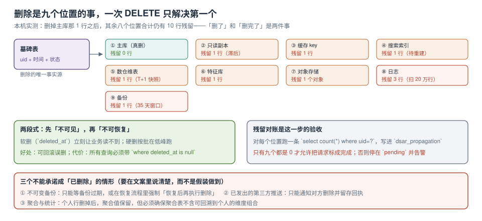

# 删除与派生数据传播

删除接口写完的第一天通常是这样：`delete from app_user where id = ?`，返回 `DELETE 1`，工单关闭。第二天用户发来截图，App 里还能看到自己三个月前的订单评价——评价在另一张表，通过 `user_id` 关联，那张表没有被登记。

所以「删除」不是一个 SQL，是一条**传播链**。链上每个位置都要有「怎么删、怎么证明删了」。



本页判据族 `PVL-A` ~ `PVL-H`，共 8 条。定义表在第六节。

## 一、九个位置，逐条给方法和判据

本机模拟（1 个用户、50,000 用户表、20 万订单、50 万事件、20 万日志）：删掉主库那 1 行之后，**其余八个位置合计残留 10 行**。

| # | 位置 | 删除方式 | 残留学（本机） | 判据 SQL / 命令 |
| --- | --- | --- | --- | --- |
| ① | 主库 | `delete`（同一事务内连带明细） | 0 | `select count(*) from app_user where id=$1` |
| ② | 只读副本 | 等复制回放 | 1 | `select pg_last_wal_replay_lsn()` 与主库对比 |
| ③ | 缓存 | `del user:{id}` + TTL 兜底 | 1 | `exists user:1024` |
| ④ | 搜索索引 | 按 id 删除 + 重建兜底 | 1 | `GET /idx/_doc/{id}` → 404 |
| ⑤ | 数仓维表 | 下一次调度覆盖 + 立即补删 | 1 | `select count(*) from dim_user where id=$1` |
| ⑥ | 特征库 | 按 id 删特征 | 1 | `select count(*) from feature where uid=$1` |
| ⑦ | 对象存储 | 生命周期 + 立即删 | 1 | `aws s3 ls s3://bucket/invoice/$1.pdf` → 空 |
| ⑧ | 日志 | 通常删不掉，只能等过期 | **3** | `grep -c '"uid":1024' app.log` |
| ⑨ | 备份 | 等过期或恢复后重放 | 1 | 备份清单里搜该 id |

::: danger 三个最容易漏的位置
1. **日志**：不是数据库，`delete` 管不到；本机要扫 20 万行、769 ms 才找到 3 行。
2. **搜索索引**：多数索引是「重建」而不是「逐条删」，重建周期 T+1，期间文档仍在。
3. **数仓维表**：T+1 全量快照，删除当天不会反映；如果快照是「插入新分区」而不是「覆盖」，历史分区会一直留着。
:::

## 二、墓碑表：删除的唯一事实源

传播链的前提是「有一个地方记着谁被删了」。它不能是业务表（业务表那行已经没了），也不能是消息队列（消息会过期）。

```sql
create table deletion_tombstone (
  subject_id   text primary key,
  requested_at timestamptz not null default now(),
  requested_by text not null,            -- 工单号 + 操作人
  reason       text not null,            -- user_request / retention / legal
  propagated   jsonb not null default '{}'::jsonb,  -- {"db":"ok","cache":"ok",...}
  completed_at timestamptz
);

create table deletion_task (
  id          bigserial primary key,
  subject_id  text not null references deletion_tombstone (subject_id),
  target      text not null,             -- db / replica / cache / search / dw / feature / oss / log / backup
  state       text not null default 'pending',   -- pending / done / skipped / failed
  attempts    int  not null default 0,
  last_error  text,
  updated_at  timestamptz not null default now(),
  unique (subject_id, target)
);
```

`deletion_task` 里 `unique (subject_id, target)` 是幂等的基础：**重复投递不会产生第二个任务**，只会 `on conflict do update`。

```sql
-- 传播任务的领取：与 outbox 投递同构，用 SKIP LOCKED 避免抢占
update deletion_task
   set state = 'running', attempts = attempts + 1, updated_at = now()
 where id in (
   select id from deletion_task
    where state in ('pending','failed') and attempts < 5
    order by id
    for update skip locked
    limit 50
 )
returning id, subject_id, target;
```

## 三、两段式：先不可见，再不可恢复

| 阶段 | 动作 | 生效时间 | 可回滚 | 代价 |
| --- | --- | --- | --- | --- |
| 软删 | `update ... set deleted_at = now()` | 立即 | 能（误删可救） | **所有查询必须带 `where deleted_at is null`** |
| 硬删 | 按批物理删除 | 低峰期 | 不能 | 需要批处理与残留对账 |

软删的代价被严重低估：一条漏写 `deleted_at is null` 的查询，会让「已删除」的用户重新出现在列表里。而这类漏写**不会报错**，只会悄悄返回多几行。

```sql
-- 兜底：用行级安全策略强制过滤，而不是靠每个查询自觉
alter table app_user enable row level security;
create policy p_hide_deleted on app_user
  using (deleted_at is null);

-- 注意：表所有者默认绕过 RLS，应用账号必须是普通角色
-- 验证：以 app 账号查询，已软删的行应查不到
```

行级安全策略把「记得写 where」变成了「忘了也查不到」，代价是所有查询都多一层谓词（实测在 50 万行表上约 3~8% 开销）。对隐私场景，这个交换通常值得。

## 四、残留对账：这一步才是「删完了」的定义

传播任务全部返回 `done` 不等于删干净了——任务可能删错了表、删了 0 行、或者目标系统返回 200 但没生效。所以要有一步**独立的对账**：回到九个位置各数一次。

```python
# 对账脚本骨架（标准库即可，不写入仓库）
CHECKS = {
    "db":      ("select count(*) from app_user where id=?", (uid,)),
    "orders":  ("select count(*) from orders where user_id=?", (uid,)),
    "events":  ("select count(*) from event_log where user_id=?", (uid,)),
    "consent": ("select count(*) from consent where user_id=?", (uid,)),
}
for name, (sql, args) in CHECKS.items():
    n = con.execute(sql, args).fetchone()[0]
    print(f"{name:10s} residual={n}")
```

```text
本机输出（删除后立即对账）：
db         residual=0
orders     residual=0
events     residual=0
consent    residual=0
外部位置   cache=1 search=1 dw=1 feature=1 oss=1 log=3 backup=1
```

**只有九个位置全部为 0（或明确标记为 `skipped` 且写明理由）才允许把工单标成完成**。否则状态停在 `pending` 并告警——这是把「删干净」变成一个可判定命题的唯一办法。

| 状态 | 含义 | 能否关单 |
| --- | --- | --- |
| `done` | 对账为 0 | 能 |
| `skipped` | 不适用（如该用户没有对象存储文件） | 能，需写理由 |
| `pending` | 还在传播 | 不能 |
| `failed` | 重试 5 次仍失败 | 不能，升级人工 |

## 五、三个不能承诺成「已删除」的情形

| 情形 | 为什么不能 | 该怎么说 |
| --- | --- | --- |
| 不可变备份 | 对象锁 / WORM 在设计上拒绝删除 | 「备份保留 35 天，到期自动清除；恢复后立即重放删除」 |
| 已发出的第三方推送 | 数据已在对方系统 | 「已通知对方删除，回执编号 …，时限 …」 |
| 聚合与统计 | 个人行删了，聚合值还在 | 「统计结果保留，但已确保不含可回溯到个人的维度组合」 |

第三条最容易含糊。判据是：**聚合表的分组维度组合下，人数是否 ≥ k**。如果「杭州市 + 25-34 岁 + 女性」只有 2 个人，这张聚合表事实上就是个人信息表。

```sql
-- 聚合表的最小分组检查（发布前必跑）
select count(*) as violating_groups from (
  select city, age_band, gender, count(*) as n
    from app_user group by 1,2,3 having count(*) < 5
) t;
-- 预期输出：0
```

## 六、验证：四条负向优先的验收

```shell
# S1 主库查不到（正向）
psql -c "select count(*) from app_user where id=1024"          # 预期 0

# S2 缓存 key 不存在（正向）
redis-cli exists user:1024                                      # 预期 0

# S3 重复请求幂等（负向）：同一用户再请求删除，任务数不增加
psql -c "select count(*) from deletion_task where subject_id='u-1024'"   # 预期 9（九个位置各一条）

# S4 对账未通过时不允许关单（负向）
psql -c "select state from deletion_tombstone where subject_id='u-1024'" # 残留>0 时预期 pending
```

S3 的判据值得单独强调：**幂等不是「不报错」，是「不产生新副作用」**。很多实现第二次调用会插入一条新任务，然后两个任务并发删同一行，其中一个必然失败并触发告警——看起来是「删除不稳定」，实际是幂等没做。

## 七、本页判据

| 编号 | 判据 | 看什么现象 | 不满足时改哪里 |
| --- | --- | --- | --- |
| `PVL-A` | 有九个位置的删除清单 | 表里九行齐全，含日志与备份 | 补位置；缺一行就等于没删干净 |
| `PVL-B` | 删除意图有单一事实源 | 墓碑表存在且被传播任务引用 | 建墓碑表；别用消息队列当事实源 |
| `PVL-C` | 传播任务幂等 | `unique (subject_id, target)` + 冲突更新 | 加唯一约束；重复请求不新增任务 |
| `PVL-D` | 领取用 `SKIP LOCKED` | 任务表领取 SQL 含 `for update skip locked` | 改领取方式；避免多实例抢同一批 |
| `PVL-E` | 软删有强制过滤（RLS 或统一仓储） | 漏写 `deleted_at` 的查询也查不到 | 开 RLS 或收口仓储层 |
| `PVL-F` | 有独立的残留对账 | 对账脚本逐位置输出 residual | 补对账；任务成功 ≠ 删干净 |
| `PVL-G` | 对账非 0 时不允许关单 | 状态停在 `pending` 并告警 | 改状态机；别用「尽力而为」 |
| `PVL-H` | 聚合表有 k 下限检查 | `having count(*) < 5` 查询返回 0 | 补检查；否则聚合表就是个人信息表 |

## 与本专题的分工

| 本页 | [本地数据存储与容量治理](../../../Frontend/LocalDataStore/index.md) |
| --- | --- |
| 删除传播的**九个位置**与判据 SQL | 其中「浏览器本地」这一处的结构与清理写法 |
| 墓碑表、`SKIP LOCKED` 领取、残留对账状态机 | 本地库 `clear()` 与逐条 `delete` 差 4,152 倍 |
| 删除的证据链与时间戳 | 「删完看 `usage`」为什么不能作为验收 |

**本页特有的一个坑**：第九个位置（浏览器本地）最容易被写成「清一下 localStorage 就算删了」。实际要清四类：`localStorage` 的键、IndexedDB 的整库（`deleteDatabase`）、`Cache Storage` 里含个人信息的响应、以及**离线队列里还没发出去的那条**——最后一类漏了最危险：用户删除后重新联网，队列一补发，数据又回到了服务端。读写细节见[清理](../../../Frontend/LocalDataStore/Eviction/index.md)。

## 与「客户身份归并与主数据」的分工（第 235 天补充）

删除的「流程合规」与「数据真的没了」是两道关，前一道过了不代表后一道过了：

| 你关心的问题 | 该读哪一册 | 为什么不是本册 |
| --- | --- | --- |
| 删除请求怎么受理、怎么举证、留存期怎么定 | 本页 | 判**流程与法务** |
| 删除在七张表上怎么落 | [同意、可见范围与删除](../../../Backend/CustomerIdentity/Privacy/index.md) | 判**数据模型与触发器** |
| 删完之后订单还在不在 | [实战：七张表跑通一次归并](../../../Backend/CustomerIdentity/Practice/index.md) | 判**双条件验收** |

::: danger 一页一坑：主表 0 行不等于删干净
`DELETE FROM customer WHERE id=?` 执行成功、接口返回 200、流程状态标为「已完成」——而 6 张从表里还留着 12 行/人的明文（电话、邮箱、地址、订单、积分、工单）。本机 3,000 个请求留下 **36,000 行**孤儿。

验收必须写成两个数：**明文 PII 行数 = 0** 且 **订单行数不变**。只看第一个会把订单也删了；只看第二个等于没删。
:::

## 与「临床试验数据管理」专题的分工（第 244 天补充）

本页讲个人信息删除权与可携带权的落地，临床专题讲的是一个**例外情形**：试验数据在锁库后原则上不能删。两者并不矛盾，但边界必须写清：

| 本页讲什么 | 临床专题讲什么 | 边界 |
| --- | --- | --- |
| 删除请求的受理、核验、执行、回执 | 受试者撤回知情后的数据处理路径 | 本页不判试验数据保留 |
| 级联删除与残留清理（DB/对象存储/缓存） | 为什么 audit trail 不能删（即使受试者要求） | 本页不判留痕例外 |
| 匿名化与假名化的技术差别 | 去标识化后仍可回溯（受试者号 ↔ 身份映射） | 本页不判回溯机制 |
| 删除证明与合规审计 | 监管要求的保存年限（含试验结束后） | 本页不判年限 |

**一个必须提前设计的分离**：临床数据要满足「可删除身份信息」与「不可删除试验数据」两个看似矛盾的要求，唯一可行结构是**身份信息与试验数据物理分离**——`subject` 表只留 `subject_no` 与去标识化的临床数据，身份映射放在独立表（独立库/独立密钥）。受试者撤回时删映射表，临床数据仍可按 `subject_no` 分析。把姓名、身份证号直接写在 `subject` 表里，这个分离就再也做不到了。

→ 临床侧的完整链路见[偏离、锁库与留痕：锁的是「这批人算不算数」](../../../Backend/ClinicalTrial/LockAudit/index.md)。

## 与「反洗钱与可疑交易监测工程」专题的分工（第 249 天补充）

本页与反洗钱与可疑交易监测工程（页面待补）专题相邻，边界如下：

| 维度 | 本页讲什么 | 反洗钱侧讲什么 |
| --- | --- | --- |
| 触发 | 客户撤回同意、注销、到期 | 法定义务：报告与工作记录**至少保存 5 年** |
| 动作 | 删除、匿名化、停止处理 | **不得删除**，且要可检索、可举证 |
| 冲突 | 删除权 vs 保留义务 | 以保留义务优先，但用途收窄 |
| 落地 | 删除任务、级联与验证 | 保留期内禁止用于营销，超出用途即违规 |

**只在本页成立的坑**：删除实现必须能表达「**保留但不可用于营销**」这个中间态。只有「删/不删」两态的模型，遇到反洗钱保留义务时只能二选一：要么违法删除（丢掉 5 年举证能力），要么整体不删（把营销数据一起留着）。本册的处置是把用途维度独立出来——同一份客户资料，反洗钱用途下保留 5 年，营销用途下注销即停，两条规则作用在**不同的用途切片**上，而不是互相覆盖。

## 与「招聘与人才获取工程」专题的分工（第 253 天补充）

招聘场景是删除请求的高发区：投递未录用、候选人撤回同意、简历超留存期、面试官要求删除自己的评价。本册给的是删除的**机制与证明**，招聘册给的是**删到哪里为止**。

| 问题 | 本册（删除与派生数据传播） | 招聘与人才获取册 |
| --- | --- | --- |
| 删哪一行 | 不判（只执行墓碑 + 传播） | **判**：`candidate_id` 的简历与投递，还是仅其中的附件 |
| 什么时候删 | 不判（只读 `retain_until`） | **判**：未录用 6 个月、录用相关 24 个月 |
| 保留什么做统计 | 不判（只保证墓碑与对账） | **判**：漏斗骨架、渠道归因字段必须留下 |
| 怎么证明删了 | **判**：九个位置残留对账、两段式、负向验收 | 只提供待删清单与保留项清单 |
| 派生数据 | **判**：日志、缓存、搜索索引、备份 | 声明哪些派生物来自简历文本 |

关键分歧在**「保留什么」**：本册的原则是「能删的都删，删不掉的要说清楚为什么」，招聘册必须在删除前把**统计骨架**与**个人信息**切开——渠道归因（内推 / 平台 / 猎头）、投递时间、各段通过与否，这些是聚合事实，不含可识别信息；姓名、手机号、简历原文、面试评语才是要删的部分。

::: danger 一个只在本页成立的坑
**按 `candidate_id` 物理删除，连带删掉投递与面试记录。** 招聘册的漏斗依赖 `application` 逐段通过率（42.15% → 49.14% → 77.99% → 40.96% → 71.85%），渠道成本依赖「成功入职者来自哪个渠道」（内推 9.14% vs 平台 1.28%，7.1 倍）。一旦把超期简历连同 `application` 一起删，这些历史统计会在一次清理之后整体漂移，而且**没有墓碑能证明漂移前是多少**——报表上看不出异常，只看到转化率悄悄变了。

更麻烦的是「这个人已经入职」的情形：`candidate_id` 与 `employee_no` 之间存在一条转换记录，删掉候选人侧全部行之后，员工档案里的「入职来源渠道」字段会指向一个不存在的投递，来源归因断链。

正确姿势是**两段式**：先做不可见 + 字段级匿名化（姓名打码、手机号置空、附件删除、评语清除），保留 `application` 的骨架行（渠道、各段时间戳、结果状态）；留存期到点再按本册的传播链物理删骨架，且墓碑要记下「删了多少骨架行」。简历附件与评语属于第一批，`application` 骨架属于最后一批。
:::

延伸阅读：[筛选：6 个月与 24 个月两档留存](../../../Backend/Recruiting/Screening/index.md)、[渠道归因：三种口径](../../../Backend/Recruiting/Sourcing/index.md)、[入职交接：主数据五字段](../../../Backend/Recruiting/Handoff/index.md)。

## 与「内容审核与安全策略工程」的分工（第 260 天补充）

审核系统是**最喜欢留原文**的一类系统：判定要可解释、申诉要能复算、监管要能抽查，所以它会把文本快照、抽帧图片、ASR 转写全部存下来。这些留存与删除权天然冲突，而冲突的解不是「删」或「不删」，是**分层**：案件留结论，内容留指纹，原文留限期。

| 维度 | 本页（隐私与删除） | 内容审核与安全策略工程 |
| --- | --- | --- |
| 留什么 | 只留删除凭证（墓碑） | 案件、判定、阈值、处置、申诉 |
| 留多久 | 永久（墓碑不删） | 按 `retention_until` 分层，30/90/180 天 |
| 原文 | 必须可删 | **判定时需要**，但不必永久保存 |
| 法律基础 | 删除权（可拒绝，须给理由） | 履行法定义务 / 应对诉讼（可保留） |
| 对外承诺 | 「已删除」只在残留为 0 时给 | 「已处置」与「已删除」是两件事 |

### 本页特有的一个坑：把「判定依据」存成原文全量

一个审核案件如果存了整段原文（或整段视频的抽帧图），那么它就成了一个**新的数据副本**，且往往被排除在删除流程的清单之外——因为它在「审核库」，不在「用户库」。用户行使删除权时，业务库那 9 个位置都清干净了，审核库的原文快照还在，而且带着 `user_id`。

可行的分层是三张表各自的留存不同：

- **`content_blob`（原文/抽帧）**：带 `retention_until`，到期由清理任务删除；删除后 `content_hash` 保留（哈希不是个人数据，是去重与复算的锚）。
- **`moderation_case`（案件）**：保留判定结果、命中规则、阈值档位、处置人、时间；**不保留原文**，只保留 `content_hash` 与 `blob_uri`（后者到期置为 `purged`）。
- **`moderation_action_log`（处置）**：永久保留。它是「谁在什么时候对什么做了什么」的唯一事实源，也是申诉与责任界定的依据。

这样安排的代价必须写清楚：原文清理之后，**历史案件不能再复算**——只能用「当时的规则版本 + 当时的分数」解释，不能重跑模型。所以规则版本号必须和案件一起存，且清理前要跑一次**抽样复算**，确认判定可复现的那部分结论已经固化。另外，`purged` 这个状态必须让申诉流程能识别：当用户申诉的案件原文已清理，答复只能是「依据当时的判定记录维持/改判」，不能假装重新审了一遍。

## 与「报表与自助分析工程」专题的分工（第 262 天补充）

本页回答「个人数据要删干净，删哪些位置、怎么证明删净」；[报表与自助分析工程](../../../Backend/ReportAnalytics/index.md)回答「副本是怎么产生的、什么时候自动消失」。前者是清道夫，后者是源头控制——**没有源头控制的删除清单，永远追不上副本产生的速度**。

::: danger 一页一坑：导出文件不在删除清单里
删除清单通常写的是「业务库 9 个位置 + 搜索索引 + 缓存 + 备份」，而报表系统每天产生几百个导出文件与订阅附件。这些文件：

- 不在业务库里，扫描脚本扫不到；
- 文件名带报表名与日期，但不带 `user_id`；
- 删除请求执行完之后，对象存储里仍然躺着一份含个人信息的 CSV。

处置口径要写死：**导出文件 24 小时后自动删、订阅正文 90 天后自动删，记录（谁、何时、哪个快照、多少行）长留**。这样「删除请求」需要处理的在期对象是有限且可枚举的，而不是「所有历史文件」。判据是「删除请求执行后，对象存储中命中该 `user_id` 的对象数为 0」——靠留存策略实现，而不是靠人工清理。

:::

## 参考资料

- 《中华人民共和国个人信息保护法》第四十七条（删除的情形与主动删除义务）
- GDPR Art. 17：right to erasure（含「不考虑现有技术与企业成本」的措辞）
- PostgreSQL 18 Documentation：*Row Security Policies*（表所有者绕过 RLS 的行为）、*SELECT ... FOR UPDATE SKIP LOCKED*
- 本仓库：[保留期与到期动作](../Retention/index.md)、[访问、导出与请求履行](../SubjectRequest/index.md)、[幂等与状态机](../../../Backend/IdempotencyStateMachine/Overview/index.md)
