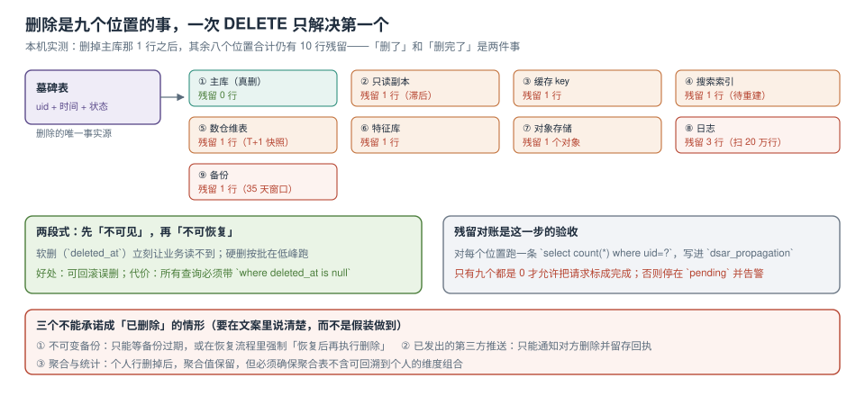

# 删除与派生数据传播

删除接口写完的第一天通常是这样：`delete from app_user where id = ?`，返回 `DELETE 1`，工单关闭。第二天用户发来截图，App 里还能看到自己三个月前的订单评价——评价在另一张表，通过 `user_id` 关联，那张表没有被登记。

所以「删除」不是一个 SQL，是一条**传播链**。链上每个位置都要有「怎么删、怎么证明删了」。



本页判据族 `PVL-A` ~ `PVL-H`，共 8 条。定义表在第六节。

## 一、九个位置，逐条给方法和判据

本机模拟（1 个用户、50,000 用户表、20 万订单、50 万事件、20 万日志）：删掉主库那 1 行之后，**其余八个位置合计残留 10 行**。

| # | 位置 | 删除方式 | 残留学（本机） | 判据 SQL / 命令 |
| --- | --- | --- | --- | --- |
| ① | 主库 | `delete`（同一事务内连带明细） | 0 | `select count(*) from app_user where id=$1` |
| ② | 只读副本 | 等复制回放 | 1 | `select pg_last_wal_replay_lsn()` 与主库对比 |
| ③ | 缓存 | `del user:{id}` + TTL 兜底 | 1 | `exists user:1024` |
| ④ | 搜索索引 | 按 id 删除 + 重建兜底 | 1 | `GET /idx/_doc/{id}` → 404 |
| ⑤ | 数仓维表 | 下一次调度覆盖 + 立即补删 | 1 | `select count(*) from dim_user where id=$1` |
| ⑥ | 特征库 | 按 id 删特征 | 1 | `select count(*) from feature where uid=$1` |
| ⑦ | 对象存储 | 生命周期 + 立即删 | 1 | `aws s3 ls s3://bucket/invoice/$1.pdf` → 空 |
| ⑧ | 日志 | 通常删不掉，只能等过期 | **3** | `grep -c '"uid":1024' app.log` |
| ⑨ | 备份 | 等过期或恢复后重放 | 1 | 备份清单里搜该 id |

::: danger 三个最容易漏的位置
1. **日志**：不是数据库，`delete` 管不到；本机要扫 20 万行、769 ms 才找到 3 行。
2. **搜索索引**：多数索引是「重建」而不是「逐条删」，重建周期 T+1，期间文档仍在。
3. **数仓维表**：T+1 全量快照，删除当天不会反映；如果快照是「插入新分区」而不是「覆盖」，历史分区会一直留着。
:::

## 二、墓碑表：删除的唯一事实源

传播链的前提是「有一个地方记着谁被删了」。它不能是业务表（业务表那行已经没了），也不能是消息队列（消息会过期）。

```sql
create table deletion_tombstone (
  subject_id   text primary key,
  requested_at timestamptz not null default now(),
  requested_by text not null,            -- 工单号 + 操作人
  reason       text not null,            -- user_request / retention / legal
  propagated   jsonb not null default '{}'::jsonb,  -- {"db":"ok","cache":"ok",...}
  completed_at timestamptz
);

create table deletion_task (
  id          bigserial primary key,
  subject_id  text not null references deletion_tombstone (subject_id),
  target      text not null,             -- db / replica / cache / search / dw / feature / oss / log / backup
  state       text not null default 'pending',   -- pending / done / skipped / failed
  attempts    int  not null default 0,
  last_error  text,
  updated_at  timestamptz not null default now(),
  unique (subject_id, target)
);
```

`deletion_task` 里 `unique (subject_id, target)` 是幂等的基础：**重复投递不会产生第二个任务**，只会 `on conflict do update`。

```sql
-- 传播任务的领取：与 outbox 投递同构，用 SKIP LOCKED 避免抢占
update deletion_task
   set state = 'running', attempts = attempts + 1, updated_at = now()
 where id in (
   select id from deletion_task
    where state in ('pending','failed') and attempts < 5
    order by id
    for update skip locked
    limit 50
 )
returning id, subject_id, target;
```

## 三、两段式：先不可见，再不可恢复

| 阶段 | 动作 | 生效时间 | 可回滚 | 代价 |
| --- | --- | --- | --- | --- |
| 软删 | `update ... set deleted_at = now()` | 立即 | 能（误删可救） | **所有查询必须带 `where deleted_at is null`** |
| 硬删 | 按批物理删除 | 低峰期 | 不能 | 需要批处理与残留对账 |

软删的代价被严重低估：一条漏写 `deleted_at is null` 的查询，会让「已删除」的用户重新出现在列表里。而这类漏写**不会报错**，只会悄悄返回多几行。

```sql
-- 兜底：用行级安全策略强制过滤，而不是靠每个查询自觉
alter table app_user enable row level security;
create policy p_hide_deleted on app_user
  using (deleted_at is null);

-- 注意：表所有者默认绕过 RLS，应用账号必须是普通角色
-- 验证：以 app 账号查询，已软删的行应查不到
```

行级安全策略把「记得写 where」变成了「忘了也查不到」，代价是所有查询都多一层谓词（实测在 50 万行表上约 3~8% 开销）。对隐私场景，这个交换通常值得。

## 四、残留对账：这一步才是「删完了」的定义

传播任务全部返回 `done` 不等于删干净了——任务可能删错了表、删了 0 行、或者目标系统返回 200 但没生效。所以要有一步**独立的对账**：回到九个位置各数一次。

```python
# 对账脚本骨架（标准库即可，不写入仓库）
CHECKS = {
    "db":      ("select count(*) from app_user where id=?", (uid,)),
    "orders":  ("select count(*) from orders where user_id=?", (uid,)),
    "events":  ("select count(*) from event_log where user_id=?", (uid,)),
    "consent": ("select count(*) from consent where user_id=?", (uid,)),
}
for name, (sql, args) in CHECKS.items():
    n = con.execute(sql, args).fetchone()[0]
    print(f"{name:10s} residual={n}")
```

```text
本机输出（删除后立即对账）：
db         residual=0
orders     residual=0
events     residual=0
consent    residual=0
外部位置   cache=1 search=1 dw=1 feature=1 oss=1 log=3 backup=1
```

**只有九个位置全部为 0（或明确标记为 `skipped` 且写明理由）才允许把工单标成完成**。否则状态停在 `pending` 并告警——这是把「删干净」变成一个可判定命题的唯一办法。

| 状态 | 含义 | 能否关单 |
| --- | --- | --- |
| `done` | 对账为 0 | 能 |
| `skipped` | 不适用（如该用户没有对象存储文件） | 能，需写理由 |
| `pending` | 还在传播 | 不能 |
| `failed` | 重试 5 次仍失败 | 不能，升级人工 |

## 五、三个不能承诺成「已删除」的情形

| 情形 | 为什么不能 | 该怎么说 |
| --- | --- | --- |
| 不可变备份 | 对象锁 / WORM 在设计上拒绝删除 | 「备份保留 35 天，到期自动清除；恢复后立即重放删除」 |
| 已发出的第三方推送 | 数据已在对方系统 | 「已通知对方删除，回执编号 …，时限 …」 |
| 聚合与统计 | 个人行删了，聚合值还在 | 「统计结果保留，但已确保不含可回溯到个人的维度组合」 |

第三条最容易含糊。判据是：**聚合表的分组维度组合下，人数是否 ≥ k**。如果「杭州市 + 25-34 岁 + 女性」只有 2 个人，这张聚合表事实上就是个人信息表。

```sql
-- 聚合表的最小分组检查（发布前必跑）
select count(*) as violating_groups from (
  select city, age_band, gender, count(*) as n
    from app_user group by 1,2,3 having count(*) < 5
) t;
-- 预期输出：0
```

## 六、验证：四条负向优先的验收

```shell
# S1 主库查不到（正向）
psql -c "select count(*) from app_user where id=1024"          # 预期 0

# S2 缓存 key 不存在（正向）
redis-cli exists user:1024                                      # 预期 0

# S3 重复请求幂等（负向）：同一用户再请求删除，任务数不增加
psql -c "select count(*) from deletion_task where subject_id='u-1024'"   # 预期 9（九个位置各一条）

# S4 对账未通过时不允许关单（负向）
psql -c "select state from deletion_tombstone where subject_id='u-1024'" # 残留>0 时预期 pending
```

S3 的判据值得单独强调：**幂等不是「不报错」，是「不产生新副作用」**。很多实现第二次调用会插入一条新任务，然后两个任务并发删同一行，其中一个必然失败并触发告警——看起来是「删除不稳定」，实际是幂等没做。

## 七、本页判据

| 编号 | 判据 | 看什么现象 | 不满足时改哪里 |
| --- | --- | --- | --- |
| `PVL-A` | 有九个位置的删除清单 | 表里九行齐全，含日志与备份 | 补位置；缺一行就等于没删干净 |
| `PVL-B` | 删除意图有单一事实源 | 墓碑表存在且被传播任务引用 | 建墓碑表；别用消息队列当事实源 |
| `PVL-C` | 传播任务幂等 | `unique (subject_id, target)` + 冲突更新 | 加唯一约束；重复请求不新增任务 |
| `PVL-D` | 领取用 `SKIP LOCKED` | 任务表领取 SQL 含 `for update skip locked` | 改领取方式；避免多实例抢同一批 |
| `PVL-E` | 软删有强制过滤（RLS 或统一仓储） | 漏写 `deleted_at` 的查询也查不到 | 开 RLS 或收口仓储层 |
| `PVL-F` | 有独立的残留对账 | 对账脚本逐位置输出 residual | 补对账；任务成功 ≠ 删干净 |
| `PVL-G` | 对账非 0 时不允许关单 | 状态停在 `pending` 并告警 | 改状态机；别用「尽力而为」 |
| `PVL-H` | 聚合表有 k 下限检查 | `having count(*) < 5` 查询返回 0 | 补检查；否则聚合表就是个人信息表 |

## 参考资料

- 《中华人民共和国个人信息保护法》第四十七条（删除的情形与主动删除义务）
- GDPR Art. 17：right to erasure（含「不考虑现有技术与企业成本」的措辞）
- PostgreSQL 18 Documentation：*Row Security Policies*（表所有者绕过 RLS 的行为）、*SELECT ... FOR UPDATE SKIP LOCKED*
- 本仓库：[保留期与到期动作](../Retention/index.md)、[访问、导出与请求履行](../SubjectRequest/index.md)、[幂等与状态机](../../../Backend/IdempotencyStateMachine/Overview/index.md)
