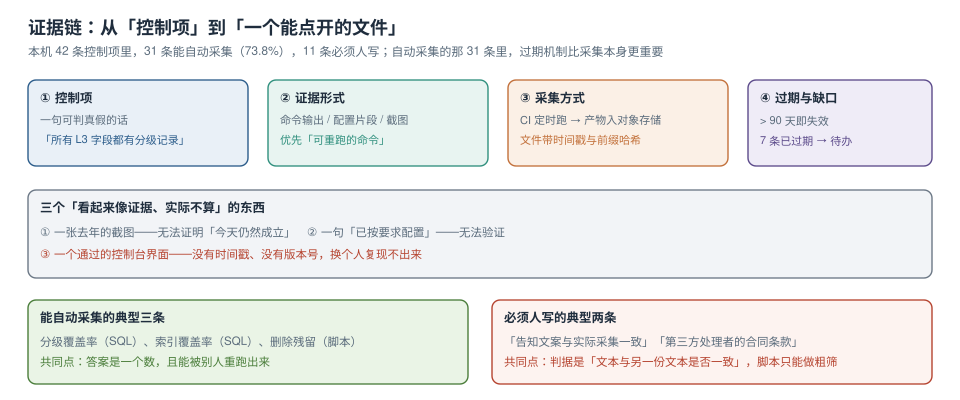

# 证据链与季度自查

前四页做完，团队手里会有一堆东西：一张列清单、若干条 `check` 约束、一个删除传播脚本、一份导出模板。这些是**控制**。但「有控制」和「能证明有控制」是两件事——后者需要证据，而证据有三个硬要求：**带时间戳、可重跑、能定位到具体控制项**。



本页判据族 `PVE-A` ~ `PVE-H`，共 8 条。定义表在第六节。

## 一、控制项要写成「一句可判真假的话」

| 坏的控制项 | 好的控制项 | 差别 |
| --- | --- | --- |
| 「做好数据分级」 | 「所有 L3/L4 列在 `privacy_column` 中有分级记录，覆盖率 ≥ 99%」 | 后半句能被 SQL 判真假 |
| 「加强日志安全」 | 「应用日志中手机号形态出现次数 = 0（最近 24 小时）」 | 后半句能被 `grep` 判 |
| 「及时删除用户数据」 | 「删除请求 7 个工作日内九个位置残留均为 0」 | 后半句有分母与时限 |
| 「合规使用 Cookie」 | 「未同意 analytics 目的的设备，不加载 analytics SDK」 | 后半句能被抓包验 |

判断方法：**能不能写出一条命令，输出是/否**。写不出来的控制项，通常不是控制项，是愿望。

## 二、三种证据形态，优先级从高到低

| 形态 | 例子 | 可信度 | 过期风险 |
| --- | --- | --- | --- |
| **可重跑的命令 + 输出** | `psql -c "…"` + 返回 `0` | 最高（别人能复现） | 低（重跑即可刷新） |
| 配置片段 + 提交哈希 | `logback.xml` 里没有 `%X{phone}` | 中（能证明「当时是这样」） | 中（配置会变） |
| 截图 | 控制台里「已开启」 | 最低 | **高（无法证明现在仍成立）** |

截图不是不能用，而是**只能作为补充**：当控制项本身无法用命令表达时（比如「告知文案与采集字段一致」），截图 + 人工签核是唯一选择。这时必须加两样东西：**截图时间**与**签核人**。

::: danger 「证据过期」比「没有证据」更危险
没有证据时，你知道自己缺；有过期证据时，你以为自己有。
本机模拟的 42 条控制项里，**7 条的证据超过 90 天**——它们都是「当时确实做了、后来没人再看」的那种。这类材料交上去，第一次能过，第二次被追问细节时就会露馅。
:::

## 三、自动采集：CI 定时跑，产物入对象存储

```yaml
# .github/workflows/privacy-evidence.yaml（示意，读者在自己工程里建）
name: privacy-evidence
on:
  schedule: [{ cron: "0 2 1 * *" }]     # 每月 1 日 02:00
  workflow_dispatch:
jobs:
  collect:
    runs-on: ubuntu-latest
    steps:
      - uses: actions/checkout@v4
      - name: PVD-01 分级覆盖率
        run: |
          psql "$PGURL" -At -f ci/sql/grade_coverage.sql | tee grade_coverage.txt
      - name: PVM-03 日志 PII 巡检
        run: |
          grep -Ec '1[3-9][0-9]{9}' /var/log/app/app.log | tee log_pii.txt || true
      - name: 归档证据（带时间戳与提交哈希）
        run: |
          mkdir -p evidence/$(date +%Y-%m)
          cp *.txt evidence/$(date +%Y-%m)/
          sha256sum evidence/$(date +%Y-%m)/*.txt > evidence/$(date +%Y-%m)/SHA256SUMS
      - uses: actions/upload-artifact@v4
        with:
          name: privacy-evidence-${{ github.run_id }}
          path: evidence/
```

三个细节决定这套东西能不能用：

1. **文件名带月份**：`evidence/2026-10/`，一眼能看出是哪一期。
2. **`SHA256SUMS`**：证明文件没被事后修改；同时也让「证据是否同一份」可判。
3. **`workflow_dispatch`**：能手动触发，否则出问题时只能等下个月。

## 四、42 条控制项：31 条能自动，11 条必须人写

| 类别 | 条数 | 自动 | 人工 | 典型控制项 |
| --- | --- | --- | --- | --- |
| 发现（分级、地图） | 9 | 8 | 1 | 分级覆盖率、双向差集、驻留标记 |
| 收敛（最小化、目的） | 8 | 5 | 3 | 日志 PII 巡检、目的必填、SDK 出域清单 |
| 履行（删除、导出） | 12 | 10 | 2 | 残留对账、索引覆盖、SLA 超时 |
| 证明（证据自身） | 5 | 4 | 1 | 证据有效期、缺口清单 |
| 组织与流程 | 8 | 4 | 4 | 责任人清单、第三方合同、培训记录 |
| **合计** | **42** | **31（73.8%）** | **11** | — |

人工那 11 条的共性：判据是「**文本与另一份文本是否一致**」（告知文案 vs 采集字段、合同条款 vs 实际共享清单），或「**某人是否做过某事**」（培训、签核）。脚本能做的是**粗筛**——比如把告知文案里的名词抽出来，与 `privacy_column` 的字段名做交集，交集为空就提示「文案可能没提到这些字段」。

```python
# 粗筛骨架：文案里的词 vs 清单里的列中文名
import re
text = open("privacy-notice.md", encoding="utf-8").read()
cols = {"手机号": 41, "收货地址": 3, "身份证号": 6}
missing = [c for c in cols if c not in text]
print("文案未提及的字段:", missing)   # 输出后仍需人确认，不能直接判违规
```

## 五、过期与缺口：两个必须分开统计的数

| 指标 | 口径 | 用途 | 本机模拟 |
| --- | --- | --- | --- |
| 覆盖率 | 有证据的控制项 / 全部控制项 | 对外汇报 | 31/42 = 73.8% |
| 有效期 | 证据年龄 ≤ 90 天的比例 | 对内巡检 | 24/31 = 77.4% |
| 缺口 | 既无自动采集、也无人签核 | 待办来源 | 11 条 |

把三个数混在一起报，会得到一个「看起来还行」的数字，掩盖住真正的问题。**分开报**才能看出「哪些是机制没建、哪些是机制建了但没人跑」。

```sql
-- 证据台账：一行一条控制项，state 由 CI 回写
create table privacy_evidence (
  control_id   text primary key,       -- PVD-01 / PVM-03 …
  title        text not null,
  owner        text not null,
  mode         text not null check (mode in ('auto','manual','none')),
  last_run_at  timestamptz,
  artifact_uri text,                   -- 对象存储路径
  artifact_sha text,
  result       text check (result in ('pass','fail','unknown')),
  note         text
);

-- 过期清单（季度自查直接跑这一条）
select control_id, title, owner, last_run_at,
       date_part('day', now() - last_run_at) as age_days
  from privacy_evidence
 where last_run_at is null
    or now() - last_run_at > interval '90 days'
 order by age_days desc nulls first;
-- 本机模拟输出：7 行（含 2 条 mode='manual'）
```

## 六、季度自查：一张表 + 六条命令

自查不需要开会，只需要跑完下面六条并归档输出：

```shell
# 1. 分级覆盖率（应 ≥ 99%）
psql -At -f ci/sql/grade_coverage.sql

# 2. 地图双向差集（两个方向都应为 0 行）
psql -At -f ci/sql/map_diff_both_ways.sql | wc -l

# 3. 日志 PII（应为 0）
grep -Ec '1[3-9][0-9]{9}' /var/log/app/app.log

# 4. 索引覆盖（应为 0 行）
psql -At -f ci/sql/missing_subject_index.sql | wc -l

# 5. 删除请求对账（未闭合数应为 0）
psql -At -c "select count(*) from deletion_tombstone where completed_at is null"

# 6. 证据过期（应为 0）
psql -At -c "select count(*) from privacy_evidence where last_run_at is null or now()-last_run_at > interval '90 days'"
```

六条命令的输出拼成一份 `2026-Q4-privacy-selfcheck.md`，附上提交哈希，就是一份可交的材料。它的价值不在格式，在**任何人都能重跑出同样的六个数**。

## 七、本页判据

| 编号 | 判据 | 看什么现象 | 不满足时改哪里 |
| --- | --- | --- | --- |
| `PVE-A` | 每条控制项都能判真假 | 控制项后面跟着阈值或「= 0」 | 改写控制项；写不出命令的降级为人工项 |
| `PVE-B` | 证据优先用可重跑命令 | 证据以 SQL/shell 为主 | 把截图降为补充材料 |
| `PVE-C` | 证据带时间戳与来源 | 文件名含月份、含 `SHA256SUMS` | 补归档规范 |
| `PVE-D` | 自动采集有定时与手动两个入口 | workflow 含 `schedule` 与 `workflow_dispatch` | 补 `workflow_dispatch` |
| `PVE-E` | 覆盖率、有效期、缺口分开统计 | 三个数分别有值 | 拆开报；合并会掩盖问题 |
| `PVE-F` | 新增字段有建表/上线门禁 | 迁移或 CI 里有检查，且有失败样本 | 加门禁；用一条故意失败的迁移证明 |
| `PVE-G` | 超过 90 天的证据会被标红 | 过期查询返回清单而非空 | 补过期查询并接进自查 |
| `PVE-H` | 季度自查是六条命令而非一次会议 | 有命令清单 + 归档文件 | 把会议纪要去掉，换成命令输出 |

## 参考资料

- GDPR Art. 30（Records of processing activities，处理活动记录的形式要求）
- NIST Privacy Framework 1.0：*Govern-P* 与 *Protect-P* 的证据类子类
- GitHub Docs：*Events that trigger workflows*（`schedule` 的 cron 时区为 UTC）、*Workflow artifacts*
- 本仓库：[访问、导出与请求履行](../SubjectRequest/index.md)、[技术决策与评审](../../TechDecision/Overview/index.md)、[研发效能度量](../../../Tools/EngineeringMetrics/Overview/index.md)
