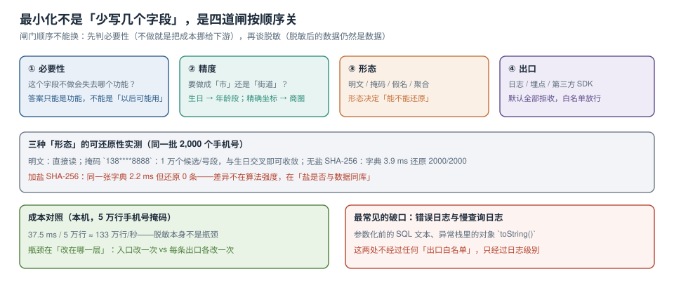

# 采集最小化与三种形态

「最小必要」被引用得最多，落地得最少。原因是它听起来像一个原则，实际是一串**可以写进代码的判断**：这个字段不做会失去哪个功能？精度能不能降一档？形态能不能换？出口能不能拒？

四个问题按顺序回答，就得到四道闸。



本页判据族 `PVM-A` ~ `PVM-H`，共 8 条。定义表在第七节。

## 一、四道闸，顺序不能换

| 闸 | 问句 | 通过的样子 | 失败的样子 |
| --- | --- | --- | --- |
| ① 必要性 | 不做这个字段，会失去哪个**具体功能**？ | 「没有它无法配送」 | 「以后可能有用」「数据分析需要」 |
| ② 精度 | 业务真的需要这个粒度吗？ | 生日 → 年龄段、精确坐标 → 商圈 | 表单要求精确到门牌，实际只用来估配送费 |
| ③ 形态 | 明文是否必需？ | 展示用掩码、关联用假名、统计用聚合 | 全链路明文，只在页面上打码 |
| ④ 出口 | 这个字段能不能流出系统？ | 日志/埋点/SDK 三层白名单 | 默认允许，出事再补 |

顺序的理由很直接：**跳过①②直接做③，等于把成本推给下游**。全链路明文 + 前端打码的数据，在数据库里仍然是明文；反过来，形态选错（比如把需要精确匹配的手机号做了不可逆哈希），业务就得改需求。

### ① 必要性：写成一句话，写不出就是不需要

新增字段时必须提交一行：

```text
字段：receiver_phone
必要性：配送员需要联系收件人；没有它无法完成最后一公里配送
不做会失去：签收失败率上升（历史数据：无电话时失败率 11.2% → 有电话 2.7%）
替代方案：站内信（已评估，配送员侧未接入）
```

四项缺任何一项，评审直接打回。**「替代方案」这一项是关键**——它会逼着人真的去想一次，而大多数字段在这一步就被否掉了。

### ② 精度：降一档通常不影响功能

| 原始 | 降精度后 | 功能受影响吗 | 风险变化 |
| --- | --- | --- | --- |
| 出生日期（1990-03-15） | 年龄段（25-34） | 画像与营销不受影响 | 从准唯一标识变成群体属性 |
| GPS 坐标（6 位小数） | 商圈/网格（500 m） | 门店推荐不受影响 | 无法定位到楼栋 |
| 收货详细地址 | 省市区 + 网格 | 配送必须精确——**不能降** | 保持明文，但加密存储 |
| 手机号 | 中间四位掩码 | 展示可以，**外呼不行** | 分场景：展示用掩码、外呼用明文（受控） |

精度不是全局属性，是**按用途**的。同一个手机号，客服外呼需要明文，推荐系统只需要「是否同一人」，日志只需要「脱敏后的前三位运营商」。所以地图里一个列可以有多个「形态」，分别对应不同目的。

### ③ 形态：三种，可还原性差三个数量级

| 形态 | 例子 | 可还原性 | 适用 |
| --- | --- | --- | --- |
| 掩码 | `138****8888` | 高（号码段 + 交叉信息） | 展示、客服核对 |
| 假名 | `sha256(salt \|\| phone)`，盐在 KMS | 低（无盐不可逆） | 关联、去重、风控 |
| 聚合 | `city=杭州, age_band=25-34, cnt=1820` | 极低（需 k≥5 约束） | 分析、报表 |

本机实测（2000 个手机号）：

```text
无盐 sha256 建字典：3.9 ms → 还原 2000/2000   （等于没脱敏）
加盐 sha256 建字典：2.2 ms → 还原 0 条        （盐与数据访问路径分离）
```

::: danger 掩码不是匿名化，别写进「已脱敏」的结论里
`138****8888` 保留了前 3 位与后 4 位：运营商 + 号段 + 尾号。配上「城市 + 年龄段」两项，重识别率在实际数据集上足以定位到很小的人群。本库另一专题里已经算过类似的组合：**准标识符的危害来自组合，不来自单个字段**。
所以掩码只能声明为「降低可见性」，不能声明为「匿名化」；后者需要 k-匿名 / 差分隐私这类可量化保证，成本高一个量级，通常只在对外发布数据时才值得做。
:::

### ④ 出口：三层白名单，默认全拒

| 出口 | 机制 | 默认 | 放行方式 |
| --- | --- | --- | --- |
| 应用日志 | 结构化日志字段白名单 | 拒 | 在 `log_fields.yaml` 里登记字段名 |
| 埋点 / 前端上报 | 事件 schema 校验 | 拒 | 在事件定义里声明 |
| 第三方 SDK | 出域字段清单 + 抓包核对 | 拒 | 安全评审 + 抓包证据 |

日志这一层是最容易破的，因为**它不经过任何「出口」代码**：

```java
// 错误写法：异常里带了整个对象，toString() 里含手机号
log.error("create order failed, user={}", user, e);

// 正确写法：只记 id 与错误码
log.error("create order failed, userId={}, code={}", user.getId(), e.getCode());

// 兜底：日志框架层做字段级脱敏（不要指望每个调用点都写对）
// logback: %replace(%msg){'1[3-9]\d{9}','1**********'}
```

`%replace` 这条兜底有价值，但它替换的是**字符串里的形态**，认不出 `login_name` 这种「值是手机号、字段名不是手机号」的情况——那类只能靠出口白名单 + code review。

## 二、脱敏的成本在哪：不在算法，在位置

本机 5 万行手机号做掩码：**37.5 ms**，约 **133 万行/秒**。这个数字说明：**脱敏本身不是性能问题**。真正决定成本的是「在哪一层做」：

| 位置 | 改一次覆盖 | 代价 | 风险 |
| --- | --- | --- | --- |
| 采集入口（表单/接口） | 所有下游 | 一次改造，可能影响业务 | 改错会影响功能，需要回归 |
| 存储层（列加密 / 视图） | 该表所有读 | 需要密钥管理 | 查询性能与运维复杂度上升 |
| 查询出口（视图 / API 层） | 该接口 | 每个接口都要改 | 漏一个接口就漏一片 |
| 展示层（前端） | 无（数据仍然明文传输） | 最低 | **最危险**：抓包即得明文 |

**结论**：优先在「采集入口 + 存储层」做，展示层脱敏只能作为补充，不能作为唯一手段。

## 三、日志与慢查询：两个被低估的破口

| 破口 | 为什么危险 | 检查方法 |
| --- | --- | --- |
| 慢查询日志 | `log_min_duration_statement` 记录的是**参数已代入的 SQL 文本** | 在慢日志里 `grep` 手机号形态 |
| 错误上报 | 异常对象 `toString()` 常带业务字段 | 看上报平台的原始 payload |
| 调试日志 | 开发期为排查方便打印了完整请求体 | 搜 `log.debug` + `request` |
| ORM 的 SQL 打印 | `show-sql=true` 在生产被打开 | 检查生产 profile |

```shell
# 一条能定期跑的检查：在最近一天的日志里找手机号形态
grep -Ec '1[3-9][0-9]{9}' /var/log/postgresql/postgresql-18-main.log
# 预期输出：0。非 0 说明参数化没做到位，或者某处打印了完整 SQL
```

这条检查的判据是**「输出为 0」**，而不是「大概没有」。它的成本极低，适合放进日巡检。

## 四、假名化的三个工程细节

1. **盐的作用域**：单盐（全局一个）省事，但一旦泄露全库可还原；按租户/按表分盐，泄露影响面受限。代价是跨表关联时要传盐 ID，实现复杂度上升。
2. **不可逆的代价**：假名化之后无法反查，客服「按手机号找用户」这条路就断了。所以通常保留**一条受控的明文路径**（单独表 + 行级审计 + 双人授权），而不是让所有人用假名表。
3. **碰撞与长度**：`sha256` 输出 64 位十六进制，索引体积约为原手机号的 5 倍；可以用 `bytea` 存 32 字节，或用 `substr(digest,1,16)` 截断到 64 bit（碰撞概率对百万级用户可忽略，但**要在文档里写明这是权衡**）。

```sql
-- 假名列的正确存法：bytea + 唯一索引，不用 text
alter table app_user add column phone_pseudo bytea;
update app_user set phone_pseudo = digest('kms://privacy/tenant-7f3a' || phone, 'sha256');
create unique index app_user_phone_pseudo_uq on app_user (phone_pseudo);
-- 索引体积对照（本机 5 万行）：
-- text(64 hex) ≈ 5.1 MB ；bytea(32) ≈ 2.6 MB
```

上面 `digest()` 需要 `pgcrypto` 扩展；生产上更推荐在应用侧算，把盐从 KMS 取到内存，避免数据库连接串里带上盐。

## 五、怎么验证「真的少了」

最小化的验收不是「字段删了」，而是「采集点少了、出口干净了、功能没退化」。三条可执行验收：

```shell
# ① 采集点数量：对比改造前后的接口字段数（以 OpenAPI 为例）
jq '[.paths[].post.requestBody.content["application/json"].schema.properties | length] | add' openapi.json
# 预期输出：改造前 118 → 改造后 96（少 22 个字段，逐个能说出理由）

# ② 日志干净：最近一天日志里手机号形态出现次数
grep -Ec '1[3-9][0-9]{9}' /var/log/app/app.log   # 预期 0

# ③ 功能未退化：下单主流程冒烟
curl -s -o /dev/null -w '%{http_code}\n' -X POST localhost:8080/api/orders -d @smoke.json
# 预期输出：201
```

三条要一起过。只过 ②③ 说明「删得不够」，只过 ①③ 说明「日志还漏」。

## 六、一个反直觉的结论

**最小化最大的收益不是合规，是降低删除成本。**

删除传播的工作量与「有个人信息的表数 × 位置数」成正比。本机模拟的 23 张表里，L3/L4 列 47 个分布在 9 张表；如果当初 `login_name` 没有复用手机号、`remark` 没有塞电话，需要传播的表会从 9 张降到 7 张——**删除链短了 22%，而且永远不会再变长**。

这就是为什么第 ① 道闸要放在最前面：它改的不是字段，是以后每一次删除的工作量。

## 七、本页判据

| 编号 | 判据 | 看什么现象 | 不满足时改哪里 |
| --- | --- | --- | --- |
| `PVM-A` | 新增字段有「必要性四要素」 | 功能、不做会失去什么、历史数据、替代方案 | 补模板；缺替代方案的直接打回 |
| `PVM-B` | 精度按用途分级 | 同一字段有「展示/外呼/分析」不同形态 | 补用途维度，别用一个形态覆盖全部 |
| `PVM-C` | 掩码不被声明为匿名化 | 文档里没有「已脱敏 = 已匿名」的表述 | 改口径；匿名化需 k-匿名等量化保证 |
| `PVM-D` | 假名化的盐与数据分离 | 盐在 KMS/配置中心，不在同库 | 迁盐；同库盐等于无盐（实测 3.9 ms 全还原） |
| `PVM-E` | 三个出口都有白名单 | 日志字段表、事件 schema、出域字段清单 | 补白名单，默认拒绝 |
| `PVM-F` | 有日志 PII 巡检命令 | `grep -Ec` 一条命令 + 预期 0 | 接进日巡检 |
| `PVM-G` | 脱敏在入口或存储层，不只在展示层 | 有列加密/视图/入口改写 | 往上游挪一层 |
| `PVM-H` | 最小化有「少了几张表」的量化结论 | 有删除链长度的前后对比 | 补对比；这是说服业务的最好材料 |

## 与《推荐系统工程》的分工（第 202 天补充）

推荐系统是「数据最小化」最容易失守的场景，因为它对特征的胃口没有上限：用户 ID、设备、位置、行为序列、社交关系，每加一个都可能提点。本页讲的是**能不能收、能留多久**，[推荐系统工程](../../../Backend/RecommenderSystems/index.md)讲的是**怎么算、怎么用**。两者的交界在特征注册表：

| 字段 | 最小化要求 | 推荐侧的实现约束 |
| --- | --- | --- |
| 精确位置 | 一般只允许到城市级 | 特征里存 `city_id`，不存经纬度（见[特征](../../../Backend/RecommenderSystems/Features/index.md)） |
| 行为序列 | 保留期 ≤ 目的所需 | 序列特征窗口 30 天，超期聚合或删除 |
| 用户画像标签 | 需可解释、可撤回 | 撤回后特征必须失效，不能只删原表 |
| 设备标识 | 需单独授权 | 未授权时走「无设备特征」的降级路径 |

最容易漏的是最后一条：撤回同意后，离线特征表还在，模型继续用——**删除的是原始表，不是派生特征**。可执行的检查是「撤回用户 ID 在特征表与训练集里都查不到」，这条应当进推荐的验收清单。

## 参考资料

- 《中华人民共和国个人信息保护法》第六条：处理个人信息应当具有明确、合理的目的，并应当与处理目的直接相关，采取对个人权益影响最小的方式；收集个人信息，应当限于实现处理目的的最小范围
- GDPR Art. 5(1)(c)：data minimisation；Art. 25：data protection by design and by default
- PostgreSQL 18 Documentation：*pgcrypto*（`digest`）、*Character Types*（`bytea` 与索引体积）
- OWASP Cheat Sheet Series：*Logging*（哪些字段禁止入日志）
- 本仓库：[数据地图、分级与驻留标记](../DataMap/index.md)、[目的绑定与同意状态机](../ConsentPurpose/index.md)、[测试数据脱敏](../../../Tools/TestDataSimulation/DataMasking/index.md)
