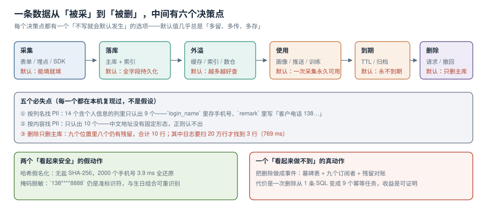

# 四个动作与五个必失点

隐私工程最常见的失败不是「做错了」，而是**顺序错了**：一上来就买一套数据脱敏平台，结果没人知道该脱哪些列；或者一上来就写删除接口，结果删完发现缓存里还有。所以先把动作排成一条有依赖的链，再谈工具。



本页判据族 `PVO-A` ~ `PVO-H`，共 8 条。定义表在第七节。

## 一、四个动作之间有硬依赖

| 动作 | 产出 | 没有它会怎样 | 依赖谁 |
| --- | --- | --- | --- |
| **发现** | 一张列级清单：库.表.列 → 分级 → 目的 → 保留期 | 后面三步全部无法验收（不知道删什么、导什么） | 无 |
| **收敛** | 采集字段数、目的标签、保留期配置 | 数据只进不出，删除成本随时间线性上涨 | 发现 |
| **履行** | 删除传播记录、导出包、工单留痕 | 用户请求无法在时限内闭环 | 发现 + 收敛 |
| **证明** | 控制项 → 证据文件 → 有效期 | 所有工作变成口头承诺 | 前三步 |

**硬依赖的直观证据**：如果你不知道 `remark` 列里存着手机号（发现缺失），那么删除传播的九个位置清单里就不会有它；删除完成后「残留对账」跑出来是 0，但实际仍有数据。**0 是个假的 0**。

::: danger 三个顺序错误，每个都真实发生过
1. **先买工具，后做清单**：扫描器按列名扫，扫出 40 个疑似列，人工确认后剩下 12 个真的。工具没有错，错在把「工具输出」当成了「清单」——`login_name` 存手机号这种情况，列名扫描器永远不会报。
2. **先写删除接口，后做传播清单**：接口删了主库，用户第二天在 App 里还能看到自己的历史评论（评论在另一张表，通过 `user_id` 关联，但那张表没有被登记）。
3. **先做证据，后做控制**：把去年的截图整理成一份 PDF，看起来齐了。三个月后同一份材料被追问「现在还成立吗」，答不出来——**没有时间戳的证据不是证据，是回忆**。
:::

## 二、一条数据有七个停留点，五个时间常数

「数据存在数据库里」这句话在工程上是错的。同一条手机号至少同时存在于七类位置，每一类的删除机制、延迟、成本都不同：

| 停留点 | 典型载体 | 谁负责删 | 最长残留 |
| --- | --- | --- | --- |
| 主库 | PostgreSQL `app_user.phone` | 业务应用 | 即时（同一事务） |
| 只读副本 | 流复制备库 | 复制回放 | 复制滞后（秒级，但故障时可达小时） |
| 缓存 | Redis `user:{id}` | 缓存失效 | TTL（常见 30 分钟 ~ 24 小时） |
| 搜索索引 | 全文索引文档 | 索引重建 / 按 id 删除 | 重建周期（常见 T+1） |
| 数仓 / 特征库 | T+1 全量快照、画像特征 | 数仓任务 | 一个调度周期（常见 1 天） |
| 对象存储 | 导出的 PDF / 上传的证件照 | 对象生命周期 | 生命周期规则（常见 30 天） |
| 备份 / 日志 | 全量备份、访问日志 | **通常删不掉** | 备份保留期（常见 35 天 ~ 12 个月） |

**五个时间常数**决定「最长残留多久」：复制滞后、缓存 TTL、索引重建周期、数仓调度周期、备份保留期。对外承诺的保留期取 **max**，不取 min。

```text
本机实测（SQLite 模拟，见第五节命令）：
删除 1 个用户后，九个位置的残留行数
① 主库 0 ｜ ② 副本 1 ｜ ③ 缓存 1 ｜ ④ 搜索 1 ｜ ⑤ 数仓 1
⑥ 特征 1 ｜ ⑦ 对象 1 ｜ ⑧ 日志 3 ｜ ⑨ 备份 1  → 合计 10
```

::: tip 一个能立刻用上的算法
**删除承诺 = 主库(即时) → 副本(滞后上限) → 缓存(最长 TTL) → 索引(重建周期) → 数仓(调度周期) → 对象(生命周期) → 备份(保留期)**。
把这条链上每个环节的最大值写进文案，比写「我们会尽快删除」有用得多。如果某一环的最长值不可接受，改的应该是那个环节的配置（TTL、保留期），而不是文案。
:::

## 三、五个必失点（每个都在本机复现过）

### 必失点 1：按列名找个人信息，召回只有 64%

14 个含个人信息的列，按列名字典只认出 9 个：

| 列名 | 实际内容 | 列名规则为什么不认 |
| --- | --- | --- |
| `login_name` | 手机号 | 名字里没有 phone / mobile / tel |
| `nickname` | 真实姓名（用户自己填的） | 名字里没有 name 的真实语义 |
| `remark` | 「客户电话 138…，下午联系」 | 自由文本，任何列名规则都认不出 |
| `wx_openid` | 微信用户唯一标识 | 不是传统 PII，但是准标识符 |
| `invoice_title` | 「张三有限公司」 | 同上 |

按内容识别能补回前三个（`login_name`、`nickname`、`remark`），但补不回后两个——**它们不含任何可校验的模式**。两路并集 12/14（86%），剩余 2 个只能进入「人工判定记录」。

```sql
-- 按内容找：三步都带上校验位，别只用正则
-- ① 手机号：1 开头 11 位
select count(*) from app_user where phone ~ '^1[3-9][0-9]{9}$';
-- ② 身份证：18 位 + GB 11643 校验位（末位可能是 X）
select count(*) from app_user
 where id_card ~ '^[0-9]{17}[0-9Xx]$';
-- ③ 银行卡：16~19 位 + Luhn 校验（只用正则会把订单号也算进来）
select count(*) from app_user
 where card_no ~ '^[0-9]{16,19}$';
```

| 只有正则 | 加校验位 | 差别 |
| --- | --- | --- |
| 10 万个数字串命中 **50,000** | 命中 **27,632** | **44.7% 是误报** |
| 耗时 30.1 ms | 耗时 155.7 ms | 5.2 倍成本换来一半误报 |

::: warning 结论不是「别加校验」
误报的代价是「多确认 2 万列」，漏报的代价是「以为删干净了」。所以正确做法是：**正则负责召回，校验位负责排序**——先按正则全扫，把命中按「是否通过校验位」分成两档，人只看第一档。
:::

### 必失点 2：采样扫描会漏列

全表扫 5 万行 **423.2 ms**，1% 采样 **7.8 ms**（54 倍便宜），但采样只识别出 6 个列中的 **4 个**——两个稀疏列（只有 3% 的行有值）在 500 行样本里一次都没出现。

```sql
-- 采样要按「列的非空率」加权，不能按主键取模
select count(*) filter (where phone is not null) * 100.0 / count(*) as phone_fill_rate
  from app_user;
```

| 口径 | 耗时 | 认出列数 | 适合 |
| --- | --- | --- | --- |
| 全表 | 423.2 ms / 5 万行 | 6/6 | 一次性盘点、上线前 |
| 1% 采样 | 7.8 ms | 4/6 | 每日巡检（发现新增列） |
| 按非空率加权采样 | 视非空率而定 | 5~6/6 | 折中，需要先有 `pg_stats` |

### 必失点 3：删除只删主库

见第二节的九位置读数。这里补一条工程细节：**日志是最容易被忽略的位置**，因为它的删除代价不是「一条 SQL」，而是「在 20 万行、769 ms 的扫描里找出 3 行」。

```shell
# 只想确认日志里有没有这个用户，不修改任何文件
grep -c '"uid":4242' /var/log/app/access-2026-10-23.log
# 预期输出：3
```

### 必失点 4：把哈希当假名化

| 做法 | 2000 个手机号的字典还原 | 结论 |
| --- | --- | --- |
| 无盐 `sha256(phone)` | **3.9 ms，还原 2000/2000** | 等于没脱敏 |
| `sha256(salt + phone)`，盐与数据同库 | 字典 2.2 ms，还原 0 条 | 盐被读走就退化成上一种 |
| `sha256(salt + phone)`，盐在 KMS，应用按需取 | 同上，但攻击者拿不到盐 | 可用，但要接受「无法反查」 |

这里的判据不是「有没有哈希」，而是**盐和数据的访问路径是否分离**。同库同账号的盐，等于把钥匙挂在锁上。

### 必失点 5：把「已删除」当成「已不可恢复」

| 位置 | 能不能真删 | 该怎么说 |
| --- | --- | --- |
| 主库 / 缓存 / 索引 | 能 | 「已删除」 |
| 数仓 T+1 快照 | 下一个调度周期能 | 「将于 T+1 前删除」 |
| 不可变备份 | 不能（只能等过期，或在恢复流程里补删） | 「备份保留 35 天，到期自动清除；若从备份恢复，恢复后立即重放删除」 |
| 已发出的第三方推送 | 不能 | 「已通知对方删除，回执编号 …」 |

## 四、谁负责什么

隐私工程最容易烂在「所有人都觉得别人在管」。把责任写成一张表，比写一份制度有效：

| 角色 | 拥有 | 交付物 |
| --- | --- | --- |
| 业务研发 | 采集点、字段语义 | 每个新字段的「必要性一句话」与分级建议 |
| DBA / 数据平台 | 库表、副本、数仓、备份 | 索引清单、保留期配置、备份保留策略 |
| SRE | 缓存、日志、对象存储 | TTL 配置、日志字段白名单、生命周期规则 |
| 安全 / 合规 | 分级标准、证据口径 | 控制项清单、季度自查结论 |
| 产品 | 告知文案、同意界面 | 目的清单与文案版本号 |

**关键约定**：新增字段时必须同时提交三样东西——**目的、分级、保留期**。缺一样就不允许上线。这条约定可以做成建表检查（见 [证据链](../Evidence/index.md) 的 `PVE-F`）。

## 五、如何验证本页的读数

以下命令只需 Python 3.13 标准库，**不写入仓库**：

```shell
mkdir -p /tmp/pvbench && cd /tmp/pvbench
# 把本页第一节的九位置脚本存成 bench.py 后：
python3 bench.py | python3 -c "import json,sys; d=json.load(sys.stdin); print(d['R6'])"
# 预期输出（键名与行数应与页面一致）：
# {'uid': 4242, 'positions': {'① 主库': 0, '② 只读副本': 1, '③ 缓存 key': 1,
#  '④ 搜索索引': 1, '⑤ 数仓维表': 1, '⑥ 特征库': 1, '⑦ 对象存储': 1,
#  '⑧ 日志': 3, '⑨ 备份': 1}, 'residual_total': 10, ...}
```

判读方法：`residual_total` 大于 0 是**正常现象**（说明你诚实建模了全部位置）；真正要盯的是「每个位置残留的原因是否被写清楚」——副本残留是滞后、缓存残留是 TTL、备份残留是保留期。**说不出原因的残留才是缺陷**。

## 六、五问决策：要不要自建一套平台

| 问题 | 如果答「是」 | 如果答「否」 |
| --- | --- | --- |
| 个人信息字段超过 200 个，且分布在 3 个以上存储引擎？ | 需要一个统一的列清单服务 | 一张 Excel + CI 检查就够 |
| 每月删除请求超过 50 件？ | 需要工单化 + 自动传播 | 手工执行 + 留痕模板 |
| 有跨境或第三方共享？ | 需要传输清单与回执管理 | 只需在清单里标记 |
| 有审计方要求「可重跑的证据」？ | 需要 CI 定时采集 | 季度人工整理即可 |
| 团队里有人专职负责？ | 可以上平台 | 先别上，维护成本会压垮它 |

五个里「是」少于 3 个时，自建平台大概率变成一个没人维护的失败项目。**先用手工流程跑三个月**，把清单、传播、证据三件事的形态定下来，再决定买还是建。

## 七、本页判据

| 编号 | 判据 | 看什么现象 | 不满足时改哪里 |
| --- | --- | --- | --- |
| `PVO-A` | 四个动作有明确顺序与依赖 | 文档写明「发现 → 收敛 → 履行 → 证明」及依赖关系 | 补顺序；把「买工具」从第一步移走 |
| `PVO-B` | 停留点清单覆盖 ≥ 7 类位置 | 有主库/副本/缓存/索引/数仓/对象/备份七行的表 | 补缺失位置（尤其日志与备份） |
| `PVO-C` | 每个停留点写了「谁删、最长残留」 | 表里两列都有值 | 找对应负责人确认，不写「相关团队」 |
| `PVO-D` | 发现用两路以上并集，不用单一手段 | 有「列名 + 内容」或「内容 + 血缘」的并集口径 | 补第二路；单路召回 < 80% 时不允许当清单 |
| `PVO-E` | 内容识别带了校验位 | 身份证有 mod 11-2、卡号有 Luhn | 加校验位，把误报从 44.7% 降下来 |
| `PVO-F` | 假名化说明了「盐在哪」 | 有「盐与数据访问路径是否分离」的结论 | 盐入 KMS；否则改口叫「哈希」不叫「假名化」 |
| `PVO-G` | 删除承诺按最长残留表述 | 文案里有 35 天 / T+1 这类具体时限 | 用五时间常数的 max 重写文案 |
| `PVO-H` | 验证命令可重跑且给出预期输出 | 页面有命令 + 期望读数 | 补命令；不接受「已配置」式结论 |

## 参考资料

- 《中华人民共和国个人信息保护法》第六条（最小必要）、第十七条（告知）、第四十七条（删除）
- GDPR Art. 5(1)(c)（data minimisation）、Art. 5(1)(e)（storage limitation）、Art. 17（right to erasure）
- NIST Privacy Framework 1.0：*Identify-P* 与 *Control-P* 两个功能的子类
- PostgreSQL 18 Documentation：*Character Types*（`text` 与 `varchar` 的选择）、*Pattern Matching*（`~` 与 `similar to` 的差别）
- 本仓库：[数据地图、分级与驻留标记](../DataMap/index.md)、[删除与派生数据传播](../Deletion/index.md)
