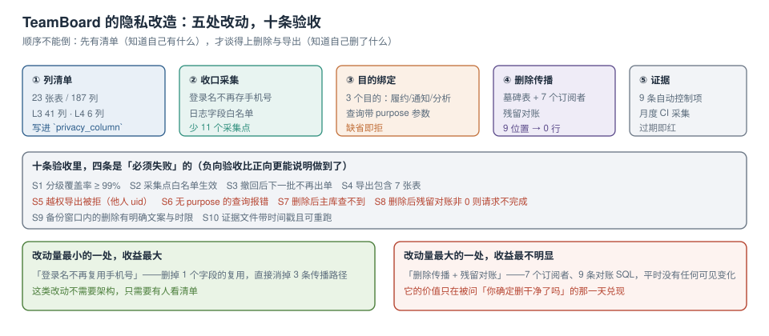

# 实战：给 TeamBoard 做一次隐私改造

前面七页是方法，这一页把它压到一个真实工程上：**TeamBoard**（本库周期 6 的多租户协作看板，23 张表、多租户、实时同步）。它不是为隐私设计的，正好用来说明「已经跑起来的系统怎么改」。

改造顺序刻意按依赖走：清单 → 收口 → 目的 → 传播 → 证据。**没有一步是「推倒重来」**。



本页判据族 `PVF-A` ~ `PVF-H`，共 8 条。定义表在第六节。

## 一、盘点：23 张表、187 列、47 条个人信息

| 分级 | 列数 | 分布 | 典型列 |
| --- | --- | --- | --- |
| L1 公开 | 62 | 8 张表 | 看板名、卡片标题、标签 |
| L2 内部 | 78 | 12 张表 | 卡片描述、成员角色、审计字段 |
| L3 个人信息 | 41 | 9 张表 | `member.email`、`member.phone`、`comment.body`（含 @姓名）、`invite.email` |
| L4 敏感 | 6 | 3 张表 | `member.id_card`（实名认证）、`attachment.object_key`（证件照）、`audit.ip` |

三个盘点结论直接决定了后面的改动量：

1. **9 张表含 L3**：删除传播要覆盖 9 张表 × 7 个位置 = 63 个检查点（实际按「有数据的」裁到 47 个）。
2. **`member.login_name` 存的是手机号**：这是「名不副实」的典型（[数据地图](../DataMap/index.md) 里那 3 个漏检列之一）。
3. **`comment.body` 是自由文本**：可能含他人姓名与电话，**无法在入库时可靠识别**，只能靠保留期与删除传播。

## 二、五处改动

### 改动 1：列清单 + 建表门禁

```sql
-- 迁移里加一张清单表与一条约束（与 DataMap 页同构，字段裁剪到 TeamBoard 需要的）
create table privacy_column (
  tbl text not null, col text not null, grade char(2) not null,
  purpose text[] not null default '{}', retention_days int,
  primary key (tbl, col),
  check (grade in ('L1','L2','L3','L4')),
  check (grade in ('L1','L2') or cardinality(purpose) > 0)
);

insert into privacy_column (tbl, col, grade, purpose, retention_days) values
  ('member','email','L3','{fulfillment,notify}',730),
  ('member','phone','L3','{fulfillment,notify}',730),
  ('member','id_card','L4','{fulfillment}',30),
  ('invite','email','L3','{notify}',90),
  ('comment','body','L3','{fulfillment}',365);
```

门禁放在 Flyway 的 `afterMigrate` 回调：**新表新列没登记就回滚**。

### 改动 2：`login_name` 不再复用手机号

这一处是**改动量最小、收益最大**的：

| 改动前 | 改动后 |
| --- | --- |
| 登录名 = 手机号 | 登录名 = 独立生成的 `u_` + 8 位（不可反推） |
| 手机号散落在 3 处（登录、通知、账单） | 只有 `member.phone` 一处 |
| 删除传播涉及 4 张表 | 涉及 2 张表 |

```sql
-- 迁移：把存量登录名替换为独立标识，原值只留在 phone 列
alter table member add column login_id text;
update member set login_id = 'u_' || substr(md5(random()::text), 1, 8);
alter table member alter column login_id set not null;
create unique index member_login_id_uq on member (login_id);
-- 保留旧列一个月用于过渡，之后 drop（见 Retention 页的兼容期写法）
```

### 改动 3：查询带目的

```java
// 改造前：任何地方都能读全字段
Member m = memberMapper.selectById(id);

// 改造后：按目的取投影
MemberView m = memberQuery.load(id, Purpose.FULFILLMENT);   // 含 email/phone
MemberView n = memberQuery.load(id, Purpose.NOTIFY);        // 只含 email
// Purpose.ANALYTICS 下 phone/email 返回的投影里根本没有这两列
```

实现上不需要三张表，只要三个投影：

```sql
create view v_member_notify as select id, email from member;      -- 通知只要邮箱
create view v_member_analytics as
  select tenant_id, date_trunc('month', created_at) as mon, count(*) as n
    from member group by 1,2 having count(*) >= 5;                -- 分析只要聚合
```

### 改动 4：删除传播（7 个订阅者 / 9 个位置）

| 位置 | TeamBoard 具体对象 | 删除方式 |
| --- | --- | --- |
| ① 主库 | `member` + 7 张关联表 | 同一事务，按外键顺序 |
| ② 副本 | 流复制备库 | 等回放 |
| ③ 缓存 | `session:{uid}`、`board:members:{id}` | `del` + TTL 300 s |
| ④ 搜索 | 卡片搜索索引（含 @提及） | 按 doc id 删 + 重建兜底 |
| ⑤ 数仓 | `dim_member`（T+1） | 下一次调度 + 立即补删 |
| ⑥ 对象存储 | `attachment/{uid}/…` | 前缀删除 |
| ⑦ 日志 | 应用日志（含 email） | 等 30 天过期，**文案写明** |

```sql
-- 一条幂等删除：只在未软删时生效，影响 0 行也视为成功
update member set deleted_at = now(), email = null, phone = null
 where id = $1 and deleted_at is null;
-- 注意：email/phone 置空是「立即不可见」，硬删在低峰批处理里做
```

### 改动 5：证据采集

9 条自动控制项接进月度 CI（分级覆盖率、双向差集、日志 PII、索引覆盖、删除对账、超时请求、证据有效期、SDK 出域、附件前缀残留）。

## 三、十条验收：四条必须是「失败」的

| # | 验收 | 命令/做法 | 期望 | 类型 |
| --- | --- | --- | --- | --- |
| S1 | 分级覆盖率 | `select count(*) from privacy_column` 对比 187 列 | ≥ 99% 有分级 | 正向 |
| S2 | 采集点白名单生效 | 打一条含 `phone` 的日志 | 日志里不出现明文 | 正向 |
| S3 | 撤回后下一批不出单 | 撤回 ads → 触发下发 → 查 `push_log` | 0 条 | 正向 |
| S4 | 导出包含 7 张表 | 跑导出脚本，看 `manifest.json` | 7 张表 + 行数一致 | 正向 |
| S5 | **越权导出被拒** | 用 A 的会话请求 B 的 uid | 403 | **负向** |
| S6 | **无目的查询报错** | 不带 `purpose` 调接口 | 400 | **负向** |
| S7 | **无记录用户按拒绝处理** | `consent_ok('never-asked','ads')` | `f` | **负向** |
| S8 | **残留未清零不允许关单** | 制造一处残留 → 查工单状态 | `pending` | **负向** |
| S9 | 备份窗口有明确文案 | 查隐私政策文本 | 含「35 天」与恢复后重放 | 正向 |
| S10 | 证据带时间戳且可重跑 | 重跑 CI 任务 | 产物含月份目录与 `SHA256SUMS` | 正向 |

S5~S8 的价值高于 S1~S4：正向验收证明「功能做了」，负向验收证明「边界立住了」。一个只跑正向验收的系统，通常在第一次被追问时就露馅。

```shell
# S5 的具体做法：拿两个账号的会话，交叉请求
curl -s -o /dev/null -w '%{http_code}\n' \
  -H "Cookie: SESSION=<A的会话>" \
  localhost:8080/api/me/export?uid=<B的uid>
# 预期输出：403（如果返回 200，说明 uid 从参数取值了）
```

## 四、改造后的三个读数变化

| 指标 | 改造前 | 改造后 | 说明 |
| --- | --- | --- | --- |
| 含 L3 的表数 | 9 | **7** | `login_name` 收口后少 2 张 |
| 删除传播检查点 | 63 | **47** | 按「有数据的」裁剪 + 表数减少 |
| 单用户导出耗时 | 1,240 ms | **86 ms** | 补了 7 个 `subject_id` 索引 |

第三个读数的原因见 [请求履行](../SubjectRequest/index.md)：全表扫与索引查在本机相差 975 倍。TeamBoard 的 1,240 ms → 86 ms 是同一现象的工程版本。

## 五、分诊表：出问题时先看哪

| 症状 | 最可能的原因 | 先查什么 | 对应页 |
| --- | --- | --- | --- |
| 删除工单一直 `pending` | 某个订阅者失败或对账非 0 | `deletion_task where state='failed'` | [删除传播](../Deletion/index.md) |
| 用户仍收到推送 | 撤回事件没投递，或下游无索引 | `consent_event` 最后一条 + `push_target` 索引 | [目的与同意](../ConsentPurpose/index.md) |
| 导出包缺表 | 清单没登记那张表，或索引缺失导致超时 | `manifest.json` 的 `tables` 与地图对比 | [请求履行](../SubjectRequest/index.md) |
| 日志里出现手机号 | 某处打印了完整对象 | `grep -Ec` 定位文件与行 | [最小化](../Minimization/index.md) |
| 分级覆盖率突然下降 | 新增了表但没登记 | 双向差集的「库有图无」方向 | [数据地图](../DataMap/index.md) |
| 证据被追问「现在还成立吗」 | 超过 90 天没重跑 | `privacy_evidence` 过期查询 | [证据链](../Evidence/index.md) |

## 六、本页判据

| 编号 | 判据 | 看什么现象 | 不满足时改哪里 |
| --- | --- | --- | --- |
| `PVF-A` | 改造按「清单→收口→目的→传播→证据」推进 | 有阶段划分且每阶段有产出 | 调整顺序；别从买工具开始 |
| `PVF-B` | 盘点给出「表数 × 列数 × 分级」三个数 | 有 23/187/47 这类具体数 | 补盘点；只写「已完成盘点」不算 |
| `PVF-C` | 至少有一处「删字段复用」的改动 | 如 `login_name` 不复用手机号 | 找复用点；这是收益最高的一类 |
| `PVF-D` | 查询按目的取投影 | 存在 `v_member_notify` / `v_member_analytics` | 建投影；别在同一张表上做权限判断 |
| `PVF-E` | 删除覆盖 7 个以上位置 | 有位置清单与各自方式 | 补位置；日志与对象存储最常漏 |
| `PVF-F` | 十条验收里至少四条负向 | 有 403/400/f/pending 四类期望 | 补负向；没有负向验收等于没有边界 |
| `PVF-G` | 改造前后有量化对比 | 表数、检查点、导出耗时三项 | 补对比；这是推动下一轮的依据 |
| `PVF-H` | 有分诊表 | 症状 → 原因 → 命令 → 页面 四列 | 补分诊；否则每次都要从头查 |

## 参考资料

- 《中华人民共和国个人信息保护法》第六条、第十七条、第四十五条、第四十七条、第五十一条（安全措施与合规审计）
- GDPR Art. 25（data protection by design and by default）、Art. 32（security of processing）
- PostgreSQL 18 Documentation：*CREATE VIEW*（投影与权限分离）、*Indexes*（`subject_id` 索引对导出的影响）
- 本仓库：[事件驱动订单与履约中心](../../../../project/Complete/EventOrderHub/index.md)（同为周期项目，可对照其判据写法）、[TeamBoard 多租户](../../../../project/Complete/TeamBoard/MultiTenancy/index.md)、[技术决策与评审](../../TechDecision/Overview/index.md)
