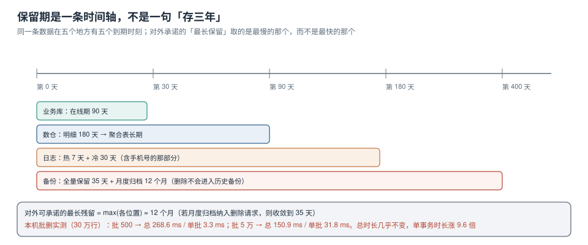

# 保留期与到期动作

「我们留存三年」这句话在技术上有五个不同的到期时刻，取决于你问的是哪一份数据。业务库里的订单、数仓里的明细、日志里的访问记录、备份里的快照、对象存储里的发票——**它们是同一条数据，但会在五个不同的日子消失**。

对外承诺的保留期必须取这五个里的**最大值**，而不是取最快的那个。否则「三年」的真实含义可能是「三年，但备份里还有十二年」。



本页判据族 `PVR-A` ~ `PVR-H`，共 8 条。定义表在第六节。

## 一、五个到期时刻

| 位置 | 到期动作 | 常见配置 | 谁改 |
| --- | --- | --- | --- |
| 业务库 | `delete` 或分区 `detach` | 在线 90 天 | 业务 + DBA |
| 数仓明细 | 分区覆盖 / 分区删除 | 180 天 | 数据平台 |
| 数仓聚合 | 不删（无个人标识） | 长期 | 数据平台 |
| 日志 | 索引生命周期 / `logrotate` | 热 7 天 + 冷 30 天 | SRE |
| 对象存储 | 生命周期规则 | 30 天 | SRE |
| 备份 | 保留策略（不可变） | 35 天 + 月归档 12 个月 | DBA |

前五行可以商量，最后一行**通常不能商量**：不可变备份（对象锁 / WORM 存储）在设计上就拒绝删除，这是它有价值的原因。所以产品文案里必须区分「在线数据保留多久」与「备份保留多久」。

## 二、三种到期动作，成本差两个数量级

### 动作 1：逐行 `delete`（适合小表、需要精确）

```sql
-- 分批删，每批独立事务，避免长事务与大量死元组
delete from event_log
 where id in (
   select id from event_log
    where created_at < now() - interval '90 days'
    limit 5000
 );
```

本机实测（30 万行，SQLite 3.50.4 模拟）：

| 批大小 | 总耗时 | 单批最长耗时 | 结论 |
| --- | --- | --- | --- |
| 500 | 268.6 ms | **3.3 ms** | 抖动最小，事务数最多 |
| 5,000 | 161.1 ms | 9.1 ms | 折中 |
| 50,000 | **150.9 ms** | **31.8 ms** | 总时长最短，单事务抖动最大 |

**总耗时几乎不变（150~270 ms），单事务时长涨了 9.6 倍**。这就是分批的全部意义：你买的不是速度，是「锁持有时间可控」。批大小按「单批 < 50 ms」反推，通常落在 2,000~10,000。

### 动作 2：分区 `DETACH`（适合大表、按时间分区）

```sql
-- 按月分区，到期直接摘掉整个分区（秒级，不产生死元组）
create table event_log (
  id bigserial,
  user_id bigint,
  payload jsonb,
  created_at timestamptz not null
) partition by range (created_at);

create table event_log_2026_07 partition of event_log
  for values from ('2026-07-01') to ('2026-08-01');

-- 到期：先摘，再归档，再删
alter table event_log detach partition event_log_2026_07;
-- 归档到对象存储后再 drop
drop table event_log_2026_07;
```

`DETACH` 的优点不只是快，是**它把「删除 3000 万行」变成「删除 1 个对象」**：没有死元组、不需要 `VACUUM`、不影响其他分区的查询计划。缺点是需要建表时就设计好分区键，事后补分区要重写表（见 [在线 Schema 演进](../../../DB/SchemaEvolution/Overview/index.md)）。

### 动作 3：归档 + 冷存（适合「不能删但要少见」）

监管要求「保留 X 年」的场景下，删除不是选项。这时要做的是**降低可访问性**而不是删除：归档到冷存储、单独授权、访问留痕。工程判据是「归档后的数据是否仍然可被普通账号查询」——如果仍然可查，归档只是换了个存储，不算收敛。

## 三、备份与删除承诺的冲突，必须写清楚

一个真实的时间线：

```text
第 0 天   用户请求删除 → 主库/缓存/索引清理完成
第 0 天   当日全量备份（含该用户）已生成，保留 35 天
第 35 天  该备份过期，删除才在「所有介质」上真正完成
第 400 天 月度归档（保留 12 个月）仍未过期 → 仍在
```

三条处理路径，按代价从低到高：

| 路径 | 做法 | 代价 | 适用 |
| --- | --- | --- | --- |
| 接受窗口 | 文案写「备份保留 35 天，到期自动清除」 | 需要产品接受 | 大多数场景 |
| 恢复后重放 | 从备份恢复时，先重放删除墓碑，再对外提供服务 | 恢复流程变复杂 | 有严格时限要求 |
| 备份加密 + 密钥销毁 | 按用户分密钥不现实，通常按租户/按周期 | 密钥管理复杂度高 | 极高敏感数据 |

```sql
-- 墓碑表：备份恢复后用它重放删除
create table deletion_tombstone (
  subject_id   text primary key,
  requested_at timestamptz not null,
  propagated   jsonb not null default '{}'::jsonb,   -- 各位置完成情况
  completed_at timestamptz
);
```

恢复流程里加一步即可：**恢复 → 重放墓碑 → 才允许切流量**。这一步写进 Runbook，比写在方案里更有效。

## 四、保留期配置放在哪：三个位置，一个来源

| 位置 | 优点 | 缺点 | 建议 |
| --- | --- | --- | --- |
| 代码常量 | 简单、可评审 | 改一次要发版 | 只用于「永不变」的（如法定最短） |
| 数据库配置表 | 可热改、可审计 | 应用要读、可能不一致 | 主来源 |
| 配置中心 | 集中、有灰度 | 与数据库双写易漂移 | 只放「开关」，不放数值 |

**推荐**：数值放数据库配置表（单一来源），配置中心只放「是否启用到期任务」这类开关。加一条一致性检查：

```sql
-- 所有到期任务读同一张表，禁止各任务自己写死天数
select name, retention_days, updated_by, updated_at
  from retention_policy
 order by name;
-- 预期：每个数据集一行，updated_by 非空（谁改的能查到）
```

配置漂移是保留期最常见的失效原因：三个任务各自 `interval '90 days'`，其中两个改了、一个忘了。检查方法就是**在代码里搜天数**：

```shell
# 找出所有硬编码的保留天数（应该只有一份来源）
grep -rn "interval '90 days'\|Duration.ofDays(90)" src/ | wc -l
# 预期输出：1。大于 1 就是漂移的起点
```

## 五、怎么验证到期真的发生了

```shell
# ① 业务库：超过保留期的行数应为 0
psql -c "select count(*) from event_log where created_at < now() - interval '90 days'"
# 预期输出：0

# ② 分区：应存在的分区清单（到期的不在列表里）
psql -c "select relname from pg_class where relname like 'event_log_2026_%' order by 1"
# 预期：只剩最近 3 个月

# ③ 日志：最老的日志文件日期
ls -1t /var/log/app/app-*.log | tail -1 | xargs stat -f '%Sm' -t '%Y-%m-%d'
# 预期：不早于 30 天前

# ④ 备份：最早的备份日期应落在保留窗口内
aws s3 ls s3://backup/pg/ --recursive | head -1
# 预期：不早于 35 天前（月归档目录除外）
```

四条都是「看最早的那一份」，而不是「看有没有删除任务」。**删除任务跑成功但没删到东西**是最常见的假绿：`delete` 的 `ROW_COUNT` 为 0，任务日志写成功。

所以判据要加一条：**每天记录实际删除行数，连续 7 天为 0 就告警**（要么没有到期数据——这通常不成立，要么条件写错了）。

```sql
-- 删除任务的执行记录（供上面那条告警使用）
create table retention_run (
  id bigserial primary key,
  dataset text not null,
  cutoff  timestamptz not null,
  deleted bigint not null,
  started_at timestamptz not null,
  finished_at timestamptz,
  error text
);
```

## 六、本页判据

| 编号 | 判据 | 看什么现象 | 不满足时改哪里 |
| --- | --- | --- | --- |
| `PVR-A` | 五个到期时刻都写出来 | 表里含业务库/数仓/日志/对象/备份五行 | 补全；缺一行就等于承诺不成立 |
| `PVR-B` | 承诺取最大值 | 文案里的时限 = max(各位置) | 改文案；或改最慢那环的配置 |
| `PVR-C` | 批删有批大小依据 | 单批耗时 < 50 ms 的实测 | 按实测调批；不按「经验值」 |
| `PVR-D` | 大表用分区 DETACH | 有 `partition by range` + `detach` | 建分区；事后补要评估重写成本 |
| `PVR-E` | 备份窗口写进文案 | 明确「备份保留 N 天」 | 补文案；恢复流程加重放墓碑 |
| `PVR-F` | 保留天数单一来源 | `grep` 硬编码结果 = 1 处 | 收敛到配置表 |
| `PVR-G` | 删除任务记录实际删除行数 | 有 `retention_run` 表与连续 0 告警 | 补记录；只记「任务成功」等于没记 |
| `PVR-H` | 归档后不可被普通账号查询 | 归档表权限已 `REVOKE` | 收回权限；否则归档只是换存储 |

## 参考资料

- 《中华人民共和国个人信息保护法》第十九条（保存期限应当为实现处理目的所必要的最短时间）
- GDPR Art. 5(1)(e)：storage limitation
- PostgreSQL 18 Documentation：*Partitioning*（`DETACH PARTITION` 与 `DETACH ... CONCURRENTLY`）、*VACUUM*（死元组与回收）
- 本仓库：[删除与派生数据传播](../Deletion/index.md)、[分区归档与留存合规](../../../DB/PartitionArchival/RetentionCompliance/index.md)、[在线 Schema 演进](../../../DB/SchemaEvolution/Overview/index.md)
