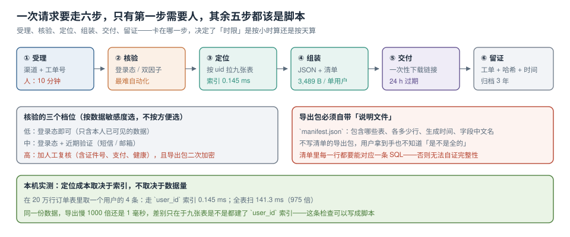

# 访问、导出与请求履行

用户发来一封邮件：「请把我的数据给我一份，然后删掉。」这条请求同时触发两条义务——**访问（导出）**与**删除**。技术上它们是两条流水线，但共用前三步：受理、核验、定位。

本页讲这条流水线怎么做到「能在时限内完成、能证明完成了、不会给错人」。



本页判据族 `PVS-A` ~ `PVS-H`，共 8 条。定义表在第六节。

## 一、六步，只有第一步需要人

| 步 | 动作 | 谁做 | 典型耗时 | 出错后果 |
| --- | --- | --- | --- | --- |
| ① 受理 | 生成工单、登记渠道与请求类型 | 人（10 分钟） | — | 需求理解错，后面全白做 |
| ② 核验 | 确认「请求者就是数据主体」 | 半自动 | 分钟级 | **给错人 = 数据泄露** |
| ③ 定位 | 按 `subject_id` 拉全部相关行 | 脚本 | 毫秒级 | 漏表 → 导出不全 |
| ④ 组装 | 生成 JSON + 清单 | 脚本 | 秒级 | 用户看不懂 → 二次工单 |
| ⑤ 交付 | 一次性下载链接 | 脚本 | 即时 | 链接外泄 |
| ⑥ 留证 | 工单归档 + 哈希 + 时间 | 脚本 | 即时 | 无法证明履行过 |

第 ② 步是唯一不能全自动的：**身份核验做错，整个流程就从「合规」变成「泄露」**。所以它值得单独设计。

## 二、核验三档：按数据敏感度选，不按方便选

| 档 | 适用 | 手段 | 反面案例 |
| --- | --- | --- | --- |
| 低 | 只含本人已可见的数据（浏览记录、收藏） | 登录态即可 | — |
| 中 | 含联系方式、订单、地址 | 登录态 + 近期验证（短信/邮箱验证码） | 只校验「知道邮箱」就发全量 |
| 高 | 含证件号、支付信息、健康数据 | 中 + 人工复核 + 导出包二次加密 | 用客服权限直接导出 |

高敏感档的「二次加密」不是形式主义：导出包用一次性口令加密，口令通过**另一条通道**（短信）发给用户。这样即使下载链接泄露，包也打不开。

::: danger 两个真实的越权姿势
1. **改 uid**：接口是 `GET /api/me/export`，有人改成 `GET /api/me/export?uid=1025`——如果后端信任了这个参数，就是任意用户导出。正确做法是**从会话里取 uid，永不从参数取**。
2. **共享链接**：导出包放在公开可读的桶里，链接形如 `https://cdn/export/u-1024.zip`。链接一旦被转发，等于永久泄露。正确做法是预签名 URL + 24 小时过期 + 下载次数限制。
:::

## 三、定位：成本取决于索引，不取决于数据量

导出 1 个用户的数据，本质是「在 N 张表里按 `subject_id` 查」。本机实测（20 万行订单表，取某用户的 4 条）：

| 查法 | 耗时 | 倍数 |
| --- | --- | --- |
| 走 `user_id` 索引 | **0.145 ms** | — |
| 全表扫 + 过滤 | **141.3 ms** | **975 倍** |

同一份数据，差别只在「有没有索引」。所以导出流水线的第一步不是写代码，是**检查九张表是不是都有 `subject_id` 索引**：

```sql
-- 找出所有「有 subject 语义列但没有索引」的表
select c.relname as tbl, a.attname as col
  from pg_class c
  join pg_attribute a on a.attrelid = c.oid
 where c.relkind = 'r'
   and a.attname in ('user_id','subject_id','uid','customer_id')
   and a.attnum > 0
   and not exists (
     select 1 from pg_index i
      where i.indrelid = c.oid and a.attnum = any (i.indkey)
   )
 order by 1;
-- 预期输出：0 行。有行就是导出会慢 1000 倍的那张表
```

这张清单同时是 [删除传播](../Deletion/index.md) 的输入——**同一条索引服务两个场景**，这也是「先做地图再做履行」的现实收益。

## 四、导出包：自带说明文件才算完整

用户拿到一个 4 MB 的 zip，里面 9 个 JSON，他不知道「是不是全的」。所以包里必须有 `manifest.json`：

```json
{
  "subject_id": "u-1024",
  "generated_at": "2026-10-23T10:12:44+08:00",
  "request_id": "DSAR-2026-0042",
  "policy_version": "privacy-2026-09",
  "tables": [
    {"name": "app_user",  "rows": 1, "columns_cn": {"phone": "手机号", "addr": "收货地址"}},
    {"name": "orders",    "rows": 4, "columns_cn": {"amount": "订单金额"}},
    {"name": "consent",   "rows": 3, "columns_cn": {"purpose": "处理目的"}}
  ],
  "not_included": [
    {"item": "服务端访问日志", "reason": "仅保留 30 天，本次请求范围内不含可关联记录"},
    {"item": "不可变备份", "reason": "备份保留 35 天，不含在线查询能力"}
  ],
  "checksum_sha256": "9f2c…"
}
```

`not_included` 这一段是整份清单里最有价值的部分：**主动说明「什么没给、为什么」**，比给了一堆文件但不说边界更可信。本机单用户导出包（1 条用户 + 4 条订单 + 200 条事件摘要）**3,489 B**——体积不是问题，说明才是。

```python
# 组装骨架：每张表一条查询，行数与清单同源，避免「说 4 行实际 7 行」
tables = {
    "app_user": ("select * from app_user where id=?", (uid,)),
    "orders":   ("select * from orders where user_id=?", (uid,)),
    "consent":  ("select purpose, action, at from consent_event where subject_id=?", (sid,)),
}
payload, manifest = {}, []
for name, (sql, args) in tables.items():
    rows = [dict(zip([d[0] for d in cur.description], r)) for r in con.execute(sql, args)]
    payload[name] = rows
    manifest.append({"name": name, "rows": len(rows)})
```

## 五、时限：法定是一个月，内部 SLA 要短得多

| 环节 | 法定/惯例 | 内部 SLA | 为什么更短 |
| --- | --- | --- | --- |
| 受理确认 | — | 1 个工作日 | 用户等待焦虑主要在前 24 小时 |
| 核验 | — | 2 个工作日 | 卡在核验的请求占多数 |
| 导出/删除执行 | — | 3 个工作日 | 给对账留时间 |
| 整体答复 | 一个月内（GDPR 口径） | **7 个工作日** | 留 3 周缓冲应对异常 |

内部 SLA 短的意义在于**异常有地方消化**：传播失败要重试、对账不通过要人工查、跨部门要协调，这些都需要时间。把 SLA 定在法定边缘，等于把所有异常都变成超时。

```sql
-- 超时预警：按内部 SLA 提前 2 天告警
select request_id, type, created_at,
       now() - created_at as elapsed
  from dsar_request
 where state not in ('completed','rejected')
   and now() - created_at > interval '5 days'
 order by created_at;
```

## 六、越权与审计：拒绝也要留痕

被拒绝的请求同样要记录，原因有三：证明「我们核验过」、发现「有人在批量试」、复盘口径（不是复盘内容，是统计口径）。

| 事件 | 记录什么 | 用途 |
| --- | --- | --- |
| 核验失败 | 请求 id、失败原因、时间、渠道 | 识别撞库式试探 |
| 越权尝试（改 uid） | 会话用户、目标 uid、接口 | 安全告警 |
| 下载 | 请求 id、IP 段（不存全量）、次数 | 链接泄露发现 |
| 完成 | 包哈希、行数、清单版本 | 履行证明 |

```sql
create table dsar_request (
  request_id   text primary key,
  subject_id   text not null,
  type         text not null check (type in ('access','export','erase','rectify')),
  channel      text not null,
  verified_by  text,                       -- 核验方式：session / sms / manual
  state        text not null default 'received',
  created_at   timestamptz not null default now(),
  completed_at timestamptz,
  package_sha  text,
  note         text
);
```

## 七、本页判据

| 编号 | 判据 | 看什么现象 | 不满足时改哪里 |
| --- | --- | --- | --- |
| `PVS-A` | 请求有六步且每步有责任人与耗时 | 流水线表齐全 | 补步骤；「受理」不能省 |
| `PVS-B` | 核验分三档并与敏感度对应 | 有低/中/高对应表 | 补档位；高敏感必须人工复核 |
| `PVS-C` | uid 从会话取，不从参数取 | 接口签名里没有 `uid` 入参 | 改接口；加越权用例 |
| `PVS-D` | 导出用预签名链接且有过期 | URL 带 `Expires`，且限次数 | 改交付方式 |
| `PVS-E` | 九张表都有 `subject_id` 索引 | 索引检查 SQL 返回 0 行 | 建索引（实测 975 倍差异） |
| `PVS-F` | 导出包含 `manifest.json` | 有行数、字段中文名、`not_included` | 补清单；没有清单等于没交付 |
| `PVS-G` | 拒绝与越权也有留痕 | `dsar_request` 有 `rejected` 状态与原因 | 补记录；只记成功的系统等于没有安全日志 |
| `PVS-H` | 内部 SLA 短于法定时限 | 有 7 个工作日这类内部目标 | 定 SLA 并接超时告警 |

## 参考资料

- GDPR Art. 12（透明性与时限：一个月内，可延长两个月）、Art. 15（访问权）、Art. 20（数据可携带）
- 《中华人民共和国个人信息保护法》第四十五条（查阅、复制权；转移权）、第五十条（申请受理与拒绝的说明义务）
- PostgreSQL 18 Documentation：*Indexes*（`pg_index` 与 `indkey` 的用法）、*Privileges*
- 本仓库：[删除与派生数据传播](../Deletion/index.md)、[证据链与季度自查](../Evidence/index.md)、[数据库访问控制与审计](../../../DB/AccessControl/AuditTrail/index.md)
