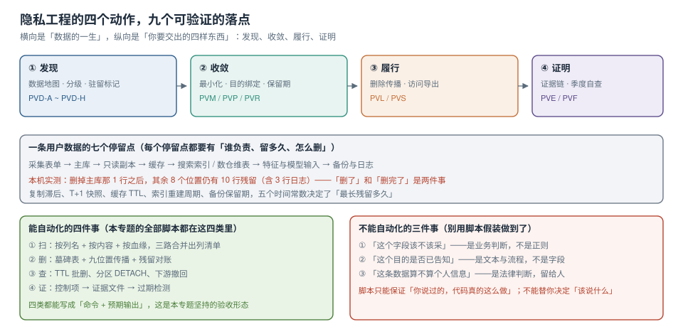

# 隐私工程与合规落地

「我们很重视用户隐私」这句话在每个官网都能看到，但它对应不到任何一行代码。真正能对应到代码的问题是四个，而且都能被追问到具体读数：**你知道自己有哪些个人信息字段吗？你只采了必要的那几个吗？用户要求删除时你删干净了吗？以上三件事你能拿出带时间戳的证据吗？**

本专题只回答这四个问题，以及它们之间的依赖顺序：**发现 → 收敛 → 履行 → 证明**。四步的顺序不能颠倒——没有清单就谈不上最小化，没有最小化就谈不上删除传播，没有删除记录就谈不上证据。

四组本机实测先摆在前面，它们是本专题的骨架（Python 3.13.12 + SQLite 3.50.4，脚本不入库）：

- **按列名找个人信息，14 个含个人信息的列只认出 9 个**（64%）：`login_name` 里存的是手机号、`nickname` 里带真名、`remark` 里写着「客户电话 138…」。换**按内容找**，认出 10 个（71%）；两路并集 **12 个（86%）**，剩下 2 个（`wx_openid`、`invoice_title`）不是任何正则能判的，只能人看。
- **内容识别本身会误报**：10 万个 16~19 位数字串，正则命中 **5 万个**，加 Luhn 校验后只剩 **27,632**——单靠「看起来像卡号」有 **44.7%** 是假的。
- **删掉主库那 1 行之后，另外八个位置合计仍有 10 行残留**：只读副本 1、缓存 1、搜索索引 1、数仓维表 1、特征库 1、对象存储 1、日志 3、备份 1。日志那 3 行是扫了 **20 万行、769 ms** 才找到的。
- **无盐 SHA-256 不是假名化**：2000 个手机号建字典 **3.9 ms**，还原 **2000/2000**；加上与数据不同库的盐之后，同一张字典 **2.2 ms**、还原 **0 条**。差别不在算法强度，在**盐放在哪**。

::: tip 一句话理解
隐私工程的产出不是一份整改报告，而是**四个能被别人重跑的数**：分级覆盖率、采集字段数、删除残留行数、证据有效期。四个数里任何一个答不出来，谈「合规」就只是表态。
:::

::: info 本专题与相邻专题的分工

| 相邻专题 | 那页回答什么 | 本专题回答什么 |
| --- | --- | --- |
| [AI 安全与合规](../../AI/AISecurityCompliance/Overview/index.md) 与[输入数据最小化](../../AI/AISecurityCompliance/DataMinimization/index.md) | 喂给模型的**提示词与上下文**里不该带什么 | 这些数据**从哪来、该留多久、怎么删**（模型输入只是九个位置之一） |
| [数据治理](../../DB/DataGovernance/Overview/index.md) | 元数据、血缘、质量、标准与主数据 | 血缘只借用它的**走向**，本专题关心「走到了哪、谁负责删」 |
| [密钥与凭据治理](../../Ops/SecurityHardening/SecretGovernance/index.md) | 密钥怎么存、怎么轮换 | 加密**密钥的驻留地**决定「数据算不算出境」，本专题只用它的结论 |
| [分区归档与留存合规](../../DB/PartitionArchival/RetentionCompliance/index.md) | 分区表、归档、留存期的**存储实现** | 留存期的**承诺口径**（对外说几年，就按最慢那个位置算） |
| [测试数据脱敏](../../Tools/TestDataSimulation/DataMasking/index.md) | 造测试数据时怎么脱敏 | 生产环境里**脱敏与假名化的可还原性**边界 |
| [数据库访问控制与审计](../../DB/AccessControl/AuditTrail/index.md) | 谁能读、读了留什么痕 | 读取**目的是否被声明**、留痕能否当合规证据 |
| [技术决策与评审](../TechDecision/Overview/index.md) | 一个决定怎么被做出来、被复核 | 隐私相关的决定**必须留下哪几样前提与失效条件** |

:::

## 目录

- [四个动作与五个必失点](Overview/index.md)
- [数据地图、分级与驻留标记](DataMap/index.md)
- [采集最小化与三种形态](Minimization/index.md)
- [目的绑定与同意状态机](ConsentPurpose/index.md)
- [保留期与到期动作](Retention/index.md)
- [删除与派生数据传播](Deletion/index.md)
- [访问、导出与请求履行](SubjectRequest/index.md)
- [证据链与季度自查](Evidence/index.md)
- [实战：给 TeamBoard 做一次隐私改造](Practice/index.md)

## 专题地图

## 判据纪律

沿用全库写法：**每页 8 条，编号形如 `PVO-A`**，逐页前缀唯一，可被 `utils/audit` 下的判据类巡检机械核对。每条判据都要能回答三件事：**看什么现象、判成什么、不满足时改哪里**。

| 页面 | 判据族 | 覆盖的约定 | 条数 |
| --- | --- | --- | --- |
| 四个动作与五个必失点 | `PVO-A` ~ `PVO-H` | 动作顺序、必失点、责任边界、口径与分母 | 8 |
| 数据地图、分级与驻留标记 | `PVD-A` ~ `PVD-H` | 三路发现、并集召回、分级四档、驻留标记、地图维护 | 8 |
| 采集最小化与三种形态 | `PVM-A` ~ `PVM-H` | 必要性、精度、形态、出口白名单、可还原性 | 8 |
| 目的绑定与同意状态机 | `PVP-A` ~ `PVP-H` | 五态、撤回传播、目的参数、匿名期授权 | 8 |
| 保留期与到期动作 | `PVR-A` ~ `PVR-H` | 五处到期、批删、分区、备份窗口、承诺口径 | 8 |
| 删除与派生数据传播 | `PVL-A` ~ `PVL-H` | 九位置、墓碑表、两段式、残留对账 | 8 |
| 访问、导出与请求履行 | `PVS-A` ~ `PVS-H` | 核验三档、导出清单、时限、越权拒绝 | 8 |
| 证据链与季度自查 | `PVE-A` ~ `PVE-H` | 控制项、证据形态、采集、过期、缺口 | 8 |
| 实战 | `PVF-A` ~ `PVF-H` | 清单、收口、目的、传播、验收 | 8 |

合计 **9 族 72 条**。

## 事实与口径速览（2026-10 核对）

| 项 | 现状 | 对本专题的影响 |
| --- | --- | --- |
| 《中华人民共和国个人信息保护法》 | 2021-11-01 施行；「告知—同意」与「最小必要」是两条独立义务 | 本专题把它们拆成两页：[最小化](Minimization/index.md) 与 [目的绑定](ConsentPurpose/index.md) |
| GDPR | 2018-05-25 起适用；数据主体请求的时限口径是「一个月内」 | [请求履行](SubjectRequest/index.md) 的时限表按这个口径写，但**内部 SLA 要短于法定时限** |
| NIST Privacy Framework | 1.0（2020-01）；五个功能：Identify / Govern / Control / Communicate / Protect | 本专题的「发现 / 收敛 / 履行 / 证明」是它的工程化投影，不是新框架 |
| 本机数据库 | PostgreSQL **18.6**、MySQL **8.4**、SQLite **3.50.4** | 页内 DDL 以 PostgreSQL 18 为准；SQLite 只用于可复跑的实测脚本 |
| 本机 Python | **3.13.12**（标准库 + `sqlite3`） | 所有实测只依赖标准库，读者不必装任何包 |
| 分区与归档 | PostgreSQL 声明式分区 + `DETACH PARTITION` 秒级 | [保留期](Retention/index.md) 的到期动作以此为前提 |

::: warning 法律判断不在这里
本专题只处理「**技术上怎么做到、怎么证明**」。某条数据算不算个人信息、某个目的算不算「履行合同所必需」、跨境该走哪条路径——这些是法务判断，页面里出现相关表述时一律标注「需法务确认」，不代替意见。
:::

三条底线：

1. **能重跑**：每条验收都写成「命令 + 预期输出」，而不是「已配置」。
2. **能证伪**：负向验收（越权被拒、缺目的报错、残留非 0）比正向验收更重要。
3. **不假装**：做不到的（不可变备份、已发出的推送）写清楚边界，不用「已删除」三个字盖过去。

## 阅读顺序

先读 [Overview](Overview/index.md) 建立四个动作与顺序感；如果你只关心一件事，按下面的场景跳：

| 你的处境 | 从这里开始 | 下一步 |
| --- | --- | --- |
| 不知道库里有哪些个人信息 | [数据地图](DataMap/index.md) | 把清单接进 CI（[证据链](Evidence/index.md)） |
| 被要求「少采一点」 | [采集最小化](Minimization/index.md) | 用[目的绑定](ConsentPurpose/index.md)把「为什么采」写进代码 |
| 收到删除请求，只删了主库 | [删除传播](Deletion/index.md) | 用[请求履行](SubjectRequest/index.md)补受理与时限 |
| 要交一份合规材料 | [证据链](Evidence/index.md) | 用[实战](Practice/index.md)的十条验收自检 |

## 参考资料

- 《中华人民共和国个人信息保护法》全文（全国人大网），重点：第六条（最小必要）、第十三条（处理依据）、第四十七条（删除）
- GDPR 官方文本（EUR-Lex, Regulation (EU) 2016/679），重点：Art. 5（原则）、Art. 15（访问）、Art. 17（删除）、Art. 30（处理活动记录）
- NIST Privacy Framework Version 1.0（NIST, 2020-01）
- PostgreSQL 18 Documentation：*Partitioning*（`DETACH PARTITION`）、*Row Security Policies*
- 本仓库：[数据库访问控制与审计](../../DB/AccessControl/Overview/index.md)、[数据治理](../../DB/DataGovernance/Overview/index.md)、[密钥与凭据治理](../../Ops/SecurityHardening/SecretGovernance/index.md)
