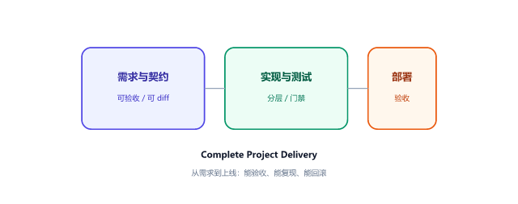
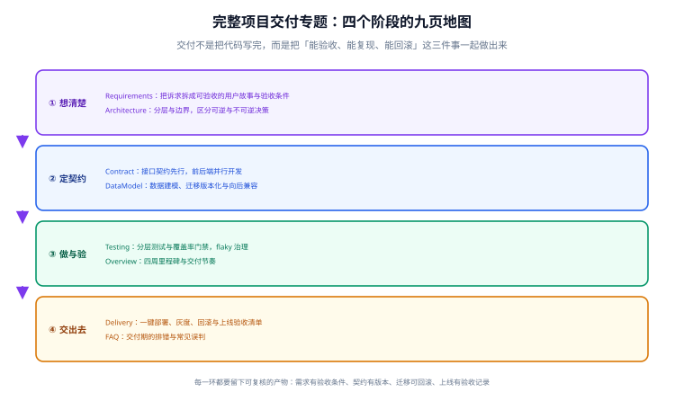

# 完整项目交付

**完整项目交付**讲的不是某个技术，而是「把一个想法变成一个能上线、能验收、能复现、能回滚的系统」这条路上的方法、模板与清单。它回答的是那些在真实项目里最容易扯皮的问题：需求怎么算拆完了、契约谁来定、数据怎么改不炸、什么时候可以上线。

## 本专题讲什么

按交付的时间顺序组织，每一页对应一个阶段，每页都给可直接抄用的模板与清单：**需求怎么写成可验收的句子 → 架构决策怎么留痕 → 契约怎么先行 → 数据怎么改才安全 → 测试怎么分层与设门禁 → 怎么上线与验收**。

::: tip 一句话定位
交付的完成标准不是「代码写完了」，而是**能验收、能复现、能回滚**这三件事同时成立。
:::

## 按阶段找页面

| 阶段 | 页面 | 你会拿到什么 |
| --- | --- | --- |
| 全景 | [交付全景与验收标准](./Overview/index.md) | 四周里程碑、每阶段的验收判据、五类常见失败模式 |
| 需求 | [需求拆分与验收条件](./Requirements/index.md) | 用户故事写法、Given/When/Then 模板、范围裁剪与非功能需求 |
| 设计 | [架构设计与技术选型](./Architecture/index.md) | 分层与边界、可逆 vs 不可逆决策、ADR 四段式、选型评分表 |
| 契约 | [接口契约先行](./Contract/index.md) | OpenAPI 契约、前后端并行、Mock、破坏性变更拦截、错误码表 |
| 数据 | [数据建模与迁移](./DataModel/index.md) | 建模与命名规范、索引取舍、迁移六步法、回滚设计 |
| 验证 | [测试策略与门禁](./Testing/index.md) | 测试分层职责、覆盖率门禁怎么设、集成测试的真实依赖、flaky 治理 |
| 交付 | [一键部署与上线验收](./Delivery/index.md) | 部署六步顺序、灰度与回滚、六类 18 项验收清单 |
| 排错 | [常见问题与排错](./FAQ/index.md) | 需求变 / 联调对不上 / 上线才发现 三类问题的处理 |

## 按角色选读路径

- **要起一个新项目**：Overview → Requirements → Architecture → Contract。四页读完，动手前该定的都定了。
- **接手一个做到一半的项目**：先看 [架构设计与技术选型](./Architecture/index.md) 的决策记录与 [测试策略与门禁](./Testing/index.md)，判断「现在到哪一步了」是否有客观答案。
- **准备上线**：[一键部署与上线验收](./Delivery/index.md) + [数据建模与迁移](./DataModel/index.md)。上线出问题绝大多数出在这两页。
- **联调总是返工**：[接口契约先行](./Contract/index.md) 一页就够，重点是破坏性变更的判定标准。

## 三条底线

1. **先有判据，再动手。** 需求要有验收条件，部署要有验收清单，测试要有门禁阈值。没有判据的工作无法验收，只能靠「我觉得差不多了」。
2. **不可逆的事情要慢，可逆的事情要快。** 数据库主键策略、对外接口语义这类改一次要迁数据改契约的决策，值得写文档反复论证；目录结构、日志方案这类改起来是一次提交的事，先做起来再说。
3. **每一步都留下可复核的产物。** 需求留验收条件、决策留 ADR、契约留版本、迁移留回滚方案、上线留验收记录。产物的意义是让后来的人（包括三个月后的你）不必重新推演一遍。

## 与传统「项目文档」的区别

本专题刻意写成**方法论 + 模板 + 清单**，而不是某个具体项目的记录：

| | 本专题 | 具体项目文档 |
| --- | --- | --- |
| 位置 | `docs/Others/ProjectDelivery/` | `project/Complete/FullStackProject/` 等 |
| 内容 | 可复用的方法、模板、判据 | 某个项目当时真实的决策与实施记录 |
| 用法 | 起新项目时照着走 | 想知道「当时为什么这么定」时翻 |

想看到一个具体项目怎么落地，去看 [全栈项目实战](../../../project/Complete/FullStackProject/index.md)；想知道「下次该怎么做」，留在本专题。

## 相关专题

- [全栈项目实战](../../../project/Complete/FullStackProject/index.md)：本专题方法论的一个具体落地案例（需求拆分、数据库设计、接口联调、编码、测试、部署）。
- [后端通用模板](../../../project/Base/BackendTemplate/index.md)：把「需求到上线」里最重复的那部分（统一响应、异常、认证、数据访问、部署）沉淀成可复用的工程基座。
- [Vue3 前端模板](../../../project/Base/Vue3Template/index.md)：前端侧的同类基座，与本专题的契约、测试两页直接相关。
- [协作与项目管理](../../Tools/Collaboration/index.md)：任务拆分、看板、Code Review 与提交规范——本专题讲「交付物的判据」，那里讲「协作的动作」。
- [Docker](../../Ops/Docker/index.md) 与 [CI/CD](../../Tools/CICD/index.md)：部署与流水线的工具层细节。

## 相关专题与分工

- [云原生与服务托管](../../Ops/CloudNative/index.md)：本专题讲**交付流程与方法论**（需求 → 架构 → 契约 → 数据 → 测试 → 部署 → 验收，每一步给判据与模板）；云原生专题讲**部署目标怎么选、账单怎么治**——自建还是托管、控制面按什么计费、节点怎么弹、成本怎么归因到团队。
- [测试工具专题](../../Tools/TestingTools/index.md)：本专题的「测试策略与门禁」页给的是**职责边界与门禁取舍**；测试工具专题给**验收要用的工具怎么跑**——JMeter 压测、Selenium 端到端、接口自动化的脚本与命令。
- [服务网格：Istio 流量与安全治理](../../Ops/ContainerOrchestration/ServiceMesh/index.md)：本专题的[架构设计与技术选型](./Architecture/index.md)要求把不可逆决策留痕，而「服务间要不要上网格」正是典型的一类——引入网格等于给每个工作负载加一层数据面代理，装上去容易、摘下来要先保证所有策略都能在原位复现。分工是：本专题给**决策的判据与留痕模板**（ADR 四段式、选型评分表），网格专题给**技术本身**——Sidecar 与 Ambient 的取舍、接入顺序、灰度与回滚。线上一旦采用网格，[一键部署与上线验收](./Delivery/index.md)的验收清单就要多出两项：**mTLS 是否全量生效**、**非网格流量是否被正确旁路**，具体做法见[实战：为博客平台接入网格](../../Ops/ContainerOrchestration/ServiceMesh/Practice/index.md)。

这几条线是「**怎么走流程 / 部署到哪 / 用什么验 / 服务间怎么治**」的关系：本专题负责流程与判据，云原生专题负责承载环境与成本，测试工具专题负责验证手段，网格专题负责运行时治理。

- [上线发布与结项验收](../../../project/Complete/BlogPlatform/ReleaseAcceptance/index.md)：**分工是**——本专题给**方法论与可裁剪模板**（六类 18 项验收清单、观察窗口三档、决策人矩阵、ADR 四段式），与具体项目无关，可以套用到任何项目；那一章给**一个周期结束时把模板落成编号判据之后的样子**：发布 `GL1~GL6`、回滚 `Rb1~Rb8`、结项交接 `H1~H8`，以及把五个编号族按验收对象重排成的终表。它还回答了一个本专题没展开的问题——**「判据定稿」与「判据兑现」是两种不同的产出**：当环境不具备时，正确做法是登记「原因 + 归属人 + 解除条件」，而不是把期望值抄进实测列。

## 与企业知识库落地的分工（第 138 天补充）

本专题给的是**与项目无关的通用验收模板**。当一个项目是「有权限边界的企业知识库」时，模板要多一条判据——见 [企业知识库落地 · 实战](../../AI/EnterpriseKB/Practice/index.md) 的 `EKB-A ~ EKB-H`。

| 维度 | 本专题 | 企业知识库落地（特例） |
| --- | --- | --- |
| 验收对象 | 功能、性能、部署、文档 | 增加**权限正确性**：越权召回必须恒为 0 |
| 判据形态 | 可裁剪的 18 项清单 | 其中 8 条是**硬门槛**，任一未勾不上线 |
| 「未跑」的处置 | 登记原因 + 归属人 + 解除条件 | 同口径，但**权限类判据不允许长期挂「未跑」**——它是红线而非优化项 |
| 失败的含义 | 功能不达标 | 越权是**安全事件**，不是体验问题 |

::: danger 增补一条最容易漏写的验收项
通用清单里通常没有这一条：**「不带用户身份的检索请求必须被拒绝」**。

它只需要**一次手工请求**，成本最低，却拦住了整条链路上最严重的那个默认行为（「不带身份就不过滤」）。把它加进你的验收模板，作为知识库类项目的固定项。
:::

## 与数据治理专题的分工

数据治理是**横切**的：它不产出业务功能，却会给一个 30 天项目增加「盘点、评审、登记」三类动作。因此本页与治理专题的接口只有一句话——**«这个项目要不要上治理，上的话做到哪一步就够»**：

| 项目形态 | 该做到哪一档 |
| --- | --- |
| 单个团队内部用、不出对外口径 | **L1 有账本**：一张关键表清单 + 责任人，别做更多 |
| 有对外报表或跨团队取数 | **L2 有口径**：争议指标各写一页唯一定义，**含「已知差异」栏** |
| 数据要进入决策链路 | **L3 有判据**：至少一条**会拦住下游出数**的规则 |

三档的定义与代价见 [数据治理入门](../../DB/DataGovernance/index.md)的成熟度表；一个真实的三个月落地顺序（八步路线、每步的产物与判据、明确不做的四件事）见 [实战：五个源系统到一个治理体系](../../DB/DataGovernance/Practice/index.md)。

::: tip 交付文档里最该出现的一栏
项目验收清单通常有「功能 / 性能 / 安全」三栏，而**数据交付应多加一栏：谁是这个数据集的负责人**。缺这一栏时，项目上线三个月后出现的口径争议会**没有任何人可以被叫来裁决**。
:::

## 与自建工具链专题的分工

- **本页**讲流程方法论：一个项目从需求到上线要经过哪些环节、每一步交付什么。
- [自建工具链](../../Tools/Toolchain/index.md) 讲**流程里重复出现的动作怎么沉淀**：哪些动作值得做成命令、做成之后谁负责它活下去、什么条件下允许下线。
- 判据：**流程本身归本页，流程里的重复动作归自建工具链专题**。本页给出「该做什么」，那边决定「哪几件值得让机器做」。

## 与「AI 安全与合规」专题的分工（第 146 天补充）

只要项目里有一次模型调用，交付清单就少了一项：**交付的判据里没有一条与「不该做」有关**。上线验收全绿只能说明功能可用——它不说明日志里有没有躺着身份证号、有没有一条该升级的请求被直接放行。[AI 安全与合规](../../AI/AISecurityCompliance/index.md) 补的正是这一段，而且它把这件工作整理成了**验收口径**，与本页的清单可以直接拼在一起。

| 边界问题 | 归本专题 | 归 [AI 安全与合规](../../AI/AISecurityCompliance/index.md) |
| --- | --- | --- |
| 验收清单 | 从需求到上线每个阶段的标准动作 | [上线自查 20 项](../../AI/AISecurityCompliance/FAQ/index.md)，**每项绑定一条判据编号**（可追溯到具体读法） |
| 交付件 | ADR、变更记录、发布说明、发布工程实践 | **六格证据包**：法规依据、责任矩阵、判据读数、日期冲突记录等（[合规清单](../../AI/AISecurityCompliance/Compliance/index.md)） |
| 风险登记 | 项目风险：进度、质量、依赖 | **合规义务的时间轴**：同一义务的新旧生效日必须同时保留并标依据——**旧日期不许删**（那边把这一条写成了判据） |
| 「做完了」的定义 | 清单勾完、验收通过 | **拆掉四道闸门中的任一道，必须看得出系统变了**；拆掉看不出，就等于没有这一道 |
| 上线后的变化 | 迭代与版本管理 | 法规是**移动靶**：生效日期会变、旧版会并行一段时间，所以这条验收**不是一次性的** |

**一句话分工**：本页回答「**怎么把项目交出去**」，那边回答「**交出去之前在 AI 合规上还差哪几张纸**」。

::: tip 合并清单时的一个顺序约定
两边的清单可以直接拼，但**顺序不能随便**：AI 那 20 项里关于数据出域的项必须排在**功能验收之前**跑。理由是它们的失败模式不对等——功能不通过是「不能用」，数据出域不通过是「已经泄露」，后者在上线后再发现，就只能走事故流程了。
:::

## 参考资料

- [OpenAPI Specification](https://spec.openapis.org/oas/latest.html)
- [Architecture Decision Records（ADR）](https://adr.github.io/)
- [十二要素应用（12-Factor App）](https://12factor.net/zh_cn/)
- [Google SRE Book：发布工程](https://sre.google/sre-book/release-engineering/)
- [The Twelve-Factor App：构建、发布、运行](https://12factor.net/zh_cn/build-release-run)
- [Keep a Changelog：变更记录规范](https://keepachangelog.com/zh-CN/1.1.0/)
