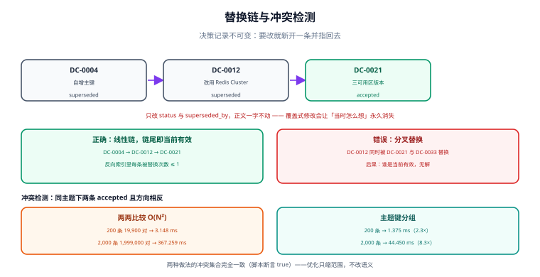

# 决策的修改与推翻

决策库活过一年一定会出现三种病：**过期的、互相矛盾的、没人认领的**。本页讲怎么让决策可被替换（而不是被覆盖）、怎么盘点决策债、以及冲突检测的两种做法与它们的代价。

::: tip 一句话理解
决策记录**不可变**。要改，就新写一条并指向被替换的那条——**覆盖式修改会让「当时为什么这么定」永久消失**。
:::



## 一、决策过期的三种形态

| 形态 | 判定 | 例子 | 处置 |
| --- | --- | --- | --- |
| **时间过期** | `review_due` 已过且未处理 | 2025 年定的缓存容量假设 | 复审 → 确认仍有效（改日期）或替换 |
| **条件过期** | 记录里写的触发条件已发生 | 「若月成本超 2k 则重开」，实际已 2.4k | 立即重开 |
| **前提过期** | 判据的取值变了 | 「团队里没人会 Go」→ 现在招了 3 个 Go 工程师 | 重开，重算判据 |

**三种形态里最危险的是「前提过期」**，因为它没有任何外部信号：记录本身完好、日期没过、触发条件没写。它只能靠**定期重读判据**发现，而重读的前提是判据被**独立成段**（见[记录结构](../RecordStructure/index.md)）——判据埋在背景段里的记录，永远不会被发现前提变了。

## 二、重开的三个条件

不是有人不高兴就能重开。重开必须有明确入口，否则团队不敢执行任何决策。

| 条件 | 谁可以触发 | 需要提供什么 | 结果 |
| --- | --- | --- | --- |
| **C1 前提变化** | 任何人 | 变化的证据（数据、公告、人员清单） | 重开评审 |
| **C2 触发条件命中** | 任何人（含自动巡检） | 命中的是哪一条 | 重开评审，无需再论证「该不该重开」 |
| **C3 复审日到期** | 台账巡检自动 | 到期清单 | 复审（可只确认，不必重开） |

::: danger 「我觉得不对」不是重开条件
允许凭感觉重开，会造成两个后果：① 已生效的决策无法稳定执行（写代码的人不知道明天会不会变）；② 真正需要重开的决策被淹没在噪音里。所以「感觉不对」必须先转成 C1/C2/C3 之一——通常转法是「把感觉写成一条可观测的触发条件」，如果写不出来，说明它还不足以重开。
:::

## 三、supersede 链：不可变记录怎么被替换

```markdown
---
id: DC-0021
title: 会话缓存改用 Redis Cluster（第二版：三可用区）
status: accepted
supersedes: [DC-0012]
superseded_by: null
review_due: 2027-10-21
topic: 会话缓存
---
```

被替换的那条**只改三个字段**，正文一字不动：

```markdown
---
id: DC-0012
status: superseded          # 由 accepted 改为 superseded
superseded_by: DC-0021      # 必填，否则链条断裂
---
```

| 规则 | 理由 |
| --- | --- |
| 只改状态与指向，不改正文 | 正文是历史证据；改了就无法回答「当时怎么想的」 |
| `superseded_by` 必填 | 缺了它读者不知道该看哪条 |
| 链可以很长，但**不允许分叉** | 一条决策只能被一条替换（多分支替换会让「当前有效」无解） |
| 新决策必须链回旧决策 | 单向链会让人找不到来路 |

```text
正确：DC-0004 → DC-0012 → DC-0021（线性，当前有效 = 链尾）
错误：DC-0012 被 DC-0021 与 DC-0033 同时替换（分叉，谁是当前有效？）
```

::: warning 分叉替换在什么时候是合理的
只有一种情况：**主题键被拆开了**。原本「会话缓存」一条决策，后来拆成「会话缓存（Web）」与「会话缓存（移动端）」。此时应新建两个主题键，各写一条新决策，并在旧记录里把 `superseded_by` 写成一个列表，同时在正文加一行说明「本条被拆分为两个主题」。这属于**例外**，要在记录里显式声明，不能默认允许。
:::

## 四、决策债与僵尸决策

「决策债」指**该做而没做、或该改而没改**的决策，它会以两种方式计息：

| 债务类型 | 形态 | 利息 |
| --- | --- | --- |
| **未决债** | 长期停在 `proposed` 的决策 | 下游空转；每次评审都要重新讲背景 |
| **过期债** | 复审日已过但未处理 | 依据失效的决策仍在被引用 |
| **冲突债** | 同一主题有两条 `accepted` 且方向相反 | 执行层各按各的理解做，出现两套实现 |

本机用 200 条造数记录跑了一次体检（Python 3.13.12 标准库，固定种子 `20261021`）：

| 指标 | 实测 | 说明 |
| --- | --- | --- |
| `accepted` 条数 | 150 | 其余为 `superseded` 25 / `proposed` 25 |
| **僵尸决策率**（复审日已过） | **19.3%** | 29 条仍在生效、但依据的假设已过期 |
| **缺判据率** | **40.0%** | 60 条无法被反驳，也无法判断「前提是否变了」 |
| **缺未采纳意见率** | **25.3%** | 38 条看不出当时有没有人反对 |

三项一起读：**缺判据 → 无法发现前提过期 → 僵尸决策累积**。它们不是三个独立问题，是同一条链上的三段。

## 五、冲突检测：两两比较 vs 主题键分组

冲突的定义要说死，否则检测没有意义。本页采用：**同一主题键下，存在两条 `accepted` 且结论方向相反**（例如一条「用 Redis Cluster」，一条「不用集群，用哨兵」）。

两种实现：

| 做法 | 复杂度 | 做法 | 200 条实测 | 2,000 条实测 |
| --- | --- | --- | --- | --- |
| 两两比较 | O(N²) | 19,900 对 / 1,999,000 对 | **3.148 ms** | **367.259 ms** |
| 主题键分组 | O(N + k²) | 8 组内比较 | **1.375 ms** | **44.450 ms** |
| 加速比 | — | — | **2.3×** | **8.3×** |

两种做法的**冲突集合完全一致**（脚本里用 `sorted(o2) == sorted(grp)` 断言，输出 `true`）——这说明优化没有改变语义，只是把比较范围从「所有对」缩到「同组对」。

**读法**：200 条时两者都是毫秒级，感受不到差别；2,000 条时差 8.3 倍。真正的分水岭不是耗时，而是**分组的副作用**——分组天然要求「主题键规范化」（去掉空格、统一大小写、统一全半角），而这一步会顺手把「同一件事被写成三个不同主题」的隐患暴露出来。

```python
import re

def norm(topic: str) -> str:
    # 去空格、去顿号与括号、统一小写：让「会话 缓存」「会话缓存（v2）」落到同一个键
    return re.sub(r"[\s·、（）()]", "", topic).lower()
```

::: danger 别用「标题相似度」做冲突分组
看起来更聪明，实际不可解释：两组标题相似度 0.82，为什么算冲突而不是两个不同的事？一旦判定不可解释，团队就不会信任这个检查，最后它会被关掉。**能用精确键的地方不要用相似度**，相似度只用于「提示可能重复」这类非门禁场景。
:::

## 六、本页判据

本页判据族 `DCX-A` ~ `DCX-H`，共 8 条。

| 编号 | 判据 | 判定方式 | 不满足时改哪里 |
| --- | --- | --- | --- |
| `DCX-A` | 记录不可变：被替换的正文一字未改 | 与上一版 diff 只动三个字段 | 回滚正文改动，新开一条 |
| `DCX-B` | `superseded` 必有 `superseded_by` 且目标存在 | 链尾检查 | 补指向 |
| `DCX-C` | 链条线性，无分叉 | 反向索引统计每条被替换次数 ≤ 1 | 合并分支或声明拆分例外 |
| `DCX-D` | 每条 `accepted` 有 `review_due` 且未过期，或已处理 | 日期比对 | 复审或替换 |
| `DCX-E` | 同一 `topic` 下 `accepted` 唯一 | 分组统计 | 处理冲突（替换或改写） |
| `DCX-F` | `topic` 键已规范化（无空格/全半角混用） | `norm()` 前后比较 | 统一键名 |
| `DCX-G` | 触发条件（C2）可被自动巡检读出 | 记录里有「重开条件」段且含阈值 | 补阈值 |
| `DCX-H` | 决策债三项（未决/过期/冲突）有清单与负责人 | 台账报表 | 建月度盘点 |

## 七、验证：三条可以直接跑的盘点命令

```shell
# ① 过期未处理（僵尸决策）
grep -l 'status: accepted' adr/*.md | xargs grep -L 'review_due' 2>/dev/null

# ② 断裂的替换链（superseded 但没有指向）
grep -l 'status: superseded' adr/*.md | xargs grep -l 'superseded_by: null'

# ③ 同一主题下出现多条 accepted（冲突候选）
grep -h '^topic:' adr/*.md | sort | uniq -d
```

三条命令的**预期输出都是空**。第三条有输出时不要直接删记录，而是逐条看：是「真的冲突」（不同方向）还是「同一方向的两次确认」（那就把后一条改成 `deprecated` 或合并）。

::: tip 月度盘点的最小动作
每月花 20 分钟跑上面三条命令，把命中项写进当月台账（谁负责、什么时候处理）。这一动作的成本极低，但它把「决策债」从一种感觉变成了一个数字——而只有变成数字的债才会被还。
:::

## 八、与相邻专题的分工

| 你的问题 | 去哪 |
| --- | --- |
| 记录该长什么样（七段结构、状态词表） | [记录结构](../RecordStructure/index.md) |
| 反对意见如何成为重开的合法入口 | [反对意见](../Dissent/index.md) |
| 定下来的变更怎么安全上线（灰度、回滚、冻结期） | [变更管理与发布工程](../../Ops/ChangeManagement/index.md) |
| 架构文档里的 ADR 目录怎么维护 | [项目交付 · 架构设计](../../Others/ProjectDelivery/Architecture/index.md) |

## 参考资料

- [Documenting Architecture Decisions（Michael Nygard, 2011）](https://cognitect.com/blog/2011/11/15/documenting-architecture-decisions)（`superseded` 状态的原始定义）
- [adr-tools：ADR 的命令行工具（含 supersede 的实现）](https://github.com/npryce/adr-tools)
- [Architecture Decision Records 官网](https://adr.github.io/)
