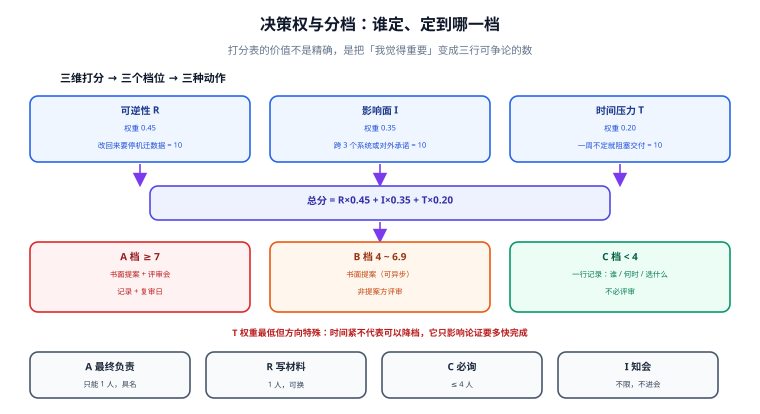

# 决策权与分级

同样的议题，由谁定、按哪一档走，决定了它要花一小时还是一周。本页把「决策权」从「谁官大谁说了算」改成两个可写进表格的东西：**决策权归属**与**决策档位**。

::: tip 一句话理解
决策权的本质不是权力，而是**责任落点**——出问题那天，谁有义务解释、谁有权力叫停、谁必须被告知。
:::



## 一、三种决策权，不要混用

| 决策权 | 拥有者 | 管的范围 | 越位的典型后果 |
| --- | --- | --- | --- |
| **领域权** | 领域负责人（如「订单域」） | 本域内的模型、状态机、对外语义 | 平台组替业务定了「订单能否部分退款」，业务不认 |
| **平台权** | 平台/基础设施组 | 所有域共用的底座（网关、消息、存储、CI） | 各业务自行绕过平台直连数据库，底座失去可观测性 |
| **资产权** | 系统所有者（Owner） | 一个服务的生与死、SLA 承诺 | 没人认领的服务无人敢下线，长期挂着 |

一条决策**必须且只能有一个主责决策权**。可以有多方参与，但「谁签字」只能有一个名字——否则出事时会出现「我们以为是他们定的」。

::: danger 三种常见越位
1. **平台组替业务定业务语义**：平台提供「幂等键」能力，但「哪些操作需要幂等」是业务决策。
2. **业务组替平台定底座**：某个业务为了赶进度自建了一套消息队列，「先用着，以后再收」——通常不会有「以后」。
3. **资产权空置**：服务上线时没写 Owner，两年后要下线，找不到能拍板的人，只能继续付账单。
:::

## 二、分级：三个维度打分，不靠感觉

给每个决策打三个 0~10 分，加权后落到三个档位。评分表本身不重要，**重要的是它把「我觉得这个很重要」变成了三行可以争论的数**。

| 维度 | 打分依据 | 权重 |
| --- | --- | --- |
| **可逆性 R** | 10 = 改回来要停机迁数据；1 = 改回来是几次提交 | 0.45 |
| **影响面 I** | 10 = 跨 3 个以上系统或对外承诺；1 = 单服务内部 | 0.35 |
| **时间压力 T** | 10 = 一周内不定就阻塞交付；1 = 没有任何 deadline | 0.20 |

分档：

| 总分 | 档位 | 需要的动作 |
| --- | --- | --- |
| ≥ 7 | **A 档（承诺型）** | 书面提案 + 评审会 + 记录 + 复审日；缺一不可 |
| 4 ~ 6.9 | **B 档（结构型）** | 书面提案（可异步）+ 至少一位非提案方评审 + 记录 |
| < 4 | **C 档（实现型）** | 记录一行即可（谁、什么时候、选了什么）；不必评审 |

注意 **T 的权重最低但方向特殊**：时间压力大不代表可以降档，它只影响「论证要多快完成」。把 T 打高分然后降档，是最常见的自欺——「来不及论证」恰恰是错误成本最高的时候。

算例（可用纸笔复算）：

```text
场景一：会话缓存换 Redis Cluster
  R = 7（切换要改客户端与运维流程，但数据可重建）
  I = 6（影响全部登录链路，不对外承诺）
  T = 3（下个季度前完成即可）
  总分 = 7×0.45 + 6×0.35 + 3×0.20 = 3.15 + 2.10 + 0.60 = 5.85 → B 档

场景二：对外接口 amount 单位由元改分
  R = 10（已发布契约，改回来要两个版本共存）
  I = 9（所有对接方 + 财务报表）
  T = 8（合作方催）
  总分 = 4.50 + 3.15 + 1.60 = 9.25 → A 档（T 高不降档）
```

## 三、RACI 的四个角色，以及它最常被误用的地方

| 角色 | 含义 | 在一个决策里只能有 | 常见错误 |
| --- | --- | --- | --- |
| **A（Accountable）** | 最终负责、签字 | **1 人** | 写成「架构组」，等于没人负责 |
| **R（Responsible）** | 写材料、推动落地 | 1 人（可换） | 与 A 合并后，材料质量无人挑战 |
| **C（Consulted）** | 会前必须征求意见 | 2~4 人 | 拉 20 人的群当 C，等于没有 C |
| **I（Informed）** | 事后被告知 | 不限 | 把 I 拉进评审会，会变成旁观者投票 |

**最常被误用的一条**：把「所有相关方」都设成 C。C 的意义是「**不征求他的意见就不能定**」，人一多，这条约束就自动失效——因为不可能真的等 20 个人。

::: tip 一个可执行的收敛办法
C 的人数上限设成 4。第 5 个相关方一律降为 I，并在记录里写清「未列入 C 的原因」（通常是「他的关注点已在第 2 条判据里被覆盖」）。这条写法比「大家都没意见」诚实得多。
:::

## 四、决策权必须出现在三个位置

只写在文档里不够，它要出现在**别人会看到的地方**：

1. **决策记录里**：`决策权：平台组`，且附签字人姓名与日期。
2. **代码仓库里**：`CODEOWNERS` 或架构决策目录的 `MAINTAINERS`，让「谁能改这条记录」有机械答案。
3. **运行时的服务目录里**：服务的 Owner 字段，用于下线、告警、容量申请时的默认责任人。

```text
# CODEOWNERS 片段：决策目录由架构组把关，业务目录由各域自己把关
/adr/platform/        @org/platform-arch
/adr/domain/order/    @org/order-team
/adr/domain/billing/  @org/billing-team
```

## 五、两个失效模式：越权与空转

| 失效模式 | 症状 | 根因 | 处置 |
| --- | --- | --- | --- |
| **越权** | 决策已执行，另一组声称「没经过我们」 | 决策权表缺项，或表里写的是团队而不是人 | 补表；已发生的按「追认 + 记录」处理，不要假装没发生 |
| **空转** | 议题在三个组之间转了两周没人接 | A 为空，或 A 是「架构组」这种集合名词 | 指定唯一 A，并把「不定就阻塞谁」写进提案 |

**空转的成本比越权高**，因为它不产生任何可讨论的产物。识别空转的信号很干净：**同一议题在两次会议之间没有新增任何材料**。

## 六、本页判据

本页判据族 `DCR-A` ~ `DCR-H`，共 8 条。

| 编号 | 判据 | 判定方式 | 不满足时改哪里 |
| --- | --- | --- | --- |
| `DCR-A` | 每条决策有且只有一个 A（具名） | 记录里的「决策权」字段是人名或具名角色 | 把集合名词改成具体人 |
| `DCR-B` | 决策类型（承诺/结构/实现）与档位（A/B/C）一致 | 按三维打分复算 | 改档位或改类型 |
| `DCR-C` | A 档决策有评审会记录，B 档有非提案方评审意见 | 记录里有对应段落 | 补评审，或降档并写明理由 |
| `DCR-D` | C 档决策有一行记录（谁 / 何时 / 选了什么） | 台账有 `decided_by` `decided_at` | 补一行，成本 30 秒 |
| `DCR-E` | C 名单 ≤ 4 人，且每人对应一条判据 | 记录里的 C 列表 | 超出部分降为 I 并写原因 |
| `DCR-F` | 决策权归属与 CODEOWNERS 一致 | 两处比对 | 改其中一处，别只改文档 |
| `DCR-G` | 服务类决策有 Owner 字段且非空 | 服务目录字段 | 补 Owner，作为下线前置条件 |
| `DCR-H` | 议题在两次会议之间必须有材料增量 | 比对材料版本号或 diff | 无增量则合并会议或结案 |

## 七、自查：一张 20 行的决策权矩阵

把团队的决策类型列成行，把「谁定」列成列，空格就是风险。

```text
| 决策类型                 | 主责(A)      | 必询(C)            | 档位 |
|--------------------------|--------------|--------------------|------|
| 对外接口语义/版本        | 领域负责人   | 平台组、对接方代表 | A    |
| 数据保留与删除口径       | 数据负责人   | 法务、运维         | A    |
| 多租户隔离方式           | 架构组具名人 | 业务负责人、DBA    | A    |
| 主键与 ID 生成策略       | 领域负责人   | DBA                | B    |
| 缓存/队列中间件选型      | 平台组       | 相关业务负责人     | B    |
| 目录结构与代码风格       | 各域自定     | —                  | C    |
| 日志库与埋点 SDK         | 平台组       | 可观测性负责人     | C    |
```

**验证方式**：把它贴到团队文档里，让每个人只回答一个问题——「表格里有没有一格，你觉得应该由你定但现在写的是别人？」。有争的位置就是决策权表最该修的位置。

```shell
# 机械核对：每条 A 档决策都应有评审记录与复审日（无输出即通过）
for f in adr/*.md; do
  grep -q '档位：A' "$f" || continue
  grep -q '## 评审记录' "$f" && grep -q '复审日' "$f" || echo "MISSING: $f"
done
```

## 八、与相邻专题的分工

| 你的问题 | 去哪 |
| --- | --- |
| 可逆 / 不可逆怎么分、ADR 四段式怎么写 | [项目交付 · 架构设计](../../Others/ProjectDelivery/Architecture/index.md) |
| 变更上线前的审批与留痕（不是决策本身） | [变更管理与发布工程](../../Ops/ChangeManagement/index.md) |
| 决策记录写完之后的评审会怎么开 | [评审会](../ReviewMeeting/index.md) |

## 参考资料

- [Architecture Decision Records 官网](https://adr.github.io/)
- [RFC 2026：The Internet Standards Process](https://www.rfc-editor.org/rfc/rfc2026)（「谁有权定标准」的原始范式）
- [项目交付 · 架构设计](../../Others/ProjectDelivery/Architecture/index.md)
