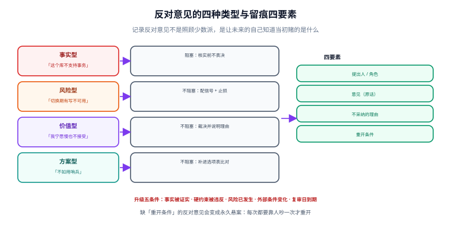

# 反对意见

反对意见是决策记录里最容易被删掉的一段，也是最值钱的一段。本页讲：反对意见有哪几类、为什么必须留痕、留痕要写成什么形状、什么情况下必须回炉重开。

::: tip 一句话理解
记录反对意见不是为了照顾少数派，而是为了让**未来的自己知道当初赌的是什么**。
:::



## 一、反对意见的四种类型

不同类型的反对意见，处置方式完全不同。把它们混成一句「有人有不同看法」，等于什么都没记。

| 类型 | 形态 | 是否阻塞决议 | 处置 |
| --- | --- | --- | --- |
| **事实型** | 「这个库不支持事务」 | **阻塞**（核实前不表决） | 当场或 24h 内查证；事实错了要改方案 |
| **风险型** | 「切换期间会有写不可用窗口」 | 不阻塞，但必须配止损 | 写进风险表：信号 + 止损动作 |
| **价值型** | 「我宁愿慢一点，也不接受多一套集群」 | 不阻塞（这是取舍，不是对错） | 记录在案 + 由决策人裁决并说明理由 |
| **方案型** | 「不如用哨兵，简单一半」 | 不阻塞，但必须给淘汰理由 | 作为新选项补进选项表，按判据比对 |

::: danger 把价值型当事实型争，是最常见的会议僵局
「多一套集群运维太复杂」——这是价值判断（复杂度值不值得换一致性），但双方会各自找事实来支撑，于是争论变成「复杂度到底有多高」的拉锯，永远没有结论。**主持人的工作是在这里喊停**：把这句话归到价值型，交给决策人裁决，并写进记录。
:::

## 二、为什么必须留痕（不是礼貌问题）

| 不留痕的后果 | 具体表现 |
| --- | --- |
| **决策无法被正确推翻** | 一年后有人提出同样的担忧，没人能说「这条当时评估过，理由是 X」——于是重新吵一遍 |
| **错误归因** | 出问题时追责到「执行不到位」，而真正的原因是当时就有人指出方案缺陷、被忽略了 |
| **组织记忆丢失** | 新人只能看到结论，看不到当时的权衡，误以为「前人没想过」 |

::: warning 一段被删掉的反对意见，会在半年后变成一句无法反驳的话
「我早就说过这个方案有问题」——这句话之所以无法反驳，是因为记录里没有它，也没有当时的理由。**记录反对意见，本质上是在保护做决策的人**，不是保护反对者。
:::

## 三、未采纳意见的写法：四个要素

```text
- 提出人 / 角色：运维组（李四）
- 意见：（一句话，用提出人自己的表述，不要改写成你方便反驳的样子）
- 不采纳的理由：（对应到判据或硬约束，不要用「综合考虑」）
- 升级/重开条件：（可观测的事件或阈值）
```

一个合格的例子：

```markdown
## 代价与未采纳意见

未采纳：运维组（李四）建议改用「主从 + 哨兵」，理由是运维复杂度低一半。

不采纳的理由：哨兵在主从切换期间存在写不可用窗口（实测 3~8 秒），违反硬约束 C2
「单节点故障不影响登录」。C2 在会前确定，未在本次会议中被修改。

重开条件：若 3 个月内故障切换失败 ≥ 2 次，或业务侧接受「切换期间登录短暂失败」，
则重开本决策，本轮评估材料保留在 DC-0012 附录。
```

四个要素缺一不可：

| 缺失 | 后果 |
| --- | --- |
| 缺提出人 | 无法追溯，也无法在重开时找人补充背景 |
| 缺原始表述 | 理由被改写成方便反驳的样子（「有人认为运维复杂」） |
| 缺不采纳理由 | 看起来像「没理由地否掉了」，下次还会被提 |
| 缺重开条件 | 反对意见变成永久悬案，每次都要靠人吵一次才重开 |

## 四、什么情况下必须回炉（升级触发条件）

不是所有反对意见都要升级。下面五条是**必须回到决策流程**的硬条件：

| 触发条件 | 为什么必须回炉 | 谁可以触发 |
| --- | --- | --- |
| **事实型反对被证实** | 前提错了，结论自然失效 | 任何人（附证据） |
| **硬约束被违反** | 硬约束是门，不是权重 | 任何人 |
| **反对者指出的风险已发生** | 说明风险评估失效 | 值班/运维，自动触发 |
| **外部条件变化**（合规、供应商、价格） | 判据的取值变了 | 决策权持有者 |
| **复审日到期** | 时间本身就是触发条件 | 台账巡检 |

::: tip 把这五条写进记录，重开就不再是「谁嗓门大谁赢」
重开一个已经生效的决策，代价很高（要重新协调、可能已经写了很多代码）。所以**必须有机械的触发条件**，否则要么永远不重开（错的决定一直执行），要么一有异议就重开（决策不稳定，团队不敢执行）。
:::

## 五、少数派的三种保护机制

| 机制 | 做法 | 成本 |
| --- | --- | --- |
| **记录留痕** | 未采纳意见进正文（本页第三节） | 10 分钟 |
| **灰度验证** | 把反对者担心的场景做成灰度/演练的一部分，用数据决定谁对 | 1~3 天 |
| **冷静期** | A 档决策在通过后保留 48 小时「异议窗口」，期间可补充证据要求复议 | 48 小时 |

第三条最不常见，但对**不可逆决策**（对外契约、数据删除口径）非常值得：48 小时的成本远低于一次错误承诺的履约成本。

## 六、本页判据

本页判据族 `DCN-A` ~ `DCN-H`，共 8 条。

| 编号 | 判据 | 判定方式 | 不满足时改哪里 |
| --- | --- | --- | --- |
| `DCN-A` | 每条未采纳意见标注了类型（事实/风险/价值/方案） | 逐条读 | 补类型；补不出说明没理解反对点 |
| `DCN-B` | 未采纳意见含四个要素（人 / 原话 / 理由 / 重开条件） | 四要素检查 | 补缺项 |
| `DCN-C` | 事实型反对在表决前已核实，且核实结果写进记录 | 记录里有结论 | 补核实结论 |
| `DCN-D` | 价值型反对由决策人裁决，并写明「已阅」 | 有裁决语句 | 补 |
| `DCN-E` | 记录里不出现「综合考虑」「多方权衡后」这类无指向理由 | 关键词扫描 | 换成具体判据编号 |
| `DCN-F` | 风险型反对已进入风险表（信号 + 止损） | 风险表存在 | 补一行 |
| `DCN-G` | 五条升级触发条件在记录中可查 | 有「重开条件」段 | 补 |
| `DCN-H` | A 档决策有 48 小时异议窗口或明确豁免理由 | 时间戳 | 补窗口或写豁免理由 |

## 七、反模式清单

| 反模式 | 为什么坏 | 正确做法 |
| --- | --- | --- |
| 「大家都没意见吧？」然后散会 | 沉默被当同意 | 逐个点名，回一个词 |
| 把反对意见合并成「部分同学有顾虑」 | 无法追溯、无法裁决 | 逐条列，带人名 |
| 用「先按这个做，不行再改」回应 | 把不可逆决策当可逆 | 若真可逆，写清回退方案与成本 |
| 反对者被要求「拿出更好的方案」才允许反对 | 提高了反对门槛，多数人就此闭嘴 | 反对只需指出问题，方案由提案人负责 |
| 会后再补反对意见进纪要 | 时序倒置，无法判断是否被讨论过 | 会上登记，会后只做文字整理 |

::: danger 第五条是「看起来没问题」的那一条
会后整理纪要时把某人私下说的话补进去，记录看起来更完整了——但**它没有经过会议讨论**，把它写进「会议记录」等于伪造时序。正确做法是写进「会后补充意见」并标注来源与时间。
:::

## 八、验证：反对意见的完整率可以算

```python
import os, re
need = ("提出人", "意见", "不采纳", "重开")
bad = []
for fn in sorted(os.listdir("adr")):
    if not fn.endswith(".md"):
        continue
    t = open(os.path.join("adr", fn), encoding="utf-8").read()
    if "## 代价与未采纳意见" not in t:
        bad.append((fn, "缺段"))
        continue
    seg = t.split("## 代价与未采纳意见")[1].split("## 复审")[0]
    miss = [k for k in need if k not in seg]
    if "未采纳" in seg and miss:
        bad.append((fn, ",".join(miss)))
for fn, why in bad:
    print(f"{fn}: {why}")
print(f"共 {len(bad)} 篇待补")
```

预期 `共 0 篇待补`。注意脚本**只查要素存在，不查理由是否成立**——理由对不对是人的判断，机器只能保证「这一段没被跳过」。

## 九、与相邻专题的分工

| 你的问题 | 去哪 |
| --- | --- |
| 会上怎么安排发言顺序、怎么定时间盒 | [评审会](../ReviewMeeting/index.md) |
| 未采纳意见之后，决策怎么被正式替换 | [决策的修改与推翻](../DecisionChange/index.md) |
| 变更事故之后的复盘与责任界定 | [事故响应与演练](../../Ops/IncidentResponse/index.md) |

## 参考资料

- [RFC 2026：The Internet Standards Process](https://www.rfc-editor.org/rfc/rfc2026)（异议与复议流程）
- [Documenting Architecture Decisions（Michael Nygard, 2011）](https://cognitect.com/blog/2011/11/15/documenting-architecture-decisions)
- [Architecture Decision Records 官网](https://adr.github.io/)
