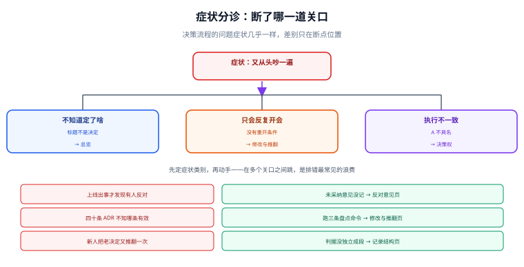

# 常见问题与排错

本页按**症状**组织，不按概念组织——遇到问题时人是先看到现象的。每条给出「先查什么」与「改哪里」，最后一节是十二问与术语表。

::: tip 一句话理解
决策流程出的问题，症状几乎都长一个样：**会开了、结论有了、三个月后又从头吵一遍**。差别只在断在哪一道关口。
:::



## 一、按症状分诊

| 症状 | 最可能断在哪 | 先查什么 | 去哪一节 |
| --- | --- | --- | --- |
| 会开完了不知道定了啥 | 提得出 | 议题是不是一个「决定」 | [总览](../Overview/index.md) |
| 每次都从背景讲起 | 说得清 | 记录里有没有「背景与约束」段 | [记录结构](../RecordStructure/index.md) |
| 争了两小时发现只有一个方案 | 说得清 | 选项表是否真的互不相同 | [选项与判据](../OptionsAndCriteria/index.md) |
| 结论定了但没人执行 | 决策权 | A 是不是一个具名的人 | [决策权与分级](../DecisionRights/index.md) |
| 同一件事开了三次会 | 改得动 | 有没有写重开条件 | [决策的修改与推翻](../DecisionChange/index.md) |
| 上线出事才发现有人反对过 | 驳得倒 | 未采纳意见有没有记录 | [反对意见](../Dissent/index.md) |
| 库里 40 条 ADR，不知道哪条有效 | 改得动 | 替换链是否断裂 / 有无冲突 | [决策的修改与推翻](../DecisionChange/index.md) |
| 新人把半年前的决定又推翻一次 | 说得清 | 判据是不是独立成段 | [记录结构](../RecordStructure/index.md) |
| 评审会开成「提案人念、领导点头」 | 驳得倒 | 决策人是否先发言了 | [评审会](../ReviewMeeting/index.md) |
| 材料每次都退回重写 | 说得清 | 有没有「需要拍板的问题」清单 | [评审会](../ReviewMeeting/index.md) |
| 决策记录只有结论没有选项 | 说得清 | 选项表是否真的存在 | [选项与判据](../OptionsAndCriteria/index.md) |

## 二、十二问

### Q1：小团队（5 人以下）也需要这套吗？

只需要三件：**一行记录**（谁、何时、选了什么）、**一个复审日**、**一句重开条件**。其余全部可以省。5 人团队的沟通成本低于文档成本，但「三个月后忘了为什么」这件事与团队大小无关。

### Q2：写 ADR 太慢，能不能只在关键决策上写？

可以，而且应该。判据是[总览](../Overview/index.md)里的三维打分：**≥ 4 分才写**，< 4 分一行记录即可。真正的问题是很多团队反过来——什么都在群里讨论，什么都不留痕。

### Q3：决策记录应该放在代码仓库还是知识库？

放**与被影响代码最近的仓库**。理由：改这块代码的人最可能遇到它，而跨系统检索的成本高得多。跨多个仓库的决策（如技术栈）放架构仓库，并在各仓库放一个指针。

### Q4：谁来维护决策库？没人愿意写。

把「写记录」挂在**已经必须发生的动作**上：提交评审材料时顺手落一条、上线检查单里加一项「决策编号」。单独设一个「文档负责人」通常会在两个月内失效，因为它不在任何人的关键路径上。

### Q5：评审会一定要开吗？

不一定。判断顺序：**无分歧 → 异步告知**；**分歧是事实 → 调研任务**；**分歧是价值取舍 → 开会**。把事实分歧带进决策会，是超时的第一原因。

### Q6：决策人不懂技术细节，怎么拍板？

他不需要懂细节，需要的是**判据**。评审人的职责是把「这个方案好不好」翻译成「在 C1/C2/C3 上分别是什么结果」。如果翻译不出来，说明材料不合格，而不是决策人不合格。

### Q7：所有人都同意，还需要记录吗？

要，而且更该记。**全票通过往往意味着没人认真看**。此时记录的价值不在「留反对意见」，而在「留下判据」——半年后条件变了，唯一能判断「要不要改」的就是当时那几条判据。

### Q8：决策写错了，改记录不行吗？

不行。覆盖式修改会让「当时为什么这么定」永久消失，而这恰恰是后人最需要的信息。正确做法：新写一条 + `supersedes` 指回，旧记录只改 `status` 与 `superseded_by` 两个字段。

### Q9：加权评分到底能不能用？

能用，但有三个前提：**硬约束先筛**、**前两名差值 ≥ 2%**、**判据会前定**。三条缺一条，评分表就从「辅助判断」变成「给已有结论配理由」。实测：完全并列时，±10% 的权重抖动会让第一名翻盘 **50.19%**（详见[选项与判据](../OptionsAndCriteria/index.md)）。

### Q10：评审通过后多久可以动手？

看档位。C 档当场就可以；B 档在材料定稿后；**A 档建议留 48 小时异议窗口**（不可逆决策），期间任何人可凭新证据要求复议。48 小时的成本远低于一次错误承诺的履约成本。

### Q11：怎么证明这套流程有效？

只用四个可算的数：**僵尸决策率**（复审日过期占比）、**缺判据率**、**缺未采纳意见率**、**决策重开率**。前三个降、第四个保持在一个非零的低位（完全不重开说明没人敢提异议）。造数实测的三个基线是 19.3% / 40.0% / 25.3%（详见[决策的修改与推翻](../DecisionChange/index.md)）。

### Q12：已有几十条历史决策，怎么补？

不要补正文。只做三件事：**补 `topic` 与 `status`**（让检索成立）、**补 `review_due`**（让过期可见）、**把互相矛盾的标出来**（`grep '^topic:' | uniq -d`）。正文补写几乎一定会写成「事后合理化」，反而污染记录。

## 三、十条纪律

1. **标题必须是决定，不是话题**——「缓存选型」不合格，「改用 Redis Cluster」合格。
2. **判据会前定，会后只许加不许删**。
3. **硬约束是门，不是权重**——不合规的方案不进加权。
4. **决策人最后发言**。
5. **沉默不是同意**——异步评审要逐个回词。
6. **未采纳意见必须有四个要素**：人、原话、理由、重开条件。
7. **决策记录不可变**——改就新开一条并指向旧的。
8. **被替换的决策只能有一条后继**（分叉要显式声明为例外）。
9. **每条 `accepted` 都要有复审日**。
10. **「最佳实践 / 综合评估 / 风险可控」这三个词出现即返工**。

## 四、术语表

| 术语 | 含义 | 容易混淆的点 |
| --- | --- | --- |
| **ADR** | Architecture Decision Record，架构决策记录 | 它是**档案格式**，不是流程；本专题补充的是流程 |
| **A / R / C / I** | RACI 的四个角色（负责 / 执行 / 咨询 / 知会） | A 只能有一个人；写成团队等于没有 |
| **supersede** | 用新决策替换旧决策 | 不是「修改」，旧记录正文不能动 |
| **决策债** | 该做未做、该改未改的决策 | 与「技术债」不同：决策债的利息是重复讨论 |
| **单向门 / 双向门** | 不可逆 / 可逆决策的比喻（Vogels） | 单向门要多花时间，双向门要快；不要把双向门当单向门论证 |
| **硬约束（门）** | 不满足即淘汰的判据 | 与「加权项」在版式上必须分开 |
| **异议窗口** | 决议后保留的复议期 | 只对不可逆决策必要，不是所有决策都加 |

## 五、本页判据

本页判据族 `DCQ-A` ~ `DCQ-H`，共 8 条。它们是**排错路径本身**的判据——用来判断「你走的这条排错路径对不对」。

| 编号 | 判据 | 判定方式 | 不满足时改哪里 |
| --- | --- | --- | --- |
| `DCQ-A` | 先定症状类别再动手，不在多个关口之间跳 | 排错记录首行有症状归类 | 回到第一节表格重分类 |
| `DCQ-B` | 每个症状都能映射到唯一关口 | 对照分诊表 | 补表格或补关口定义 |
| `DCQ-C` | 「找不到结论」类问题先查标题是否为决定 | 标题检查 | 改标题 |
| `DCQ-D` | 「反复开会」类问题先查重开条件 | 有无「重开条件」段 | 补条件 |
| `DCQ-E` | 「执行不一致」类问题先查 A 是否具名 | 决策权字段 | 指定具名 A |
| `DCQ-F` | 「不知道哪条有效」类问题先跑三条盘点命令 | 命令输出为空 | 修链或标冲突 |
| `DCQ-G` | 十二问中每条答案都能指到一个页面 | 链接存在性 | 补链接 |
| `DCQ-H` | 术语表覆盖正文出现的所有专有词 | 抽样比对 | 补术语 |

## 六、排错示例：一次真实的「第三次重开」

```text
现象：会话缓存这件事，半年内开了三次会，每次结论都是「再研究研究」。
排查：
  ① 症状归类 → 「反复开会」→ 先查重开条件      → 记录里没有任何重开条件
  ② 查决策权   → A 写的是「架构组」            → 没有具名责任人
  ③ 查判据     → 判据段不存在                  → 无法判断前提是否变化
  ④ 查选项     → 只有「自研」与「采买」两个    → 「不做」被当成默认，未评估
修正（按成本从低到高）：
  a. 把 A 改成具名的人（成本 1 分钟）
  b. 补一条重开条件：「工单数 > 20/月则立即重开」（成本 5 分钟）
  c. 补判据三条 + 「不做」选项（成本 30 分钟）
  d. 补复审日（成本 1 分钟）
结果：第四次会在 45 分钟内收敛到结论，且结论带触发条件。
```

这个例子的价值在于：**四个缺陷全部是格式缺陷，没有一个是「大家不够聪明」**。重开三次不是因为问题难，是因为记录的形状不允许它被关闭。

## 七、与相邻专题的分工

| 你的问题 | 去哪 |
| --- | --- |
| 架构文档要产出什么（ADR 四段式、最小文档集合） | [项目交付 · 架构设计](../../Others/ProjectDelivery/Architecture/index.md) |
| 变更上线前的审批、冻结期、灰度与回滚 | [变更管理与发布工程](../../Ops/ChangeManagement/index.md) |
| 决策周期的度量口径 | [研发效能度量](../../Tools/EngineeringMetrics/index.md) |
| 事故之后的责任界定与改进项跟踪 | [事故响应与演练](../../Ops/IncidentResponse/index.md) |

## 参考资料

- [Architecture Decision Records 官网](https://adr.github.io/)
- [Documenting Architecture Decisions（Michael Nygard, 2011）](https://cognitect.com/blog/2011/11/15/documenting-architecture-decisions)
- [RFC 2026：The Internet Standards Process](https://www.rfc-editor.org/rfc/rfc2026)
- [项目交付 · 架构设计](../../Others/ProjectDelivery/Architecture/index.md)
