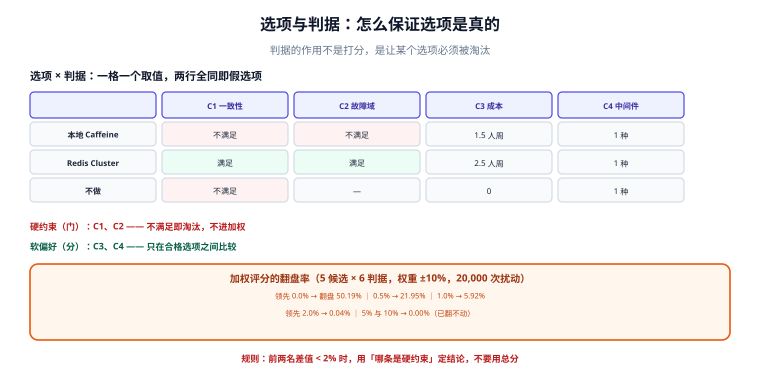
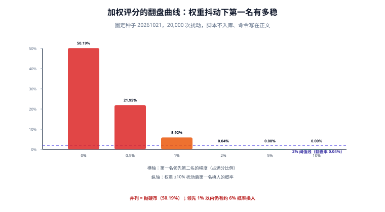

# 选项与判据

一场评审会最贵的浪费不是「吵」，而是**吵在一个只有一条路的提案上**。本页解决两件事：怎么保证选项是真的、怎么保证判据能判死。

::: tip 一句话理解
判据的作用不是「打分」，是**让某个选项必须被淘汰**。如果所有选项都能通过所有判据，那些判据只是装饰。
:::



## 一、假选项的四种形态

| 形态 | 长什么样 | 为什么有害 | 识别方法 |
| --- | --- | --- | --- |
| **稻草人** | 主推 A，陪衬一个明显不可行的 B | 结论事先定了，评审变成背书 | 问「B 有没有支持者？他怎么说」 |
| **假二选一** | 「要么全量迁移，要么维持现状」 | 抹掉了第三条路（渐进、双写、只迁热数据） | 强制写出第三种组合 |
| **隐藏默认** | 不写「不做」，把现状当成零成本基线 | 忽略延迟成本与维护成本 | 强制单列「不做」并写代价 |
| **选项退化为方案** | 「选项 1：用 A 方案的第 3 步」 | 其实是同一方案的两种实施顺序 | 要求选项之间在**判据上取不同值** |

::: danger 判断选项是否真的不同，只有一个办法
把选项按判据逐格填表。如果两行在**每一条判据上取值都相同或等价**，那就不是两个选项，是一个选项的两个名字。下表左边合格，右边不合格：

```text
| 选项        | C1 一致性 | C2 故障域 | C3 成本 |
|-------------|-----------|-----------|---------|
| 本地缓存    | 不满足    | 满足      | 1.5 人周 |
| Redis 集群  | 满足      | 满足      | 2.5 人周 |
| 不做        | 不满足    | —         | 0       |

不合格的样子（两行等价）：
| Redis 集群（3 主 3 从） | 满足 | 满足 | 2.5 人周 |
| Redis 集群（5 主 5 从） | 满足 | 满足 | 4.0 人周 |
```

右表的第二行在第一列与第二列**没有任何区别**，只在成本上更差——它不是选项，是「更贵的同一个选项」。写进评审材料只会浪费十分钟。
:::

## 二、判据要会前定，而且要能判死

判据在会议开始前确定，是**唯一能防止「结论先行」的机制**。会后再补判据，等于给已经选好的答案配理由。

一条合格判据有三要素：

| 要素 | 反例 | 正例 |
| --- | --- | --- |
| **可观测** | 「性能好」 | 「P99 读延迟 ≤ 50 ms（现有量级 40 ms）」 |
| **有阈值** | 「成本可接受」 | 「月成本增量 ≤ 1.5k」 |
| **可判死** | 「社区活跃」 | 「近 12 个月有 ≥ 3 个 minor release 且有 ≥ 2 家公司生产使用」 |

**「可判死」是最容易被忽略的一条**。判据如果对每个选项都成立，它就没有信息量。检验方式：把表填完之后，**每条判据至少要让一个选项不满足**；做不到就删掉这条判据，或者承认它只是个提示。

## 三、加权评分的三个陷阱（含实测）

加权评分（每个判据一个权重，加权求和取最高）是最常见的做法，也是最容易被当成「客观」的做法。它有三个陷阱：

### 陷阱一：权重决定结论，而权重是拍出来的



本机实测（Python 3.13.12 标准库，固定种子 `20261021`，20,000 次扰动）：给 5 个候选、6 条判据打分，然后**把每个权重乘上一个 0.9~1.1 之间的随机数再归一化**（模拟「不同人对权重的合理分歧」），看第一名会不会换人。

| 第一名领先第二名的幅度 | 第一名翻盘的概率 |
| --- | --- |
| 0.0%（完全并列） | **50.19%** |
| 0.5% | **21.95%** |
| 1.0% | **5.92%** |
| 2.0% | **0.04%** |
| 5.0% | **0.00%** |
| 10.0% | **0.00%** |

读法：**并列时，结论完全由权重决定**（50.19% 就是抛硬币）；领先 1% 以内时，还有约 6% 的概率换人；领先 2% 以上，±10% 的权重分歧已经翻不动它。

这条读数给出一个可直接用的规则：**算完加权总分后，先看前两名的差值占满分的比例。低于 2% 时，不要用「总分更高」当结论，而要用「哪条判据是硬约束」来定。**

### 陷阱二：把所有判据都换成同一量纲

「稳定性 8 分、成本 6 分」这种打分，实际是在比较两个不可通约的东西。常见的粗暴处理是「都折算成钱」，但稳定性折算成钱需要一个**故障损失假设**——那个假设往往比分数本身更值得审。

正确做法：**硬约束用布尔值（必须/不必），软偏好才用打分**。

```text
判据分层（推荐）
  硬约束（一票否决）：C1 一致性必须满足、C2 合规必须满足
  软偏好（加权）：   C3 成本、C4 交付期、C5 团队熟悉度
判定顺序：先用硬约束筛掉不合格选项 → 剩下 2 个以上时再算加权分
```

这样做之后，加权分只在「都合格」的选项之间起作用，翻盘风险被限制在一个更小的范围里。

### 陷阱三：判据是事后从结论倒推的

识别方法：看判据的时间戳与提案的版本。如果判据段的「会前确定」日期与结论段同一天，或者判据的措辞**恰好只有选中项满足**（例如「必须支持三主三从」），基本可以判定是倒推的。

::: tip 一个低成本的防伪手段
在提案第一版里就把判据定下来，并在评审会上**只允许新增判据、不允许删除判据**。新增要说明「原判据漏了什么」。这条规则会让倒推变得很麻烦，而正常提案几乎不受影响。
:::

## 四、成本判据怎么量化

「成本」几乎总是被低估得最厉害的一条。一个可用的三段式：

| 段 | 内容 | 常见漏项 |
| --- | --- | --- |
| **建设成本** | 人力（人周）× 单价 + 采购 | 评审、联调、迁移窗口的加班 |
| **运行成本** | 机器 + 存储 + 带宽 + 许可（按月） | 备份、日志留存、跨区流量 |
| **变更成本**（最常漏） | 以后每次改动要额外付的 | 双写期间的额外一致性检查、客户端兼容层、两套文档 |

```text
三年总成本 = 建设 + 运行 × 36 + 变更 × 预计变更次数
```

**「变更成本」是决定选项胜负的那一项**。经验上，一个需要兼容层（adapter / 双写 / 影子表）的方案，每次业务改动的成本会多 20%~40%；一年改 12 次的技术，三年下来这一项就能把便宜的建设成本吃掉。

## 五、可逆性作为一票否决

有些判据不是「打分项」，而是「门」：

| 门类 | 例子 | 处理 |
| --- | --- | --- |
| **合规门** | 数据不能出境 / 不能落第三方 | 不满足直接淘汰，不进加权 |
| **不可逆门** | 一旦上线无法回滚（对外契约、数据删除） | 必须额外给「回滚演练方案」才允许通过 |
| **团队门** | 团队里没人会维护的语言/栈 | 淘汰或附带招聘/培训计划才允许通过 |

**门类判据必须与打分项在版式上分开**（单独一段、单独一张表），否则一定会在讨论中被「综合来看」掉。

## 六、本页判据

本页判据族 `DCC-A` ~ `DCC-H`，共 8 条。

| 编号 | 判据 | 判定方式 | 不满足时改哪里 |
| --- | --- | --- | --- |
| `DCC-A` | 选项 ≥ 2，且两两在至少一条判据上取不同值 | 逐格比对 | 补真实选项或合并重复项 |
| `DCC-B` | 「不做」被单列为选项并写出后果 | 选项列表 | 补第三行 |
| `DCC-C` | 判据有「会前确定」日期且早于结论日 | 两个日期比对 | 重开会前定判据 |
| `DCC-D` | 每条判据至少淘汰一个选项 | 填表后统计 | 删掉无区分力的判据 |
| `DCC-E` | 每条判据有阈值，不是形容词 | 逐条读 | 补数值或改为可观测描述 |
| `DCC-F` | 硬约束（门类）与软偏好（打分）分开呈现 | 版式检查 | 拆成两段两张表 |
| `DCC-G` | 前两名总分差 < 2% 时，结论由硬约束给出而非总分 | 复算差值 | 改用硬约束判定并写明 |
| `DCC-H` | 成本含建设 / 运行 / 变更三段 | 成本段 | 补变更成本 |

## 七、验证：把判据表变成可复算的东西

不用电子表格也能验：把判据与打分写成一个文件，用二十行脚本复算「前两名差值」与「每条判据淘汰了几个选项」。

```python
crit = ["C1 一致性", "C2 故障域", "C3 成本", "C4 运维"]
must = {"C1 一致性": True, "C2 故障域": True}      # 硬约束
opts = {
    "本地缓存":   {"C1 一致性": 0, "C2 故障域": 1, "C3 成本": 5, "C4 运维": 5},
    "Redis 集群": {"C1 一致性": 1, "C2 故障域": 1, "C3 成本": 3, "C4 运维": 3},
    "不做":       {"C1 一致性": 0, "C2 故障域": 0, "C3 成本": 5, "C4 运维": 5},
}
alive = [k for k, v in opts.items() if all(v[c] for c in must)]
print("通过硬约束：", alive)
for c in crit:
    if c in must:
        continue
    killed = [k for k in alive if opts[k][c] <= 1]
    print(f"{c} 淘汰了 {len(killed)} 个选项")
```

预期输出 `通过硬约束： ['Redis 集群']`——当硬约束已经收敛到唯一选项时，**加权分根本不该算**，算出来的小数位只会给结论制造虚假精度。

::: danger 别在硬约束收敛之后再晒总分
「Redis 集群 4.2 分 vs 本地缓存 3.8 分」这种表述，会让读者以为结论是「险胜」。实际上本地缓存根本没通过硬约束。**总分只在有 2 个以上合格选项时才有意义**，这是本页最容易被违反的一条。
:::

## 八、与相邻专题的分工

| 你的问题 | 去哪 |
| --- | --- |
| 判据写完之后，论证怎么写才能被反驳 | [取舍表达](../TradeoffExpression/index.md) |
| 谁来定判据、谁有权改判据 | [决策权与分级](../DecisionRights/index.md) |
| 选项调研本身要跑多少实验、怎么记 | [研发效能度量](../../../Tools/EngineeringMetrics/index.md)（度量口径）与[测试数据与仿真环境](../../../Tools/TestDataSimulation/index.md)（造数） |

## 九、影响面：把「谁会变」算成判据（第 189 天补充）

判据表最容易缺的一列是**影响面**。少了它，两个选项在纸面上成本相当，实际一个改 1 个组件、另一个改 24 个——评审里没人反对，落地时才发现要重跑全量回归。

影响面是可以算出来的，不需要估：

| 改动 | 下游 token | 受影响组件 | 结论（进判据表的那一列） |
| --- | --- | --- | --- |
| 主色 `color-blue-600` | 3 | **1** | 可灰度验证，回滚成本分钟级 |
| 圆角 `radius-6` | 24 | 23 | 整包发版 + 全量基线，回滚成本小时级 |
| 间距 `space-12` | **26** | **24** | 同上，且要提前冻结改动窗口 |

```shell
# 影响面 = 反向索引：token → 引用它的 token → 引用这些 token 的组件
node scripts/impact.mjs --token=space-12
# 期望：space-12 → 26 tokens → 24 components
```

三个把它写进决策记录的纪律：

1. **影响面必须与「可逆性」一起看**：影响 24 个组件的改动，即使技术上可回滚，业务上也常常不可逆（用户已经看到新界面）；
2. **不要用「组件数量」代替影响面**：一个组件可能被 40 个页面用，另一个只在一个弹窗里——影响面要算到**消费侧**，算不到就写明「未量化」；
3. **影响面会被复用**：同一次改动的影响面数据，同时也是发布通道（灰度 / 整包）、回归范围、变更通告范围的输入，所以它应该存成一份可引用的产物，而不是评审 PPT 里的一张图。

这套口径的完整来源（反向索引怎么建、四道闸门、影响面与发版成本的对应关系）见 [设计系统与组件库工程 · 版本、废弃与发布治理](../../../Frontend/DesignSystem/ReleaseGovernance/index.md)。

## 参考资料

- [MADR：Markdown Architectural Decision Records](https://adr.github.io/madr/)（`Decision Drivers` 与 `Considered Options` 两段的来路）
- [Documenting Architecture Decisions（Michael Nygard, 2011）](https://cognitect.com/blog/2011/11/15/documenting-architecture-decisions)
- [RFC 2026：The Internet Standards Process](https://www.rfc-editor.org/rfc/rfc2026)（「技术可行性 vs 工程可行性」分层表决的原始做法）
