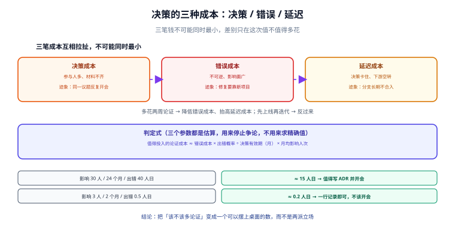

# 技术决策总览

本页给整套方法一个骨架：**先认出手里这件事是哪一类决策，再决定要花多少成本、走哪道关口**。读完应该能回答三个问题——这件事该不该由我定、要写多厚的记录、什么时候可以停下来不写。

::: tip 一句话理解
决策质量不取决于「想到了多少」，而取决于**在写下结论之前，有没有人被迫把选项和代价说清楚**。
:::



## 一、决策不是「选型」

日常说的「选型」只是决策的一种形态。真正需要留痕的技术决定，至少有三类，它们的失效方式完全不同：

| 类型 | 典型形态 | 定了之后改的代价 | 失效时的表现 |
| --- | --- | --- | --- |
| **承诺型** | 对外接口语义、数据保留口径、计费规则、SLA 数字 | 高（改要协调外部） | 上线后被合作方拿着旧文档要求履约 |
| **结构型** | 多租户隔离方式、主键策略、分层与依赖方向 | 中高（改要迁数据或重写一层） | 半年后发现某条约束与业务冲突，改不动 |
| **实现型** | 日志库、构建工具、目录结构、代码风格 | 低（几次提交） | 团队里两种写法并存，靠口头提醒维持 |

**判断口径**：问「如果三个月后要改，需要几个人、几个系统配合」。答案是「我自己改几行」→ 实现型，不要写 ADR；答案是「要停机迁移或要通知外部」→ 承诺型，必须评审。

::: danger 最常见的误判：把实现型当承诺型
「前端组件库选 Element Plus 还是 Ant Design」被写成三页文档、开了两次会——这属于实现型决策，真正的成本不在选错，而在**为了选它花掉的会议时间**。反过来，把承诺型当实现型更贵：「接口返回的 `amount` 到底用分还是元」如果只在一行代码里定，半年后一定会出现两套并存的数据。
:::

## 二、三种成本：决策成本、错误成本、延迟成本

任何一次决策都在同时付三笔钱，而它们互相拉扯：

| 成本 | 什么时候变大 | 可观测的迹象 |
| --- | --- | --- |
| **决策成本** | 参与人多、材料不齐、判据没定 | 同一议题反复开会；每次都要重新讲一遍背景 |
| **错误成本** | 决策不可逆、影响面广、回滚要迁数据 | 上线后才发现约束冲突；修复要靠新项目 |
| **延迟成本** | 决策卡住导致下游空转 | 「等架构组定了再开工」；分支长期不合入 |

**三笔钱不可能同时最小。**「多花两周论证」买到的是更低的错误成本、付出的是更高的延迟成本；「先上线再迭代」反过来。问题是，**大多数团队从来没有把这笔账写下来**，于是每次争论都在争「该不该多论证」，而不是争「这次值得多论证多少」。

一个可直接用的判定式（三个参数都是经验值，用时替换成自己的）：

```text
值得投入的论证成本 ≈ 错误成本 × 出错概率 ÷ 决策有效期（月） × 月均影响人次
```

举例：一个影响 30 人、有效期 24 个月、出错概率 30%、一旦出错要 40 人日的决策，算出来是 `40 × 0.3 ÷ 24 × 30 = 15` 人日——**远高于**「花一天写 ADR + 两小时评审」。而一个影响 3 人、有效期 2 个月、出错改两行的事，算出来是 `0.5 × 0.3 ÷ 2 × 3 ≈ 0.2` 人日——**不该开会**。

::: warning 这个式子的用法与边界
它是用来**停止争论**的，不是用来求精确值的。三个参数都是估算，唯一作用是让「要不要为这件事花两天」变成一个可以摆到桌面上的数，而不是「我觉得需要 / 我觉得不用」。真实精度差异在数量级，不在小数点。
:::

## 三、四道关口

一次决策从提出到被后人使用，要过四道关口。**每一道都有独立的失效形态**，缺一道就会在别的地方补回来——通常是以返工的形式。

| 关口 | 要回答的问题 | 不过关的表现 | 对应页面 |
| --- | --- | --- | --- |
| **提得出** | 到底在决定什么？不做的后果是什么？ | 议题名字是「关于缓存的讨论」，会开完不知道定了啥 | [决策权与分级](../DecisionRights/index.md) |
| **说得清** | 有哪些选项？按什么判据选？选完的代价是什么？ | 记录里只有结论，没有选项与判据 | [选项与判据](../OptionsAndCriteria/index.md)、[取舍表达](../TradeoffExpression/index.md) |
| **驳得倒** | 什么情况下这个决定会被推翻？谁有权推翻？ | 没人敢反对，或者反对了但没记录 | [评审会](../ReviewMeeting/index.md)、[反对意见](../Dissent/index.md) |
| **改得动** | 它什么时候过期？被替换时怎么标？ | 库里躺着 40 条 `accepted`，互相矛盾且没人知道哪条有效 | [决策的修改与推翻](../DecisionChange/index.md) |

**四道关口是有顺序的**：前一道不过，后一道做得多认真都没有意义。评审会上最常见的时间浪费，是**在一个「选项没列全」的提案上认真讨论判据权重**。

## 四、三种决策模式与适用条件

不是所有决策都要开会，也不是所有决策都能靠文档异步解决。

| 模式 | 适用条件 | 成本量级 | 主要风险 |
| --- | --- | --- | --- |
| **单人裁决 + 事后告知** | 实现型；可逆；影响面 ≤ 一个小组 | 分钟级 | 当事人不知道有这事，撞车后才发现 |
| **异步书面评审** | 结构型；选项清晰；参与者跨时区或跨团队 | 半天到两天 | 沉默被当成同意（没人回复 ≠ 没人反对） |
| **会议评审** | 承诺型；存在真实分歧；需要当场收敛 | 1 小时 × 参与人数 | 发言顺序决定结论；强势者定调 |

::: tip 选择顺序
先问「有没有真实分歧」——没有分歧的会议只是通知，改成异步；有分歧但分歧点是**事实**（某个库到底支不支持 X），那就不是决策会而是调研任务，先补材料；只有分歧点是**价值取舍**（要快还是要稳）时才值得开会。
:::

## 五、决策质量的四个可观察指标

不要用「大家觉得这次决策挺充分」这种感受做度量。下面四个指标都能从台账直接算出来，本机用 200 条造数决策记录跑了一遍（Python 3.13.12 标准库，固定种子 `20261021`，脚本不入库）：

| 指标 | 定义 | 造数实测 | 说明 |
| --- | --- | --- | --- |
| **僵尸决策率** | `status = accepted` 且复审日已过的占比 | **19.3%**（150 条 accepted 中 29 条） | 复审日不是装饰，过期不处理就等于默认「永远有效」 |
| **缺判据率** | accepted 且记录里没有「判据」段的占比 | **40.0%** | 没有判据的决策，无法被反驳，也无法被复用 |
| **缺未采纳意见率** | accepted 且没有「未采纳意见」段的占比 | **25.3%** | 一段都没有，通常不是「没人反对」，而是「反对没记」 |
| **主键可检索性** | 能否用「主题 + 状态」在台账里定位到唯一一条 | 见下文 | 直接决定复审时要不要重读全部正文 |

复跑方式（把脚本放到仓库外任意目录）：

```shell
python3 decision_measure.py    # 输出 report.json，含 m1/m2/m3/m4 四组读数
```

::: danger 这些数字是「造数」不是「行业统计」
200 条记录是按固定规则生成的（每 5 条缺 1 次判据、每 4 条缺 1 次未采纳意见、复审日按 `200 + (i*7) % 260` 分布）。它证明的是**这类体检可以做、做了会看到什么形状**，不能拿去说「业界有 40% 的决策没写判据」。凡是拿造数当统计引用的，都会在下一次核对时被打回。
:::

**第四个指标为什么单列**：台账里最常见的失效不是「记录写错了」，而是**找不到**。同一次查询在三种实现下的成本（200 篇 ADR，20 次「按主题找已采纳决策」的查询）：

| 实现 | 单次查询耗时 | 相对全文扫描 |
| --- | --- | --- |
| 逐文件全文扫描（Python 等价 `grep`） | **23.683 ms** | 1× |
| 读一份 JSON 台账后在内存过滤 | **0.0152 ms**（另加载 0.597 ms） | 约 **1,558×** 更快 |
| SQLite + `(topic, status)` 复合索引 | **0.0639 ms** | 约 **371×** 更快 |

结论不是「一定要上数据库」，而是：**当条目超过几十条，检索方式就决定了你会不会去查它**。200 条时人还愿意 grep，两千条时没人查，决策就变成了考古。

## 六、本页判据

本页判据族 `DCO-A` ~ `DCO-H`，共 8 条。全部针对「决策还没开始写」的那一步。

| 编号 | 判据 | 判定方式 | 不满足时改哪里 |
| --- | --- | --- | --- |
| `DCO-A` | 决策有唯一标题，且标题是一个「决定」而不是一个「话题」 | 标题能补全「我们决定……」，补不全即不合格 | 重写标题，如「缓存选型」→「会话缓存改用 Redis Cluster 而非本地 Caffeine」 |
| `DCO-B` | 决策类型（承诺/结构/实现）已标注 | 记录首段有类型字段 | 补类型；补不出说明还没想清楚影响面 |
| `DCO-C` | 三笔成本至少定性写出两笔（决策 / 错误 / 延迟） | 有「成本」段 | 补一段三行即可，不必算精确值 |
| `DCO-D` | 「不做会怎样」有明确答案 | 记录里有「不决策的后果」 | 补；答不出说明这件事可能不该做 |
| `DCO-E` | 决策模式（裁决/异步/会议）与类型匹配 | 承诺型走了单人裁决即为不符 | 升级决策模式 |
| `DCO-F` | 有效期或复审日已写明 | 有 `review_due` 字段 | 补；写「永不过期」需给出理由 |
| `DCO-G` | 决策不与其他 `accepted` 记录冲突 | 按主题键检索后两两比对方向 | 见[决策变更](../DecisionChange/index.md) |
| `DCO-H` | 记录能被「主题 + 状态」单次检索命中 | 台账里有主题键与状态列 | 补主题键，别用标题当键 |

## 七、一份最小可用的决策记录长什么样

不必等机制建全，先写这一份（字段含义见[记录结构](../RecordStructure/index.md)）：

```markdown
# DC-0012 会话缓存改用 Redis Cluster 而非本地 Caffeine

- 类型：结构型
- 状态：accepted（2026-10-21）
- 决策权：平台组（架构评审通过）
- 复审日：2027-04-21

## 背景与约束
多实例部署后本地缓存命中率分裂，跨实例会话不一致；现有 Redis 单节点无副本。

## 选项
1. 本地 Caffeine + 定点失效广播
2. Redis Cluster（三主三从）
3. 不做（接受不一致）

## 判据（会前确定，会后不得追加）
- 一致性：跨实例读到同一会话
- 故障域：单节点故障不影响登录
- 迁移成本：≤ 3 人周，不停机

## 结论
选 2。理由：判据 1、2 只有 2 能满足；3 的评估见下方代价。

## 代价
运维多一套集群；客户端需处理 MOVED/ASK 重定向；月成本 +1.2k。

## 未采纳意见
- 运维组：三主三从的运维复杂度被低估，建议先做主从 + 哨兵。——记录在案，未采纳；
  触发条件：若 3 个月内发生 2 次以上故障切换失败，重开本决策。

## 复审
2027-04-21，或出现第 4 个可用区需求时提前复审。
```

这份记录的价值不在长度，而在**它把「反悔条件」写进了正文**——第 6 段那句触发条件，是以后唯一能合法重开讨论的入口。

验证方式：把上面这份存成 `DC-0012.md`，然后跑一次自检——

```shell
# 判据 DCO-A/C/F 的最小机械核对（无输出即通过）
grep -q '^# DC-00' DC-0012.md && grep -q '复审日' DC-0012.md && grep -q '## 代价' DC-0012.md && echo OK
```

预期输出 `OK`。缺任意一段都会没有输出——这就是「记录形状」能被机器守的部分；「理由写得好不好」不能。

## 八、与相邻专题的分工（写死在页面上）

| 你真正的问题 | 该看哪里 |
| --- | --- |
| 一份架构文档要包含哪几张图、ADR 四段式怎么写 | [项目交付 · 架构设计](../../ProjectDelivery/Architecture/index.md) |
| 一个决策该谁定、怎么开会、怎么被推翻 | 本专题（从[决策权](../DecisionRights/index.md)开始） |
| 定下来之后怎么安全地改到线上 | [变更管理与发布工程](../../../Ops/ChangeManagement/index.md) |
| 契约改动算不算破坏性变更 | [API 版本演进与兼容](../../../Backend/ContractEvolution/index.md) |
| 决策周期、重开率这些指标怎么算 | [研发效能度量](../../../Tools/EngineeringMetrics/index.md) |

## 参考资料

- [Documenting Architecture Decisions（Michael Nygard, 2011）](https://cognitect.com/blog/2011/11/15/documenting-architecture-decisions)
- [Architecture Decision Records 官网](https://adr.github.io/)
- [RFC 2026：The Internet Standards Process](https://www.rfc-editor.org/rfc/rfc2026)
- [项目交付 · 架构设计](../../ProjectDelivery/Architecture/index.md)
