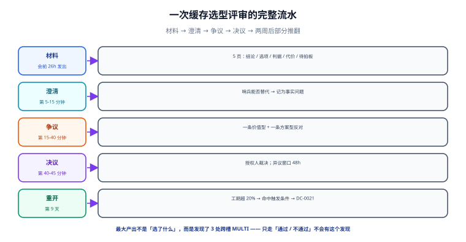

# 实战：一次缓存选型评审的全过程

前面九页讲的是每一段该怎么写。本页把一次真实的评审从头走到尾：材料原文、会上谁说了什么、决议怎么写、两周后怎么被部分推翻。**所有材料可以直接套用**，把项目名换掉即可。

::: tip 一句话理解
看一遍完整的流水，比读十遍模板管用——尤其是「未采纳意见」那一段，它决定了这次评审有没有价值。
:::



## 一、背景：为什么这件事需要评审

| 项 | 内容 |
| --- | --- |
| 议题 | 会话缓存从「本地 Caffeine + 单节点 Redis」改为「Redis Cluster」 |
| 触发 | 扩容到 6 个实例后，跨实例会话不一致的工单在 3 周内涨到 27 张 |
| 类型判定 | 结构型（R=7 / I=6 / T=3 → 5.85 分，B 档） |
| 决策权 | 平台组（张三），C = 后端负责人、运维组、安全组 |
| 会议形态 | 会议评审（存在真实价值分歧：一致性 vs 运维复杂度） |

算档位的过程不是装饰——**它决定了「要不要开会」**。同一件事如果算出来是 C 档，正确做法是一行记录，开会本身就是浪费。

## 二、材料（会前 26 小时发出，5 页）

```markdown
# 提案：会话缓存改为 Redis Cluster

## 1 一句话
建议改为 Redis Cluster（三主三从），解决跨实例会话不一致；需拍板的问题是
「是否接受多一套集群的运维代价」与「迁移窗口放在大促前还是后」。

## 2 背景与约束
6 实例部署后本地缓存命中率分裂；跨实例会话不一致工单 3 周 27 张（占本季度工单 18%）。
硬约束：不停机；改造 ≤ 3 人周；不引入第二种缓存中间件（公司规范 OPS-31）。

## 3 选项表
| 选项 | C1 一致性 | C2 故障域 | C3 成本 | C4 中间件种类 |
| --- | --- | --- | --- | --- |
| 1 本地 Caffeine + 失效广播 | 不满足（广播依赖单点） | 不满足 | 1.5 人周 | 1 种 |
| 2 Redis Cluster 三主三从 | 满足 | 满足 | 2.5 人周 + 1.2k/月 | 1 种 |
| 3 不做 | 不满足 | — | 0 | 1 种 |

硬约束：C1、C2 为门（必须满足），C3、C4 为软偏好。

## 4 结论与理由
选 2。硬约束筛完只剩 2，因此不计算加权总分（避免用小数位制造虚假精度）。

## 5 代价与风险
代价：运维多一套集群、客户端处理 MOVED/ASK、月成本 +1.2k。
风险与止损：
| 风险 | 早期信号 | 止损动作 |
| --- | --- | --- |
| 双写期间不一致 | 对账差异率 > 0.01% 持续 2h | 值班关双写开关（5 min，免审批） |
| 集群内存不足 | 使用率 > 75% 持续 30 min | 平台组扩容；超 30 min 切回旧集群 |

## 6 需拍板
P1 是否接受多一套集群的运维代价
P2 迁移窗口：大促前（风险高、早解决）还是后（风险低、投诉继续）
```

## 三、会前预读发现的三个问题

材料发出后到开会前的 26 小时里，两位评审人提了三个问题。**这三个问题都没有在会上占用时间**，因为它们被前置处理了——这是「提前一天发材料」唯一真正的价值。

| 预读问题 | 类型 | 处理 | 对会议的影响 |
| --- | --- | --- | --- |
| 「C3 的 3 人周含不含测试？」 | 事实型 | 提案人当晚补充：含联调不含压测 | 争议时间从 30 分钟压到 20 分钟 |
| 「为什么没有『只迁热数据』这个选项？」 | 方案型 | 补进选项表：热数据占 8%，`C1` 上仍不满足（冷数据里也有会话） | 会上少了一次「你漏了方案」的往返 |
| 「旧 Redis 的单点是不是可以先加副本？」 | 方案型 | 补进选项表：`C2` 满足但 `C1` 不满足（副本仍不解决本地缓存分裂） | 会上直接用判据淘汰，不用讨论 |

::: tip 预读问题的价值不在「问题本身」
三个问题里有两个最终都被淘汰了，看起来「白问」。但它们把「为什么这个方案不行」**提前变成了表格里的一行**，于是会上不用再花时间解释——**淘汰一个选项的成本，在会上是 5 分钟，在会前是 5 分钟写一行**。差别在于会上那 5 分钟要乘以参与人数。
:::

## 四、会上发生了什么（45 分钟实录）

| 时段 | 内容 | 关键动作 |
| --- | --- | --- |
| 0-5 | 提案人讲结论、判据、两个待拍板问题 | 没有讲实现细节 |
| 5-15 | 澄清：运维问「哨兵能不能替代」 | 记为**事实型**，24h 内查证（结论：切换窗口 3~8 s 写不可用） |
| 15-40 | 争议：逐条过 C1~C4 | 出现一条**价值型**反对、一条**方案型**反对 |
| 40-45 | 决议：授权人裁决，选 2；确认两条反对意见均已记录 | 决策人最后发言 |

三条值得记下来的现场细节：

1. **运维的第一句话是方案型反对**（「用哨兵，简单一半」）。主持人把它转成事实问题（哨兵切换期的写可用性），避免了当场陷入「复杂度 vs 一致性」的价值拉锯。
2. **安全组提了一条事实型反对**（「Redis Cluster 的跨槽事务不支持，你们用了 `MULTI` 吗」）。当场无法确认，记为 action；会后核实：现有代码有 3 处 `MULTI`，改造清单因此多了 1 项——**这条反对改变了工作量估算，而它本来不在提案里**。
3. **决策人在第 40 分钟才第一次发言**。如果他在第 5 分钟就说「我觉得行」，后面两条反对大概率不会出现。

::: warning 这次评审差点漏掉的东西
安全组的问题如果不问，`MULTI` 那 3 处会在迁移当天才炸——而且是「部分命令在跨槽时直接报错」这种硬失败。**事实型反对的价值往往不在「反对」，而在「补全了提案的盲区」**。这也是为什么第 5 页要求写「需要拍板的问题」：它给了评审人一个具体的下手点。
:::

## 五、决议与记录

```markdown
# DC-0012 会话缓存改用 Redis Cluster 而非本地 Caffeine

- 决议方式：授权人裁决（平台组 张三）
- 表决情况：5 人参与，3 同意、1 有保留（运维组）、1 未表态（安全组，已阅材料，会后代为确认）
- 复审日：2027-04-21
- 异议窗口：48 小时（至 2026-10-23 18:00）

## 未采纳意见
1. 运维组（李四）建议「主从 + 哨兵」。
   - 不采纳理由：哨兵切换期间写不可用 3~8 s，违反硬约束 C2。
   - 重开条件：3 个月内切换失败 ≥ 2 次，或业务接受切换期登录短暂失败。
2. 安全组（王五）提出跨槽事务限制。
   - 处理：**已采纳为改造项**（3 处 `MULTI` 拆成单槽操作），估算 +0.5 人周。
   - 影响：总工期由 2.5 人周调整为 3.0 人周，C3 阈值（≤3 人周）处于边界。

## 复审
2027-04-21。或 C3 在执行中超支 20% 时提前复审。
```

注意第 2 条：它**从反对意见变成了改造项**。记录里保留了「它曾经是反对意见」这个事实——这比直接删掉更有用，因为下次同类项目会知道「跨槽事务」是个必查项。

## 六、两周后：一次部分推翻

迁移第 9 天，`MULTI` 改造实际用了 1.4 人周（估 0.5），总工期变成 3.9 人周，超出 C3 阈值 20%。触发了记录里写的重开条件，于是：

| 动作 | 结果 |
| --- | --- |
| 重开评审（30 分钟，异步） | 结论：**继续**，但把 C3 从「≤3 人周」改为「≤4.5 人周」，并写明「原阈值基于对 `MULTI` 的低估」 |
| 记录处置 | 新开 DC-0021（`supersedes: [DC-0012]`），DC-0012 只改 `status` 与 `superseded_by`，正文一字未动 |
| 教训沉淀 | 在 DC-0021 的「判据」段加了一条：客户端改造必须做一次「不兼容 API 扫描」再估工期 |

**这次重开的价值不在「改了个数字」，而在它证明了三件事**：① 重开条件是有效的（自动命中，不靠人吵）；② 重开不需要推翻结论（可以只改判据）；③ 旧记录完整保留，能回答「当时为什么估 2.5 人周」。

## 七、S1 ~ S10 验收序列

这一节是**判据**，不是「本次实际输出」。可按顺序执行，每步都有明确的通过条件。

| 序号 | 验收项 | 命令 / 动作 | 通过条件 |
| --- | --- | --- | --- |
| `S1` | 记录七段齐全 | 见[记录结构](../RecordStructure/index.md)第八节脚本 | 不合格 0 篇 |
| `S2` | 档位可复算 | 按 R/I/T 三维打分复算 | 结果与记录中的档位一致 |
| `S3` | 选项在判据上取不同值 | 逐格比对选项表 | 任意两行至少一格不同 |
| `S4` | 硬约束与软偏好分开 | 版式检查 | 门类单独成表 |
| `S5` | 未采纳意见四要素齐全 | 见[反对意见](../Dissent/index.md)第八节脚本 | 待补 0 篇 |
| `S6` | 会议纪要三条齐 | `grep` 决议方式 / 复审日 / 反对意见 | 输出 `OK` |
| `S7` | 替换链不断裂 | `grep superseded_by: null` | 无输出 |
| `S8` | 台账可单次检索 | 按 `topic + status` 查询 | 命中唯一一条当前有效 |
| `S9` | 异议窗口已过且无复议 | 时间戳比对 | 窗口期无新证据 |
| `S10` | 复审日已进日历 | 日历条目 | 到期前 7 天提醒 |

::: warning 这份验收序列的诚实说明
`S1`/`S5`/`S6`/`S7` 是**可以机械判定**的（脚本退出码）；`S2`/`S3`/`S4`/`S8` 是**可复算但需要人读**的；`S9`/`S10` 是**流程动作**，只能靠日历与记录核对。三类别混在一张表里时，读者容易把「表里打了勾」当成「全自动通过」——所以这里逐行标了判定方式。
:::

## 八、本页判据

本页判据族 `DCP-A` ~ `DCP-H`，共 8 条。它们是「一次评审是否合格」的端到端判据。

| 编号 | 判据 | 判定方式 | 不满足时改哪里 |
| --- | --- | --- | --- |
| `DCP-A` | 材料提前 ≥ 1 工作日发出且 ≤ 6 页 | 时间戳 + 页数 | 延期或拆分 |
| `DCP-B` | 材料的选项表在判据上互不相同 | 逐格比对 | 补真实选项 |
| `DCP-C` | 硬约束筛完只剩 ≥ 2 个选项时才计算加权分 | 复算 | 补算或删掉总分 |
| `DCP-D` | 会上出现至少一条事实型或方案型反对 | 纪要 | 若真没有，写明「已逐个征询无人提出」 |
| `DCP-E` | 事实型反对在 24h 内答复并写进记录 | 时间戳 | 补答复 |
| `DCP-F` | 反对意见要么被采纳为改造项、要么带重开条件 | 逐条检查 | 补一项 |
| `DCP-G` | 发生超阈值时按记录里的重开条件走，而不是「下次注意」 | 比对触发条件 | 补重开记录 |
| `DCP-H` | 替换后旧记录正文未改 | diff 只动状态字段 | 回滚并新建 |

## 九、这次做对了什么、做错了什么

| 做对了 | 具体证据 |
| --- | --- |
| 先算档位再决定开会 | 5.85 分 → B 档 → 值得开一次 45 分钟的会 |
| 把方案型反对转成事实问题 | 哨兵的写可用性被查证为 3~8 s，成了硬约束的依据 |
| 决策人最后发言 | 两条反对都在他发言前出现 |
| 重开条件写进了记录 | 超支 20% 时自动命中，没有变成「下次注意」 |

| 做错了 | 后果 | 已在 DC-0021 修正 |
| --- | --- | --- |
| 工期估算没有做「不兼容 API 扫描」 | 低估 0.9 人周 | 判据段新增一条必查项 |
| C3 阈值定得过紧（3 人周）且没有留缓冲 | 一次正常超支就触发重开 | 改为「≤4.5 人周」并说明依据 |
| 安全组的「未表态」被记为「已阅」 | 严格说这是把沉默当同意 | 后续异步评审要求逐个回词 |

**最值得记的一条**：这次评审最大的产出不是「选了 Redis Cluster」，而是**发现了 3 处 `MULTI`**。如果评审只走「通过/不通过」，这个发现根本不会发生。

## 十、与相邻专题的分工

| 你的问题 | 去哪 |
| --- | --- |
| 方法论：档位、判据、记录结构 | [总览](../Overview/index.md) |
| 评审会的议程与角色 | [评审会](../ReviewMeeting/index.md) |
| 项目侧的架构决策实例（TeamBoard 的模块边界） | [TeamBoard 架构设计](/project/Complete/TeamBoard/Architecture/index.md) |
| 变更上线后的灰度和回滚 | [变更管理与发布工程](../../Ops/ChangeManagement/index.md) |

## 参考资料

- [Documenting Architecture Decisions（Michael Nygard, 2011）](https://cognitect.com/blog/2011/11/15/documenting-architecture-decisions)
- [MADR：Markdown Architectural Decision Records](https://adr.github.io/madr/)
- [变更管理与发布工程](../../Ops/ChangeManagement/index.md)：决策落地后的灰度与回滚
