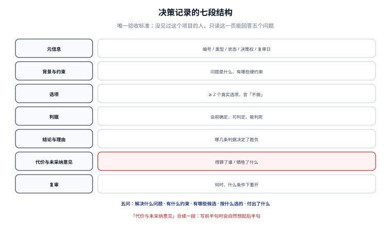

# 记录结构

一条决策记录的唯一验收标准是：**一个没见过这个项目的人，只读这一页，能回答五个问题**。本页把那五个问题落成七段结构，并给出状态词表与字段化的做法。

::: tip 一句话理解
记录不是写给人「回顾」的，是写给人「反驳」的——写的时候要假设读者**站在反对面**。
:::



## 一、五个必答问题

| 问题 | 谁最常问 | 缺失时的后果 |
| --- | --- | --- |
| 当时要解决什么问题？ | 半年后接手的人 | 把决策当成「古人的怪癖」，随手推翻 |
| 有哪些约束是当时就有的？ | 想改这个决策的人 | 拿今天的条件去否定昨天的决定，白吵一轮 |
| 有哪些候选？ | 评审会与复盘 | 以为「只有一条路」，重复调研 |
| 按什么判据选的？ | 反驳者 | 无法判断「今天环境变了要不要改」 |
| 选完付出了什么代价？ | 运维与财务 | 以为没有代价，直到账单或告警出现 |

**这五个问题就是七段结构的来路**，不是先有模板再找理由。

## 二、七段结构

| 段 | 内容 | 长度参考 | 可否省略 |
| --- | --- | --- | --- |
| **元信息** | 编号、标题、类型、状态、决策权、复审日 | 6 行 | 不可省 |
| **背景与约束** | 问题是什么、有哪些硬约束（合规、既有架构、时间） | 3~8 行 | 不可省 |
| **选项** | 至少 2 个真实选项，含「不做」 | 每个 1~3 行 | 不可省 |
| **判据** | 会前确定、可判定、排序明确 | 3~6 条 | 不可省 |
| **结论与理由** | 选了哪个、哪几条判据决定了它 | 2~5 行 | 不可省 |
| **代价与未采纳意见** | 付出了什么、谁反对、为什么不采纳 | 2~6 行 | **建议合并成一段，但不可省** |
| **复审** | 何时、在什么条件下重开 | 1~2 行 | 不可省 |

::: warning 为什么「代价」与「未采纳意见」放在同一段
它们回答的是同一个问题的两面：**这个决定得罪了谁 / 牺牲了什么**。分成两段时，第二段经常被省略；合成一段（「代价与未采纳意见」）后，写作者在填第一半时会自然想起第二半。这是排版影响内容的一个实例。
:::

## 三、与 ADR 四段式的关系

本库既有的 [架构设计](../../../Others/ProjectDelivery/Architecture/index.md) 页给的是 Nygard 的 ADR 四段式，那是**架构文档的产出格式**。两者不冲突，分工如下：

| 维度 | ADR 四段式（架构设计页） | 本页的七段结构 |
| --- | --- | --- |
| 目的 | 让架构决策**有档案** | 让决策**能被反驳与复审** |
| 判据段 | 通常并入 Context | **独立成段**，且要求会前确定 |
| 未采纳意见 | 通常不要求 | **强制**，含触发重开条件 |
| 复审 | 通常不要求 | **强制**，含日期与条件 |
| 适用 | 架构类决策 | 所有 A/B 档决策 |

**一句话**：ADR 是「最小档案」，七段是「可复审档案」。团队里两套并存时，用 ADR 的元信息 + 七段的正文，不要维护两份。

## 四、字段化：哪些进 frontmatter，哪些留在正文

| 内容 | 放哪 | 理由 |
| --- | --- | --- |
| 编号、标题、类型、状态、决策权、复审日 | **frontmatter** | 需要被脚本检索与统计（见下文） |
| 背景、选项、判据、结论、代价 | **正文** | 需要人读，也需要能长篇解释 |
| 反向链接（替换了哪条、被哪条替换） | frontmatter 的 `supersedes` / `superseded_by` | 用于构建链条，必须机器可读 |

```markdown
---
id: DC-0012
title: 会话缓存改用 Redis Cluster 而非本地 Caffeine
type: structural          # commitment | structural | implementation
status: accepted          # proposed | accepted | rejected | deprecated | superseded
decided_by: 张三（平台组）
decided_at: 2026-10-21
review_due: 2027-04-21
topic: 会话缓存           # 检索键，同一主题的决策必须用同一个键
supersedes: []
superseded_by: null
---
```

::: danger 别用标题当检索键
标题会改。用标题做键的结果是：改一次标题，链条断一次，冲突检测全部失效。主题键要**短、稳定、允许重复**——「会话缓存」这个键上可以有多条决策（历史版本），这正是 supersede 链能成立的前提。
:::

## 五、状态词表与迁移规则

| 状态 | 含义 | 允许迁移到 | 备注 |
| --- | --- | --- | --- |
| `proposed` | 已提出，未决议 | `accepted` / `rejected` | 长期停在 `proposed` 是空转信号 |
| `accepted` | 已决议并生效 | `deprecated` / `superseded` | 必须有复审日 |
| `rejected` | 明确不采纳 | （终态） | 要写「什么条件下值得重提」 |
| `deprecated` | 仍有效但不再推荐 | `superseded` | 用于「新代码别这么写，老代码先留着」 |
| `superseded` | 已被新决策替换 | （终态） | **必须**有 `superseded_by` |

三条硬规则：

1. **`superseded` 没有指向 = 死链**。链条断掉之后，读者不知道该看哪条，于是两条都读、然后自己判断——这正是决策库失效的起点。
2. **`accepted` 必须有 `review_due`**。写「永不过期」要给出理由（例如「这是物理常量」）。
3. **状态只能向前迁移**，不允许 `superseded → accepted`。要恢复旧决策，新写一条并链回去。

## 六、一个完整样例

```markdown
---
id: DC-0012
title: 会话缓存改用 Redis Cluster 而非本地 Caffeine
type: structural
status: accepted
decided_by: 张三（平台组）
decided_at: 2026-10-21
review_due: 2027-04-21
topic: 会话缓存
supersedes: [DC-0004]
superseded_by: null
---

## 背景与约束
多实例部署后本地缓存命中率分裂，跨实例会话不一致；现有 Redis 单节点无副本。
硬约束：不停机；客户端改造预算 ≤ 3 人周；不允许引入第二种缓存中间件。

## 选项
1. 本地 Caffeine + 定点失效广播（改造 1.5 人周）
2. Redis Cluster 三主三从（改造 2.5 人周）
3. 不做，接受会话不一致（0 人周）

## 判据（2026-10-14 会前确定）
- C1 一致性：跨实例读到同一会话（必须满足）
- C2 故障域：单节点故障不影响登录（必须满足）
- C3 迁移成本：≤ 3 人周且不停机（必须满足）
- C4 运维复杂度：不新增第二种中间件（必须满足）

## 结论与理由
选 2。C1、C2 只有选项 2 满足；选项 1 在 C2 上不成立（广播依赖单点）；选项 3 违反 C1。
选项 2 在 C4 上不劣于现状（沿用 Redis 家族）。

## 代价与未采纳意见
代价：运维多一套集群；客户端需处理 MOVED/ASK；月成本 +1.2k。
未采纳：运维组建议「主从 + 哨兵」（更简单）。理由：哨兵切换期间存在写不可用窗口，违反 C2 的
「不影响登录」。触发重开条件：3 个月内发生 2 次以上故障切换失败，或出现第 4 个可用区需求。

## 复审
2027-04-21。或满足上述触发条件时提前复审。
```

## 七、本页判据

本页判据族 `DCS-A` ~ `DCS-H`，共 8 条。

| 编号 | 判据 | 判定方式 | 不满足时改哪里 |
| --- | --- | --- | --- |
| `DCS-A` | 七个段落齐全（元信息 / 背景 / 选项 / 判据 / 结论 / 代价与未采纳 / 复审） | 逐段存在性检查 | 补段；宁可一句话也不要空 |
| `DCS-B` | 选项 ≥ 2 且包含「不做」 | 数选项 | 补「不做」并写它的后果 |
| `DCS-C` | 判据标注了「会前确定」的日期 | 判据段首行有日期 | 补日期；补不出说明判据是事后凑的 |
| `DCS-D` | 每段结论都能指回判据编号 | 结论段引用 `C1`~`Cn` | 补引用；补不出说明判据没用上 |
| `DCS-E` | `status = accepted` 时有 `review_due` | 字段检查 | 补日期或写不过期理由 |
| `DCS-F` | `superseded` 时有 `superseded_by` 且指向存在的编号 | 链尾与目标存在性 | 补指向 |
| `DCS-G` | `topic` 键非空且同主题复用同一个键 | 键值与历史比对 | 统一键名，别用标题 |
| `DCS-H` | 记录可被脚本按 `topic + status` 单次检索命中 | 台账/索引查询 | 补索引（见下节验证） |

## 八、验证：让结构可被机器核对

七段结构的好处是**大部分能机械检查**。下面这段 Python 直接跑在决策目录上，不需要装依赖：

```python
import os, re, sys

REQ = ["背景与约束", "选项", "判据", "结论与理由", "代价与未采纳意见", "复审"]
bad = 0
for fn in sorted(os.listdir("adr")):
    if not fn.endswith(".md"):
        continue
    text = open(os.path.join("adr", fn), encoding="utf-8").read()
    miss = [s for s in REQ if f"## {s}" not in text]
    if "status: accepted" in text and "review_due" not in text:
        miss.append("review_due")
    if "status: superseded" in text and "superseded_by: null" in text:
        miss.append("superseded_by")
    if miss:
        bad += 1
        print(f"{fn}: 缺 {', '.join(miss)}")
print(f"检查 {len(os.listdir('adr'))} 篇，不合格 {bad} 篇")
sys.exit(1 if bad else 0)
```

预期输出形如 `检查 200 篇，不合格 0 篇`，退出码 0。**判据是退出码，不是那行文字**——文字可能被缓存，退出码不会。

::: tip 为什么不用 YAML 解析 frontmatter
本仓的教训是「校验器崩了比校验失败更危险」。上面用子串判断而不是 `yaml.safe_load`，是因为半截 YAML 会让解析器抛异常，而异常在 CI 里看起来像「工具坏了」，真问题反而被掩盖。子串判断的误报可以人工过一眼，异常不能。
:::

## 九、参考资料

- [Documenting Architecture Decisions（Michael Nygard, 2011）](https://cognitect.com/blog/2011/11/15/documenting-architecture-decisions)
- [MADR：Markdown Architectural Decision Records](https://adr.github.io/madr/)
- [项目交付 · 架构设计](../../../Others/ProjectDelivery/Architecture/index.md)：ADR 四段式与最小文档集合
- [决策的修改与推翻](../DecisionChange/index.md)：状态迁移的细节
