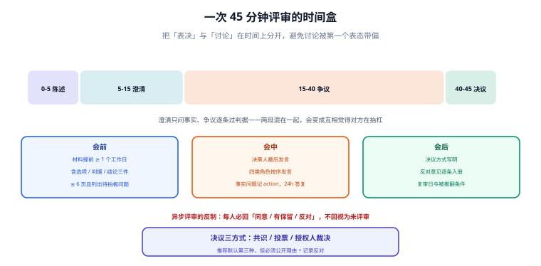

# 评审会

评审会是唯一能把「事实分歧」与「价值分歧」当面分开的场合。但大多数技术评审会开成了「提案人念 PPT、领导点头、散会」。本页给出一套可执行的议程、角色与决议规则。

::: tip 一句话理解
评审会的产出不是「通过」，而是**一份带着反对意见的决议**——只有通过的会议，等于把风险留到了上线之后。
:::



## 一、评审会解决什么、不解决什么

| 评审会**能**解决 | 评审会**不能**解决 |
| --- | --- |
| 价值取舍（要快还是要稳） | 事实问题（某个库到底支不支持 X）——那是调研任务 |
| 跨团队影响面的暴露（谁会被这个决定影响） | 方案细节的正确性（那需要代码评审/设计评审） |
| 决策权的行使与签字 | 资源分配（那是排期会） |
| 反对意见的正式留痕 | 需求是否该做（那是需求评审） |

**把事实问题带进决策会，是会议超时的第一大原因。** 判断方法：如果争论的焦点能用「查一下就知道」回答，那它是事实问题，应当当场记为 action 并结束讨论。

## 二、会前：材料的三条硬要求

材料不合格就不开会——这一条比议程更重要，因为**材料的质量决定了会议的上限**。

| 要求 | 判定 | 不合格的处置 |
| --- | --- | --- |
| **提前 1 个工作日发出** | 有邮件/文档时间戳 | 会议延期，不讨论 |
| **含选项、判据、结论建议**（三件齐） | 三要素存在性 | 退回补材料 |
| **不超过 6 页 / 2,000 字** | 字数统计 | 拆成「必读 1 页 + 附录」 |

第三条常被误解为「越短越好」。真实原因是：**评审人只有在能读完全文时才可能提出结构性反对**；读不完时，他们只能对最后一页提意见。

```text
提案材料的推荐结构（6 页内）
1. 一句话：我要决定什么、建议选哪个
2. 背景与约束（3~5 行）
3. 选项表（选项 × 判据，一格一个取值）
4. 结论与理由（哪条判据决定了胜负）
5. 代价与风险（三列：风险 / 信号 / 止损）
6. 需要评审会拍板的具体问题（1~3 条）
```

**第 6 页是最容易被省略、也最该有的一页**。它把「这次会议要拍哪几板」写死，避免会开完了还在讨论「我们今天到底要定什么」。

## 三、四类角色与发言顺序

| 角色 | 职责 | 发言顺序 | 不该做的事 |
| --- | --- | --- | --- |
| **提案人（R）** | 讲 5 分钟，只讲结论与判据 | 第 1 | 讲实现细节、讲自己做了多少工作 |
| **受影响方（C）** | 说出自己会被怎么影响 | 第 2 | 评判方案优劣（那是评审人的事） |
| **评审人（2~3 人）** | 找漏洞、提替代方案 | 第 3 | 重复受影响方已说过的影响 |
| **决策人（A）** | 最后发言、拍板、签字 | 第 4 | 早发言（一旦先表态，后面全是附和） |

**顺序里只有一条真正重要：决策人最后发言。** 这是低成本、高收益的规则——它把「表决」和「讨论」在时间上分开，避免讨论被第一个表态带偏。

::: danger 让决策人先发言会发生什么
不是「大家不敢说」，而是更隐蔽的**「大家开始为结论找理由」**。表面上会议很顺、很快达成一致，实际上所有反对意见都被自我审查掉了。等到上线出问题，这些意见才会以「我当时就觉得……」的形式重新出现，而且已经没有任何记录。
:::

## 四、时间盒：把 60 分钟切成四段

| 段 | 时长 | 内容 | 超时的处置 |
| --- | --- | --- | --- |
| 陈述 | 5 分钟 | 提案人讲结论、判据、需要拍板的问题 | 到点打断，剩余内容转书面 |
| 澄清 | 10 分钟 | 只问事实，不做评价 | 事实问题记为 action，会后 24h 内答复 |
| 争议 | 30 分钟 | 逐条过判据，记录反对意见 | 到点未收敛 → 转「授权人裁决」或延会 |
| 决议 | 10 分钟 | 决策人拍板、确认反对意见已记录、定复审日 | 无决议则明确记录「未决议 + 卡在哪」 |

**「澄清」与「争议」必须分开**。混在一起的后果是：一个人在问事实，另一个人在评价方案，两个人互相觉得对方在抬杠。

```text
主持人开场三句话（照读即可）
1. 今天要拍的是 X，材料已提前一天发出。
2. 前 15 分钟只问事实，不做评价；事实问题记成 action，会后答复。
3. 后 40 分钟逐条过判据，反对意见我会记下来，写进决议。
```

## 五、异步评审：什么条件下比开会更好

| 条件 | 异步更优 | 会议更优 |
| --- | --- | --- |
| 参与者跨时区 | ✅ | ❌ |
| 分歧是事实层面 | ✅（各自查证） | ❌（会上查不动） |
| 分歧是价值取舍且对立明显 | ❌（文字容易升级为对峙） | ✅ |
| 需要当场签字 | ❌ | ✅ |
| 参与人数 > 8 | ✅ | ❌ |

异步评审的**最大风险是「沉默被当成同意」**。三个反制手段：

1. **显式表态**：每人必须回一个词——`同意` / `有保留` / `反对`，不回视为未评审，不算通过。
2. **设截止时间并点名**：`请在周三 18:00 前回复；未回复我会单独找你`。
3. **反对意见优先处理**：先处理 `反对`，再处理 `有保留`，最后才看 `同意`。

```text
异步评审模板（贴到文档评论或群里）
【待决议】DC-0012 会话缓存改用 Redis Cluster
【材料】<链接>（1 页结论 + 2 页选项表）
【需要你回答】只回一个词：同意 / 有保留（附一句理由） / 反对（附替代方案）
【截止】2026-10-23 18:00，逾期视为未评审
【已回复】—（我每收到一个就更新这一行）
```

## 六、决议形成的三种方式

| 方式 | 适用 | 风险 | 记录要求 |
| --- | --- | --- | --- |
| **共识**（无人反对） | 影响面小、分歧弱 | 沉默被当成共识 | 必须逐个点名确认 |
| **投票** | 参与者对等、选项清晰 | 少数派被多数压制且不记录 | 记录票数与少数派意见 |
| **授权人裁决** | 存在不可调和的取舍 | 决策人信息不足时拍错 | 记录裁决理由与「反对意见已阅」 |

**推荐默认走第三种**：技术决策不是民主问题，但**裁决必须公开理由、必须记录反对意见、必须设复审日**。这三条让「裁决」不等于「独断」。

## 七、本页判据

本页判据族 `DCM-A` ~ `DCM-H`，共 8 条。

| 编号 | 判据 | 判定方式 | 不满足时改哪里 |
| --- | --- | --- | --- |
| `DCM-A` | 材料提前 ≥ 1 个工作日发出 | 时间戳比对 | 延期会议 |
| `DCM-B` | 材料含选项、判据、结论建议三件 | 存在性检查 | 退回补材料 |
| `DCM-C` | 材料有「需要拍板的问题」清单（1~3 条） | 段落存在 | 补；补不出说明会不必开 |
| `DCM-D` | 决策人最后发言 | 议程或纪要顺序 | 调整议程 |
| `DCM-E` | 澄清与争议分段时间盒 | 议程有时间分配 | 补时间盒 |
| `DCM-F` | 存在至少一条反对意见或「有保留」，或写明「无人反对已逐个确认」 | 纪要 | 补点名确认记录 |
| `DCM-G` | 决议方式（共识/投票/裁决）已写明 | 纪要字段 | 补；默认填「授权人裁决」并署名 |
| `DCM-H` | 决议含复审日与被推翻条件 | 纪要末尾 | 补 |

## 八、本页验证：一次 45 分钟评审的完整议程脚本

把下面这份贴到会议邀请里，会议就不会跑偏：

```text
议程：DC-0012 会话缓存选型评审
0-5   提案人：结论 + 判据 + 需拍板的 2 个问题
5-15  澄清：只问事实（记录为 action，24h 内答复）
15-40 争议：逐条过 C1~C4，记录反对意见（主持人逐条登记）
40-45 决议：选 2 / 选 1 / 延后；确认复审日；确认反对意见已写进决议

需拍板：
 P1 是否接受「多一套集群」的运维代价
 P2 迁移窗口放在双十一之后还是之前

不在本次范围：客户端改造排期（另开排期会）
```

会议结束后用三条命令自检纪要是否合格：

```shell
# 纪要必须含：决议方式 / 复审日 / 反对意见（或「无人反对已逐个确认」）
grep -qE '决议方式：(共识|投票|授权人裁决)' minutes.md && \
grep -q '复审日' minutes.md && \
grep -qE '反对意见|无人反对已逐个确认' minutes.md && echo OK
```

预期输出 `OK`。**这三条缺任意一条，纪要就不算完成**——它和「会开得成不成功」无关，和「半年后能不能回答『当时谁反对过』」有关。

## 九、与相邻专题的分工

| 你的问题 | 去哪 |
| --- | --- |
| 谁有权拍板、这件事该走哪一档 | [决策权与分级](../DecisionRights/index.md) |
| 反对意见怎么记、什么时候必须回炉 | [反对意见](../Dissent/index.md) |
| 变更上线前的审批流程（不是决策评审） | [变更管理与发布工程](../../../Ops/ChangeManagement/ApprovalTrail/index.md) |
| 一次真实的评审全过程 | [实战](../Practice/index.md) |

## 参考资料

- [RFC 2026：The Internet Standards Process](https://www.rfc-editor.org/rfc/rfc2026)（「异议必须记录」的原始要求）
- [Documenting Architecture Decisions（Michael Nygard, 2011）](https://cognitect.com/blog/2011/11/15/documenting-architecture-decisions)
- [Architecture Decision Records 官网](https://adr.github.io/)
