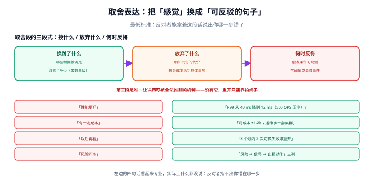

# 取舍表达

选项与判据列完了，最后一步是**把它说成人话**：换到了什么、放弃了什么、在什么条件下会反悔。本页讲怎么写这一段，以及哪些写法看起来专业、实际上什么都没说。

::: tip 一句话理解
取舍表达的最低标准是：**反对者能拿着你写的这段话，指出你哪一步错了**。指不出来，就说明你什么都没说。
:::



## 一、三段式：换什么 / 放弃什么 / 何时反悔

| 段 | 要回答 | 反例 | 正例 |
| --- | --- | --- | --- |
| **换到了什么** | 哪些判据被满足了，改善了多少 | 「性能更好」 | 「P99 从 40 ms 降到 12 ms（压测 500 QPS）」 |
| **放弃了什么** | 哪些代价是明知而付的 | 「有一定成本」 | 「月成本 +1.2k；运维多一套集群；客户端要处理重定向」 |
| **何时反悔** | 触发重开的可观测条件 | 「以后再看」 | 「3 个月内 2 次以上切换失败，或出现第 4 个可用区需求」 |

第三段是**唯一让决策可被推翻的机制**。没有它，决策只能靠「有人拍桌子」重开；有了它，重开变成一个正常的、提前约定好的流程。

## 二、机会成本的写法

机会成本是「因为这些资源投在这里，所以没投在那里」。它经常被省略，因为它需要一个**对照**——而对照往往不在提案范围内。

写法：**给出一句「如果不做这件事，同样的人力会去做什么」**。

```text
本方案占用 2 名后端 3 周（约 6 人周）。
同期队列里还有：A 项目结算对账（预计收益：每月省 40 人时）、B 项目导出提速（收益：投诉下降）。
本方案的机会成本 = 这两个项目各推迟 3 周。
```

这一句的价值在于：**它让「优先级」变成可讨论的对象**。很多方案单独看都值得做，放在一起就必须排序——而排序恰恰是决策者真正的工作。

::: warning 机会成本最容易造假的地方
写成「机会成本很高」是废话，写成「占用 6 人周」是事实，写成「导致 A 项目推迟 3 周」才是决策信息。**必须落到具体受影响的另一件事上**，否则读者无法判断值不值。
:::

## 三、把「不做」写成一个决策

「不做」有三个不同的含义，混在一起会让记录失去信息：

| 含义 | 写法 | 需要写什么 |
| --- | --- | --- |
| **明确不做** | 「本季度不做 X」 | 为什么不做 + 什么条件下值得重提 |
| **暂时不做** | 「X 推迟到 Q2，触发条件是 Y」 | 触发条件必须是可观测的 |
| **换个方式做** | 「不做 X，改为在 Y 里顺带解决」 | 说明 Y 何时能覆盖 X 的需求 |

**「暂时不做」是最容易腐烂的一类**：写的时候有个模糊的意图，一年后没人记得，需求以另一个名字重新提出来，于是从零开始调研——这一次甚至不知道上次已经调研过。

```text
反例：暂缓做多租户计费，等业务稳定后再说。
正例：暂缓做多租户计费。触发条件：付费租户数 ≥ 50 或出现第一个按量计费合同。
     重提时先读 DC-0009（2026-06 的调研结论：按席位计费会与现有权限模型冲突）。
```

## 四、可被反驳的论证

一个论证「可被反驳」，意味着它给出了**自己的证伪条件**。技术写作里最有效的三种句式：

| 句式 | 用途 | 例子 |
| --- | --- | --- |
| **如果……就说明我错了** | 给出证伪条件 | 「如果压测显示 P99 在 200 QPS 就超过 50 ms，这个结论不成立」 |
| **我假设……若不成立请指出** | 显式暴露假设 | 「我假设团队里至少有 2 人能维护 Lua 脚本」 |
| **代价是……我接受它，因为……** | 承认代价并给出理由 | 「代价是多一套集群，我接受，因为会话不一致的工单已经占本季度 18%」 |

::: danger 五种「看起来专业但什么都没说」的写法
1. **「业界最佳实践」**——哪家业界？在什么约束下？说这话的人通常答不上来。
2. **「大厂都这么干」**——大厂的组织规模、流量量级、合规要求与你不一定相同；大厂解决的是大厂的问题。
3. **「综合评估后认为」**——综合了哪几项、权重多少、谁的评估？
4. **「长期看更优」**——长期是多久？把「长期」换成具体年限，很多结论会立刻反转。
5. **「风险可控」**——哪几个风险、可控到什么程度、出问题时止损动作是什么？
:::

## 五、把风险写成「可执行的止损」

风险段最常见的失败是写成一张形容词表（「存在一定的技术风险」）。可用的写法是**风险 → 信号 → 止损动作**三列：

| 风险 | 早期信号（可观测） | 止损动作（谁、多久内） |
| --- | --- | --- |
| 迁移期间双写不一致 | 对账差异率 > 0.01% 连续 2 小时 | 值班回滚双写开关（5 分钟内，无需审批） |
| 新集群容量不足 | 内存使用率 > 75% 持续 30 分钟 | 平台组扩容（30 分钟内），超时则切回旧集群 |
| 客户端兼容问题 | 5xx 比例 > 0.5% | 关闭灰度批次（10 分钟内） |

**「早期信号」必须是能配成告警的东西**。写不出信号的风险，本质上是「我不知道会怎么坏」——那就该在提案里承认这一点，而不是用「风险可控」盖过去。

## 六、本页判据

本页判据族 `DCW-A` ~ `DCW-H`，共 8 条。

| 编号 | 判据 | 判定方式 | 不满足时改哪里 |
| --- | --- | --- | --- |
| `DCW-A` | 有「换到了什么」，且带数量级 | 找数字 | 补压测/账单/工单数据 |
| `DCW-B` | 有「放弃了什么」，且逐项列出 | 代价段条目数 ≥ 2 | 补；只写「有一定成本」不合格 |
| `DCW-C` | 有「何时反悔」，条件是可观测的 | 触发条件含阈值或事件 | 补阈值；「以后再看」不合格 |
| `DCW-D` | 机会成本落到具体被挤占的事项 | 有对照项 | 补「同样人力会去做什么」 |
| `DCW-E` | 「不做」写明属于哪一种（明确不做 / 暂时不做 / 换个方式） | 措辞检查 | 明确归类 |
| `DCW-F` | 论证含至少一条证伪条件或显式假设 | 找「如果……就说明」或「我假设」 | 补一条 |
| `DCW-G` | 风险写成「风险 → 信号 → 止损」三列 | 风险段版式 | 拆成三列 |
| `DCW-H` | 全文无「最佳实践 / 综合评估 / 长期看更优 / 风险可控」这类空话 | 关键词扫描 | 逐句替换成具体表述 |

最后一条可以直接机械扫：

```shell
# 空话扫描（有输出就说明话没说完）
grep -nE '最佳实践|综合评估|长期看更优|风险可控|业界普遍' adr/DC-0012.md
```

预期**无输出**。有输出时不要删句子了事，而是问「这句话想表达的具体事实是什么」。

## 七、一份可以照抄的取舍段模板

```markdown
## 结论与理由
选 <选项>。满足的硬约束：C1、C2。软偏好得分：C3 4.2 / C4 3.8（第二名 C3 4.0 / C4 4.0，
差值 0.2 分 = 满分的 4%，超过 2% 阈值，结论不依赖权重抖动）。

## 代价（我接受，因为……）
- 月成本 +1.2k —— 接受，因为会话不一致的工单占本季度 18%。
- 运维多一套集群 —— 接受，条件是平台组把切换演练纳入季度日历（见 OPS-31）。
- 客户端改造 2.5 人周 —— 接受，已排进下个迭代。

## 机会成本
占用 2 名后端 3 周，导致「结算对账」推迟 3 周。

## 风险与止损
| 风险 | 早期信号 | 止损动作 |
| --- | --- | --- |
| 双写不一致 | 对账差异率 > 0.01% 持续 2h | 值班关双写开关（5 min，免审批） |

## 何时反悔
3 个月内 ≥ 2 次切换失败，或出现第 4 个可用区需求，或月成本超 2k。
```

## 八、验证：让「空话」变成可计数

```shell
# 全目录扫描，统计每个文件命中的空话条数（0 才算合格）
for f in adr/*.md; do
  n=$(grep -cE '最佳实践|综合评估|长期看更优|风险可控|业界普遍' "$f")
  [ "$n" -gt 0 ] && echo "$f: $n"
done
```

这条命令的产出**应该为空**。如果一整个目录都在报，说明这是团队的写作习惯问题，不是个别文档问题——那就该把它写进提案模板，而不是逐篇返工。

## 九、与相邻专题的分工

| 你的问题 | 去哪 |
| --- | --- |
| 选项本身怎么列全、判据怎么定 | [选项与判据](../OptionsAndCriteria/index.md) |
| 论证要不要在会上讲、怎么讲 | [评审会](../ReviewMeeting/index.md) |
| 反对意见怎么记录（取舍段里的「未采纳」） | [反对意见](../Dissent/index.md) |
| 技术写作的一般方法（读者分层、结构） | [技术写作与分享](../../TechWriting/index.md) |

## 参考资料

- [MADR：Markdown Architectural Decision Records](https://adr.github.io/madr/)（`Consequences` 段的写法）
- [Documenting Architecture Decisions（Michael Nygard, 2011）](https://cognitect.com/blog/2011/11/15/documenting-architecture-decisions)
- [技术写作与分享](../../TechWriting/index.md)：`ISO 24495-1:2023` 的可理解性原则与本页的「可反驳」是同一件事的两面
