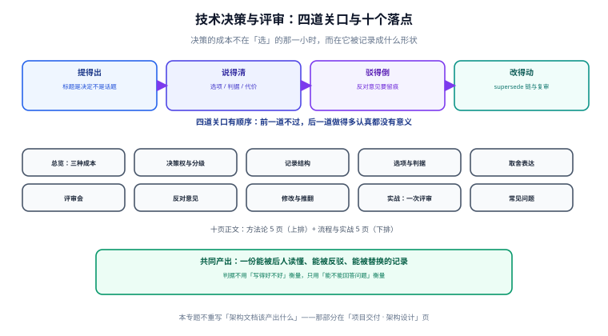

# 技术决策与评审

技术决策（Technical Decision）是「在两个都说得通的方案里选一个，并为这个选择承担后果」。本专题面向技术负责人、架构师与需要写提案的工程师，回答一件工程团队最常见的亏：**决策做了、也执行了，但三个月后没人说得出「当时为什么这么定」**。

::: tip 一句话理解
决策的成本不在「选」的那一小时，而在**它被记录成什么形状**——记录不成形状，同一场会议要在半年内重开三次，每次都从零开始吵。
:::

::: info 本专题与相邻专题的分工
- **架构文档该产出什么**（可逆/不可逆决策分类、ADR 四段式、选型评分表、最小文档集合）→ [项目交付 · 架构设计](../../Others/ProjectDelivery/Architecture/index.md)：那一页回答「一份架构文档要包含哪几样」。
- **一个决策从提出到被推翻的全流程**（谁有权决定、材料怎么写、评审会怎么开、反对意见怎么留、决策怎么改）→ 本专题：回答「这一个决定该怎么被做出来、被复核、被替换」。
- **变更怎么分级与审批** → [变更管理与发布工程](../../Ops/ChangeManagement/index.md)：那里管的是「已经定下来的东西怎么安全地改到线上」，决策评审管的是「要不要这么定」。
- **对外契约怎么演进** → [API 版本演进与兼容](../../Backend/ContractEvolution/index.md)：契约兼容性是决策的**约束条件**，不是决策本身。
- **过程指标怎么算** → [研发效能度量](../../Tools/EngineeringMetrics/index.md)：决策周期、重开率这类过程指标的口径在那一边。
- **战略层的边界划分** → [DDD 战略设计](../../Backend/DDD/StrategicDesign/index.md)：领域边界一旦划定就是长期决策，那页讲边界怎么切，本页讲切完之后怎么留痕与复审。
:::

## 目录

- [总览：决策的三种成本与四道关口](Overview/index.md)
- [决策权与分级：谁有权定，定到哪一档](DecisionRights/index.md)
- [记录结构：一条决策要能被后人读懂](RecordStructure/index.md)
- [选项与判据：如何避免「只有一个选项」的评审](OptionsAndCriteria/index.md)
- [取舍表达：把「不做什么」写成可反驳的论证](TradeoffExpression/index.md)
- [评审会：四类角色、时间盒与决议形成](ReviewMeeting/index.md)
- [反对意见：少数派意见怎么留、什么时候必须回炉](Dissent/index.md)
- [决策的修改与推翻：supersede 链与决策债](DecisionChange/index.md)
- [实战：一次缓存选型评审的全过程](Practice/index.md)
- [常见问题与排错](FAQ/index.md)

## 专题地图

## 判据纪律

本专题沿用全库的判据写法：**每页 8 条，编号形如 `DCX-A`**，逐页前缀唯一，可被 `utils/audit` 下的判据类巡检机械核对。判据不是「原则口号」，每条都要能回答三个问题：**看什么现象、判定成什么、不满足时改哪里**。

| 页 | 判据族 | 条数 | 这一族管什么 |
| --- | --- | --- | --- |
| 总览 | `DCO-A` ~ `DCO-H` | 8 | 决策的类型识别与关口完整性 |
| 决策权 | `DCR-A` ~ `DCR-H` | 8 | 决策权归属与分级是否写明 |
| 记录结构 | `DCS-A` ~ `DCS-H` | 8 | 一条记录能否回答五个问题 |
| 选项与判据 | `DCC-A` ~ `DCC-H` | 8 | 选项是否真实、判据是否可判死 |
| 取舍表达 | `DCW-A` ~ `DCW-H` | 8 | 论证是否可被反驳、代价是否写明 |
| 评审会 | `DCM-A` ~ `DCM-H` | 8 | 会前材料、角色、时间盒、决议 |
| 反对意见 | `DCN-A` ~ `DCN-H` | 8 | 意见留痕与升级触发条件 |
| 决策变更 | `DCX-A` ~ `DCX-H` | 8 | 重开条件、链式替换、决策债 |
| 实战 | `DCP-A` ~ `DCP-H` | 8 | 一次评审的端到端验收 |
| 常见问题 | `DCQ-A` ~ `DCQ-H` | 8 | 症状分诊与口径澄清 |

合计 **10 族 80 条**。

## 事实与口径速览（2026-10 核对）

| 项 | 口径 | 说明 |
| --- | --- | --- |
| ADR 的原始定义 | Michael Nygard，2011-11-15《Documenting Architecture Decisions》 | 五段式（Title / Status / Context / Decision / Consequences），当年发在个人博客，后被 adr.github.io 收录为通行模板 |
| ADR 常用模板 | Nygard 原版、MADR（Markdown ADR，3.x）、Y-Statement | MADR 增加了「Considered Options / Decision Drivers」，与本专题的「选项 + 判据」两段对应 |
| 决策状态词表 | `proposed` / `accepted` / `rejected` / `deprecated` / `superseded` | 取自 Nygard 原文与 adr-tools 的实现；本专题额外要求 `superseded` **必须带指向** |
| RFC 流程的公开样本 | IETF RFC 2026（互联网标准流程，1996，经多次修订） | 「提案 → 草案 → 评审 → 定稿」四段与「必须记录反对意见」是 RFC 体系的硬要求，可直接借来当评审会的骨架 |
| 架构决策的「不可逆」判据 | 亚马逊 CTO Werner Vogels 的 one-way / two-way door 说法（公开演讲与博客，2015 起） | 「单向门」决策要多花时间，「双向门」决策要快；本专题把它落成可打分的三档 |
| 加权评分的脆弱性 | 本机实测（Python 3.13.12 标准库，固定种子 20261021，20,000 次扰动） | 领先 1% 时第一名翻盘率 5.92%、领先 0.5% 时 21.95%、完全并列时 50.19%——详见[选项与判据](OptionsAndCriteria/index.md) |

::: info 版本组织说明（为何不建版本目录）
本专题讲的是**决策这件事的做法**，不绑定任何框架的大版本——Nygard 的 ADR 五段式自 2011 年提出至今仍可原样使用，`proposed / accepted / rejected / deprecated / superseded` 五个状态词在 adr-tools 的实现里也没有变过。因此**不建 `v1/` `v2/` 这类版本目录**：这里不存在需要长期并存维护的第二条内容线，硬拆版本只会让同一份方法学散成两份各自漂移的副本。

真正会随版本漂移的是**工具与系统字段**（adr-tools、各家 ADR 插件、评审系统的状态字段名），这类差异一律写在页内 `::: info` 里并标注适用版本，不新开目录；不与本专题冲突的既有页面（如 [架构设计](../ProjectDelivery/Architecture/index.md) 的 ADR 四段式）**保留原貌、只追加分工说明，不覆盖**。

判据：若将来真出现「同一套方法学需要两份长期并存维护」的情形，**届时再建版本目录并把旧目录原样保留**，而不是就地改写现有页面。
:::

::: warning 关于「实测」的诚实标注
本专题里的数字分两类：**一类是本机可复跑的脚本读数**（Python 标准库、固定种子、命令写在页面里，脚本本身不入库）；**另一类是公开资料里的口径**（表格中逐条标了来源）。两类不混排——凡是出自造数语料的，正文都写明「造数」，不当成行业统计。
:::

## 三条底线

1. **没有记录的决定不算决定**——它只是当时在场几个人的记忆，人一走就失效。
2. **没有被写下来的反对意见，会在三个月后以「我早就说过」的形式重新出现**，而且那时没有人能反驳它。
3. **决策记录不可变**：要改就新写一条并指向被替换的那条，不要在原文上悄悄改结论。

## 学习路径

| 你现在的位置 | 从哪开始 | 大约要花的时间 |
| --- | --- | --- |
| 只是要写一份提案给上级看 | [记录结构](RecordStructure/index.md) → [取舍表达](TradeoffExpression/index.md) | 30 分钟 |
| 要主持一次技术评审 | [评审会](ReviewMeeting/index.md) → [反对意见](Dissent/index.md) → [实战](Practice/index.md) | 1 小时 |
| 要建立团队的决策机制 | [总览](Overview/index.md) → [决策权](DecisionRights/index.md) → [决策变更](DecisionChange/index.md) | 1.5 小时 |
| 已经有几十条 ADR，开始互相矛盾 | [决策变更](DecisionChange/index.md) → [常见问题](FAQ/index.md) | 40 分钟 |

## 参考资料

- [Documenting Architecture Decisions（Michael Nygard, 2011）](https://cognitect.com/blog/2011/11/15/documenting-architecture-decisions)
- [Architecture Decision Records 官网与模板索引](https://adr.github.io/)
- [MADR：Markdown Architectural Decision Records](https://adr.github.io/madr/)
- [RFC 2026：The Internet Standards Process](https://www.rfc-editor.org/rfc/rfc2026)
- [项目交付 · 架构设计](../../Others/ProjectDelivery/Architecture/index.md)：ADR 四段式与选型评分表的产出清单
