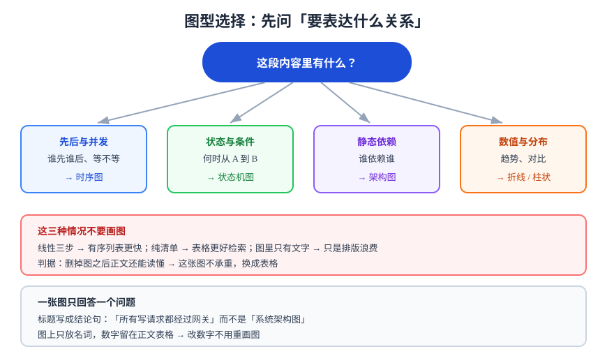

# 图表表达

图不是文字的装饰，是**另一种数据结构**：它把「关系」从线性文字里抽出来，让读者一次看到整体。判断该不该画图的标准不是「好不好看」，而是**这段内容里有没有必须同时看到才成立的关系**。

## 一、什么时候该画图

三个条件满足任意一个，画图就比文字省读者的时间：

| 条件 | 例子 | 不画图的后果 |
| --- | --- | --- |
| 涉及 3 个以上对象的关系 | 网关 → 服务 → 缓存 → 数据库 | 读者要在脑内拼装拓扑 |
| 流程有分支或回路 | 重试、回滚、补偿 | 文字描述分支必然写成嵌套列表 |
| 对比维度 ≥ 3 | 三种方案的六个维度 | 表格不够，需要「位置 + 方向」表达 |

反过来，下面三种情况**不要画图**：

1. **线性三步**——有序列表比图更快；
2. **纯清单**——表格的检索性远好于图；
3. **图里只有文字**——那是排版的浪费，读者还得缩放才能看清。

::: tip 一句话判据
**画完之后，如果删掉图、文字仍然完整，那这张图只是装饰；如果删掉图、文字读不懂，那这张图是承重的。** 承重的图才值得花时间画。
:::



## 二、图型选择表

| 你要表达 | 该用什么图 | 它不能表达 | 常见误用 |
| --- | --- | --- | --- |
| 请求在组件间的先后 | **时序图** | 组件内部逻辑 | 用流程图硬画，时序全乱 |
| 组件的静态依赖 | **架构图 / 拓扑图** | 时间与顺序 | 把调用顺序画成箭头方向 |
| 状态与转移条件 | **状态机图** | 数据流 | 用流程图画「重试」，看不出状态 |
| 判断与分支 | **流程图** | 并发与并行 | 菱形判断写成矩形 |
| 方案对比 | **对照表**（首选）或象限图 | 精确数值 | 用雷达图比较 3 个方案 |
| 趋势与分布 | **折线 / 柱状 / 散点** | 因果关系 | 把相关性当因果写在标题里 |

## 三、一张图只回答一个问题

图的标题要写成**结论句**，不是分类名。这是最容易改、收益最大的一条：

| 弱标题 | 强标题 |
| --- | --- |
| 系统架构图 | 所有写请求都经过网关，读请求可绕过网关直连缓存 |
| 部署流程图 | 迁移必须先于应用替换，否则回滚会读到旧结构 |
| 调用链路 | 一次拖动只更新一行，广播在事务提交之后 |

标题写成结论之后，图里就只保留**支撑这个结论**的元素，其余删掉——这顺便解决了「图太满」。

## 四、视觉语法：让形状有固定含义

同一张图里，形状和颜色必须是**有语义的**，并且全专题一致：

| 元素 | 含义 | 约定 |
| --- | --- | --- |
| 矩形 | 组件 / 服务 / 步骤 | 圆角表示「可独立部署」 |
| 菱形 | 判断 | 只有判断用菱形 |
| 圆柱 | 存储 | 数据库、对象存储、消息队列 |
| 实线箭头 | 同步调用 / 主流程 | 带方向与动作词 |
| 虚线箭头 | 异步 / 可选 / 已废弃 | 在图注里说明 |
| 红色 | 风险、失败路径、禁区 | 不作为唯一编码 |

::: danger 只靠颜色编码的图
红绿区分「成功/失败」，在灰度打印与色觉障碍读者眼里是同一种灰。**必须叠一层形状或文字**（红色框加「×」、绿色框加「✓」）。这与 [WCAG 2.2](https://www.w3.org/TR/WCAG22/) 的「不只依赖颜色传达信息」是同一条要求。
:::

## 五、手绘 SVG 的六条规范

本库的示意图全部手绘 SVG（矢量、可 diff、体积小）。六条硬规范：

1. **固定画布**：`viewBox="0 0 880 560"`，宽度不超过正文栏；
2. **字号 12~24**：最小 12（图注）、节点标题 14~16、图标题 22~24；
3. **所有文字落在框内**：中文按「字数 × 字号」估算宽度，留 20px 内边距；
4. **不依赖系统字体**：只写 `font-family` 的通用族或不写，避免跨机器渲染差异；
5. **浅色主题优先**：白底 + 白卡片描边，不用大面积深色；
6. **箭头带 `marker`**：方向必须显式，不靠读者猜。

```xml
<svg xmlns="http://www.w3.org/2000/svg" width="880" height="320" viewBox="0 0 880 320">
  <rect width="880" height="320" fill="#FFFFFF"/>
  <text x="440" y="40" text-anchor="middle" font-size="22" font-weight="bold" fill="#1E293B">标题写成结论句</text>

  <rect x="60" y="90" width="200" height="64" rx="10" fill="#EFF6FF" stroke="#3B82F6" stroke-width="2"/>
  <text x="160" y="128" text-anchor="middle" font-size="15" fill="#1D4ED8">网关</text>

  <line x1="260" y1="122" x2="330" y2="122" stroke="#94A3B8" stroke-width="2" marker-end="url(#ar)"/>
  <defs>
    <marker id="ar" markerWidth="10" markerHeight="10" refX="8" refY="3" orient="auto">
      <path d="M0,0 L8,3 L0,6 Z" fill="#94A3B8"/>
    </marker>
  </defs>
</svg>
```

::: warning 两个会让图「看起来对、实际错」的细节
1. **`marker` 定义在 `<defs>` 里、引用在定义之前**——SVG 允许，但很多编辑器预览时会丢箭头，导出后才发现；写完先渲染一次；
2. **文字超框不报错**——SVG 里文字不会自动换行也不会撑开容器，超出的部分直接压到相邻元素上，只有在渲染图里才看得见。
:::

## 六、不返工三原则

1. **先列节点与边，再画框**——在纸上写「A→B，条件 C」，比直接拖框快三倍；
2. **先黑白，后上色**——黑白阶段就能发现结构问题，此时改成本最低；
3. **图注写「看什么」**——不是「图 1 系统架构」，而是「图 1：红色虚线是这次要新增的路径，其余为现状」。

## 七、图与正文的分工

| 内容 | 放图里 | 放正文里 |
| --- | --- | --- |
| 结构、顺序、层级 | ✅ | 只写一句概述 |
| 精确数值与阈值 | ❌（改了要重画） | ✅ 表格 |
| 判据与验证命令 | ❌ | ✅ |
| 历史演进与取舍 | 演进图可 | ✅ 文字解释原因 |

::: tip 一个省事的做法
图上只放**名词**（组件、状态、动作），把所有**数字**留在正文表格里。这样改数字不需要重画图，图也永远不会「过期」。
:::

## 八、验证方式

- **缩略图测试**：把图缩到 30% 大小看，还能分辨主结构吗？不能说明元素太多；
- **灰度测试**：去掉颜色后，语义是否仍然完整；
- **删图测试**：删掉图，正文是否仍可读？可读说明图不承重，考虑换成表格；
- **渲染测试**：用真实渲染器出一张 PNG 看，文字有没有出框、箭头有没有丢。

```shell
# 结构合法性检查（本库 svgcheck 的同源做法）
python3 -c "import xml.dom.minidom,sys; xml.dom.minidom.parse('图.svg'); print('XML OK')"
# 期望输出：XML OK
```

## 参考资料

- [W3C WCAG 2.2：Use of Color](https://www.w3.org/WAI/WCAG22/Understanding/use-of-color.html)
- [MDN：SVG 教程](https://developer.mozilla.org/docs/Web/SVG/Tutorial)
- [Data-to-Viz：按数据类型选图](https://www.data-to-viz.com/)
