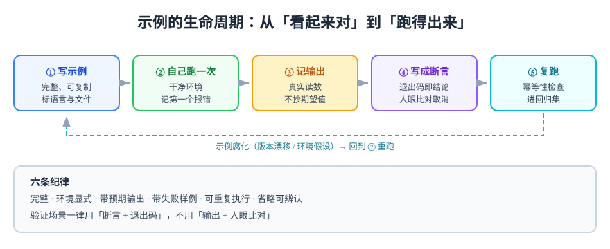

# 示例与可验证性

示例是技术文档里**唯一能被机器检查的部分**。一段散文写错了看不出来，一段命令写错了，读者第一条命令就会失败。所以示例的质量标准不是「看起来对」，而是**作者自己跑过、读者能跑出同样结果**。

## 一、示例的三种用途

同一段代码放在不同位置，要求完全不同：

| 用途 | 位置 | 读者拿它做什么 | 关键要求 |
| --- | --- | --- | --- |
| **教学示例** | 概念页 | 理解语法结构 | 最小、可读，允许省略 |
| **参考示例** | API / 配置页 | 抄片段改参数 | 完整字段、注释写清取值 |
| **验证示例** | 操作页 / Runbook | 复制执行 | 可运行、有预期输出、幂等 |

::: danger 混用三种用途
最常见的错：把**教学示例**放进操作步骤里。教学示例通常省略了错误处理与清理，读者照着跑，第一次成功、第二次失败（端口被占、文件已存在）。**操作页里的每条命令都必须是验证示例。**
:::



## 二、可运行示例六条纪律

| # | 纪律 | 缺失后的症状 | 正确写法 |
| --- | --- | --- | --- |
| 1 | **完整** | 读者粘贴后报语法错 | 给出可直接执行的整段，不给人留填空 |
| 2 | **环境显式** | 版本不同，命令参数不认 | 首行注释写版本与前置（`# 需要 jq 1.6+`） |
| 3 | **带预期输出** | 跑完不知道对不对 | 输出写在命令下方，或以 `# →` 内嵌 |
| 4 | **带失败样例** | 读者只会「成功路径」 | 给一条会失败的输入，说明错误长什么样 |
| 5 | **可重复执行** | 第二次跑就报错 | 加幂等判断或清理步骤 |
| 6 | **可复制** | 关键处写成 `...` | 省略必须显式声明，并说明省略了什么 |

### 纪律 3 的三种写法

```shell
# 写法 A：内嵌注释（短输出，最省空间）
docker compose ps --services
# → alertmanager
# → app
# → metrics-collector

# 写法 B：独立输出块（长输出，便于 diff）
curl -s localhost:9090/-/ready
```

```text
Prometheus Server is Ready.
```

```shell
# 写法 C：直接断言（验证场景首选，退出码即结论）
curl -sf localhost:9090/-/ready | grep -q 'Ready' && echo PASS || echo FAIL
# → PASS
```

::: tip 验证场景一律用写法 C
操作手册里的命令如果只有输出、没有断言，读者必须**人眼比对**——而人眼比对的失败率远高于机器。把「预期输出」升级成「断言」，这一步是从「文档」到「门禁」的分界。
:::

## 三、代码块的标注规范

四条，缺一条就会让复制成本上升：

1. **语言标签必填**（`shell` / `json` / `yaml` / `sql` / `typescript`）——没有标签就没有高亮，也说明作者没想清楚这是什么；
2. **涉及具体文件时用标题语法**： 

   ````markdown
   ```yaml [compose.yaml]
   ````

3. **注释写「为什么」，不写「是什么」**——`# 等待采集器就绪` 无用，`# 采集周期 15s，冷启动需要 3 个周期才有数据` 有用；
4. **省略必须显式**——用 `# ... 其余字段保持不变` 而不是裸 `...`，否则读者不知道少的是必填还是可选。

## 四、示例腐化的四种形态

示例会随时间失效，而失效是静默的。四种常见形态与对策：

| 形态 | 表现 | 对策 |
| --- | --- | --- |
| **版本漂移** | 参数在新版本被改名或移除 | 首行写版本，升级时把它当代码一起改 |
| **环境假设** | 假设 `/tmp` 可写、假设有 `jq` | 前置检查写在第一条命令里 |
| **路径假设** | 假设读者在仓库根执行 | 每条命令前给 `cd`，或注明工作目录 |
| **权限假设** | 假设有 `sudo` 或集群管理员 | 显式写出需要的角色 |

::: warning 「在我机器上是好的」
这句话不是免责声明，是缺陷描述。示例的可移植性由**前置声明**保证：把「我的机器有什么」写成第一屏的检查清单，读者缺什么会立刻知道，而不是在第 5 步遇到一个看不懂的报错。
:::

## 五、一个完整的示例模板

下面这段可以直接当模板用（注意六条纪律都落到了）：

````markdown
### 验证告警规则能加载

前置：Prometheus 已在运行（`curl -sf localhost:9090/-/ready` 返回 0）。

```shell
# 1) 静态校验：不需要起栈，先挡掉语法错
promtool check rules rules/alerting.yaml
# → SUCCESS: 6 rules found

# 2) 重载配置（幂等：重复执行结果相同）
curl -sX POST localhost:9090/-/reload -o /dev/null -w '%{http_code}\n'
# → 200

# 3) 断言：规则名集合必须等于期望的 6 个
curl -s localhost:9090/api/v1/rules \
  | jq -r '.data.groups[].rules[].name' | sort | tr '\n' ' '
# → CollectorScrapeSlow HighErrorRate ServiceDown TargetDown TargetScrapedZeroSamples TSDBRetentionSizeTriggered

# 4) 失败样例：故意写错一个字段，第 1 步必须报错
sed 's/expr:/expr :/' rules/alerting.yaml > /tmp/bad.yaml
promtool check rules /tmp/bad.yaml; echo "exit=$?"
# → FAILED: 解析失败 ... exit=1
```
````

## 六、把示例变成断言

示例的最高形态是**自己能判断成败**。三种常用手法：

```shell
# ① 退出码 + grep -q：最通用
systemctl is-active nginx >/dev/null && echo PASS || echo FAIL
# → PASS

# ② 数值比较：把阈值写进命令，而不是写进人脑
err_rate=$(curl -s localhost:9090/api/v1/query?query='sum(rate(http_requests_total{code=~"5.."}[5m]))/sum(rate(http_requests_total[5m]))' \
  | jq -r '.data.result[0].value[1] // "0"')
awk -v v="$err_rate" 'BEGIN{ exit (v < 0.005) ? 0 : 1 }' && echo "PASS err=$err_rate"
# → PASS err=0.0004

# ③ 集合相等：比「数量相等」更强
expected="HighErrorRate ServiceDown TargetDown"
actual=$(curl -s localhost:9090/api/v1/rules | jq -r '.data.groups[].rules[].name' | sort | tr '\n' ' ' | sed 's/ $//')
[ "$actual" = "$expected" ] && echo PASS || echo "FAIL: $actual"
```

::: danger 数词类断言的两种假绿
1. **只比总数**——删掉 A 补上 B，总数不变，断言仍然通过；
2. **把注释算进计数**——`grep -c runbook_url` 会把注释里提到的那一次也算上。

对策：**逐条覆盖 + 剔注释**（`grep -v '^[[:space:]]*#'`），或直接比较集合。
:::

## 七、验证方式

- **冷读测试**：找一台没装过依赖的机器（或容器），照示例跑一遍，记录第一个报错；
- **复跑测试**：连续执行两次，第二次的退出码必须与第一次一致（幂等）；
- **断言测试**：把示例里的期望值改错一个字符，断言必须失败——不失败说明它是恒真判据；
- **腐化检查**：三个月后回看，示例里的版本号是否还在支持窗口内。

```shell
# 复跑测试示例：两次结果必须相同
for i in 1 2; do bash 示例脚本.sh; echo "run$i exit=$?"; done
# → run1 exit=0
# → run2 exit=0
```

## 参考资料

- [Google Technical Writing：Code samples](https://developers.google.com/tech-writing/two/code-samples)
- [Write the Docs：Code samples 指南](https://www.writethedocs.org/guide/writing/code-samples.html)
- [Microsoft Style Guide：Code examples](https://learn.microsoft.com/style-guide/code-examples/)
