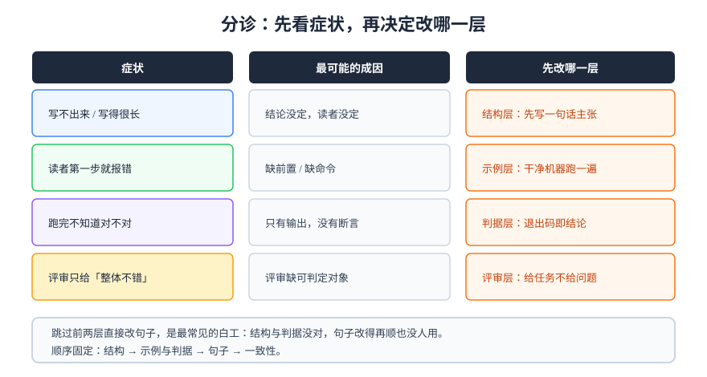

# 常见问题与最佳实践

这一页按**症状**组织，而不是按概念。遇到具体问题时先看分诊表，定位到一类，再往下找具体问法。

## 一、分诊表：先判断是哪一类问题

| 症状 | 最可能的成因 | 先看哪一节 | 一次修不好的话 |
| --- | --- | --- | --- |
| 面对空白页写不出来 | 结论没定，或读者没定 | 问题 1 / 2 | 先写一页决策记录，不写正文 |
| 写完很长，但没人读完 | 按思考顺序写，结论在后 | 问题 3 / 4 | 把结论提到第一屏，砍掉 40% 背景 |
| 读者照着做，第一步就失败 | 缺前置条件 / 缺命令 | 问题 5 / 6 | 找一台干净机器跑一遍 |
| 评审只给「整体不错」 | 评审缺可判定对象 | 问题 7 / 8 | 换任务式评审：给对方一个任务 |
| 分享讲完没人提问 | 主张不明确 / 时长失控 | 问题 9 / 10 | 把主张压成一句话，重排时间 |
| 文档三个月后就没人信 | 没有维护机制与口径 | 问题 11 / 12 | 给每条强断言加日期与出处 |



## 二、十二个高频问题

### 问题 1：脑子里一团，怎么开始写？

先不要写正文，写三行：**给谁看 / 他要做什么 / 做完算成功的样子**。三行写不出来，说明这件事还没想清楚，此时写出来的都是背景铺垫。经验做法是先把结论写成一句话贴在文件顶部，再往下填支撑。

### 问题 2：一页文档要写给谁？能不能都照顾到？

不能。**一份文档只有一个主读者**，其余降级为「可查阅」。三类读者（决策者 / 执行者 / 维护者）的进入点不同，硬塞在一起的结果是谁都不满意。需要照顾多方时，正确做法是**一份文档 + 三个入口**（第一节给结论、第二节给命令、附录给背景），而不是把三种写法混在每一段里。

### 问题 3：为什么我的文档总是越写越长？

因为每一段都在「证明自己有必要存在」。有效的删减判据是三条：

1. 删掉这段，读者还能不能完成任务？能 → 删；
2. 这段是「我怎么想的」还是「读者要做什么」？前者 → 移到附录或删；
3. 这段在别处有没有？有 → 换成链接 + 一句差异说明。

### 问题 4：结论到底该放哪？

放**第一屏**，且在**标题之下、第一个小标题之上**。判断方法：只读第一段，能不能做出「要不要继续读」的决定。做不到就是还没到位。

### 问题 5：读者说「按你的文档跑不起来」，怎么排查？

按出现频率排序，四类原因：

| 原因 | 表现 | 修法 |
| --- | --- | --- |
| 缺前置 | 第一条命令就 `command not found` | 第一屏加「前置检查」一条命令 |
| 路径假设 | `No such file or directory` | 每条命令前给 `cd`，或注明工作目录 |
| 版本差异 | 参数不认识、字段被改名 | 首行标版本，命令用长期存在的参数 |
| 权限假设 | `Permission denied` | 写明需要的角色与授权方式 |

### 问题 6：命令要不要给预期输出？

**验证类步骤必须给**，理解类示例可以不给。判断标准：读者跑完之后，**是否需要人眼比对**。需要 → 给输出，最好直接给断言（`&& echo PASS`）。不需要 → 说明这段只是示意。

### 问题 7：评审总是变成「我觉得」，怎么办？

把评审从「读一遍提意见」改成「带着任务做一次」。给评审人一句话：「假设你要按这份文档在预发环境部署一次，把第一次卡住的地方标出来。」主观评论会立刻减少，具体缺陷会立刻增加。

### 问题 8：评审意见互相矛盾，听谁的？

按**视角优先级**裁决：领域正确性 > 读者可用性 > 编辑一致性。两个领域专家矛盾时，用一条可执行的判据解决（跑一次、查一次日志），而不是比谁资历深。

### 问题 9：技术分享没人提问，是内容不好吗？

多数时候不是内容问题，而是**没有留下可问的钩子**。三个有效做法：

1. 讲一个「我们踩过的坑」，比讲成功经验更容易引出问题；
2. 明确说出边界（「这套方案在 X 场景不成立」），听众会从边界处提问；
3. 结尾给一个待决问题（「这两条路我们还没定，想听听大家的」）。

### 问题 10：15 分钟的分享，我准备了 30 页怎么办？

按 1.5~2 分钟/页换算，15 分钟只能讲 8~10 页。删到 10 页的方法是：**只留三个支撑各一页证据**，其余全部移到备用页（问答时用）。页数不是内容量，是**节奏**。

### 问题 11：文档写了没人维护，怎么办？

三件事能显著延长寿命：

1. **强断言带日期**（「截至 2026-10，主线为 3.5.x」），过期时读者能自己判断；
2. **把易变内容外置**（版本号、阈值、命令参数放进配置或脚本，文档只引用）；
3. **给每条改进项一个归属人**，没有归属人的内容默认会腐烂。

### 问题 12：AI 能写文档，还需要人写吗？

AI 擅长**把已有事实组织成通顺文字**，不擅长**判断哪些事实值得写、结论是否成立、判据能不能跑**。可行的分工是：人负责结论、判据、取舍；AI 负责初稿、改写、一致性检查。**判断标准不变**：一页文档的价值仍由「读者能不能照着做成」决定。

## 三、最佳实践十四条

1. 一段只讲一件事，超过 5 行就拆；
2. 每个结论后面跟一个「看到什么算通过」；
3. 形容词一律换成数量词或布尔；
4. 每条步骤是一条能复制的命令；
5. 命令给预期输出，验证场景改成断言；
6. 数字写清「何时、对谁、怎么取」；
7. 第一屏给结论，第二屏给代价；
8. 标题写成结论句，能当目录读；
9. 一节内自洽，读者从任何一节进入都能读懂；
10. 术语首次出现给英文，全篇只用一种写法；
11. 图只放名词，数字留在表格里；
12. 省略必须显式声明，并说明省略了什么；
13. 改进项四要素：做什么 / 谁 / 何时 / 怎么算完成；
14. 交稿前跑一遍机械检查（形容词、TODO、H1 数量）。

::: danger 三条最常见的「看起来做了」
1. **加了很多图**——但图里只有文字，删掉不影响理解；
2. **写了很多判据**——但都是「应保持正常」这类无法执行的句子；
3. **开了评审会**——但没有人带着任务读，结论是「整体不错」。

三条的共同点：**动作完成了，判据没有建立。**
:::

## 四、术语表

| 术语 | 含义 | 易混点 |
| --- | --- | --- |
| 判据 | 可被第二个人跑出同样结果的判定条件 | 与「要求」「标准」不同：它必须可执行 |
| 口径 | 一个数字的采集对象、时间窗口与取值方式 | 没有口径的数字不可复核 |
| 结论先行（BLUF） | 把结论放在第一段，后续给支撑 | 不等于「只写结论」 |
| 承重图 | 删掉后正文就读不懂的图 | 与「装饰图」相对 |
| 断言 | 用退出码或布尔表达式表达的判据 | 与「预期输出 + 人眼比对」相对 |
| 读者卡 | 一句话描述某类读者的时刻、诉求与入口 | 与「用户画像」不同：它绑定文档结构 |

## 五、交稿前的五分钟自查

```shell
# 一次性跑完四类机械检查（把文件名换成你的文档）
DOC=你的文档.md
echo "H1 数量：$(grep -c '^# ' $DOC)（期望 1）"
echo "形容词：$(grep -cE '正常|稳定|尽量|大概|左右|明显' $DOC)（期望 0）"
echo "待办残留：$(grep -cE 'TODO|待补|待确认' $DOC)（期望 0）"
echo "命令数：$(grep -c '^```shell' $DOC)（期望 ≥ 1）"
```

```text
H1 数量：1（期望 1）
形容词：0（期望 0）
待办残留：0（期望 0）
命令数：3（期望 ≥ 1）
```

四项全过不代表写得好，但任何一项不过，**一定有一处读者会卡住**。

## 参考资料

- [Diátaxis：如何选择文档类型](https://diataxis.fr/map/)
- [Google Technical Writing 课程（全两门）](https://developers.google.com/tech-writing)
- [Write the Docs：文档指南合集](https://www.writethedocs.org/guide/)
- [ISO 24495-1:2023 Plain language](https://www.iso.org/standard/78907.html)
