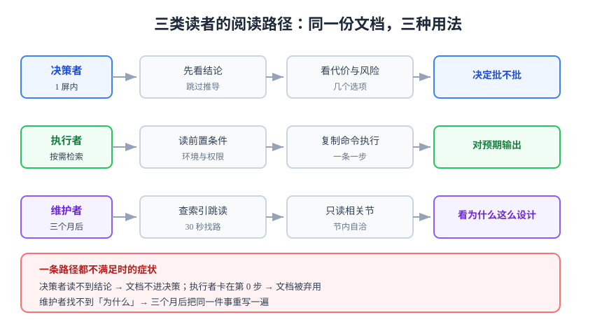

# 概述：读者、载体与验收标准

一页技术文档的价值不在「写得多完整」，而在**读者用它做了什么**。所以动笔前必须先回答三件事：**谁读、他要在多长时间里做什么、做完算成功的样子是什么。** 这三问答不出来，后面所有写作技巧都只是在装饰一份没人用的东西。

## 一、三类读者：他们要的东西不一样

同一个系统，三类读者的「阅读姿势」完全不同。写作前先确定主读者，**一份文档只服务一类主读者**：

| 读者 | 典型场景 | 他要什么 | 能容忍的长度 | 失败形态 |
| --- | --- | --- | --- | --- |
| **决策者** | 评审、立项、事故后追责 | 结论、代价、风险、选项 | 1 屏内看到结论 | 读完仍不知道「该不该批」 |
| **执行者** | 部署、排障、接入 | 命令、前置条件、预期输出 | 按需检索，单节不超过 1 屏 | 卡在第 0 步，或跑完不知道对不对 |
| **未来的维护者**（常常是你自己） | 三个月后改这块代码 | 为什么这么设计、当时否掉了什么 | 可跳读，需要索引 | 「不敢改」或「改完踩同一个坑」 |

::: tip 一句话判据
**决策者要「所以呢」，执行者要「然后呢」，维护者要「为什么」。** 一段话如果三类读者都能读，通常意味着三类都没被服务好。
:::



## 二、四种载体：先选形态，再写内容

载体选错，写得多好都别扭。四种载体的差别不在长度，而在**读者是「学」还是「查」**：

| 载体 | 读者姿态 | 结构特征 | 成功的标志 |
| --- | --- | --- | --- |
| **解释**（Explanation） | 从头读到尾，为了理解 | 概念递进，允许铺垫与类比 | 读者能自己回答「为什么不是另一种方案」 |
| **教程**（Tutorial） | 跟着做，为了学会 | 一条主路径，无分支 | 读者按顺序做完，得到同一个结果 |
| **操作**（How-to / Runbook） | 跳着查，为了完成任务 | 按任务分节，节内自洽 | 任取一节，冷读者也能执行 |
| **参考**（Reference） | 精确查找某个事实 | 表格化、可扫描、无叙事 | 找到即用，不需要读上下文 |

企业内部的五类常见文档与它们的映射关系：

| 内部文档 | 对应载体 | 主读者 | 必须包含的「验收物」 |
| --- | --- | --- | --- |
| 设计文档 / RFC | 解释 + 参考 | 决策者、维护者 | 被否掉的方案与理由、影响的边界 |
| 操作手册 / Runbook | 操作 | 执行者 | 每条命令的预期输出、失败时的下一步 |
| 故障报告 | 解释 + 操作 | 决策者、维护者 | 时间线（带时间戳）、可复现的判据、改进项的归属 |
| 交接文档 | 操作 + 参考 | 执行者 | 「谁在什么条件下找谁」的对照表 |
| 技术分享稿 | 解释 | 混合 | 一句话主张 + 三个支撑证据 |

::: danger 最常见的载体错配
把 Runbook 写成散文：**「首先我们需要确认数据库的连接状态是否正常」**。执行者在凌晨三点读到这句话，需要的是 `mysqladmin ping`，不是「我们需要」。

反向的错配同样常见：把设计文档写成命令清单，读者知道了怎么做，但不知道为什么这么做——三个月后没人敢改。
:::

## 三、写作是一次接口设计

把文档当成一个被调用的函数，很多模糊的要求会立刻变成明确的缺口：

| 函数要素 | 文档要素 | 缺失后的症状 |
| --- | --- | --- |
| 参数 | 前置条件：环境、权限、版本、已有数据 | 读者在第 0 步就失败 |
| 返回值 | 可验证结果：命令输出、页面状态、数字区间 | 读者做完了不知道算不算成功 |
| 异常 | 失败处置：常见错误、回滚方式、找谁 | 出错后只能停在那里等人 |
| 副作用 | 影响范围：会改哪些数据、会影响谁 | 读者不敢执行，或误伤他人 |
| 幂等性 | 可重复执行 | 第二次执行结果不同，无法复核 |

一份文档只要把前三个补齐，就可用了；补齐后两个，才敢交给别人执行。

## 四、四条可验收标准

这四条是本专题的骨架，后面每一页都在展开其中一条：

### 标准一：可判定

每个结论后面必须跟着「看到什么算通过」。判定的形态只有三种，**形容词不算**：

| 写法 | 判定形态 | 是否可验收 |
| --- | --- | --- |
| 「服务应保持稳定」 | 无 | ❌ 形容词 |
| 「三个容器状态均为 `running`」 | 布尔 | ✅ |
| 「`/metrics` 返回 200，且 `up` 为 1 的目标数等于 3」 | 数字关系 | ✅ |
| 「错误率低于 0.5%」 | 阈值 + 口径 | ✅（需同时写明统计窗口） |

### 标准二：可执行

每条步骤是**一条可以复制粘贴的命令 + 一个预期输出**。「请确保环境满足要求」不是步骤，是愿望。

### 标准三：可复核

每个数字都要写清「**什么时候、对着哪个对象、用什么方式取的**」。同一个指标，不同口径能差出一个数量级：

```shell
# 口径写不出来的读数，不能进文档
docker inspect monitoring-prometheus-1 \
  --format '{{index .Config.Labels "com.docker.compose.project.config_files"}}'
# → /tmp/monitoring-run/compose.yaml    ← 说明这个容器是被哪份编排起的
```

### 标准四：可定位

读者要能在 **30 秒内**回答「我现在该看哪一节」。判据很机械：给出一个真实问题（例如「告警没收到」），让没读过这份文档的人找，计时。超过 30 秒就是导航失败，与内容质量无关。

## 五、什么时候不该写长篇

写作也有「不该做」的场景，硬写只会产出负债：

1. **结论还没定**——用一页决策记录（选项、代价、倾向）代替长文，等定了再写；
2. **只有一个人会读**——写进提交信息或工单评论，比新建一份文档更可能被读到；
3. **内容会每周变**——写成脚本或配置里的注释，让它在变更处就地可见；
4. **已经在别处写过**——补一个链接和一句「为什么这里不一样」，不要复制第二份。

::: warning 复制第二份的代价
同一段内容存在两处，就一定会漂移；漂移之后，读者无法判断哪一份是当前口径。**判据：这段内容如果明天改了，有几处要跟着改？答案大于 1 就不该复制。**
:::

## 六、最小起步五步

1. **写一句主张**：这份文档要让读者做什么决定或动作（一句话，不超过 40 字）。
2. **点名主读者**：三类读者里选一个，其余降级为「可查阅」。
3. **列验收物**：读者读完手上应该多出什么（一个决定、一条命令跑通、一份清单）。
4. **搭骨架**：用[结构与逻辑](../Structure/index.md)的七模块填空，先写标题不写正文。
5. **先跑一遍**：照自己写的步骤做一次，把卡住的地方记下来——那是文档真正的缺陷清单。

## 验证方式

- 找一位没参与写作的同事，只给他这份文档，让他完成文档声称能完成的任务；记录**第一次卡住的位置**。
- 抽查三个数字，问他「这个数是什么时候、对着什么取的」——答不出即「可复核」不成立。
- 用一句话复述文档主张，与作者的原句对比；偏差过大说明主张没写在显眼处。

```shell
# 一个粗糙但有效的自查：全文形容词与模糊量词计数
grep -oE '正常|稳定|较快|适当|若干|左右|大概|尽量' 你的文档.md | sort | uniq -c | sort -rn
# 期望：0 行输出。每出现一次，就有一处判据是空的。
```

## 参考资料

- [Diátaxis：教程 / 操作 / 参考 / 解释四象限](https://diataxis.fr/)
- [ISO 24495-1:2023 Plain language](https://www.iso.org/standard/78907.html)
- [Google Technical Writing：Audience 一节](https://developers.google.com/tech-writing/one/audience)
- [Write the Docs：文档类型指南](https://www.writethedocs.org/guide/)
