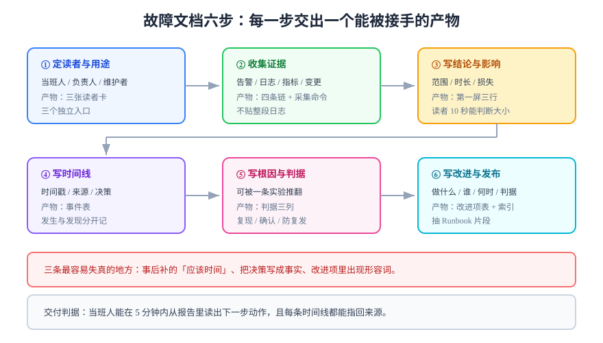

# 实战：把一次线上故障写成可复用文档

本节把前面五页的方法落到一件事上：**手上有一份告警记录、几段日志、几条聊天记录，要写成一份三个月后还能被拿来用的故障报告。** 走完六步，产出物是一份 2 页左右、能被第二个人复核、能被下一次直接套用的文档。

选这个场景做实战，是因为它同时踩中写作的四个难点：**事实零散、读者分层、结论有争议、写完还要能复用**。



## 第 1 步：定读者与用途

不要写「给大家看的报告」。三类读者的用法完全不同，先各写一张读者卡：

| 读者卡 | 他要在什么时刻读 | 他要拿走的 | 文档里对应哪节 |
| --- | --- | --- | --- |
| **当班人**（下次同类故障） | 凌晨，故障正在发生 | 一条能立刻执行的命令 / 找谁 | 「快速判定」一节，放在最前 |
| **技术负责人** | 第二天上午，决定改不改 | 影响范围、根因、代价 | 「结论与影响」一节，控制在一屏 |
| **三个月后的维护者** | 改这块代码之前 | 当时为什么这么设计、踩过什么 | 「根因」与「改进项」两节 |

::: tip 一句判据
**三类读者的进入点不同，所以文档里必须有三条独立的入口。** 如果只有一条从「背景」开始的路径，当班人不会读它——他在赶时间。
:::

## 第 2 步：收集证据（四条链）

故障报告的可靠性取决于**证据是否能追溯到具体来源**。四条链缺一条，结论就会被质疑：

| 证据链 | 取什么 | 存什么 | 常见错误 |
| --- | --- | --- | --- |
| 告警 | 触发时间、恢复时间、规则名 | 截图或 API 返回原文 | 只记「大概 8 点多」 |
| 日志 | 首条异常、最后一条异常、错误码分布 | 关键 20 行，不是 2000 行 | 贴整段日志，读者找不到重点 |
| 指标 | 异常前后的数值与窗口 | 查询语句 + 数值 | 只贴图，不给查询 |
| 变更 | 窗口内的发布、配置、DDL、开关 | 提交号 / 工单号 / 操作人 | 漏掉「有人改了一个开关」 |

```shell
# 四条链的最小采集脚本（示例，按自己的栈替换查询）
TS=$(date -u +%Y-%m-%dT%H:%M:%SZ); echo "采集时间 $TS"

# ① 告警：当前活跃告警
curl -s localhost:9090/api/v1/alerts | jq -r '.data.alerts[] | "\(.labels.alertname)\t\(.state)\t\(.activeAt)"'

# ② 日志：只留错误级，前后各 5 分钟
journalctl -u blog-api --since '08:05' --until '08:45' -p err --no-pager | head -20

# ③ 指标：一条查询 + 一个数
curl -s 'localhost:9090/api/v1/query?query=histogram_quantile(0.95,sum(rate(http_request_duration_seconds_bucket[5m]))by(le))' \
  | jq -r '.data.result[0].value[1]'

# ④ 变更：窗口内的提交
git log --since='2026-10-16 07:00' --until='2026-10-16 09:00' --oneline
```

::: warning 「证据」不等于「截图」
截图无法被检索、无法被 diff、也无法证明是哪一刻取的。**优先贴命令与文本输出**，截图只在「只有界面能表达」时使用，并在图注里写清采集时间。
:::

## 第 3 步：写结论与影响

第一屏只放三行：结论、影响、状态。

```markdown
## 结论

08:12—08:41 写入延迟升高，根因是主库磁盘 IO 被打满（`iowait` 62%），
由一次未限速的批量回填触发。已于 08:41 限速并恢复。

## 影响

- 范围：全部写请求（读请求不受影响）
- 时长：29 分钟
- 损失：132 个写请求失败（客户端已重试成功 118 个），无数据丢失
- 用户可见：发布按钮偶发「保存失败」提示

## 状态

已恢复。改进项 3 条，见第 6 节。
```

**影响必须三要素齐全**：范围（谁受影响）、时长（多久）、损失（多少）。缺任何一个，读者都无法判断「这事大不大」。

## 第 4 步：写时间线

时间线是故障报告里**唯一不能被总结替代**的部分。四条纪律：

1. **统一时区并写明**（`全部为 UTC+8`）；
2. **每条带来源**（告警 / 人工发现 / 日志 / 变更）；
3. **区分「发生」与「被发现」**——两者的差值是 MTTD；
4. **判定句单独成行**：谁在什么时刻做了什么决定。

```markdown
| 时间 | 事件 | 来源 |
| --- | --- | --- |
| 08:11:40 | 批量回填任务启动（未限速） | 变更记录 #4412 |
| 08:12:05 | `HighWriteLatency` 告警触发 | 告警 |
| 08:14:20 | 值班确认告警，开始排查 | 人工 |
| 08:22:10 | 定位到 `iowait` 62%，确认与回填任务时间吻合 | 指标 + 变更 |
| 08:26:00 | **判定**：先限速，不回滚（回滚会丢已回填的 3 万行） | 决策 |
| 08:41:30 | 延迟回落至基线，告警恢复 | 告警 |
```

::: danger 时间线里最常见的两种失真
1. **事后补的「应该时间」**——写着 08:15 发现，实际是 08:22，MTTD 因此被低估 7 分钟，改进项也就定错了方向；
2. **把决策写成事实**——「决定限速」不是事实，**「谁在几点决定限速，理由是什么」**才是。
:::

## 第 5 步：写根因与判据

根因要写成**可证伪的句子**，而不是一个名词。对比：

| 写法 | 问题 | 改写 |
| --- | --- | --- |
| 「磁盘 IO 高」 | 这是现象，不是根因 | 未限速的批量回填把 `iowait` 推到 62%，超过写入路径的容忍阈值 40% |
| 「代码有 bug」 | 无法验证 | 回填任务缺少 `batch_size` 与 `sleep` 限制，单批 5 万行 |
| 「运维操作不当」 | 归因到人，不可改 | 变更流程里没有「大批量任务必须限速」的检查项 |

然后给**判据三列**：怎么复现、怎么确认已修复、怎么防止复发。

```markdown
| # | 判据 | 怎么验证 |
| --- | --- | --- |
| R1 | 回填任务必须带 `--batch-size<=1000 --sleep=50ms` | `grep -E 'batch-size|sleep' scripts/backfill.sh` 有输出 |
| R2 | 同类任务启动时 `iowait` 不超过 40% | 预发跑 5 分钟，`iostat -x 1 5` 观察 `%util` |
| R3 | `HighWriteLatency` 告警能在 2 分钟内触发 | 用 `stress-ng --hdd` 注入，计时 |
```

## 第 6 步：写改进项与发布

改进项必须四要素齐全：**做什么、谁做、什么时候、怎么算完成**。

```markdown
| # | 改进项 | 归属 | 截止 | 完成判据 |
| --- | --- | --- | --- | --- |
| 1 | 回填脚本加限速参数与默认值 | 后端-张 | 10-20 | 脚本 `--help` 含 `--batch-size`，默认 1000 |
| 2 | 变更流程加「大批量任务」检查项 | 平台-李 | 10-24 | 工单模板出现该必填项 |
| 3 | 写入延迟告警阈值从 800ms 调到 500ms | SRE-王 | 10-18 | `alerting.yaml` 中 `for: 2m` 且阈值 0.5 |
```

::: warning 「加强监控」「提高意识」不是改进项
它们没有归属人、没有截止、没有判据，因此永远不会被验收。**判据里出现形容词，这条改进项就作废。**
:::

发布与复用的三个动作：

1. 报告归档到固定路径（如 `docs/incidents/2026-10-16-write-latency.md`），文件名带日期与现象；
2. 在团队索引页加一行（日期 + 一句话 + 链接），否则没人找得到；
3. 把「快速判定」一节抽成 Runbook 片段，下次直接从那一节开始。

## 验收清单（9 条）

| # | 检查项 | 通过标准 |
| --- | --- | --- |
| 1 | 第一屏有结论 | 只读前 10 行能说出「发生了什么、影响多大、现在怎样」 |
| 2 | 影响三要素齐全 | 范围 / 时长 / 损失都有具体值 |
| 3 | 时间线带时区与来源 | 每条都有出处，发生与发现分开 |
| 4 | 决策有主 | 每条「判定」写明谁、何时、理由 |
| 5 | 根因可证伪 | 能被一条实验推翻 |
| 6 | 判据可执行 | 每条都有命令或查询 |
| 7 | 改进项四要素 | 做什么 / 谁 / 何时 / 怎么算完成 |
| 8 | 无形容词判据 | 全文搜不到「正常 / 稳定 / 尽量」 |
| 9 | 有复用入口 | 报告已进索引，Runbook 片段已抽出 |

## 验证方式

- **当班人模拟**：把报告只给「快速判定」一节，让同事在 5 分钟内说出下一步动作；
- **证据抽查**：随机抽 3 条时间线，问「这条的来源在哪」，答不出即不可复核；
- **判据复跑**：至少跑通 1 条「怎么确认已修复」的判据，读数写回文档；
- **改进项跟踪**：一周后回看，四条要素是否仍有人认领（只写不做是常态，需要显式跟踪）。

```shell
# 交稿前的机械自查（三条，全部应返回 0）
grep -cE '正常|稳定|尽量|大概|左右' 报告.md
grep -cE 'TODO|待补|待确认' 报告.md
grep -c '^| ' 报告.md   # 若为 0，说明连一张表都没有，大概率缺判据
```

## 参考资料

- [Google SRE Book：Postmortem Culture](https://sre.google/sre-book/postmortem-culture/)
- [PagerDuty：Incident Response Documentation](https://response.pagerduty.com/)
- [Write the Docs：Incident reports](https://www.writethedocs.org/guide/writing/style-guides.html)
