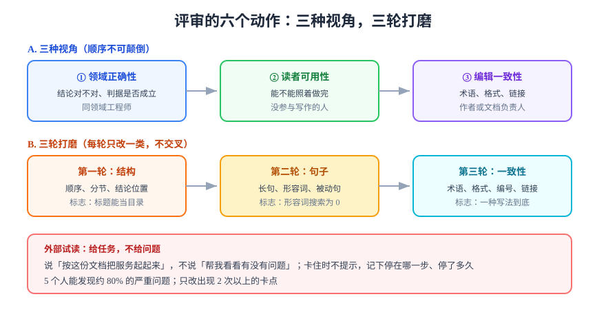

# 评审与打磨

评审失效的典型场景：三个人读完，给出「整体不错」「建议再打磨一下」「结构可以更清晰」——作者改了一版，没人看得出变了什么。原因不是态度，而是**评审缺少可判定的对象**：评论的对象是「感觉」，而感觉无法被复现。

## 一、把评审变成清单

评审要问的是「这一页能不能完成它的任务」，而任务可以被拆成 12 条可判定项。每条都给出**怎么查**，避免落到主观：

| # | 判据 | 怎么查 | 不通过的例子 |
| --- | --- | --- | --- |
| 1 | 第一段给出结论 | 只读第一段 | 「本文介绍……」后接三段背景 |
| 2 | 主读者明确 | 全文找「谁来做」 | 「相关人员需注意」 |
| 3 | 每条步骤可执行 | 抽查 3 条命令能否直接复制 | 「配置好数据库连接」 |
| 4 | 每个数字有口径 | 抽 3 个数字问「何时、对谁、怎么取」 | 「延迟约 200ms」 |
| 5 | 有验证收尾 | 找「看到什么算通过」 | 步骤结束后直接进入「小结」 |
| 6 | 有失败处置 | 找「出错怎么办」 | 只有成功路径 |
| 7 | 标题可当目录 | 只读标题 | 全部是「概述 / 说明 / 其他」 |
| 8 | 术语唯一 | 同一概念两种写法 | 「判据」与「验收标准」混用 |
| 9 | 无空判据 | 搜形容词 | 「稳定」「较快」「尽量」 |
| 10 | 图承重 | 删图后是否仍可读 | 图里只有一排文字框 |
| 11 | 引用可追溯 | 点开 3 个链接 | 「详见附件」「参见上文」 |
| 12 | 边界写明 | 找「本文不回答什么」 | 什么都想讲，读者不知道边界 |

::: tip 评审的正确姿势
**带着任务读，而不是带着心情读。** 给评审人一句话任务：「假设你要按这份文档在预发环境部署一次，读的时候把第一次卡住的地方标出来。」——这一句话能把 80% 的主观评论变成具体缺陷。
:::



## 二、三种评审视角

不同角色的评审重点不同，**顺序不能颠倒**——先用编辑视角挑错别字，会让结构性问题的修改白做：

| 顺序 | 视角 | 谁来看 | 只看什么 | 不看什么 |
| --- | --- | --- | --- | --- |
| ① | **领域正确性** | 同领域工程师 | 结论对不对、判据是否成立 | 排版、措辞 |
| ② | **读者可用性** | 没参与写作的人 | 能不能照着做完 | 内部实现细节 |
| ③ | **编辑一致性** | 作者自己或文档负责人 | 术语、格式、标题层级、链接 | 技术结论 |

## 三、评审意见怎么写

一条有效的评审意见包含三件事：**位置 + 问题类型 + 改法（或至少一个方向）**。

| 差的意见 | 为什么无效 | 改写 |
| --- | --- | --- |
| 这里不太清楚 | 不知道哪里、为什么 | 第 3 节第 2 条命令没有预期输出，读者无法判断成功 |
| 建议补充说明 | 补什么？ | 缺「失败时怎么办」：补一张错误码 → 处置表 |
| 结构可以更好 | 无法执行 | 建议把「结论」提前到第 1 段，现有第 1~3 段压成背景 |
| 我觉得这样更好 | 缺理由 | 三处「稳定」建议换成「错误率 < 0.5%」，否则无法验收 |

::: danger 「作者已读，无意见」
沉默不等于通过。评审记录里必须能回答：**谁看了哪几条判据、哪几条没看**。这跟代码评审里「Approve 但没看 diff」是同一类风险。
:::

## 四、三轮打磨法

不要一次改所有问题，分三轮，每轮只做一类：

| 轮次 | 只改什么 | 典型动作 | 完成标志 |
| --- | --- | --- | --- |
| **第一轮：结构** | 顺序、分节、结论位置 | 调整章节、拆并小节 | 标题能当目录读 |
| **第二轮：句子** | 长句、形容词、被动句 | 拆句、换数量词、加主语 | 形容词搜索为 0 |
| **第三轮：一致性** | 术语、格式、链接、编号 | 统一写法、补链接、查编号 | 同一概念只有一种写法 |

三轮之间**不要交叉**：在改结构的同时改错别字，会让你在移动段落时丢掉刚改的内容。

## 五、外部试读：五个人法则

内部评审有一个天然缺陷：评审人知道得太多。外部试读能补上这一块：

1. **找 3~5 个没参与的人**（不必是专家，最好是目标读者）；
2. **给任务不给问题**：不说「帮我看看有没有问题」，说「按这份文档把这套服务起起来」；
3. **只看不说**：卡住时不提示，记录他停在哪一步、停了多久；
4. **记录卡点**：位置、现象、他的原话（原话比你的总结更有价值）；
5. **只改前三类卡点**：出现≥2 次的卡点优先，一次性的个性化问题可以不改。

::: warning 五个人就够了
可用性测试的经验是：**5 个人能发现约 80% 的严重问题**。找 20 个人的边际收益很低，而组织成本很高——把精力放在改上，而不是找人上。
:::

## 六、评审记录：改了什么、为什么不改

评审意见不是全部都要采纳。**不采纳的必须留理由**，否则下一轮会被重新提一遍：

```markdown
| # | 意见 | 处置 | 理由 |
| --- | --- | --- | --- |
| 1 | 补「失败处置」一节 | ✅ 已补 | 第 6 节新增错误码表 |
| 2 | 建议改成中英双语 | ❌ 不改 | 面向内部读者，双语会拉长 40% 且增加漂移面 |
| 3 | 第 3 节命令加 `-f` 参数 | ✅ 已改 | 无 `-f` 时 4xx 不返回非零退出码 |
```

## 验证方式

- 用 12 条判据逐条打勾，**空着的条目就是未完成项**；
- 抽查 3 条命令，能在干净环境跑通即为「可执行」成立；
- 让一位没读过的人完成文档声称的任务，记录第一次卡住的位置与耗时；
- 检查评审记录是否覆盖所有提出的意见（含不采纳的）。

```shell
# 交稿前最后一次机械自查（本库常用的三类）
grep -cE '正常|稳定|较快|适当|左右|尽量' 你的文档.md   # 期望 0
grep -c '【待补】\|TODO\|待补充' 你的文档.md            # 期望 0
python3 -c "import re,sys;t=open('你的文档.md',encoding='utf-8').read();print('H1 数量',len(re.findall(r'^# ',t,re.M)))"  # 期望 1
```

## 参考资料

- [Nielsen Norman Group：Why You Only Need to Test with 5 Users](https://www.nngroup.com/articles/why-you-only-need-to-test-with-5-users/)
- [Google Technical Writing：Editing](https://developers.google.com/tech-writing/two/editing)
- [Write the Docs：Review guidelines](https://www.writethedocs.org/guide/writing/review-guidelines.html)
