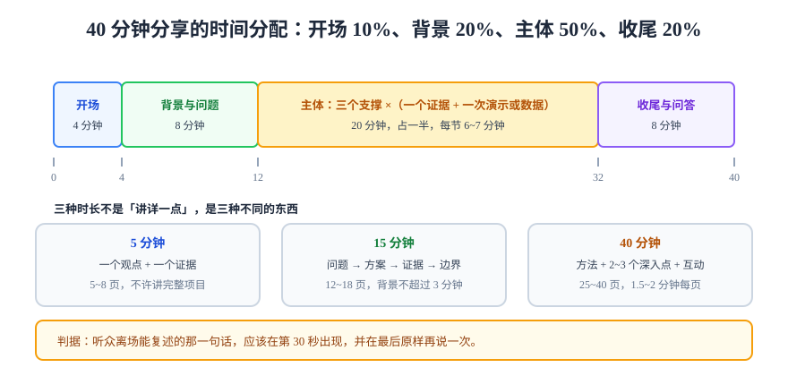

# 演讲与分享

技术分享不是「把文档念一遍」，而是**在有限时间里改变听众的一个判断**。它和写作共享同一套内核（结论先行、判据、示例），差别只在**带宽**：口头表达是线性的、不可回看的，所以结构必须更硬、冗余必须更多。

## 一、时长决定结构

同一个主题，5 分钟和 40 分钟不是「讲得详细一点」，而是**两种不同的东西**：

| 时长 | 只能做到 | 结构 | 页数 | 常见错误 |
| --- | --- | --- | --- | --- |
| **5 分钟**（闪电演讲） | 讲清一个观点 | 结论 + 一个证据 + 一句号召 | 5~8 页 | 想讲完整个项目 |
| **15 分钟** | 讲清一个问题与一种解法 | 问题 → 方案 → 证据 → 边界 | 12~18 页 | 背景占掉一半 |
| **40 分钟** | 讲清一套方法与取舍 | 全场结构 + 2~3 个深入点 + 互动 | 25~40 页 | 平均用力，没有重点 |

::: tip 一句话判据
**听众离场时能复述的那一句话，就是你真正讲完的内容。** 那句话应该在开场 30 秒内出现，并在结尾原样再说一次。
:::



## 二、一句话主张与三个支撑

准备分享的第一步不是做幻灯片，而是写出一句话：

```text
我认为【谁】应该【做什么改变】，因为【三个支撑】。
```

例：**我认为后端同学应该把「判据」写进交付文档，因为验收扯皮、口径打架、回滚无人敢拍板这三件事，根因都是判据缺失。**

三个支撑就是主体的三节，每节只需要一个证据（数据、事故、演示）。**超过三个支撑，听众一个都记不住。**

## 三、开场 30 秒

开场只有两个任务：**让听众知道为什么要听，让他知道你会讲多久。**

| 开场方式 | 适用 | 例子 |
| --- | --- | --- |
| **结论式** | 听众已经关心这个主题 | 「今天讲一件事：我们的发布回滚平均 27 分钟，能压到 4 分钟。」 |
| **问题式** | 听众不知道自己有问题 | 「上次发布出问题，是谁决定回滚的？举手看看。」 |
| **反直觉事实** | 主题偏枯燥 | 「我们 80% 的线上故障，改的是配置，不是代码。」 |

::: danger 三种最贵的开场浪费
1. **自我介绍 90 秒**——听众不关心你的履历，只关心你能不能解决问题（一句「我是 XX，负责 XX」足够）；
2. **目录页朗读**——「我今天讲四部分」，接着把四部分念一遍，等于浪费两分钟；
3. **感谢主办方 60 秒**——留到结尾一句即可。
:::

## 四、幻灯片三原则

| 原则 | 具体做法 | 反面 |
| --- | --- | --- |
| **一页一论点** | 标题写成结论句，页内只放支撑它的图或三条要点 | 一页四个并列主题，听众不知看哪 |
| **字少图大** | 单页文字 ≤ 30 字，图占 60% 以上面积 | 把文档段落粘进 PPT，字号 14 |
| **字号可读** | 正文 ≥ 24pt，代码 ≥ 18pt | 现场后排读不到，等于没写 |

页数与时长的经验换算：**1.5~2 分钟/页**。40 分钟 ≈ 25 页正稿 + 10 页备用（备在问答环节）。

## 五、讲稿与提词

念稿是最容易被识别的紧张信号，也最容易让听众走神。可行的做法是**只写路标句**：

```markdown
<!-- 每页只写三样：这一页要改变什么判断、一句过渡、一个必须说出的数字 -->
P7 关键页
- 要改变：听众以为「回滚慢是流程问题」→ 其实是「不知道回滚到哪个版本」
- 过渡：「所以问题不在流程，在可回滚性。」
- 必说：27 分钟里，21 分钟花在确认版本。
```

::: tip 排练的判据
**不看幻灯片也能讲完主线的三节**，说明结构在你脑子里；做不到，说明你还在背稿。
:::

## 六、演示（Demo）的三条纪律

现场演示的风险与收益都极高，三条纪律可以把风险压到可接受：

1. **预录兜底**：现场演示 + 一段 60 秒录屏，网络或环境失败时直接放录屏，并说明「这是刚才同一操作的录制」；
2. **时间盒**：演示不超过总时长的 20%，且提前设定「如果 2 分钟内没出结果就切录屏」；
3. **结果先行**：先给观众看结果页（已成功的界面 / 已通过的断言），再回放过程——**观众要的是结论，过程只是可信度**。

## 七、现场问答：四类问题与应答

| 问题类型 | 特征 | 应答模板 |
| --- | --- | --- |
| **澄清型** | 「你刚才说的 X 是指？」 | 一句话复述定义，再补一个例子（20 秒内） |
| **质疑型** | 「你这个方案在 Y 场景不成立」 | 先承认边界（「对，Y 场景我们没覆盖」），再给判据或后续动作 |
| **经验型** | 「我们那边是这样做的」 | 记录 + 对比一句差异，不辩论 |
| **超纲型** | 你不确定答案 | 「这个我没验证过，会后我查一下发到群里」——**不要编** |

::: warning 「好问题」是最贵的敷衍
对每个问题都说「好问题」，听众会立刻知道你没在听。有效的替代：**复述问题里的关键约束**（「你担心的是多租户下的越权，对吧？」）——这既确认了理解，也给自己 5 秒思考时间。
:::

## 八、四种翻车与处置

| 翻车 | 症状 | 处置 |
| --- | --- | --- |
| 设备故障 | 投影不出、麦克风无声 | 提前 15 分钟到场；准备 PDF 版本；不现场装驱动 |
| 超时 | 讲到第 3 节已用掉 80% 时间 | 提前标记「可删页」，超时直接跳到结论与问答 |
| 被质疑卡住 | 一个问题把你带偏 10 分钟 | 「这个问题很重要，我们会后单独展开，先保证后面两节讲完」 |
| 冷场 | 提问无人应答 | 换成举手式二选一（「用过 A 的举手」），比开放提问门槛低 |

## 九、分享之后：把一次讲变成一份资产

分享的最大浪费是「讲完就完了」。三件事让一次分享留下资产：

1. **幻灯片补讲稿注释**（每页一句「这页要说什么」），归档到文档库；
2. **把问答整理成 FAQ**，尤其是「被问住」的那几个；
3. **录播加时间戳索引**（00:03:20 回滚三段式 / 00:11:05 判据清单），否则没人会看完 40 分钟。

## 验证方式

- **计时彩排**：完整走一遍，记录每节实际用时与计划的偏差，超过 20% 就删内容；
- **试讲给一个人**：让对方在结束后复述你的主张，复述不出说明开场失败；
- **录一遍回看**：只看三件事——有没有念稿、有没有超时、有没有一页讲超过 3 分钟；
- **材料沉淀检查**：分享结束后 48 小时内，幻灯片、FAQ、时间戳索引三样是否都已归档。

```shell
# 幻灯片字数的粗查（导出的纯文本，按页统计）
awk 'BEGIN{RS="\f"} {n=length($0); if (n>400) printf "第 %d 页字数 %d，建议精简\n", NR, n}' slides.txt
# 期望：无输出（单页正文超过 400 字通常意味着在念稿）
```

## 参考资料

- [Google Technical Writing：Presentations](https://developers.google.com/tech-writing/two/slides)
- [Nielsen Norman Group：Presentation structure](https://www.nngroup.com/articles/presentation-structure/)
- [Speaking.io：How to prepare a technical talk](https://speaking.io/)
