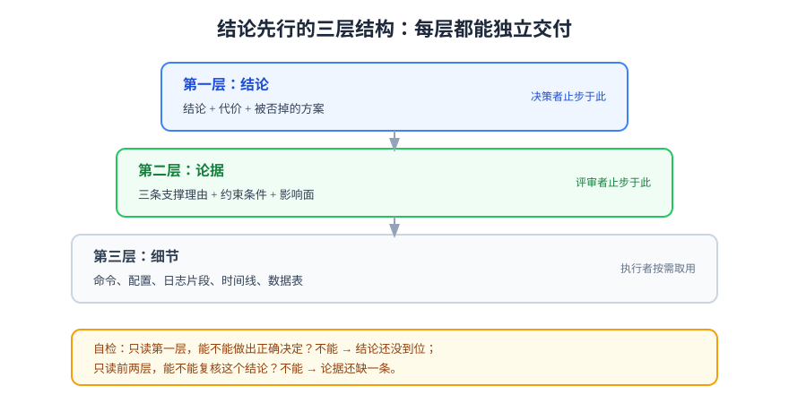

# 结构与逻辑

结构解决的是**读者的路径问题**：同一堆事实，按不同顺序摆放，一份会被读完，另一份会在第二段被关掉。判断结构好坏的标准很朴素——**把每一级标题单独摘出来，能不能当一份目录读懂。**

## 一、结论先行：把「所以呢」放到第一段

技术文档最常见的结构病是「按思考顺序写」：背景 → 调研 → 尝试 → 排除 → 结论。作者写得很顺，因为那就是他的思考过程；读者却要读到 80% 才知道这页在讲什么。

**结论先行（BLUF, Bottom Line Up Front）** 要求第一段就给出结论，后续内容都是支撑：

| 结构 | 第一段写什么 | 读者成本 |
| --- | --- | --- |
| 思考顺序 | 「我们先看一下背景……」 | 必须读完才知道结论 |
| 结论先行 | 「结论：保留双写方案，代价是 3 天工期。理由三条，见下。」 | 3 秒决定要不要继续读 |

结论先行的三种模板，按载体选一个：

```markdown
<!-- 设计文档：结论 + 代价 + 备选 -->
结论：采用方案 B（读写分离 + 影子库），预计工期 5 天。
代价：需要一套影子库同步任务，长期多一份运维成本。
被否掉的方案：A（双写）一致性更好但回滚困难。

<!-- 故障报告：结论 + 影响 + 状态 -->
结论：08:12 起写入延迟升高，根因是主库磁盘 IO 打满，已于 08:41 恢复。
影响：期间 132 个写请求失败，无数据丢失。
状态：已恢复，改进项 3 条（第 5 节）。

<!-- Runbook：适用 + 结果 + 时长 -->
适用：读者端 502 且容器在运行。
结果：恢复后 `/health` 返回 200、错误率回到基线。
时长：正常 2 分钟，含验证 5 分钟。
```

::: tip 一句话检验
写完第一段，问自己：**如果读者只读这一段就走，他能不能做出正确的决定？** 不能就说明结论还不够靠前。
:::



## 二、页面骨架七模块

本库所有技术页都按这套骨架写，它对应「读者从进入到离开」的七个问题：

| 模块 | 回答的问题 | 参考长度 | 省略后的后果 |
| --- | --- | --- | --- |
| ① 一句话定位 | 这是什么、解决什么问题、给谁看 | 1~2 句 | 读者不知道要不要读 |
| ② 适用与前置 | 什么版本、什么环境、需要什么权限 | 1 个短表 | 读者跑不通，且不知道是环境问题 |
| ③ 核心概念 / 结论 | 关键定义与原理（或直接给结论） | 1~3 节 | 后面全是「怎么」而没有「为什么」 |
| ④ 步骤 / 设计 / 对照 | 主体内容 | 占全文 50%~70% | 文档变成概述，落不了地 |
| ⑤ 判据与验证 | 看到什么算成功 | 1 节或 1 表 | 读者做完不知道对不对 |
| ⑥ 失败处置 | 常见错误、回滚、找谁 | 1 表或 1 节 | 出错即卡死 |
| ⑦ 参考资料 | 官方来源、延伸阅读 | 3~5 条 | 读者无法自行核对 |

::: warning 只有 ④ 的文档
最常见的残缺形态是「只有步骤」：读者照着敲完，不知道自己在干什么，也不知道成功了没有。**④ 是主体，但 ⑤ 才是交付物**——没有 ⑤ 的步骤清单，在交付场景里等同于「口头说了一句」。
:::

## 三、标题要能当目录读

标题是全文复用率最高的部分：读者先扫标题，再决定读哪节。所以标题必须**带信息**，不能只是分类名词。

| 弱标题 | 强标题 | 差在哪 |
| --- | --- | --- |
| 背景 | 写入延迟升高的直接原因是磁盘 IO 打满 | 给出了结论，不只是话题 |
| 使用方法 | 用一条命令完成首次部署（约 50 秒） | 给了动作与代价 |
| 注意事项 | 三个会让配置静默失效的写法 | 给了数量与后果 |
| 总结 | 保留双写，代价是 3 天工期 | 结论可被引用 |

三条机械规则：

1. **标题里出现动词**——「怎么配」「为什么失败」比「配置」「问题」可读；
2. **标题里出现数量或结论**——「三个坑」让读者知道要读几条；
3. **同级标题句式一致**——同层要么都是动宾，要么都是名词短语，混排会让层级感消失。

::: danger 标题写成「一、二、三」的风险
纯序号标题（「一、概述」「二、实现」）在没有上下文时零信息量，且一旦插节就要重排序号。本库的做法是**序号 + 语义**（「二、页面骨架七模块」），序号只用于标记顺序，语义承担导航。
:::

## 四、段落节奏：一段一意

段落是阅读的最小单位。三条纪律：

- **一段只讲一件事**，超过 5 行（约 120 字）就该拆；
- **每段第一句是结论**，后面是支撑——这与「结论先行」是同一个原则的缩小版；
- **并列内容用列表，对照关系用表格，因果链用段落**——三者不要混用。

| 内容形态 | 该用什么 | 不该用什么 |
| --- | --- | --- |
| 三个并列的检查项 | 无序列表 | 一段里逗号连接 |
| 两种方案的六个维度对比 | 表格 | 两段各自叙述 |
| 「因为 A 所以 B，但 C 会导致 D」 | 段落 | 拆成四条列表（因果会丢） |
| 操作步骤 | 有序列表 + 命令块 | 段落里嵌命令 |

## 五、长文导航：三件套

超过 5 屏的文档，导航比内容更影响可用性。三件事必须做：

1. **开头的「本文回答什么 / 不回答什么」**——两行，写死边界（本库每个专题首页都在用）；
2. **一节内的自洽**——读者从任何一节进入都能读懂，不依赖上一节；
3. **交叉引用带理由**——不写「详见上文」，写「版本差异见第 2 节表格的最后两行」。

```markdown
## 本文回答什么

- 为什么写入延迟会在磁盘 IO 打满时放大 10 倍；
- 三个可以立刻执行的排查命令。

## 本文不回答什么

- 磁盘扩容的具体采购流程（见《容量规划》）；
- 历史上的三次同类事故（见《故障档案》）。
```

## 六、三种载体的骨架对照

同一套七模块，落到三种载体上的顺序并不相同——**因为读者的进入点不同**：

| 载体 | 推荐顺序 | 关键差异 |
| --- | --- | --- |
| 设计文档 | 结论 → 约束 → 方案 → 被否方案 → 影响面 → 验证 | 「被否方案」必须写，否则后人会重新提一遍 |
| Runbook | 适用场景 → 前置检查 → 步骤 → 验证 → 失败处置 | 步骤里禁止出现「先思考一下」类内容 |
| 故障报告 | 结论与影响 → 时间线 → 根因 → 判据 → 改进项 | 时间线必须带时间戳与证据出处 |

## 七、五种结构病与改法

| 病症 | 表现 | 改法 |
| --- | --- | --- |
| 漏斗式开头 | 三段背景后才出现主题 | 把结论提到第一段，背景压成一两句 |
| 无主语的步骤 | 「需要配置好数据库」 | 换成命令或明确责任人与前置判据 |
| 层级跳跃 | H2 直接到 H4 | 补一层，或把 H4 提升为 H2 |
| 一节装两件事 | 「部署与监控」 | 拆成两节，互相链接 |
| 结论散落 | 关键判断藏在第 6 节某段 | 抽成「结论」小节，或加一个开头摘要表 |

## 验证方式

- **目录测试**：把全文标题摘出来单独看，能否复述出「这页讲了什么、结论是什么」；
- **单节测试**：随机抽一节给没读过的人，问他缺什么上下文；
- **首段测试**：只读第一段，问「要不要继续读」，答案应能明确给出；
- **标题信息量测试**：统计标题中动词与数量词的比例，纯名词标题超过一半就要改。

```shell
# 摘出所有标题当目录看（本库 Markdown 直接可用）
grep -nE '^#{1,3} ' 你的文档.md
# 期望：只看这份输出就能说出结论，不需要打开正文
```

## 参考资料

- [Google Technical Writing：Paragraphs 与 Headings](https://developers.google.com/tech-writing/one/paragraphs)
- [Plain English Campaign：How to write in plain English](https://www.plainenglish.co.uk/how-to-write-in-plain-english.html)
- [Write the Docs：Documentation structure](https://www.writethedocs.org/guide/writing/style-guides.html)
