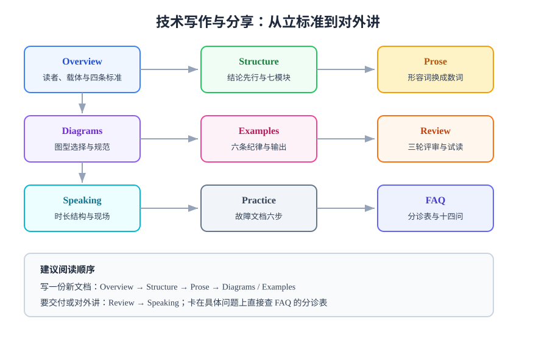

# 技术写作与分享

技术写作（Technical Writing）是把**工程判断**变成**别人能执行、能复核、能复用**的文字的工程活动。它不是「把想清楚的事写下来」，而是**想清楚的那一步本身**——一段话写不出可验证的收尾，通常意味着那件事还没想清楚。

本专题面向三类人：写设计文档与故障报告的工程师、写操作手册与交付文档的负责人、要做技术分享的人。全篇只回答一个问题：**怎样让一页文字在别人手里也能跑出同样的结果。**

::: tip 一句话理解
**写作不是表达，是接口设计。** 读者是调用方，文档是被调用的函数——参数（前置条件）、返回值（可验证的结果）、异常（失败时怎么办）三样缺一，调用方就只能靠猜。
:::

## 专题地图

| 页面 | 内容 | 适合谁读 |
| --- | --- | --- |
| [概述：读者、载体与验收标准](Overview/index.md) | 三类读者、四种载体、四条可验收标准 | 所有人，先读这页 |
| [结构与逻辑](Structure/index.md) | 结论先行、页面骨架七模块、段落节奏与导航 | 写长文的人 |
| [语言与表达](Prose/index.md) | 把形容词换成数词、术语纪律、常见病句改写 | 写完初稿要打磨的人 |
| [图表表达](Diagrams/index.md) | 什么时候该画图、图型选择、SVG 手绘规范 | 要出架构图与流程图的人 |
| [示例与可验证性](Examples/index.md) | 可运行示例六条纪律、命令块与期望输出 | 写操作手册与教程的人 |
| [评审与打磨](Review/index.md) | 把「写得好不好」变成可判定项、三轮评审法 | 文档负责人与评审人 |
| [演讲与分享](Speaking/index.md) | 时长决定结构、幻灯片三原则、问答与翻车处置 | 要做技术分享的人 |
| [实战：把一次故障写成可复用文档](Practice/index.md) | 六步走完整流程，附完整片段与验收清单 | 想直接照做的人 |
| [常见问题与最佳实践](FAQ/index.md) | 分诊表、十二问、十四条最佳实践 | 所有人 |

## 本专题的四个可验收标准

写作质量长期被当成「文笔」，于是无法验收。本专题把它拆成四条**可以被第二个人判定**的标准，后面每一页都围绕这四条展开：

| 标准 | 判据形态 | 反例（写了等于没写） |
| --- | --- | --- |
| **可判定** | 每个结论后面跟着「看到什么算通过」 | 「服务运行应保持稳定」 |
| **可执行** | 每条步骤是一条能复制的命令 + 一个预期输出 | 「请确保环境满足要求」 |
| **可复核** | 每个数字写清「什么时候、对着哪个对象取的」 | 「延迟约 200ms 左右」 |
| **可定位** | 读者能在 30 秒内找到「我现在该看哪一节」 | 一篇 800 行、只有三级标题的手册 |

::: warning 这四条不是「风格建议」
它们对应四类真实事故：**没有判据**的验收会在交付时变成扯皮，**没有命令**的步骤会让下一个人卡在第 0 步，**没有口径**的数字会在两次测量间打架，**没有导航**的文档会让人直接放弃阅读——而放弃阅读之后，文档就从「资产」变成了「负债」：它还在，但没人再信它。
:::

## 与相邻专题的分工

| 相邻专题 | 它讲什么 | 本专题讲什么 |
| --- | --- | --- |
| [文档体系建设](../../Tools/DocsInfra/index.md) | 站点怎么搭、搜索怎么做、多版本怎么管、CI 怎么巡检 | **单篇文字怎么写**：结构、语言、图、示例、评审 |
| [写作规范（DocsInfra）](../../Tools/DocsInfra/Standards/index.md) | 一个仓库的页面骨架与格式约定 | 跨仓库通用的**表达方法**，以及为什么这些约定有效 |
| [完整项目交付](../../Others/ProjectDelivery/index.md) | 交付流程里的文档**位置**（谁在什么阶段要什么） | 那几份文档**具体怎么写**才可执行 |
| [API 设计与治理](../../Tools/APIDesign/index.md) | 契约本身怎么写（OpenAPI / 语义 / 版本） | 契约之外**给人读的说明**怎么写 |
| [AI 编程助手](../../AI/AICodingAssistant/index.md) | 人机协作里指令文件的写法（提示侧） | 面向人的长文档的写法（阅读侧） |
| [文档协作](../../Tools/Collaboration/DocCollaboration/index.md) | 工具与流程（谁改、怎么留痕、怎么发布） | 改什么、按什么标准改 |

## 标准与工具速览（2026-10 核对）

写作领域没有「版本迭代很快」的框架，可引用的多是**稳定性很高**的标准与课程。下表只列会被判据引用的几条：

| 引用对象 | 状态 | 本专题怎么用 |
| --- | --- | --- |
| ISO 24495-1:2023《Plain language》 | 2023 年发布，现行 | 「一句话定位」与短句纪律的依据（可读性不是审美偏好） |
| WCAG 2.2 | 2023-10-05 成为 W3C 推荐标准 | 图文对比度、图注与替代文本的底线要求 |
| Diátaxis 文档框架 | 无版本号，长期稳定 | 教程 / 操作 / 参考 / 解释四种载体的划分依据 |
| Google Technical Writing 课程 | 免费公开，长期在线 | 主动语态、术语一致、段落长度等基础纪律的来源 |

::: tip 为什么不给「最佳实践」打版本号
`docs/` 里多数专题需要标注版本，因为库、框架、命令参数会变。写作方法的变化极慢，真正会变的只有**工具链**（生成器、检查器）——那些内容在[文档体系建设](../../Tools/DocsInfra/index.md)里按版本维护，本专题只引用不重复。
:::

## 建议学习路径

1. **先立标准**：读[概述](Overview/index.md)，把「可判定 / 可执行 / 可复核 / 可定位」四条记住，后面所有技巧都服务于它们。
2. **搭骨架**：读[结构与逻辑](Structure/index.md)，用七模块骨架把一页空文档填成可评审的初稿。
3. **磨句子**：读[语言与表达](Prose/index.md)，把形容词、模糊量词、被动句逐条换掉。
4. **补图与例**：读[图表表达](Diagrams/index.md)与[示例与可验证性](Examples/index.md)，让读者不必靠想象。
5. **过评审**：读[评审与打磨](Review/index.md)，把主观争论收敛成清单。
6. **对外讲**：读[演讲与分享](Speaking/index.md)，同一份内容换一种载体再交付一次。

## 参考资料

- [ISO 24495-1:2023 Plain language — Part 1: Governing principles and guidelines](https://www.iso.org/standard/78907.html)
- [Diátaxis：文档四象限框架](https://diataxis.fr/)
- [Google Technical Writing 课程](https://developers.google.com/tech-writing)
- [W3C Web Content Accessibility Guidelines (WCAG) 2.2](https://www.w3.org/TR/WCAG22/)
- [Microsoft Writing Style Guide](https://learn.microsoft.com/style-guide/)
