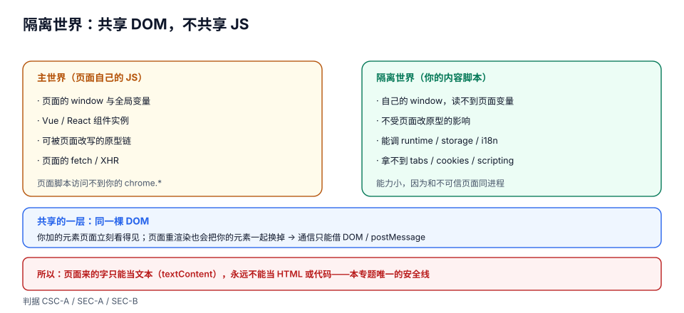

# 内容脚本与隔离世界

内容脚本是你唯一能「碰到别人页面」的地方，也是整个扩展里**最容易被写坏**的地方。它写坏的方式很特别：不是报错，而是**静默地跑了两遍**、**拿不到页面的变量**、**改完样式被页面自己的框架覆盖**、**在单页应用切路由后彻底失效**。

这一页要建立的第一个认知是：**内容脚本不在页面里，它在页面旁边**。

::: tip 一句话理解
内容脚本和页面共享**同一棵 DOM**，但不共享**同一个 JavaScript 世界**。所以「同一个 `document`、不同的 `window`」——你能改元素，但拿不到页面脚本里的变量；页面也拿不到你的。
:::

## 判据族声明

本页判据族 `CSC-A` ~ `CSC-H`，共 8 条。定义表在第八节。

## 本页不讲什么

- 不讲消息怎么发、怎么保证不丢，归 [跨上下文消息](../Messaging/index.md)。
- 不讲权限怎么声明（`matches` 与 host 权限的关系），归 [权限模型](../Permissions/index.md)。
- 不讲「页面恶意内容如何攻击扩展」，归 [安全边界](../Security/index.md)。
- 不讲富文本的粘贴清洗，归[富文本编辑器工程](../../../Frontend/RichTextEditor/PasteSanitize/index.md)。

## 一、隔离世界：共享 DOM，不共享 JS



| 东西 | 内容脚本能看到 | 说明 |
| --- | --- | --- |
| `document` / DOM 树 | ✅ 同一棵 | 你 `appendChild` 的元素页面立刻能看到 |
| 页面上的 CSS | ✅ 同一套 | 你的样式会受页面样式影响（也会影响页面） |
| 页面脚本里的变量（`window.foo`） | ❌ | 两个独立的 JS 全局对象 |
| 页面脚本的原型链（`Array.prototype` 被改） | ❌ | 这一条是**安全特性**：页面无法通过改原型来劫持你的逻辑 |
| `localStorage` | ✅（同一份） | 因为它是按源存储的，不是按 JS 世界 |
| `chrome.*` 的大部分 API | ❌ | 只有 `runtime` 的消息、`storage`、`i18n` |

```javascript [content.js]
// 页面里可能有 window.__BOARD_STATE__，但这里读不到
console.log(window.__BOARD_STATE__);        // undefined

// 但 DOM 是共享的，所以可以「从 DOM 反推状态」
const boardId = document.querySelector('[data-board-id]')?.dataset.boardId;
```

::: warning 这条隔离是双向的，两个方向都会坑人
1. **你拿不到页面的框架实例**（Vue / React 的组件树、jQuery 的 `$`），只能走 DOM。
2. **页面也拿不到你**，所以你不能「给页面暴露一个 API 让它调用」——要通信必须经过 DOM 事件或 `postMessage`（见第五节）。
:::

## 二、注入时机：四档，差一档就差一个数量级

| `run_at` | 时机 | 适合 | 风险 |
| --- | --- | --- | --- |
| `document_start` | 文档元素刚有，DOM 还没建 | 抢在页面脚本前改环境、注入样式防闪烁 | 此时 `document.body` 是 `null` |
| `document_end` | DOM 建完，资源（图片 / 子框架）未完成 | 需要完整 DOM、但要尽早 | 页面脚本可能已经跑过一轮 |
| `document_idle`（默认） | `document_end` 之后、`window.onload` 之前的某个时刻 | 绝大多数场景 | 「某个时刻」由浏览器决定，**不能假设顺序** |
| 编程式（`executeScript`） | 你调用的那一刻 | 用户手势后按需注入 | 需要权限，且要处理「已注入过」 |

::: danger `document_idle` 不是「DOM 就绪事件」
它是浏览器在 `document_end` 与 `load` 之间**自行选一个时机**。这意味着：

- 它可能早于某个异步渲染完成的组件；
- 也可能晚于页面的首屏脚本。

所以「等某个元素出现」不能用 `run_at` 解决，只能用 `MutationObserver` 或轮询加超时：

```javascript [content.js]
function waitFor(selector, timeout = 5000) {
  return new Promise((resolve, reject) => {
    const found = document.querySelector(selector);
    if (found) return resolve(found);
    const obs = new MutationObserver(() => {
      const el = document.querySelector(selector);
      if (el) {
        obs.disconnect();
        clearTimeout(timer);
        resolve(el);
      }
    });
    obs.observe(document.documentElement, {childList: true, subtree: true});
    const timer = setTimeout(() => {
      obs.disconnect();
      reject(new Error('timeout: ' + selector));
    }, timeout);
  });
}
```
:::

## 三、三种注入方式：什么时候用哪个

| 方式 | 声明位置 | 生效范围 | 生命周期 | 适合 |
| --- | --- | --- | --- | --- |
| 静态声明 | `manifest.content_scripts` | 匹配即注入 | 随页面 | 主流程、必须尽早生效 |
| 动态注册 | `chrome.scripting.registerContentScripts` | 运行时决定 | **跨 worker 重启保留** | 用户开关控制、按站点启用 |
| 编程式注入 | `chrome.scripting.executeScript` | 调用即注入 | 一次性 | 用户手势后的按需动作 |

```javascript [sw.js]
// 动态注册：用户打开「在知乎启用」时才注入，且注册结果持久
async function syncRegistration(enabled) {
  const existing = await chrome.scripting.getRegisteredContentScripts({ids: ['zhihu']});
  if (enabled && !existing.length) {
    await chrome.scripting.registerContentScripts([{
      id: 'zhihu',
      matches: ['https://www.zhihu.com/*'],
      js: ['content.js'],
      runAt: 'document_idle',
      persistAcrossSessions: true,
    }]);
  } else if (!enabled && existing.length) {
    await chrome.scripting.unregisterContentScripts({ids: ['zhihu']});
  }
}
```

::: info 为什么优先用「动态注册」而不是「executeScript」
`executeScript` 是**一次性**的：页面一导航就没了，你得在 `tabs.onUpdated` 里再注一次，于是又多了一个「什么时候注、注没注过」的状态机。动态注册把这件事交给浏览器，**注册本身是持久的**，只在用户改设置时才变。判据 `CSC-C`。
:::

## 四、重复注入：最常见的「看起来很怪」的 bug

一次重复注入会产生：**两个事件监听器**、**两次请求**、**两个悬浮按钮**、**两份日志**。三个典型成因：

1. **单页应用切路由**：URL 变了但页面没重新加载，静态 `content_scripts` **不会**再注入一次——所以「切了路由脚本就失效」和「切了路由脚本跑两遍」是**两种不同的病**；
2. **`executeScript` 叠加静态声明**：用户在按钮上连点两次，注入两次；
3. **扩展更新后旧脚本还在**：更新扩展时，已经打开的标签页里跑的还是旧版内容脚本，直到刷新。

标准解法是**单例标记 + 幂等清理**：

```javascript [content.js]
// 单例守卫：用 Symbol 挂在 DOM 上（跨世界可见），不用 window 变量
const FLAG = '__clip_installed__';
if (document.documentElement.dataset[FLAG]) {
  // 已经装过：什么也不做，直接退出
} else {
  document.documentElement.dataset[FLAG] = '1';
  install();
}

function install() {
  // 先清理可能残留的 UI（扩展热更新后旧元素还在）
  document.querySelectorAll('[data-clip-ui]').forEach((n) => n.remove());
  const btn = document.createElement('button');
  btn.dataset.clipUi = '1';
  btn.textContent = '摘录';
  document.body.appendChild(btn);
  btn.addEventListener('click', onPick, {once: false});
}
```

**为什么标记挂在 DOM 上而不是 `window` 上**：同一次文档生命周期内，两次 `executeScript` 拿到的隔离世界是同一个，所以 `window.__flag` 也能挡住重复注入。但 DOM 标记多两个好处：**主世界也能观察到它**（需要跨世界协作时有用了），以及**新版本的脚本能凭 `[data-clip-ui]` 找到旧版本留下的 UI 并清理**——扩展更新后的标签页里，新旧两代脚本会短暂共存，能清理比能判断更重要。

至于 **SPA 切路由**，标记帮不上忙：URL 变了但文档没重建，脚本不会被重新注入，被换掉的是**页面自己的 DOM**（你的按钮跟着一起没了）。所以要么让 UI 自愈，要么接受失效：

```javascript [content.js]
let lastHref = location.href;
setInterval(() => {
  if (location.href === lastHref) return;
  lastHref = location.href;
  if (!document.querySelector('[data-clip-ui]')) install();   // UI 被路由换掉了就补回来
}, 1000);
```

::: danger 三个「监听路由」的错误做法
1. **监听 `popstate` 就够了**：只覆盖前进后退，`pushState` 不触发。
2. **改 `history.pushState` 来劫持**：这需要跑在**主世界**，隔离世界里改的是你自己的 `history` 对象，页面根本不受影响。
3. **用 `MutationObserver` 监听整个 `document`**：在长列表页面上，回调每秒可能触发上千次，主线程直接被拖慢——这是「装了扩展浏览器变卡」的常见来源。
:::

## 五、和页面通信：三条合法通路

内容脚本与页面之间**没有共享变量**，所以只能借三样东西：

| 通路 | 方向 | 适合 | 注意 |
| --- | --- | --- | --- |
| 修改 / 观察 DOM | 双向 | 读页面状态、注入 UI | 会被页面框架重渲染覆盖 |
| `window.postMessage` | 双向 | 传结构化数据 | **必须校验 `event.origin` 与 `event.source`** |
| `world: "MAIN"` 注入 | 单向（注入的代码与页面同世界） | 必须调用页面自己的函数 | Chrome 111+；注入的代码**不受隔离保护**，页面能改它 |

```javascript [content.js]
// 内容脚本 → 页面：用 postMessage（页面侧会收到）
window.postMessage({source: 'clip-ext', type: 'REQUEST_STATE'}, location.origin);

// 页面 → 内容脚本：校验来源，别接任何 origin 的消息
window.addEventListener('message', (e) => {
  if (e.source !== window) return;              // 必须是自己这页
  if (e.origin !== location.origin) return;     // 必须是同源
  if (e.data?.source !== 'board-app') return;   // 必须是对端约定的标记
  handle(e.data);
});
```

```javascript [sw.js]
// 需要调用页面自己的函数时，注入到主世界（Chrome 111+）
await chrome.scripting.executeScript({
  target: {tabId},
  world: 'MAIN',
  func: () => window.__BOARD__?.exportSelection?.(),
});
```

::: warning `postMessage` 是「谁都能发」的广播
`window.postMessage` 的接收方**无法分辨发送者是谁**（同一页面里任何脚本都能发同样的消息）。所以它只能用来传**非敏感**数据，或者配合「一次性随机数」做校验。**任何会改变服务端状态的动作，都必须回到 service worker 里做来源校验**（判据 `SEC-E`）。
:::

## 六、样式注入与「打架」

三种注入样式的方式，代价完全不同：

| 方式 | 写法 | 影响范围 | 适合 |
| --- | --- | --- | --- |
| `content_scripts.css` | manifest 声明 | 页面全局 | 一次性主题、必须尽早生效 |
| `scripting.insertCSS` | 运行时注入 | 页面全局 | 按需开关 |
| Shadow DOM | 组件内部 `attachShadow` | **完全隔离** | 注入 UI（按钮、面板、浮层） |

**结论**：**改页面的样式**用前两种；**加自己的 UI** 一律用 Shadow DOM。原因很实际——你不可能预判所有站点的 `button { ... }` 规则，而页面也不可能预判你的 class 名。

```javascript [content.js]
const host = document.createElement('div');
host.dataset.clipUi = '1';
const shadow = host.attachShadow({mode: 'closed'});
shadow.innerHTML = `
  <style>
    .btn { all: initial; font: 13px/1.4 system-ui; padding: 6px 10px;
           border-radius: 6px; background: #1f6feb; color: #fff; cursor: pointer; }
  </style>
  <button class="btn">摘录</button>`;
document.body.appendChild(host);
```

`all: initial` 这一行是关键：它把页面继承下来的 `font` / `color` / `line-height` 全部清掉，否则你的按钮在 A 站是宋体、在 B 站是 20 px 加粗。

## 七、四个边界场景

1. **iframe**：内容脚本默认只注入顶层框架。需要进 iframe 时加 `"all_frames": true`，并且**每个框架都是独立实例**——你的单例标记在每个框架里各有一份。
2. **`about:blank` 与 `srcdoc`**：继承父框架的源，注入行为依浏览器而异，别依赖。
3. **PDF 查看器 / `chrome://` 页面**：**平台保留页，一律注入不了**。这不是权限问题，是硬边界。
4. **扩展更新后的已开标签页**：跑的还是旧脚本。要么提示用户刷新，要么让脚本检测版本号自杀。

```javascript [content.js]
// 版本守卫：扩展更新后，旧脚本主动退场，避免新旧两套逻辑并存
const MY_VERSION = '1.4.2';
chrome.storage.local.get('runningVersion').then(({runningVersion}) => {
  if (runningVersion && runningVersion !== MY_VERSION) return;   // 自己是旧的，直接不干活
  chrome.storage.local.set({runningVersion: MY_VERSION});
});
```

## 八、判据表

| 判据 | 断言 | 怎么验 |
| --- | --- | --- |
| `CSC-A` | 内容脚本不依赖页面 JS 变量（`window.xxx`），只通过 DOM / `postMessage` 取数据 | `grep -n "window\." content.js`，命中项只能是自有变量或标准 API |
| `CSC-B` | 「等元素出现」用 `MutationObserver` + 超时，不用固定 `setTimeout` 猜 | 断网加载页面（元素永不出现），5 秒内给出超时错误而非静默挂死 |
| `CSC-C` | 可开关的注入用 `registerContentScripts`（持久），不用每次 `executeScript` | worker 重启后开关状态仍然生效，页面导航后脚本仍在 |
| `CSC-D` | 脚本有单例守卫，连点两次按钮不会出现两个 UI / 两个监听器 | 连点 5 次，页面上只有一个悬浮按钮，控制台只有一组初始化日志 |
| `CSC-E` | 注入的 UI 用 Shadow DOM 且 `all: initial`，在两个不同站点外观一致 | 在两个样式差异极大的站点各截一张图，按钮尺寸/字体一致 |
| `CSC-F` | SPA 切路由后 UI 自愈或明确失效，不出现「两个按钮」或「完全没反应」 | 在目标 SPA 里连续切 5 个路由，每次检查按钮数量为 1 |
| `CSC-G` | `postMessage` 的接收端校验 `source` / `origin` / 自定义标记三项 | 在控制台手工 `window.postMessage({source:'board-app',...}, '*')`，若被当作合法业务即为不通过 |
| `CSC-H` | 扩展更新后旧内容脚本不继续跑业务（版本守卫或提示刷新） | 装旧版 → 打开页面 → 升级扩展 → 观察旧脚本是否仍在发请求 |

## 参考资料

- 内容脚本概念（隔离世界）：<https://developer.chrome.com/docs/extensions/develop/concepts/content-scripts>
- `chrome.scripting`（含 `world: "MAIN"`）：<https://developer.chrome.com/docs/extensions/reference/api/scripting>
- 内容脚本身份与 `isolated world`：<https://developer.chrome.com/docs/extensions/develop/concepts/content-scripts#isolated_world>
- `run_at` 的定义：<https://developer.chrome.com/docs/extensions/reference/manifest/content-scripts>
