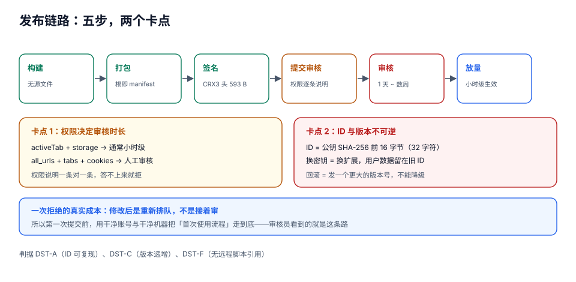

# 打包、签名与分发

到这一步，代码写完了，功能能跑。然后有 **三件不可逆的事** 在等着：**ID 定了就改不了**、**版本号只能往上加**、**发出去的东西收不回来**。

这一页的每个数字都是本机实跑出来的，因为这里的坑特别「看不见」——比如：**压缩之后包反而变大**、**换个文件派生出来的 ID 完全不是你以为的那个**、**`1.4.10` 比 `1.4.9` 小**。

::: tip 一句话理解
扩展的身份不是它的名字，是它的**签名公钥**。所以「发版」这件事的本质是：**用同一把钥匙、签一个版本号更大的包**。钥匙丢了 = 这个扩展死了；钥匙换了 = 这是一个新扩展。
:::

## 判据族声明

本页判据族 `DST-A` ~ `DST-H`，共 8 条。定义表在第八节。

## 本页不讲什么

- 不讲权限变更对审核的影响，归 [权限模型](../Permissions/index.md)。
- 不讲远程代码禁令的判定细节，归 [安全边界](../Security/index.md)。
- 不讲桌面应用（`.dmg` / `.msi`）的签名与公证，归[桌面应用 · 打包](../../../Frontend/DesktopApp/Packaging/index.md)。
- 不讲 CDN 分发与灰度，归[CDN 原理](../../../Ops/EdgeCDN/CDNPrinciple/index.md)。

## 一、扩展 ID：32 个字符，只由公钥决定

派生规则只有三步：

1. 取**签名公钥的 DER 编码**（SPKI，2048 位 RSA 时是 **294 字节**）；
2. 对它做 **SHA-256**，取**前 16 字节**；
3. 每个字节拆成两个半字节（0~15），逐个映射到字母 **`a`~`p`**，得到 **32 个字符**。

本机实测（OpenSSL 3.x + Node 22.22.2，四份输入）：

| 输入文件 | 内容 | 派生出的扩展 ID |
| --- | --- | --- |
| `key1.der` | 密钥 A 的**公钥**（294 B） | `lkepccbgeeacdchhkihmpgcckigkheeh` |
| `key2.der` | 密钥 B 的公钥（294 B） | `bhpbkhgamgcmmdcholidfbegkjafpghg` |
| `key1b.der` | 重新生成的密钥 C 的公钥（294 B） | `hcmjgkaglhinhodiolfmpimhipbddbpm` |
| `key1.pk8` | 密钥 A 的**私钥**（PKCS#8，1,217 B） | `cghohjiljamfjognfiicjipdiejjdjmf` |

四行读完，能得出四条结论：

1. **同一把钥匙 → 同一个 ID**（可复现，与文件名、路径、manifest 内容全部无关）。
2. **换一把钥匙 → 换一个扩展**（前两行）。用户装的是新扩展，旧的 `storage` / `cookies` / IndexedDB 全部留在旧 ID 下，新包一无所见。
3. **拿私钥去派生，会得到一个"看起来对"的错误 ID**（第四行）。这是最阴的一种：脚本跑通了、ID 也是 32 个字符、格式完全合法，但**和商店里那个不是同一个**。
4. **公钥文件只有 294 字节**，私钥 1,217 字节——所以「不小心把私钥打进安装包」这件事，靠体积是发现不了的（安装包根本不需要任何密钥文件，只需**签名时**用到）。

```shell
# 正确的派生方式：从私钥导出公钥 DER，再哈希
openssl rsa -in key.pem -pubout -outform DER -out pub.der
node -e '
const {createHash} = require("node:crypto");
const fs = require("node:fs");
const a = "abcdefghijklmnop";
const d = createHash("sha256").update(fs.readFileSync("pub.der")).digest().subarray(0, 16);
let s = "";
for (const b of d) s += a[b >> 4] + a[b & 15];
console.log(s);
'
# 输出：lkepccbgeeacdchhkihmpgcckigkheeh
```

::: danger 三条与密钥有关的硬规矩
1. **私钥离线保存，不进仓库、不进 CI 变量以外的任何地方**。丢私钥 = 永远无法给现有用户发新版（只能发一个全新扩展，用户得重装、数据全丢）。
2. **开发版与商店版是两个 ID**。用 `--load-extension` 加载未打包目录时，ID 由**目录路径**派生（临时 ID）；一旦打包签名，ID 由密钥派生。所以「开发时存的数据，装了商店版之后不见了」是正常的。
3. **`key` 字段只用于「未打包时固定 ID」**，不是签名。在 manifest 里写 `"key": "<base64 公钥>"` 能让本地加载也用固定 ID，方便调试，但**商店会忽略它**。
:::

## 二、打包：压缩不一定让包变小

扩展的 `.zip` 是把**目录内容**（不是父目录）压到根：`manifest.json` 必须在 zip 的根，不能是 `my-ext/manifest.json`。

本机实测一个最小可用扩展（9 个条目：manifest + sw.js + content.js + popup.html + popup.js + 3 个真实 PNG 图标 + 1 个目录项）：

| 指标 | 值 |
| --- | --- |
| 原始字节（未压缩） | **1,522 B**（其中图标 451 B） |
| zip 后 | **2,392 B** |
| 「压缩后」数据部分合计 | 1,040 B |
| 容器开销（zip 头 + 中央目录） | **1,352 B ≈ 150 B / 条目** |
| 结果 | **压缩后比原始大 57%** |

这个结果不是 bug：**每个 zip 条目有约 100~150 字节的固定头**（本地文件头 + 中央目录项 + 文件名），9 个条目就是 1,300 多字节。当文件本身只有几十字节（`popup.js` 54 B 压到 52 B），**容器开销远大于压缩收益**。

再叠加 **CRX3 头**：

| 组成 | 字节 |
| --- | --- |
| 定长前缀 `Cr24` + 版本 + 头长度 | 12 |
| protobuf：公钥（294 B）+ 签名（256 B）+ 字段开销 | 581 |
| **CRX3 头合计** | **593** |
| zip | 2,392 |
| **CRX 总计** | **2,985**（头部占 **19.87%**） |

::: info 这条对真实项目意味着什么
593 字节的头是**定长**的（只与密钥长度有关，256 位 ECDSA 会小一些）。所以：

- **对 3 KB 的小包**，头部占两成——这时「少放一个图标」比「压缩代码」有用得多；
- **对 2 MB 的正常包**，头部占 0.03%——可以忽略。

真正该关注的是**别把源文件、`node_modules`、`.map`、测试夹具打进包**。商店对单包有体积上限，而「包里带了一个 8 MB 的演示视频」是最常见的超限原因。
:::

```json [package.json]
{
  "scripts": {
    "build": "vite build",
    "pack": "cd dist && rm -f ../ext.zip && zip -qr ../ext.zip . -x '*.map' '*.ts' 'node_modules/*'"
  }
}
```

## 三、更新清单与版本比较

自托管更新靠一个 XML 清单（商店分发时由商店代管，你不需要这个文件）：

```xml [update.xml]
<?xml version='1.0' encoding='UTF-8'?>
<gupdate xmlns='http://www.google.com/update2/response' protocol='2.0'>
  <app appid='lkepccbgeeacdchhkihmpgcckigkheeh'>
    <updatecheck codebase='https://dl.example.com/ext-1.4.2.crx' version='1.4.2' />
  </app>
</gupdate>
```

文件本身很小（实测 **263 B**），但有两处必须完全正确：

1. **`appid` 必须等于公钥派生出的 32 字符 ID**——写错时浏览器不报错，只是**永远不更新**；
2. **`version` 必须比已安装的版本大**（按下面的比较规则），否则不会触发下载。

### 版本比较：不是字符串比较

Chrome 的版本号是**点分的整数段**（1~4 段，每段 0~65535），比较时**逐段按数值**。字符串比较会在这四对上都给出错误答案：

| 版本 A | 版本 B | 字符串比较结论 | 逐段数值比较结论 | 哪个对 |
| --- | --- | --- | --- | --- |
| `1.4.10` | `1.4.9` | A **小** | A **大** | 数值对 |
| `1.10.0` | `1.9.9` | A **小** | A **大** | 数值对 |
| `2.0` | `2.0.0` | A 小 | **相等** | 数值对（`2.0` 与 `2.0.0` 是同一版本） |
| `1.4.2-beta` | `1.4.2` | A **大** | A **小（或相等）** | 数值对——**而且带 `-beta` 的版本商店根本不接受** |

```javascript
// 版本比较的正确实现（与 Chrome 语义一致）
function cmpVersion(a, b) {
  const pa = a.split('.').map((x) => parseInt(x, 10));
  const pb = b.split('.').map((x) => parseInt(x, 10));
  for (let i = 0; i < Math.max(pa.length, pb.length); i++) {
    const x = pa[i] ?? 0;
    const y = pb[i] ?? 0;
    if (x !== y) return x > y ? 1 : -1;
  }
  return 0;              // 2.0 与 2.0.0 相等
}
```

::: danger 三条发版事故，都出在「版本」上
1. **`version` 没改就打包上传**：商店拒收（「版本号必须大于已发布版本」）。
2. **想「回滚」到旧版本**：**做不到**。商店只接受更大版本号，唯一办法是发一个 `1.4.3` 把 `1.4.2` 的代码重打一遍——所以「回滚」在扩展里等于「发一个更大的版本」。
3. **`1.4.2.0` 与 `1.4.2` 混用**：四段的 `1.4.2.0` 比三段 `1.4.2` 大，但用户在界面上看不到第四段，出问题时对不上号。
:::

## 四、商店审核：决定周期的是权限，不是代码量



| 因素 | 快（小时~1 天） | 慢（数天~数周） |
| --- | --- | --- |
| 权限范围 | `activeTab` + `storage` | `<all_urls>` + `tabs` + `cookies` |
| 代码来源 | 全部随包，无远程引用 | 编译产物里含 `https://` 的脚本引用 |
| 隐私政策 | 不收集数据 / 有明确政策 | 收集数据但政策缺失或含糊 |
| 权限说明 | 一条权限一句功能说明 | 「为了改善体验」 |
| 历史记录 | 无违规记录 | 曾被拒 / 被下架 |

三项必交材料，缺一项就打回：

1. **商店列表**：名称、简短描述、详细描述、截图（至少 1 张，建议 3~5 张）、分类、语言；
2. **隐私政策 URL**（涉及任何用户数据处理就必须有）；
3. **权限理由**：每一项敏感权限一句「用在哪」。

::: warning 一次拒绝的隐形成本
拒绝后修改再提交通常是**重新排队**，而不是「接着上次审」。所以第一次提交前值得做的事：**用一个从没用过的 Google 账号、在一台干净机器上装一遍**，把「首次使用流程」走到底——审核员看到的就是这个路径，你在这里遇到的每个困惑，他都会遇到。
:::

## 五、商店外分发

| 方式 | 平台 | 自动更新 | 适合 |
| --- | --- | --- | --- |
| Chrome 应用商店 | 全平台 | ✅（商店代管） | 面向公众 |
| 企业策略强制安装（`ExtensionInstallForcelist` / `ExtensionSettings`） | Chrome / Edge，受管设备 | ✅（自托管 `update_url`） | 公司内部工具 |
| 开发者模式「加载已解压」 | 全平台 | ❌（每次改动手动重载） | 开发与内部试用 |
| 拖拽 `.crx` 安装 | 仅在 Linux 等少数环境 | ❌ | 不推荐 |

**结论**：面向公众只有一条路——上商店；内部工具走企业策略；「自己搭个下载页发 `.crx`」在 Windows / macOS 上已经被平台关掉了（用户拖进去会被拦）。

```json [企业策略示例（ExtensionSettings）]
{
  "extensions": {
    "lkepccbgeeacdchhkihmpgcckigkheeh": {
      "installation_mode": "force_installed",
      "update_url": "https://dl.example.com/updates.xml"
    }
  }
}
```

## 六、发布前检查单（八条，全部可机械验证）

```shell
# 1) manifest 合法且版本号正确
node -e 'const m=require("./dist/manifest.json");console.log(m.manifest_version, m.version)'

# 2) 包里没有源文件 / sourcemap / 测试夹具
unzip -l ext.zip | grep -E "\.(ts|map|test\.js)$" && echo "FAIL: 源文件被打进包" || echo "OK"

# 3) 编译产物里没有远程脚本引用
grep -rnE "import\(['\"]https://|new Function|eval\(" dist/ && echo "FAIL: 疑似远程代码" || echo "OK"

# 4) ID 与商店一致（同一把钥匙）
shasum -a 256 pub.der | cut -c1-32

# 5) 包体积在预算内
du -h ext.zip
```

## 七、判据表

| 判据 | 断言 | 怎么验 |
| --- | --- | --- |
| `DST-A` | 签名私钥离线备份，且两次打包派生出的 ID 完全相同 | 用备份的私钥重新派生一次，与商店后台显示的 ID 逐字符比对 |
| `DST-B` | 派生 ID 用的是**公钥 DER**，不是私钥、不是 PEM 文本、不是证书 | 跑一遍派生脚本，输出与商店一致；把私钥换进去应当得到不同值 |
| `DST-C` | `manifest.version` 严格递增（按逐段数值比较），且不出现预发布后缀 | 用 `cmpVersion` 脚本对比上一版与本版，返回 1 |
| `DST-D` | zip 根目录直接是 `manifest.json`，没有多套一层父目录 | `unzip -l` 第一行路径不以目录名开头 |
| `DST-E` | 包内无 `.map`、`.ts`、测试夹具、`node_modules` | `unzip -l` 结果里 grep `.map` 与 `.ts` 后缀，命中数为 0 |
| `DST-F` | 编译产物中不存在远程脚本引用 | 对 `dist/` 全文搜索 `import('https://` 与 `eval(`，命中数为 0 |
| `DST-G` | 自托管分发的 `update.xml` 中 `appid` 与实际 ID 一致，且 `version` 大于线上版本 | 下载 `update.xml`，把两个字段与商店/本地比对 |
| `DST-H` | 「回滚」预案写成「发一个更大版本号的旧代码」，而不是降版本 | 发布文档里有该预案，且演练过一次（用测试渠道） |

## 参考资料

- 分发与打包总览：<https://developer.chrome.com/docs/extensions/how-to/distribute>
- 打包扩展（`.crx` 与私钥）：<https://developer.chrome.com/docs/extensions/how-to/distribute/package>
- 自托管与 `update_url`：<https://developer.chrome.com/docs/extensions/how-to/distribute/host-on-linux>
- 企业策略 `ExtensionSettings`：<https://chromeenterprise.google/policies/#ExtensionSettings>
- 版本号格式与比较：<https://developer.chrome.com/docs/extensions/reference/manifest/version>
- 商店审核与政策：<https://developer.chrome.com/docs/webstore/program-policies>
