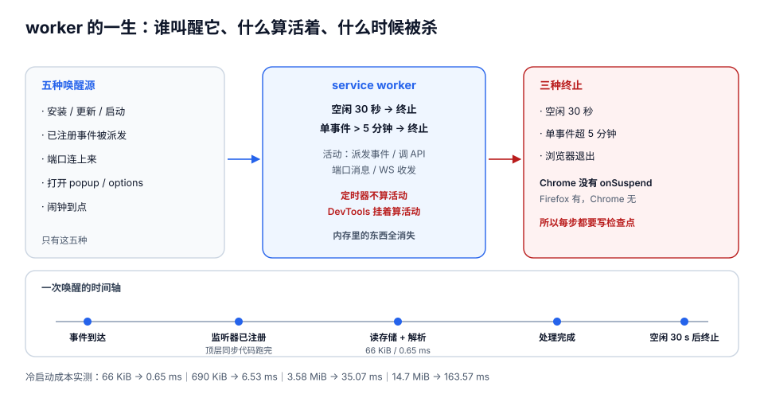

# manifest 与生命周期

MV3 真正的分水岭不是「没有 `background.page` 了」，而是**后台从「一个一直活着的页面」变成了「一个随时会消失的函数」**。这一页要解决的就是这一件事：**你的代码什么时候会被叫醒、醒来时哪些假设已经失效、以及醒来这一下的成本有多高**。

::: tip 一句话理解
service worker 的寿命不是「30 秒」，而是「**30 秒没有活动**」。所以正确的问句不是「怎么让它活着」，而是「**下一次是谁把它叫醒**」——如果你答不上来，这段代码在线上就是死的。
:::

## 判据族声明

本页判据族 `MFL-A` ~ `MFL-H`，共 8 条。定义表在第八节。

## 本页不讲什么

- 不讲 `permissions` 字段怎么填，归 [权限模型](../Permissions/index.md)。
- 不讲内容脚本的注入时机与隔离世界，归 [内容脚本](../ContentScript/index.md)。
- 不讲端口（`runtime.connect`）的重连与背压，归 [跨上下文消息](../Messaging/index.md)。
- 不讲「状态放哪个存储区」，归 [存储与配额](../StorageState/index.md)。

## 一、manifest.json：只需要真正用到的九个字段

一份能上架的最小 manifest 长这样（`manifest_version` 必须是 `3`，这个数字没有第二选择）：

```json [manifest.json]
{
  "manifest_version": 3,
  "name": "网页摘录",
  "version": "1.4.2",
  "description": "把网页上选中的段落摘到看板，保留原文链接。",
  "minimum_chrome_version": "120",
  "permissions": ["storage", "contextMenus", "activeTab", "scripting", "alarms"],
  "optional_host_permissions": ["https://board.example.com/*"],
  "background": { "service_worker": "sw.js", "type": "module" },
  "action": { "default_popup": "popup.html", "default_title": "摘录" },
  "content_scripts": [
    { "matches": ["https://*/*"], "js": ["content.js"], "run_at": "document_idle" }
  ],
  "icons": { "16": "icons/16.png", "48": "icons/48.png", "128": "icons/128.png" },
  "declarative_net_request": {
    "rule_resources": [{ "id": "ruleset_1", "enabled": true, "path": "rules.json" }]
  }
}
```

| 字段 | 作用 | 常见错误 |
| --- | --- | --- |
| `manifest_version` | 只能是 `3` | 写 `2` 会被商店直接拒（MV2 已在 2026-08-31 全部下架） |
| `version` | 商店用它判断「有没有新版」 | 写成四段（`1.2.3.4`）是允许的，但**比较规则不是字符串**，见[分发](../Distribution/index.md) |
| `minimum_chrome_version` | 低于该版本不允许安装 | 用到 Chrome 120 的 `alarms` 30 秒粒度就必须声明 `120`，否则老版本上「30 秒」被静默拉长到 60 秒 |
| `permissions` | 需要声明的能力 | 把 host 权限也写进来——MV3 起 host 权限要放 `host_permissions` |
| `host_permissions` / `optional_host_permissions` | 站点访问权 | 一上来就要 `<all_urls>`，安装警告会写「读取和更改您在所有网站上的所有数据」 |
| `background.service_worker` | 后台入口 | 写 `background.scripts` / `background.page` 是 MV2 语法，MV3 会报错（Chrome 121 起降级为警告，但不会生效） |
| `background.type: "module"` | 允许在 worker 里用 `import` | 忘了写，`import` 直接语法错误，worker 注册失败 `Status code: 3` |
| `content_scripts` | 静态注入 | `matches` 写成 `<all_urls>` 会让「本站不需要」的页面也被注入 |
| `declarative_net_request` | 静态规则集声明 | 只写 `permissions: ["declarativeNetRequest"]` 而不声明规则集，规则一条也不会加载 |

::: warning `background.type: "module"` 与「监听器同步注册」会打架
用 ES module 时，`import` 是**同步求值**的，但被导入的模块顶层如果含 `await`，就会把「注册监听器」推迟到微任务之后——**事件可能在你注册前就被派发**。修法只有一条：**监听器写在入口文件最外层**，被依赖的异步初始化放到 `onInstalled` 或第一次事件处理里。
:::

## 二、worker 的一生：五种唤醒源与三个终止条件



**五种唤醒源**（只有这五种，别的都不会叫醒它）：

1. 扩展安装 / 更新 / 浏览器启动；
2. 一个**已注册**的事件被派发（消息、闹钟、标签页事件、DNR 命中）；
3. 扩展页或内容脚本通过端口连上来；
4. 用户点开 popup / options / side panel；
5. 闹钟到点。

**什么算「活动」（会把 30 秒倒计时清零）**：

| 行为 | 是否重置空闲计时 | 备注 |
| --- | --- | --- |
| 收到并派发一个扩展事件 | 是 | MV3 基线行为 |
| 调用任意扩展 API | 是 | **Chrome 110 起**；此前不是所有事件都算 |
| 端口收到一条消息 | 是 | 端口「开着」本身不算（原生消息端口除外） |
| WebSocket 收发消息 | 是 | **Chrome 116 起**；只「开着」不算 |
| `fetch` 未返回 | 部分 | 响应超过 30 秒可能被切断 |
| `setTimeout` / `setInterval` | **否** | 定时器不保活，也不保证被触发 |
| 原生消息端口保持连接 | **是（强保活）** | **Chrome 105 起**，端口在 worker 就不死 |
| DevTools 挂着 | **是** | 只在调试期有效——**这就是「本地好好的、线上炸」的头号原因** |

**三个终止条件**：空闲 30 秒；**单个事件处理超过 5 分钟**；浏览器退出。

::: danger 五个「看起来在保活、其实没有」的错觉
1. **`setInterval` 能保活**：不能。定时器连自己都不保证被执行。
2. **端口开着就活着**：只有**原生消息端口**是强保活；`runtime.connect` 的普通端口只在「收到消息」时重置计时。
3. **WebSocket 开着就活着**：Chrome 116 起要**收发消息**才算，光连上不算。
4. **`fetch` 挂着一个长轮询就活着**：响应超过 30 秒可能被切断，且**单事件 5 分钟上限**照旧生效。
5. **DevTools 开着测过就没问题**：`DevTools attached` 本身就是保活条件。**关掉调试面板再测一次**，这是本专题所有验收的固定前置。
:::

## 三、三条纪律

### 纪律 1：监听器必须在顶层同步注册

```javascript [sw.js]
// ✅ 正确：第一层同步执行，事件派发时监听器一定在
chrome.alarms.onAlarm.addListener(onAlarm);
chrome.runtime.onMessage.addListener(onMessage);
chrome.runtime.onInstalled.addListener(onInstalled);

// 之后才做异步初始化
void boot();

async function boot() {
  const {token} = await chrome.storage.session.get('token');
  // ...
}
```

```javascript [sw.js]
// ❌ 错误：await 之后才注册，worker 被叫醒时事件已经派发完了
async function boot() {
  const cfg = await chrome.storage.local.get('cfg');
  chrome.alarms.onAlarm.addListener(onAlarm); // 太晚了
}
void boot();
```

**为什么这条如此致命**：worker 被唤醒的流程是「启动 → 跑完顶层同步代码 → 派发事件」。你在 `await` 之后注册，等于把监听器放在了「事件已经派发完」之后。表现是**偶发**——因为开发期 worker 常常是热的。

### 纪律 2：状态放存储，不放内存

```javascript [sw.js]
// ❌ 模块级状态：两次事件之间一定消失
let counter = 0;
chrome.runtime.onMessage.addListener((m, _s, reply) => {
  if (m.type !== 'inc') return;
  counter += 1;          // 下次唤醒从 0 开始
  reply(counter);
});

// ✅ 状态落到 session（内存态、浏览器退出即清）或 local（持久）
chrome.runtime.onMessage.addListener((m, _s, reply) => {
  if (m.type !== 'inc') return;
  chrome.storage.session.get('count').then(({count = 0}) => {
    const next = count + 1;
    return chrome.storage.session.set({count: next}).then(() => reply(next));
  });
  return true;           // 异步回复必须 return true
});
```

选哪个区：**「浏览器关了就该没」→ `session`；「明天还要在」→ `local`；「换设备要带过去」→ `sync`（但它只有 100 KB）**。详见[存储与配额](../StorageState/index.md)。

### 纪律 3：不要保活——把冷启动做成无损

保活（每 20 秒 ping 一次 API、开个假端口）在技术上可行，但代价是**在用户不使用你的扩展时持续占内存和电**，而且平台明确不鼓励；一旦规则收紧，第一个坏的就是它。正确做法是让**冷启动与热启动不可区分**：

- 所有需要「跨事件」的值都从存储读；
- 所有「未完成的事」都写成**检查点**（见第六节）；
- 所有「一次性初始化」都放进 `onInstalled` / `onStartup`，并做成**幂等**。

## 四、定时任务的四个边界

`chrome.alarms` 是 MV3 里唯一的定时器，它有四个硬边界：

| 边界 | 值 | 后果 |
| --- | --- | --- |
| 最小周期 | **30 秒**（Chrome 120 起；此前 60 秒） | 写 `periodInMinutes: 0.1` 会退化成 30 秒并给警告 |
| 活动闹钟数量 | **500** 个（Chrome 117 起） | 超过后 `create` 失败，`runtime.lastError` 有值 |
| 名字长度 | **1024 字节**（Chrome 150 起） | 超长直接拒绝创建 |
| 同名覆盖 | 创建同名闹钟会**替换**，不是报错 | 误以为「已存在就不动」，实际把原调度重置了 |

```javascript [sw.js]
const ALARM = 'clip:flush';

chrome.runtime.onInstalled.addListener(async () => {
  const existing = await chrome.alarms.get(ALARM);   // 先查，避免每次启动重置调度
  if (!existing) {
    await chrome.alarms.create(ALARM, {periodInMinutes: 1, delayInMinutes: 0.5});
  }
});

chrome.alarms.onAlarm.addListener((alarm) => {
  if (alarm.name === ALARM) void flushQueue();
});
```

::: warning 闹钟会「任意延迟」，不会「准时」
官方原文是 alarm firings can be arbitrarily delayed——省电模式、休眠唤醒、浏览器重启都会推迟。所以**任何依赖「准点」的逻辑都要写成「发现落后就补跑」**，而不是「每次只处理这一分钟」。
:::

## 五、冷启动的预算是多少钱

每次唤醒都要重付一遍「读状态 + 解析」的成本。本机实测（Node 22.22.2，读文件 + `JSON.parse`，取 5 次最优）：

| 状态体积 | 条数 | 读 + 解析 |
| --- | --- | --- |
| 66 KiB | 1,000 | **0.65 ms** |
| 690 KiB | 10,000 | **6.53 ms** |
| 3,581 KiB | 50,000 | **35.07 ms** |
| 14,714 KiB | 200,000 | **163.57 ms** |

换算成速率约 **10 ms / MiB**，是线性的。这条曲线决定了两件事：

1. **状态不能无界增长**。10 万条摘录（约 7 MiB）会让每次唤醒多付 80 ms——用户点一下按钮到看见反应，光「读状态」就吃掉了大半的 100 ms 预算。
2. **闹钟频率要和单次成本一起算**。每分钟唤醒一次 = 每天 1,440 次；若每次读 690 KiB，一天就是 **1,440 × 6.53 ms ≈ 9.4 秒**的纯解析开销（还没算进程启动本身）。每 30 秒一次则翻倍到 18.8 秒。

还有一笔更容易被忽略的账：**读改写的扇出**。如果为了改 1 条记录而「整体读出来 → 改 → 整体写回」，搬运量会放大到与总条数成正比——本机用 1 万条（200 KiB）算，改 1 条（约 300 B）却要搬 200 KiB，**放大 683 倍**。

```javascript [sw.js]
// ❌ 整体读改写：每次写都搬全量
const {queue = []} = await chrome.storage.local.get('queue');
queue.push(item);
await chrome.storage.local.set({queue});

// ✅ 一条一 key：只搬这一条，且天然支持「按 key 续跑」
await chrome.storage.local.set({[`q:${item.id}`]: item});
```

## 六、长任务：分块 + 检查点 + 可续跑

单事件 5 分钟上限意味着**长任务必须能被切开**。切成什么样？三个要求：

1. **每块有明确的进度游标**，且游标在**处理之前**落盘（先记「我要处理到 500」，再处理，否则崩在中间会重复）。
2. **每块结束写检查点**，下一块从检查点继续，而不是从头。
3. **块大小由「单块耗时 × 安全系数」定**，安全系数取 10 以上（因为用户机器可能慢 10 倍）。

```javascript [sw.js]
const CHUNK = 200;
const ALARM = 'clip:reindex';

chrome.alarms.onAlarm.addListener(async (alarm) => {
  if (alarm.name !== ALARM) return;
  const {cursor = 0, total = 0} = await chrome.storage.local.get(['cursor', 'total']);
  const rows = await readSlice(cursor, CHUNK);
  if (!rows.length) {
    await chrome.storage.local.remove(['cursor', 'total']);
    return;                                   // 完成后清检查点
  }
  await processRows(rows);
  await chrome.storage.local.set({cursor: cursor + rows.length, total});
});
```

**怎么验证「可续跑」**：跑一半时在 DevTools 里点 **Stop**（终止 worker），等闹钟下一跳，看日志是从 `cursor=200` 继续还是从 0 重来（判据 `MFL-E`）。

## 七、offscreen document：什么时候非用不可

worker 里没有 DOM，也没有 `URL.createObjectURL`、`DOMParser`、`Audio`、`chrome.tabs.captureVisibleTab` 的某些用法。需要这些能力时要开一个**离屏文档**（`chrome.offscreen`，Chrome 109+）：

```javascript [sw.js]
await chrome.offscreen.createDocument({
  url: 'offscreen.html',
  reasons: ['DOM_PARSER'],
  justification: '解析剪贴板 HTML 片段，需要 DOMParser',
});
```

| 场景 | 用 offscreen | 为什么不能用别的 |
| --- | --- | --- |
| 解析 HTML 片段 | ✅ | worker 没有 `DOMParser` |
| 生成图片缩略图（`canvas`） | ✅ | worker 没有 `canvas` |
| 播放提示音 | ✅ | worker 没有 `Audio` |
| 长时间持续计算 | ✅ | worker 单事件 5 分钟上限 |
| 只是想「保活」 | ❌ | 这是滥用，审核与平台都不认 |

::: danger offscreen 的两个坑
1. **一个扩展同时只能有一个 offscreen 文档**，重复 `createDocument` 会报错，必须先 `hasDocument()` 再决定。
2. **它不会替你管理生命周期**：文档开着就一直占内存，用完必须 `closeDocument()`。忘记关的典型表现是「浏览器越用越慢」，而扩展面板里看不出任何异常。
:::

## 八、判据表

| 判据 | 断言 | 怎么验 |
| --- | --- | --- |
| `MFL-A` | service worker 中没有跨事件依赖的模块级可变状态 | 通读 `sw.js`，所有 `let` 要么是常量缓存且每次重建，要么在事件内即用即弃 |
| `MFL-B` | 所有事件监听器在入口文件顶层同步注册 | `grep -n "addListener" sw.js`，行号必须先于任何 `await` |
| `MFL-C` | 定时任务用 `chrome.alarms`，全文无 `setInterval` 承担后台调度 | `grep -n "setInterval\|setTimeout" sw.js`，命中项不得用于跨事件调度 |
| `MFL-D` | 闹钟创建前先 `alarms.get` 判存在，避免每次启动重置调度 | 代码审查 + 重启浏览器后查看 `alarms.getAll()` 的 `scheduledTime` 是否被推后 |
| `MFL-E` | 长任务按块处理，且检查点先于处理落盘；中止后能从游标续跑 | 跑到一半点 Stop，等下一跳，日志首行游标 = 上次结束值 |
| `MFL-F` | 关掉 DevTools 后，核心流程仍能跑通（不依赖调试期保活） | 关闭所有扩展页与 DevTools，只靠闹钟与页面动作驱动，观察 15 分钟 |
| `MFL-G` | 唤醒后读取的状态体积有上界，不随使用时长无界增长 | 造 10 万条数据后测「点击 → 有反馈」的端到端耗时，与 1,000 条对比 |
| `MFL-H` | 使用 `offscreen` 时有 `hasDocument` 判重且用完 `closeDocument` | 连续触发两次创建，第二次不报错；流程结束后 `chrome.offscreen.hasDocument()` 为 `false` |

## 参考资料

- service worker 生命周期（含 30 秒 / 5 分钟口径）：<https://developer.chrome.com/docs/extensions/develop/concepts/service-workers/lifecycle>
- 事件驱动后台的设计指引：<https://developer.chrome.com/docs/extensions/develop/migrate/to-service-workers>
- `chrome.alarms` 参考（30 秒下限、500 个上限）：<https://developer.chrome.com/docs/extensions/reference/api/alarms>
- `chrome.offscreen` 参考：<https://developer.chrome.com/docs/extensions/reference/api/offscreen>
- 「Chrome 120 起闹钟最小 30 秒」发布说明：<https://developer.chrome.com/docs/extensions/whats-new>
