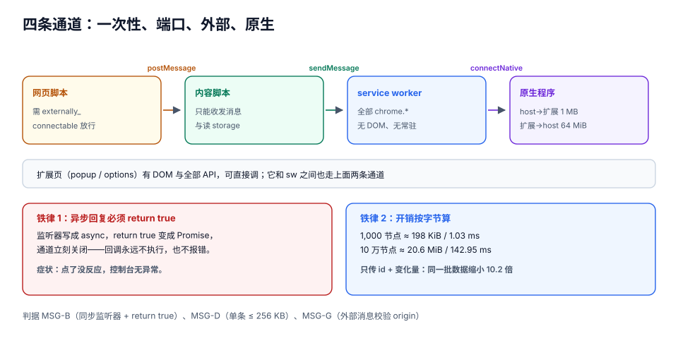

# 跨上下文消息

扩展的四个上下文（service worker、扩展页、内容脚本、页面）之间**没有共享内存**，一切都靠消息。而消息有三个残酷的性质：**它是异步的、它会丢、它的成本是序列化**。

绝大多数「功能偶发不生效」的问题最后都落在这一页：`sendResponse` 之后忘了 `return true`、端口在对端关闭之后才 `postMessage`、把 20 MB 的数据塞进一条消息、以及**根本没检查 `runtime.lastError`**。

::: tip 一句话理解
消息**不是函数调用**，它是**两条独立的通道**（发出去 / 回得来），每一条都可能断，而且断了**默认不报错**。所以每一条消息都要能回答：「丢了怎么办」。
:::

## 判据族声明

本页判据族 `MSG-A` ~ `MSG-H`，共 8 条。定义表在第八节。

## 本页不讲什么

- 不讲 worker 的生命周期与保活，归 [manifest 与生命周期](../ManifestLifecycle/index.md)。
- 不讲内容脚本的注入与隔离世界，归 [内容脚本](../ContentScript/index.md)。
- 不讲消息来源的鉴权与信任边界，归 [安全边界](../Security/index.md)。
- 不讲「消息里的业务数据怎么存」，归 [存储与配额](../StorageState/index.md)。

## 一、四条通道，用途完全不同



| 通道 | API | 方向 | 有回复吗 | 适合 |
| --- | --- | --- | --- | --- |
| 一次性消息 | `runtime.sendMessage` | 任意 → 扩展（sw / 扩展页） | 有（一次） | 请求-响应，短小 |
| 长连接端口 | `runtime.connect` + `port.postMessage` | 任意 ↔ 任意 | 双向多次 | 流式、订阅、持续交互 |
| 页面 → 扩展 | `runtime.sendMessage(extensionId, ...)` | 网页 → 扩展 | 有 | 需要 `externally_connectable` 显式放行 |
| 原生消息 | `runtime.connectNative` / `sendNativeMessage` | 扩展 ↔ 本地程序 | 双向 | 需要碰系统能力 |

```javascript [content.js]
// 一次性消息：注意最后一行
chrome.runtime.sendMessage({type: 'clip:save', payload}, (res) => {
  if (chrome.runtime.lastError) {
    console.warn('save failed:', chrome.runtime.lastError.message);
    return;
  }
  render(res);
});
```

```javascript [sw.js]
// 接收端：异步回复必须 return true，否则通道立刻关闭
chrome.runtime.onMessage.addListener((msg, sender, sendResponse) => {
  if (msg?.type !== 'clip:save') return;      // 不处理的类型直接返回，别 reply
  saveClip(msg.payload, sender)
    .then((r) => sendResponse(r))
    .catch((e) => sendResponse({ok: false, reason: 'internal', detail: String(e)}));
  return true;                                 // ← 少了这一行，回复永远不到
});
```

::: danger `return true` 的三个变体，每个都能单独让人查一天
1. **`return true` 写在 `if` 外面但函数是 `async`**：`async` 函数返回的是 Promise，`return true` 变成「resolve 成 true 的 Promise」，**监听器拿到的不是字面量 `true`** → 通道照样关。**`onMessage` 的监听器不要写成 `async`**。
2. **中途 `return` 了但没 `sendResponse`**：调用方的回调**永远不会被调用**（不是拿到 `undefined`，是根本不执行），表现为「点了没反应、也没有报错」。
3. **多个监听器都 `return true`**：只有第一个 `sendResponse` 生效，后面的被忽略——**同一个扩展里不要有两个监听器处理同一个 `type`**。
:::

## 二、序列化的成本：按「字节」而不是「条数」算

`runtime.sendMessage` 走的是 **JSON 序列化**（不是结构化克隆）。这意味着：`Map` / `Set` / `Date` 会变形、`undefined` 会被丢掉、循环引用直接抛错。成本也可以直接量出来——本机用同构的卡片对象做基准（Node 22.22.2，`JSON.stringify` + `JSON.parse` 各测一次）：

| 节点数 | 消息体积 | 每节点 | `stringify` | `parse` |
| --- | --- | --- | --- | --- |
| 100 | 19.4 KiB | 198 B | 0.11 ms | 0.21 ms |
| 1,000 | 198.4 KiB | 203 B | 1.03 ms | 1.54 ms |
| 10,000 | 2,023.7 KiB | 207 B | 12.13 ms | 11.55 ms |
| 100,000 | 20,628.4 KiB | 211 B | 142.95 ms | 105.68 ms |

两条结论：

1. **成本随体积近似线性**，约 **12 ms / 2 MB**（双向各算一次，实际是 **24 ms** 的 CPU，还不含跨进程拷贝）。一帧是 16.7 ms——**一条 2 MB 的消息就能卡掉一帧半**。
2. **「只传引用」能省一个数量级**：同一批 1,000 条数据，传全量是 203,151 B，只传 `{id, len}` 是 19,891 B，**缩小 10.2 倍**。所以消息里应该传 **id + 变化量**，让接收方自己去存储取全量。

```javascript [content.js]
// ❌ 把整段 HTML 和截图 base64 一起塞进消息
chrome.runtime.sendMessage({type: 'clip:save', payload: {html, pngBase64}});

// ✅ 只传选择器与文本，图片走单独的、带进度的大消息或直接上传
chrome.runtime.sendMessage({
  type: 'clip:save',
  payload: {url: location.href, selector: pathOf(range), text: text.slice(0, 8000)},
});
```

::: warning 三种「看起来能传」其实传不过去的东西
1. **DOM 节点 / `File` / `Blob`**：JSON 序列化后变成 `{}`，接收方拿到一个空对象，不报错。
2. **`undefined` 与函数**：被静默丢弃——`{a: undefined, b: 1}` 传过去是 `{b: 1}`。
3. **`Error` 对象**：变成 `{}`。所以要传错误必须自己转成 `{message, stack}`。
:::

## 三、端口：什么时候必须用长连接

一次性消息适合「问一句答一句」。以下四种场景必须用端口：

1. **流式结果**（边算边回，比如批量导入进度）；
2. **订阅**（页面状态变化要主动推给 popup）；
3. **需要保活**（原生消息端口，见第五节）；
4. **多轮握手**（先 `hello` 再 `auth` 再 `data`）。

```javascript [content.js]
const port = chrome.runtime.connect({name: 'clip:stream'});

port.onMessage.addListener((msg) => {
  if (msg.type === 'progress') setProgress(msg.done, msg.total);
  if (msg.type === 'done') port.disconnect();
});

port.onDisconnect.addListener(() => {
  // 断开的三种原因：对端主动 disconnect、对端被销毁（worker 回收 / 页面导航）、扩展被重载
  const err = chrome.runtime.lastError;   // 读一下，避免 "Unchecked runtime.lastError"
  scheduleReconnect(err?.message);
});

let backoff = 500;
function scheduleReconnect() {
  setTimeout(() => {
    backoff = Math.min(backoff * 2, 30_000);   // 指数退避，封顶 30 秒
    reconnect();
  }, backoff);
}
```

::: danger 端口的四个必踩坑
1. **worker 被回收时端口会断**，而**端口不会保活**（除了原生消息端口）。所以「开个端口让它一直活着」是错的。
2. **`postMessage` 到已断开的端口不抛错**，只是静默丢弃——必须监听 `onDisconnect` 才能发现。
3. **断开的 `lastError` 不读会有控制台噪音**（`Unchecked runtime.lastError: The message port closed...`），读一次就消掉。
4. **重连不要用固定 100 ms**：worker 冷启动本身要几十毫秒，固定短间隔会在「刚断就重连」的窗口里打空转，形成雪崩。指数退避 + 抖动。
:::

## 四、向外暴露：`externally_connectable`

网页默认**不能**给你的扩展发消息。要放行必须在 manifest 里声明，并且**只放行你自己的域名**：

```json [manifest.json]
{
  "externally_connectable": {
    "matches": ["https://board.example.com/*"]
  }
}
```

```javascript [page.js]
// 网页侧（需要 extensionId，通常由用户安装后回跳携带）
chrome.runtime.sendMessage(EXT_ID, {type: 'auth:ping'}, (res) => console.log(res));
```

```javascript [sw.js]
chrome.runtime.onMessageExternal.addListener((msg, sender, sendResponse) => {
  // sender.url 是网页地址，sender.origin 是它的源；两者都要校验
  if (!sender.origin?.endsWith('://board.example.com')) return;
  if (msg?.type !== 'auth:ping') return;
  sendResponse({ok: true, version: chrome.runtime.getManifest().version});
  return true;
});
```

::: danger `externally_connectable` 的三条红线
1. **不要写 `"matches": ["*://*/*"]`**：任何网站都能给你的扩展发消息。
2. **不要用消息内容判断「是不是自己人」**：来源校验只能看 `sender.origin` / `sender.url`，消息体是攻击者可控的。
3. **`onMessageExternal` 与 `onMessage` 是两个监听器**，前者只收外部消息。忘了写前者时，网页的消息**静默无人处理**，回调永不执行。
:::

## 五、原生消息：1 MB 与 64 MiB 的不对称

扩展要和本地程序（读写任意路径、串口、调用系统命令）通信，只能走原生消息。协议很简单：**JSON + UTF-8 + 32 位长度前缀**，走 stdin/stdout。

| 方向 | 单条上限 | 超限后果 |
| --- | --- | --- |
| host → 扩展 | **1 MB** | Chrome 主动断开：`Native host has exited.` |
| 扩展 → host | **64 MiB** | 大消息会被拒 |

这个**不对称**是最容易被忽略的设计约束：

- 「让 host 把整个目录的清单发回来」→ 超过 1 MB 就断，而且**断在 host 侧**，扩展只看到端口关闭，看不到原因；
- 「扩展把 50 MB 的文件内容发给 host 去写」→ 在 64 MiB 处被拒。

正确做法是**分页 + 确认**：

```javascript
// 扩展侧：按 256 KB 分页请求，逐页确认
const PAGE = 256 * 1024;
let offset = 0;
while (true) {
  const page = await sendNative({cmd: 'read', path, offset, limit: PAGE});
  if (!page.bytes) break;
  append(page.bytes);
  offset += page.bytes;
}
```

::: warning 原生消息的部署成本比代码高得多
host 必须在每台机器上「注册」：macOS 放 `~/Library/Application Support/Google/Chrome/NativeMessagingHosts/<name>.json`，Linux 放 `~/.config/google-chrome/NativeMessagingHosts/`，Windows 要写注册表。清单里的 `allowed_origins` **必须写死扩展 ID**——而 ID 由签名公钥决定，于是「开发版」和「商店版」是两个不同的 ID，需要两套清单。

**如果功能能在扩展里做完，就不要引入原生消息**：它把「装一个扩展」变成了「装一个扩展 + 装一个本地程序 + 配一次清单」，安装转化率会掉一个数量级。
:::

## 六、消息契约：让「丢了」变成可发现的

一条可靠的消息应该长这样（五个字段，缺一个都会在某个场景下付出代价）：

```json
{
  "v": 1,
  "id": "0f4a6c1e-1b7d-4a0e-9c33-2a5f6d1c8b90",
  "type": "clip:save",
  "payload": {"url": "https://example.com/a", "text": "..."},
  "ts": 1755000000000
}
```

| 字段 | 作用 | 缺了会怎样 |
| --- | --- | --- |
| `v` | 协议版本 | 新旧版本扩展同时在跑（更新后未刷新的标签页）时，字段对不上 |
| `id` | 幂等键 / 关联请求与响应 | 重试时服务端无法去重，产生重复记录 |
| `type` | 路由 | 多个监听器抢消息 |
| `payload` | 数据 | —— |
| `ts` | 排查时间线 | 日志里无法判断「这条消息是 3 秒前还是 3 小时前的」 |

**重试的正确形态**：不是「失败就再发一次」，而是「**先落盘，再发，成功才标记**」——因为 service worker 随时可能死，只有存储能跨事件。

```javascript [sw.js]
async function enqueueAndFlush(item) {
  await chrome.storage.local.set({[`q:${item.id}`]: {...item, tries: 0}});
  await flushQueue();
}

async function flushQueue() {
  const all = await chrome.storage.local.get(null);
  const pending = Object.entries(all).filter(([k]) => k.startsWith('q:'));
  for (const [key, item] of pending) {
    const r = await saveClip(item);
    if (r.ok) await chrome.storage.local.remove(key);
    else if (item.tries >= 5) await chrome.storage.local.set({[key]: {...item, dead: true}});
    else await chrome.storage.local.set({[key]: {...item, tries: item.tries + 1}});
  }
}
```

## 七、排查：五种症状与它们的唯一原因

| 症状 | 唯一原因 | 修法 |
| --- | --- | --- |
| 回调永远不执行 | 监听器没有 `return true`（或写成 `async`） | 改同步监听器 + `return true` |
| 回调拿到 `undefined` | 对端 `return true` 了但没 `sendResponse`，通道关闭后回调以 `undefined` 触发 | 所有分支都要 `sendResponse` |
| `The message port closed before a response was received` | 时序同上，或对端 worker 在处理中被回收 | 缩短处理时间；长任务改端口 + 进度 |
| `Could not establish connection. Receiving end does not exist.` | 目标上下文不存在（内容脚本未注入 / 页面无该扩展 / 扩展已重载） | 注入前先 `ping`，或在 `tabs.onUpdated` 里重注 |
| `Unchecked runtime.lastError` | 你没读 `lastError` | 每个回调第一行读它 |

## 八、判据表

| 判据 | 断言 | 怎么验 |
| --- | --- | --- |
| `MSG-A` | 每条消息都有 `type`，且全局唯一路由，没有两个监听器处理同一 `type` | `grep -rn "onMessage.addListener" .`，监听器数量与 `type` 分支数量一致 |
| `MSG-B` | 所有异步回复的监听器都是**同步函数**且 `return true` | 审查 `onMessage` 回调：不带 `async` 关键字，含 `return true` |
| `MSG-C` | 每个 `sendMessage` 回调都先读 `chrome.runtime.lastError` 再处理结果 | 全文搜索 `sendMessage`，逐一确认回调首行 |
| `MSG-D` | 消息体积有上界（单条 ≤ 256 KB），超出走分页或只传引用 | 在最大数据量场景下打日志记录 `JSON.stringify(msg).length` |
| `MSG-E` | 端口有 `onDisconnect` 处理与指数退避重连，重连不早于 500 ms | 手动 `Stop` worker，观察重连日志的时间间隔递增 |
| `MSG-F` | 需要跨 worker 生命周期的写操作走「先落盘再发」，成功后才删本地记录 | 发送瞬间停掉网络，重启浏览器后队列自动补发 |
| `MSG-G` | `onMessageExternal` 校验 `sender.origin`，且 `externally_connectable.matches` 不含通配全域 | 读 manifest 与监听器代码两处对照 |
| `MSG-H` | 原生消息按 ≤ 1 MB 分页（host → 扩展方向），且分页有终止条件 | 让 host 返回 3 MB 数据，观察是否被断开；分页循环是否正常退出 |

## 参考资料

- 消息传递总览：<https://developer.chrome.com/docs/extensions/develop/concepts/messaging>
- `runtime.sendMessage`（含 `return true` 说明）：<https://developer.chrome.com/docs/extensions/reference/api/runtime#method-sendMessage>
- 长连接端口：<https://developer.chrome.com/docs/extensions/develop/concepts/messaging#connect>
- `externally_connectable`：<https://developer.chrome.com/docs/extensions/reference/manifest/externally-connectable>
- 原生消息（1 MB / 64 MiB）：<https://developer.chrome.com/docs/extensions/develop/concepts/native-messaging>
