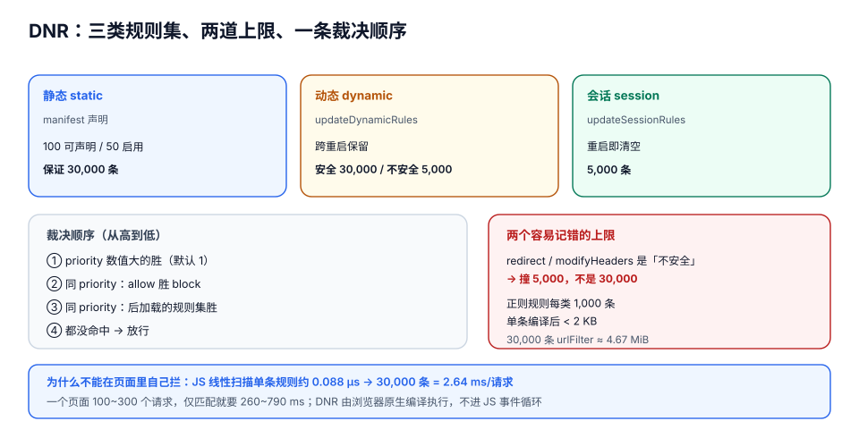

# 声明式网络规则

MV3 把「拦网络」这件事从**命令式**改成了**声明式**，这不是 API 换代，而是**控制权转移**：以前是你的代码在请求路径上「看一眼再决定」，现在是浏览器拿着你**事先写好的规则**自己裁决，**你的代码连请求都看不见**。

这个转移带来两个后果：**能力范围收窄**（看不到响应体、不能根据运行时上下文动态决定），**性能大幅提升**（规则在浏览器原生侧编译执行，不进 JS 事件循环）。

::: tip 一句话理解
DNR 是「**写给浏览器看的过滤器**」，不是「挂在 `fetch` 上的钩子」。凡是需要「看一眼内容再决定」的需求，DNR 都做不到——不是没写对，是模型不允许。
:::

## 判据族声明

本页判据族 `NET-A` ~ `NET-H`，共 8 条。定义表在第八节。

## 本页不讲什么

- 不讲 `host_permissions` 与站点访问权的授予时机，归 [权限模型](../Permissions/index.md)。
- 不讲内容脚本如何配合拦截结果改页面，归 [内容脚本](../ContentScript/index.md)。
- 不讲服务端网关的限流与 WAF，归[流量治理](../../../Backend/GatewayDeep/TrafficManagement/index.md)。
- 不讲 CDN 缓存与回源，归[CDN 原理](../../../Ops/EdgeCDN/CDNPrinciple/index.md)。

## 一、`webRequest` 还剩什么

| 能力 | MV3 普通扩展 | 策略强制安装（企业） |
| --- | --- | --- |
| 观察请求（`onBeforeRequest` 等） | ✅ 只读，**不能改** | ✅ |
| 阻塞 / 重定向 | ❌ | ✅（`webRequestBlocking` 仍可用） |
| 改请求头 / 响应头 | ❌ | ✅ |
| 读响应体 | ❌（从来没有正式支持过） | ❌ |

「观察」仍然有用：做统计、做调试、做「这条请求被哪条规则拦了」的排查。但要改流量，只有 DNR 一条路。

::: warning `webRequestBlocking` 不是「以后会恢复」
它在 MV3 里只对**通过企业策略强制安装**的扩展开放。消费级扩展提交时声明这个权限会被直接拒。看到「加 `webRequestBlocking` 就能拦」的老文章，先看它是不是在讲企业部署。
:::

## 二、三类规则：静态、动态、会话



| 类型 | 怎么来 | 生效时机 | 数量上限 | 适合 |
| --- | --- | --- | --- | --- |
| 静态（static） | `manifest.declarative_net_request.rule_resources` 指向的 JSON 文件 | 随扩展加载 | 可声明 **100** 个规则集，同时启用 **50** 个；**保证 30,000 条**静态规则 | 固定规则（广告域名、追踪器） |
| 动态（dynamic） | `updateDynamicRules()` 运行时写入 | 立即，**跨浏览器重启保留** | 安全动作 **30,000**（Chrome 121+）；不安全动作 **5,000** | 用户自定义黑名单 |
| 会话（session） | `updateSessionRules()` | 立即，**浏览器重启即清空** | **5,000** | 临时规则（本次调试、本次会话） |

```json [rules.json]
[
  {
    "id": 1,
    "priority": 1,
    "action": {"type": "block"},
    "condition": {
      "urlFilter": "||tracker.example.com^",
      "resourceTypes": ["script", "image", "xmlhttprequest"]
    }
  }
]
```

```json [manifest.json]
{
  "permissions": ["declarativeNetRequest"],
  "declarative_net_request": {
    "rule_resources": [{ "id": "ruleset_ads", "enabled": true, "path": "rules.json" }]
  }
}
```

### 「安全」与「不安全」动作的分界线

这条分界线决定了你撞的是 30,000 还是 5,000：

| 动作 | 分类 | 上限 |
| --- | --- | --- |
| `block` | 安全 | 30,000 |
| `allow` | 安全 | 30,000 |
| `allowAllRequests` | 安全 | 30,000 |
| `upgradeScheme` | 安全 | 30,000 |
| `redirect` | **不安全** | **5,000** |
| `modifyHeaders` | **不安全** | **5,000** |

::: danger 重定向密集的扩展撞的是 5,000
「把某个域名的资源全部替换成本地占位图」「把 http 重定向到 https 的自定义域名表」——这类功能全在 `redirect` 上，**上限 5,000 条**，不是 30,000。而且这 5,000 条**要把动态规则里的不安全规则一起算**（含 `modifyHeaders`）。

看到「DNR 有 30,000 条，够用了」就放心的方案，十有八九是没读这张表。
:::

## 三、匹配条件：`urlFilter` 的六个记号

`urlFilter` 是一套**简化语法**，比正则快得多，也比正则安全（不会被灾难性回溯拖死）：

| 记号 | 含义 | 例子 | 匹配 |
| --- | --- | --- | --- |
| `\|` | 锚定开头或结尾 | `\|https://a.com` | 只匹配以它开头的 URL |
| `\|\|` | 锚定**域名**起点 | `\|\|a.com^` | 匹配 `a.com`、`x.a.com`，不匹配 `nota.com` |
| `^` | 分隔符（`/`、`?`、`&`、`=`、`:` 等） | `\|\|a.com^` | 保证 `a.com` 后面是边界，避免匹配 `a.com.evil` |
| `*` | 任意字符（含空） | `/ads/*/banner` | 通配 |
| 无锚定 | 子串匹配 | `banner` | 任何位置含 `banner` |
| `~`（在 `excluded*` 里） | 排除 | 见下 | —— |

```json
{
  "id": 7,
  "priority": 2,
  "action": {"type": "block"},
  "condition": {
    "urlFilter": "||ads.example.com^",
    "excludedInitiatorDomains": ["mysite.example.com"],
    "resourceTypes": ["script", "image"]
  }
}
```

::: warning `\|\|a.com^` 里的 `^` 不能省
省掉之后 `||a.com` 会匹配 `a.com.evil.net`——**域名后缀攻击**。这是 DNR 规则里最常见的一个安全漏洞，且症状是「规则生效了，但没拦住真正想拦的」。
:::

## 四、优先级：谁赢

裁决顺序（从高到低）：

1. `priority` 数值大的胜（默认 1，范围到 `2^31-1`）；
2. 同 priority 时，**`allow` / `allowAllRequests` 胜 `block`**；
3. 同 priority 且同类型时，**后加载的规则集**（按 manifest 里的顺序）胜；
4. 没有任何规则命中 → 放行。

```json
[
  {
    "id": 1,
    "priority": 1,
    "action": {"type": "block"},
    "condition": {"urlFilter": "||cdn.example.com^", "resourceTypes": ["script"]}
  },
  {
    "id": 2,
    "priority": 2,
    "action": {"type": "allow"},
    "condition": {
      "urlFilter": "||cdn.example.com/app/*",
      "resourceTypes": ["script"],
      "initiatorDomains": ["board.example.com"]
    }
  }
]
```

上面这一对的语义是：**默认拦掉这个 CDN 的脚本，但自家看板页面加载的放行**。`initiatorDomains` 是这里的关键——它让「谁发起的」参与裁决，而不是只看目标。

## 五、规则的体积：30,000 条到底有多大

本机实测（Node 22.22.2，用与官方示例同构的规则对象）：

| 规则形态 | 条数 | JSON 体积 | 每条 | `JSON.parse` |
| --- | --- | --- | --- | --- |
| `urlFilter` 型 | 100 | 15.0 KiB | 153.8 B | 0.1 ms |
| `urlFilter` 型 | 1,000 | 152.1 KiB | 155.8 B | 1.7 ms |
| `urlFilter` 型 | 30,000 | **4,665.8 KiB** | 159.3 B | **34.5 ms** |
| `regexFilter` 型 | 1,000 | 208.8 KiB | 213.8 B | 1.0 ms |

三条结论：

1. **一条 `urlFilter` 规则约 155 B**，30,000 条约 **4.7 MiB**——这是要打进安装包的体积，不是免费的。
2. **`regexFilter` 比 `urlFilter` 贵约 37%**，而且还有单独的 1,000 条/类上限与「单条编译后 < 2 KB」的限制。
3. **解析 34.5 ms 只是一次性成本**（浏览器启动/规则更新时），但如果你在**页面侧**自己实现同样的匹配，就是另一回事了。

### 为什么不能「在页面里自己拦」

同一个实验里，用 JS 正则近似匹配 301 条 pattern × 1,000 次（共 301,000 次判定）耗时 26.6 ms，即单次判定 **0.088 µs**。换算到 30,000 条：

```text
0.088 µs × 30,000 = 2.64 ms / 每条请求
```

一个页面一次加载可能发出 100~300 个请求——**仅规则匹配就要 260~790 ms**，还没算 DOM 操作。这就是 DNR 存在的根本原因：**规则由浏览器原生编译执行，不进 JS 事件循环**。

::: info 所以「DNR 只能声明」不是限制，是价格
如果 DNR 允许运行时任意回调，浏览器就必须为每条请求回调一次 JS——性能会退回到 MV2 的水平（甚至更差，因为要多进程）。平台用「声明式」换掉了「每请求一次 JS」，代价就是你**看不到请求内容**。这笔交易对 99% 的拦截需求是划算的。
:::

## 六、增量更新：不要整体替换

```javascript [sw.js]
// ❌ 每次全量替换：中间有一个「规则为空」的窗口，流量会漏出去
async function badSetRules(rules) {
  const old = await chrome.declarativeNetRequest.getDynamicRules();
  await chrome.declarativeNetRequest.updateDynamicRules({
    removeRuleIds: old.map((r) => r.id),
    addRules: rules,
  });
}

// ✅ 增量：只改差异，且 id 稳定可推导
async function goodSetRules(rules) {
  const old = await chrome.declarativeNetRequest.getDynamicRules();
  const oldById = new Map(old.map((r) => [r.id, JSON.stringify(r)]));
  const toAdd = rules.filter((r) => oldById.get(r.id) !== JSON.stringify(r));
  const keep = new Set(rules.map((r) => r.id));
  const toRemove = [...oldById.keys()].filter((id) => !keep.has(id));
  await chrome.declarativeNetRequest.updateDynamicRules({
    removeRuleIds: toRemove,
    addRules: toAdd,
  });
}
```

`updateDynamicRules` 的 `addRules` 与 `removeRuleIds` 在**同一次调用**里是原子的——这一点很关键：整体替换分成两次调用时，中间那个窗口里**没有任何规则生效**。

## 七、排查：怎么知道哪条规则拦了

```javascript
// 需要 declarativeNetRequestFeedback 权限（仅未打包 / 开发者模式可用）
const matched = await chrome.declarativeNetRequest.getMatchedRules({tabId});
console.log(matched.rulesMatchedInfo);
```

| 现象 | 排查顺序 |
| --- | --- |
| 规则完全不生效 | ① `getEnabledRulesets()` 是否含该 id；② 规则 JSON 是否被解析（加载时控制台有 warning）；③ `resourceTypes` 是否漏了 `main_frame` |
| 规则生效但拦错了 | ① `urlFilter` 的 `^` 是否缺失；② 是否有更高 priority 的 `allow`；③ `excludedInitiatorDomains` 写反 |
| 部分站点不生效 | 该站点的请求可能由 Service Worker 生成或来自 `CacheStorage`——**DNR 只管到达网络栈的请求** |
| 加了 `redirect` 就报超限 | 不安全动作上限 5,000，把 `modifyHeaders` 一起算进去了 |

::: danger DNR 看不见的三类请求
1. **页面 Service Worker 生成的响应**（`respondWith(new Response(...))`）——没到网络栈；
2. **`CacheStorage` 命中的响应**——同上；
3. **`chrome-extension://` 自己的资源**——不受 DNR 管辖。

所以「我在 DNR 里拦了这个图片，为什么还显示」的正确答案往往是：**它来自页面自己的 Service Worker 缓存**。
:::

## 八、判据表

| 判据 | 断言 | 怎么验 |
| --- | --- | --- |
| `NET-A` | 所有改流量的逻辑都走 DNR，manifest 里没有 `webRequestBlocking` | 读 manifest，`permissions` 中无 `webRequestBlocking` |
| `NET-B` | 域名匹配一律用 `\|\|domain^` 形式，无裸子串匹配 | 扫描规则文件，`urlFilter` 含域名但缺 `^` 的条目数为 0 |
| `NET-C` | `redirect` / `modifyHeaders` 类规则总数 ≤ 5,000，且与动态规则合并计数 | `getDynamicRules()` 里不安全动作条数 + 静态规则集中同类条数 ≤ 5,000 |
| `NET-D` | 静态规则总体积有预算（≤ 5 MiB），且单条 < 2 KB | 统计规则文件字节数；对最长规则单独测量 |
| `NET-E` | 规则更新走增量（同一调用内 add + remove），不存在「空规则」窗口 | 代码审查 `updateDynamicRules` 调用次数；连续触发更新时抓包不漏 |
| `NET-F` | 所有规则都有稳定可推导的 `id`，不使用随机 id | 重跑一次生成逻辑，两次 id 集合完全相同 |
| `NET-G` | 需要一个「总开关」时用 `allowAllRequests` 或禁用规则集，而不是删光规则 | 关掉开关后 `getEnabledRulesets()` 为空或含 allow 规则，且恢复后规则集完整 |
| `NET-H` | 「拦不住」的排查清单已写进文档（SW 生成 / CacheStorage / 扩展自身资源） | 文档里有对应章节，且能举出至少一个真实案例 |

## 参考资料

- `declarativeNetRequest` 参考（含全部限额常量）：<https://developer.chrome.com/docs/extensions/reference/api/declarativeNetRequest>
- 规则条件与 `urlFilter` 语法：<https://developer.chrome.com/docs/extensions/reference/api/declarativeNetRequest#property-RuleCondition-urlFilter>
- MV2 → MV3 的网络能力迁移：<https://developer.chrome.com/docs/extensions/develop/migrate/improve-security>
- 策略安装扩展的 `webRequestBlocking` 例外：<https://developer.chrome.com/docs/extensions/develop/migrate/blocking-web-requests>
