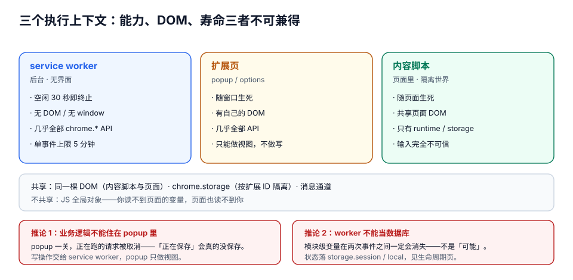
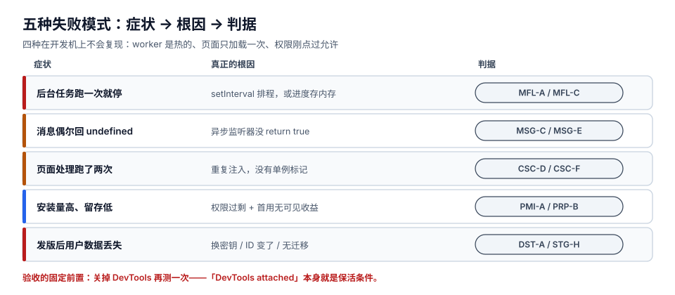
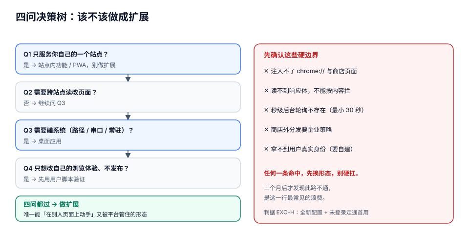

# 概述：三个执行上下文与六条硬约束

扩展最容易被低估的地方，是它**看起来像网页**：HTML、CSS、JavaScript，`document.querySelector` 照样能用，`fetch` 照样能发。于是绝大多数人第一版都写成「一个网页 + 一点后台逻辑」，然后在上线后的第三个月遇到同一批问题：**后台逻辑跑一次就停、消息偶尔回不来、注入的脚本跑了两遍、发版之后用户设置全没了**。

这四个症状背后是同一件事：扩展不是「一个网页」，而是**三个互不相通的执行上下文**，加**六条不跟你商量的平台约束**。

::: tip 一句话理解
网页的默认假设是「**我一直活着**」，扩展的默认假设是「**我随时会死，而且死前没人通知我**」。把后台代码当成无状态函数写，其余所有设计（状态放哪、谁负责重发、监听器在哪注册）都是这条假设的推论。
:::

## 判据族声明

本页判据族 `EXO-A` ~ `EXO-H`，共 8 条。定义表在第七节。

## 本页不讲什么

- 不讲 worker 被回收的**具体秒数**与「什么算活动」，归 [manifest 与生命周期](../ManifestLifecycle/index.md)。
- 不讲 `permissions` 的每一个字段与匹配模式语法，归 [权限模型](../Permissions/index.md)。
- 不讲 `declarativeNetRequest` 的规则写法，归 [声明式网络规则](../NetworkRules/index.md)。
- 不讲桌面壳（Electron / Tauri）的实现，归 [桌面应用深入](../../../Frontend/DesktopApp/index.md)。

## 一、三个上下文：能力、DOM、寿命三者不可兼得

| 维度 | service worker（后台） | 扩展页（popup / options / side panel） | 内容脚本（页面里） |
| --- | --- | --- | --- |
| 有没有 DOM | **没有**（无 `document`、无 `window`） | 有，但是**自己的** DOM | 有，是**页面的** DOM |
| 能调多少 `chrome.*` | **几乎全部** | 几乎全部 | 只有一小撮（`runtime` 的消息、`storage`、`i18n`） |
| 寿命 | 事件驱动，**30 秒空闲即终止** | 随窗口生死（popup 一关就没） | 随页面生死（导航即销毁） |
| 能否跨站 | 能（按 host 权限） | 不适用 | **只在自己被注入的页面里** |
| 典型职责 | 编排、调度、调接口、管状态 | 用户界面、设置 | 读页面、改页面、把用户动作报上去 |
| 常见误用 | 在里面存全局变量 | 把业务逻辑写在 popup 里 | 在里面直接 `fetch` 自家后端（受页面 CSP 与 CORS 约束） |

三条推论，每一条都对应一类线上事故：

1. **业务逻辑不能住在 popup 里**。popup 一关，页面就销毁，正在跑的请求被取消——用户点开 popup 看到「正在保存…」，手一抖点空白处，保存就没了。**popup 只是视图**，写操作要交给 service worker。
2. **内容脚本不能当成「小后台」**。它活在页面的进程里，页面一导航就换了一个实例；在 `https://a.com` 里攒的状态，到 `https://b.com` 就没了。
3. **service worker 不能当数据库**。它的模块级变量在两次事件之间**一定**会消失——不是「可能」，是「一定」（判据 `MFL-A`）。

::: info 为什么内容脚本只能拿到一小撮 API
因为内容脚本和**不受信任的网页**共享同一个渲染进程。平台的设计是：内容脚本拿不到 `chrome.tabs`、`chrome.cookies`、`chrome.scripting` 这些「能代表用户做事」的能力，只保留「和我的扩展说话」与「读写我自己的存储」两类。想用完整能力，就必须把请求**转发给 service worker**，由它校验来源后代办——这个「转发 + 校验」是后面[消息](../Messaging/index.md)与[安全](../Security/index.md)两页的主线。
:::

## 二、六条硬约束

这六条不是建议，是**平台的物理定律**。每条都给出「违反后的症状」，方便你反查。

### 约束 1：后台没有常驻内存

worker 空闲 30 秒被终止，单个事件处理超过 5 分钟被终止，`setTimeout` / `setInterval` **不算活动**（不会被触发，也不能保活）。状态必须落到 `chrome.storage` 或 IndexedDB。

**症状**：定时任务只跑第一次；计数器永远是 1；「已登录」状态在几分钟后丢失。

### 约束 2：不能有远程代码

Chrome 应用商店把「从扩展自身文件之外加载并执行的 JavaScript / WASM」定义为**远程托管代码（RHC）**，MV3 一律禁止——包括**引用了但从未执行**的代码，包括你从 CDN 拉进来的第三方库。JSON 配置、CSS、远程 API 调用都不算 RHC；沙箱 iframe 里可以跑远程代码，但拿不到宿主页面的 DOM。

**症状**：提交被拒，错误码 `Blue Argon`；或者更糟——本地加载正常，上架后被下架。

::: danger 最常见的两种「无意中的远程代码」
1. 打包产物里保留了 `import('https://cdn.example.com/x.js')` 或 `new Function(远程字符串)`——即使代码路径永远不执行，扫描器也会命中。
2. 用「远程配置下发脚本片段」做热更新。**合规的做法是下发 JSON 参数**（阈值、开关、文案），代码本身随包发版。
:::

### 约束 3：网络能力被改成声明式

阻塞式 `webRequest` 在 MV3 里对普通扩展已经关闭（只有**策略强制安装**的企业扩展还保留 `webRequestBlocking`）。要拦、要改头、要重定向，只能用 `declarativeNetRequest`（DNR）：你**声明规则**，浏览器自己执行，你的代码**看不到请求本身**。

**症状**：「我要根据响应体内容决定拦不拦」——这个需求在 DNR 上**做不到**，不是没写好，是模型不允许（响应体不在 DNR 视野里）。

### 约束 4：权限要过两道关

第一道是**用户**：安装时弹出的警告文案由声明的最小权限集决定，`<all_urls>` + `tabs` 的扩展安装转化率会明显下滑。第二道是**审核**：宽泛的 host 权限会触发人工审核，权限说明写不清就被打回。

**症状**：功能都写完了，卡在审核两周；或者装的人不少、留下来的很少。

### 约束 5：身份不可迁移

扩展 ID 由**签名公钥**派生（公钥 DER 的 SHA-256 前 16 字节，映射到 32 个 `a`~`p` 字符）。`storage`、`cookies`、`indexedDB` 全部按 ID 隔离。**换密钥 = 换一个扩展**：老用户的本地数据留在旧 ID 下，新包对它们一无所见。

**症状**：发版后用户抱怨「设置全部重置、登录掉了」，而你的代码一行没改。第 [分发](../Distribution/index.md) 页用四个真实派生值把这条钉死。

### 约束 6：跨浏览器不是「一份代码」

Firefox 的 MV3 用 event page 而不是 service worker，**没有 5 分钟硬上限**，但会在回收前触发 `runtime.onSuspend`；Safari 需要 Xcode 转换工程、`browser.*` 命名空间、部分 API 缺失。**同一份 manifest 要做多目标构建**，而不是复制粘贴三份。

**症状**：Chrome 上一切正常，Firefox 上第一个闹钟就不触发，Safari 上 popup 白屏。

## 三、五种失败模式：症状 → 根因 → 判据

| # | 症状 | 真正的根因 | 判据 |
| --- | --- | --- | --- |
| 1 | 后台任务「跑一次就停」 | 用 `setInterval` 排程，或把进度存在模块变量里 | `MFL-A` / `MFL-C` |
| 2 | 消息偶尔回 `undefined` | 异步监听器没 `return true`；或端口在对端关闭后才 `postMessage` | `MSG-C` / `MSG-E` |
| 3 | 页面里的事件处理跑了两次 | 内容脚本被重复注入（SPA 路由 + `executeScript` 叠加），或没做单例标记 | `CSC-F` |
| 4 | 安装量高、留存低 | 权限过剩（安装警告吓人）+ 首次使用没有「立即可见的收益」 | `PMI-A` / `PRP-B` |
| 5 | 发版后用户数据丢失 | 换了签名密钥、或 ID 变了、或存储 key 迁移没写 | `DST-A` / `STG-H` |

::: warning 「自测通过」在这里几乎不构成证据
五种失败模式里有四种**在开发机上不会复现**：开发时 worker 是热的（因为 DevTools 挂着——`DevTools attached` 本身就会保活）、页面只加载一次、消息量小、权限刚点过「允许」。所以本专题每一页的验收都要求「**在冷启动 + 二次导航 + 权限被撤销**这三个条件下各验一次」。
:::

## 四、该不该做成扩展：四问决策树

1. **只服务你自己的一个站点？** → 不要做扩展。站点内功能 + PWA 就能做到，且没有审核、没有权限警告、没有 ID 迁移问题。
2. **需要跨站点读改页面（在别人的页面上加东西、取东西）？** → 扩展是唯一解。PWA 出不了自己的源。
3. **需要碰系统（任意路径读写、串口 / USB、常驻进程、开机自启）？** → 桌面应用。扩展的文件访问是用户手势驱动的、沙箱内的，做不了「后台持续扫描目录」。
4. **只是想改自己的浏览体验、不打算发布？** → 先用用户脚本（Tampermonkey 之类）验证价值。它的能力模型比扩展窄得多，但**零审核、零签名、改一行立刻生效**。验证完再决定要不要付扩展的工程成本。

再来一张「扩展做不到什么」的清单，避免走完三个月才发现此路不通：

| 做不到 | 原因 | 替代 |
| --- | --- | --- |
| 注入 `chrome://`、`chrome-extension://`（别家）、Chrome 应用商店页面 | 平台保留页禁止内容脚本 | 无（这是硬边界） |
| 读响应体后决定拦截 | DNR 看不到响应体 | 只能拦请求；要看响应体必须在页面侧 `fetch` 代理 |
| 后台常驻轮询（秒级） | worker 30 秒回收 + `alarms` 最小 30 秒 | 服务端推送 / 用户动作驱动 / 降到 30 秒粒度 |
| 静默自动更新到自己服务器 | 商店外分发需企业策略或手动安装 | 商店更新（几小时级）或企业 `ExtensionInstallForcelist` |
| 拿到用户的真实身份 | 平台不提供 | `chrome.identity` 走 OAuth，自己建账号体系 |

## 五、从「能跑」到「能交付」：三个阶段各自的门槛

| 阶段 | 你会觉得「做完了」 | 实际上还差 | 对应页 |
| --- | --- | --- | --- |
| 能跑（第 1 周） | 加载未打包扩展，按钮点了有反应 | 后台一冷就废、权限写成了 `<all_urls>`、错误全被吞 | [生命周期](../ManifestLifecycle/index.md) / [权限](../Permissions/index.md) |
| 能用（第 2~3 周） | 功能齐了，自己天天在用 | 二次导航重复注入、离线时消息丢失、配额写满静默失败 | [内容脚本](../ContentScript/index.md) / [消息](../Messaging/index.md) / [存储](../StorageState/index.md) |
| 能交付（第 4 周） | 打包上传，等审核 | 版本比较写错导致不更新、密钥没备份、隐私政策缺失、远程代码被拒 | [分发](../Distribution/index.md) / [安全](../Security/index.md) |

一个判断「是否真的到了第三阶段」的土办法：**把你的扩展装在一台干净的机器上，用一个没登录过任何账号的浏览器配置，按商店描述走一遍首次使用流程**。90% 的「上架后第一波差评」都出在这一步——因为你自己的浏览器里已经有登录态、有缓存、有你调试时点过的「允许」。

## 六、判据表

| 判据 | 断言 | 怎么验 |
| --- | --- | --- |
| `EXO-A` | 业务逻辑不在 popup / options 页里，页面关闭不中断任何写操作 | 打开 popup 触发一次写 → 立刻点空白处关闭 → 查结果是否落库 |
| `EXO-B` | 内容脚本里没有直接调用需要扩展权限的 API（`tabs` / `cookies` / `scripting`） | 全文搜索 `chrome.tabs` / `chrome.cookies` / `chrome.scripting`，只在 sw 与扩展页出现 |
| `EXO-C` | service worker 里没有跨事件依赖的模块级可变状态 | `grep -n "^let \|^var " sw.js` 结果全部是常量或每次重建的缓存 |
| `EXO-D` | 打包产物中不存在远程脚本引用（编译后 grep `https://` 只出现在数据/配置字段） | 对 `dist/` 做 `grep -nE "import\(['\"]https|new Function|eval\("`，输出为空 |
| `EXO-E` | 所有「拦截 / 改头 / 重定向」都通过 DNR 实现，`webRequest` 只用于观察 | `manifest.json` 里有 `declarativeNetRequest`，没有 `webRequestBlocking` |
| `EXO-F` | 声明的 host 权限是功能所需的最小子集，且每一权限在权限说明里有对应句子 | 权限清单 × 说明段落一一对照，缺一条即不通过 |
| `EXO-G` | 签名密钥已离线备份，且 CI 用的是同一把（ID 不变） | 打包两次，两次派生出的 32 字符 ID 完全相同 |
| `EXO-H` | 首次使用流程能在「全新浏览器配置 + 未登录」下走通 | 新建一个空 profile，装包，按商店描述走一遍，不借助任何既有缓存 |

## 参考资料

- Chrome 扩展文档首页：<https://developer.chrome.com/docs/extensions>
- 扩展的架构总览（三个上下文）：<https://developer.chrome.com/docs/extensions/develop/architecture>
- service worker 生命周期：<https://developer.chrome.com/docs/extensions/develop/concepts/service-workers/lifecycle>
- 远程托管代码政策：<https://developer.chrome.com/docs/extensions/develop/migrate/remote-hosted-code>
- 内容脚本的能力边界：<https://developer.chrome.com/docs/extensions/develop/concepts/content-scripts>
