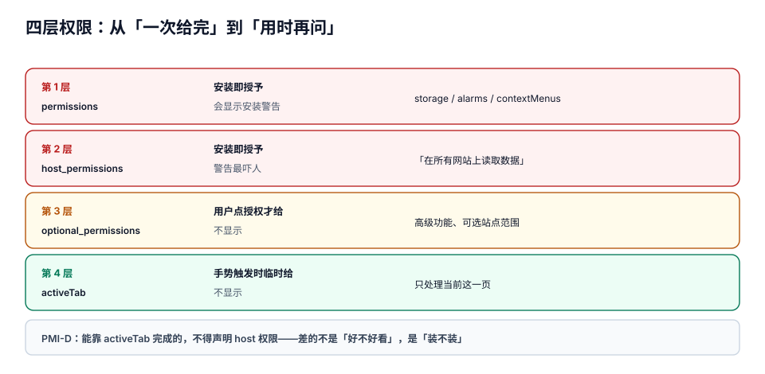

# 权限模型与最小授权

扩展的权限是这个平台最贵的货币。它决定三件事：**安装页面上写着什么警告**（决定装不装）、**审核要不要人工看**（决定多久能上架）、**用户会不会在某次升级后把你删掉**（决定活得久不久）。

而它最反直觉的地方是：**同一份功能，权限可以差出十倍**。你要「把当前页面的选中文本发到一个固定接口」，最少只需要 `activeTab` + 一个 `optional_host_permissions`；写错成 `<all_urls>` + `tabs` + `cookies`，安装警告立刻从「读取您在当前标签页的数据」变成「读取和更改您在所有网站上的所有数据」，转化率能掉一半。

::: tip 一句话理解
**权限不是「我能做什么」，而是「我承诺了永远可以做什么」**——用户在安装时一次性授权，之后几乎不会再回来检查。所以每加一条权限，都要能回答「**不做这条，哪个具体功能会坏**」。
:::

## 判据族声明

本页判据族 `PMI-A` ~ `PMI-H`，共 8 条。定义表在第七节。

## 本页不讲什么

- 不讲内容脚本怎么注入、注入到哪个世界，归 [内容脚本](../ContentScript/index.md)。
- 不讲 DNR 规则怎么写，归 [声明式网络规则](../NetworkRules/index.md)。
- 不讲「页面能不能借我的手干坏事」这一类攻击面，归 [安全边界](../Security/index.md)。
- 不讲商店里权限说明的文案撰写，归 [分发](../Distribution/index.md)。

## 一、四层权限：从「一次给完」到「用时再问」



| 层 | 字段 | 何时生效 | 安装警告 | 适合什么 |
| --- | --- | --- | --- | --- |
| 第 1 层 | `permissions` | 安装即授予 | 会显示（如「管理您的下载内容」） | 与站点无关的能力：`storage`、`alarms`、`contextMenus` |
| 第 2 层 | `host_permissions` | 安装即授予 | 会显示（如「在所有网站上读取数据」） | **确实需要长期、跨站点**读写 |
| 第 3 层 | `optional_permissions` / `optional_host_permissions` | 用户点「授权」后才给 | **不显示**，运行时弹窗 | 高级功能、可选的站点范围 |
| 第 4 层 | `activeTab` | 用户**手势**触发时临时授予 | 不显示 | 「只处理当前这一页」 |

### `permissions` 里常见的十项，以及它们的真实代价

| 权限 | 能做什么 | 代价 / 注意 |
| --- | --- | --- |
| `storage` | 四个存储区 | 无警告，几乎必加 |
| `alarms` | 定时任务 | 无警告；不加则 `chrome.alarms` 是 `undefined` |
| `contextMenus` | 右键菜单 | 无警告 |
| `activeTab` | 手势触发时临时访问当前页 | **最被低估的一条**，能替代大量 host 权限 |
| `scripting` | 编程式注入 | 需要配合 host 权限或 `activeTab` 才有实际效果 |
| `tabs` | 读所有标签页的 `url` / `title` / `favIconUrl` | 会显示「读取您的浏览记录」——**很多场景不需要它** |
| `webNavigation` | 精细的导航事件 | 显示「读取您的浏览记录」 |
| `cookies` | 读写 cookie（含 `httpOnly`） | 显示「读取和更改您的 Cookie」；审核敏感 |
| `downloads` | 管理下载 | 显示「管理您的下载内容」 |
| `declarativeNetRequest` | 声明式拦截 | 无警告（**拦自己的**不需要 host 权限） |

::: warning `tabs` 是最大的一笔冤枉账
很多扩展加 `tabs` 只是为了拿当前页 URL，而这件事有两条更便宜的路：

1. `activeTab` —— 用户点了工具栏按钮 / 右键菜单 / 快捷键，就临时拿到当前页的完整访问权（**包括 URL**）；
2. `chrome.tabs.query({active: true, currentWindow: true})` 在**有 `activeTab` 或对应 host 权限**时也能拿到 URL。

只有「在后台持续枚举所有标签页的 URL」才真的需要 `tabs`。先问自己是不是这种。
:::

## 二、host 权限：匹配模式的三段结构

一个匹配模式是 `scheme://host/path`：

| 部分 | 允许的写法 | 例子 | 说明 |
| --- | --- | --- | --- |
| scheme | `http` / `https` / `*` / `file` / `ftp` | `https` | `*` 只匹配 `http` 与 `https` |
| host | `*` / `*.example.com` / `example.com` | `*.example.com` | `*.example.com` **同时匹配** `example.com` 本身 |
| path | 必须以 `/` 开头，可含 `*` | `/board/*` | `/*` 匹配全部路径 |

```json [manifest.json]
{
  "host_permissions": ["https://board.example.com/*"],
  "optional_host_permissions": ["https://*/*"]
}
```

四条容易踩的规矩：

1. **`<all_urls>` 包含 `file://` 与 `ftp://`**，而 `*://*/*` 只含 http/https。前者会让安装警告更吓人。
2. **端口不在匹配模式里**：`https://example.com:8443/*` 不是合法模式，应写 `https://example.com/*` 并在运行时判断端口。
3. **子域通配不能跨级**：`*.example.com` 匹配 `a.example.com` 与 `a.b.example.com`，但**不匹配** `example.com.evil.com`（这点是安全的，别自己写正则替代它）。
4. **路径通配只在末尾有效**：`/a/*/b` 里中间的 `*` 行为依实现而异，规范用法是「前缀 + `*`」。

## 三、`activeTab`：被低估的第四层

`activeTab` 的授予时机只有四种**用户手势**：

| 手势 | 授予范围 | 持续时间 |
| --- | --- | --- |
| 点击 `action` 工具栏按钮 | 当前标签页 | 直到该标签页导航或关闭 |
| 右键菜单项（`contextMenus`） | 当前标签页 | 同上 |
| 键盘快捷键（`commands`） | 当前标签页 | 同上 |
| 从地址栏 Omnibox 接受建议 | 当前标签页 | 同上 |

拿到之后，你可以对该页 `scripting.executeScript`、读它的 URL、发跨域请求到**该页的源**。用户看到的授权画面上**没有 host 权限那一行**。

```javascript [sw.js]
chrome.action.onClicked.addListener(async (tab) => {
  // 有 activeTab 才能这样直接注入，无需任何 host_permissions
  await chrome.scripting.executeScript({
    target: {tabId: tab.id},
    func: () => document.title,
  });
});
```

::: danger `activeTab` 的三个失效时刻
1. **导航即失效**：用户点了按钮、你注入了脚本，用户一按 F5，权限没了——后续注入会抛 `Cannot access contents of the page`。
2. **换标签页即失效**：A 页点按钮、切到 B 页再注入，B 页没有授权。
3. **不能在后台「预热」**：`activeTab` 不能在你自己的定时任务里凭空获得，必须有真实手势。
:::

## 四、可选权限：把「以后可能要」挪出安装警告

```javascript
// 请求（必须在用户手势里调用，否则报错）
const granted = await chrome.permissions.request({
  origins: ['https://board.example.com/*'],
});

// 查询（任何时候都行）
const has = await chrome.permissions.contains({origins: ['https://board.example.com/*']});

// 撤销
await chrome.permissions.remove({origins: ['https://board.example.com/*']});
```

三条纪律：

1. **`request` 必须在用户手势的调用栈里**（点击事件处理函数内），`await` 一层都可能让它失效——需要 `await` 就先 `await` 完再同步调用 `request`。
2. **被拒绝是常态**，不是异常。拒绝后功能要**降级可用**（比如「只能复制到剪贴板，不能直接存到看板」），而不是白屏或死循环弹窗。
3. **`permissions.contains` 才是真相**，不要用「上次用户点过允许」这个本地标记代替——用户可能在 `chrome://extensions` 里手动撤掉。

```javascript [sw.js]
async function ensureBoardAccess() {
  const origin = 'https://board.example.com/*';
  if (await chrome.permissions.contains({origins: [origin]})) return true;
  try {
    return await chrome.permissions.request({origins: [origin]});
  } catch {
    return false;               // 非手势调用会抛错，按「没有权限」处理
  }
}
```

## 五、运行时降权的四种真实故障

「权限少了」比「权限多了」更难查，因为**API 不会消失，只会失败**：

| 现象 | 根因 | 表现 |
| --- | --- | --- |
| `storage` 突然读不到数据 | 用户在 `chrome://extensions` 里把「站点访问权限」改成「点击时」 | `host_permissions` 覆盖的站点访问全部降级，内容脚本不再注入 |
| 定时清理不跑了 | 闹钟创建时没权限（`alarms` 忘声明） | `chrome.alarms` 是 `undefined`，`create` 直接 TypeError |
| 请求 403 | host 权限被撤，但代码里 `fetch` 用的相对路径走了页面源 | 错误落在 `catch` 里被吞 |
| 注入失败但界面「正常」 | `executeScript` 的 Promise 被 `void` 掉，reject 没人接 | 用户看到按钮点了没反应，控制台一条未捕获拒绝 |

```javascript [sw.js]
// 把「权限缺失」变成可诊断的显式分支
async function saveClip(payload) {
  try {
    const res = await fetch('https://board.example.com/api/clips', {
      method: 'POST',
      headers: {'content-type': 'application/json'},
      body: JSON.stringify(payload),
    });
    if (res.status === 401 || res.status === 403) return {ok: false, reason: 'auth'};
    if (!res.ok) return {ok: false, reason: 'http', status: res.status};
    return {ok: true};
  } catch (e) {
    // TypeError: Failed to fetch 通常意味着 host 权限缺失或离线
    return {ok: false, reason: 'network', detail: String(e)};
  }
}
```

## 六、审核视角：权限说明要「一条对一条」

商店审核看的不是你写得多好，而是**每一条权限有没有对应的功能句子**。一个可直接照抄的结构：

| 权限 | 用在哪里 | 说明文字（写进商店列表） |
| --- | --- | --- |
| `activeTab` | 点工具栏按钮摘录当前页 | 「仅在您点击扩展按钮时读取当前页面的选中文字」 |
| `storage` | 本地暂存未发送的摘录 | 「摘录先保存在本地，联网后自动上传」 |
| `contextMenus` | 右键「摘录到看板」 | 「提供右键菜单入口」 |
| `optional_host_permissions` | 上传到你的看板 | 「仅在您授权后访问您的看板地址，用于保存摘录」 |

**判据很简单**：把权限列表和说明文字做成两列，**任何一条权限没有对应句子就不通过**（`PMI-F`）。

::: danger 三条会被直接打回的写法
1. 「为了改善用户体验」这种**没有信息量**的理由——等于没写。
2. 声明了 `tabs` 或 `cookies` 却没有任何功能用到——审核会问「为什么需要」，答不上来就是拒。
3. 把 host 权限写成 `<all_urls>`，功能却只需要一个域名——这是最典型的「权限过剩」拒审理由。
:::

## 七、判据表

| 判据 | 断言 | 怎么验 |
| --- | --- | --- |
| `PMI-A` | `permissions` 中每一项都能指向一个具体功能；删掉它会有可观察的功能缺失 | 逐项注释掉重新加载，记录哪一处坏了；注释不出来的项就是多余的 |
| `PMI-B` | 不需要「后台枚举所有标签页」的场景，不得声明 `tabs` | `grep -n "chrome.tabs.query" .`，确认都带 `active: true` 或已有 host 权限 |
| `PMI-C` | host 权限是最小域名集合，没有 `<all_urls>` 或 `*://*/*` 兜底 | 读 `manifest.json`，`host_permissions` 每项都能对应一个业务域名 |
| `PMI-D` | 「只处理当前页」的能力走 `activeTab`，不靠 host 权限实现 | 卸载 host 权限后只点按钮，功能仍可用 |
| `PMI-E` | 可选权限在用户手势内请求，且被拒后有降级路径 | 手动点「拒绝」，功能降级但界面不白屏、不循环弹窗 |
| `PMI-F` | 每条权限在商店说明里有一句对应文字 | 权限列表 × 说明段落两列对照，无空缺 |
| `PMI-G` | 所有依赖权限的调用都有失败分支，且失败原因可区分（权限 / 网络 / 业务） | 在 `chrome://extensions` 撤销站点访问后再操作，界面给出「需要授权」而非静默失败 |
| `PMI-H` | 权限变更（新增或扩大）会在更新说明里显式写出 | 对比相邻两版 manifest 的 `permissions` 与 `host_permissions` 差异，更新说明里有对应句子 |

## 参考资料

- 权限总览（含每条权限的警告文案）：<https://developer.chrome.com/docs/extensions/reference/permissions-list>
- 声明式权限与可选权限：<https://developer.chrome.com/docs/extensions/develop/concepts/declare-permissions>
- `activeTab` 的授予时机：<https://developer.chrome.com/docs/extensions/develop/concepts/activeTab>
- `chrome.permissions` API：<https://developer.chrome.com/docs/extensions/reference/api/permissions>
- 匹配模式语法：<https://developer.chrome.com/docs/extensions/develop/concepts/match-patterns>
