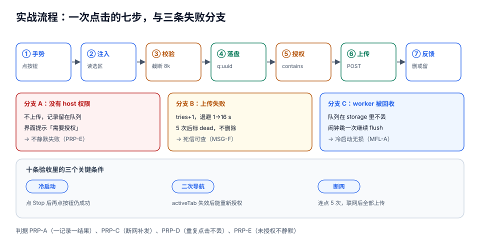

# 实战：网页摘录扩展

前面九页讲的是零件，这一页把它们装成一台机器：一个能上架、能在冷启动下不丢数据、能被审核一次通过的**网页摘录扩展**（下称 Clip）。

需求一句话：**用户在任意页面选中一段文字，点一下工具栏按钮，这段文字带着原文链接与时间戳存进自己的看板**。看起来很小，但它把本专题的每个硬约束都碰了一遍——无常驻（队列要落盘）、权限（要主动最小化）、内容脚本（要选区、要注入 UI）、消息（要能重试）、存储（要配额与迁移）、分发（要签名与版本）、安全（页面文本不能当 HTML）。



::: tip 一句话理解
这个项目的验收标准不是「点一下能存」，而是「**在断网、冷启动、权限被撤、连点五次、页面切了三个路由**这五个条件下，仍然只有一条记录、且用户能看到真实结果」。
:::

## 判据族声明

本页判据族 `PRP-A` ~ `PRP-H`，共 8 条。定义表在第十一节。

## 一、需求口径：先写死六个数

| 口径 | 值 | 为什么是它 |
| --- | --- | --- |
| 单条摘录长度上限 | **8,000 字符** | 超过这个长度 `storage.sync` 单项必爆；也超过人一次能读完的量 |
| 本地队列上限 | **200 条** | 200 × 约 1.2 KB ≈ 240 KB，远小于 `local` 的 10 MB，但足够离线一天 |
| 单次消息体积上限 | **256 KB** | 本机实测 2 MB 的消息序列化 + 解析要 24 ms，256 KB 约 3 ms，不卡帧 |
| 重试上限 | **5 次**，指数退避 1/2/4/8/16 秒 | 覆盖一般的网络抖动，又不至于让「死信」一直占着队列 |
| 支持站点 | 所有 http/https（用 `activeTab`，不预先要 host 权限） | 安装警告里不出现「读取所有网站数据」 |
| 上传域名 | `https://board.example.com`（**可选权限**） | 用户不授权也能用（降级为复制到剪贴板） |

## 二、权限最小集：四次「能不能不要」

| 想要的能力 | 第一反应 | 最终方案 | 省掉了什么 |
| --- | --- | --- | --- |
| 读当前页选中文字 | `host_permissions: ["<all_urls>"]` | **`activeTab`** + 点按钮时 `scripting.executeScript` | 安装警告从「所有网站」变成不显示 |
| 存摘录 | `storage` | `storage`（不申请 `unlimitedStorage`） | 少一条权限 |
| 右键菜单入口 | `contextMenus` | `contextMenus` | —— |
| 上传到看板 | `host_permissions` 直接写死 | **`optional_host_permissions`**，首次保存时请求 | 用户不授权也能用 |

```json [manifest.json]
{
  "manifest_version": 3,
  "name": "网页摘录",
  "version": "1.0.0",
  "description": "选中一段文字，一键摘到自己的看板，保留原文链接。",
  "minimum_chrome_version": "120",
  "permissions": ["storage", "activeTab", "scripting", "contextMenus", "alarms"],
  "optional_host_permissions": ["https://board.example.com/*"],
  "background": { "service_worker": "sw.js", "type": "module" },
  "action": { "default_title": "摘录选中文字" },
  "icons": { "16": "icons/16.png", "48": "icons/48.png", "128": "icons/128.png" }
}
```

注意这里**没有** `content_scripts` 字段——所有注入都是**用户手势后**的编程式注入。代价是「页面里没有常驻的内容脚本」，收益是**零 host 权限、零常驻注入**。这是本实战最重要的一个取舍（判据 `PRP-B`）。

## 三、service worker：一条消息、一个队列、一次上传

```javascript [sw.js]
const QUEUE_PREFIX = 'q:';
const MAX_TRIES = 5;

// ① 监听器全部在顶层同步注册（否则冷启动丢事件）
chrome.action.onClicked.addListener(onActionClicked);
chrome.contextMenus.onClicked.addListener(onMenuClicked);
chrome.runtime.onMessage.addListener(onMessage);
chrome.alarms.onAlarm.addListener(onAlarm);
chrome.runtime.onInstalled.addListener(onInstalled);

async function onActionClicked(tab) {
  if (!tab.id) return;
  // activeTab 在手，直接注入到当前页；world 默认 ISOLATED
  const [{result}] = await chrome.scripting.executeScript({
    target: {tabId: tab.id},
    func: readSelection,          // 见第四节
  });
  if (!result?.text) return;
  await enqueue({...result, url: tab.url, title: tab.title});
}

function onMessage(msg, sender, sendResponse) {
  if (msg?.type !== 'clip:save') return;      // 未知类型不处理
  // 来源校验：只接受本扩展、且来自有 tab 的上下文
  if (sender.id !== chrome.runtime.id) return;
  enqueue(msg.payload).then(sendResponse, (e) =>
    sendResponse({ok: false, reason: 'internal', detail: String(e)}));
  return true;                                 // 同步函数 + return true
}

// ② 先落盘、再发送：worker 随时会死，只有存储能跨事件
async function enqueue(item) {
  if (typeof item?.text !== 'string' || !item.text.trim()) {
    return {ok: false, reason: 'empty'};
  }
  const text = item.text.slice(0, 8000);
  const id = crypto.randomUUID();
  const record = {
    id, text, url: item.url ?? '', title: item.title ?? '',
    createdAt: Date.now(), tries: 0, dead: false,
  };
  await chrome.storage.local.set({[QUEUE_PREFIX + id]: record});
  const r = await flushOnce(id);
  return r.uploaded ? {ok: true, id, uploaded: true} : {ok: true, id, uploaded: false};
}

async function flushOnce(id) {
  const key = QUEUE_PREFIX + id;
  const got = await chrome.storage.local.get(key);
  const rec = got[key];
  if (!rec || rec.dead) return {uploaded: false};

  const hasPerm = await chrome.permissions.contains({origins: ['https://board.example.com/*']});
  if (!hasPerm) return {uploaded: false};      // 没授权：留在队列里，等用户授权后补发

  const res = await upload(rec);
  if (res.ok) {
    await chrome.storage.local.remove(key);    // 成功才删，失败留在队列
    return {uploaded: true};
  }
  const tries = rec.tries + 1;
  if (tries >= MAX_TRIES) {
    await chrome.storage.local.set({[key]: {...rec, tries, dead: true}});
  } else {
    await chrome.storage.local.set({[key]: {...rec, tries}});
    chrome.alarms.create(`retry:${id}`, {delayInMinutes: 0.5 * 2 ** rec.tries});
  }
  return {uploaded: false};
}

async function upload(rec) {
  try {
    const res = await fetch('https://board.example.com/api/clips', {
      method: 'POST',
      headers: {'content-type': 'application/json'},
      body: JSON.stringify({
        id: rec.id, text: rec.text, url: rec.url, title: rec.title,
        createdAt: new Date(rec.createdAt).toISOString(),
      }),
    });
    if (!res.ok) return {ok: false, reason: 'http', status: res.status};
    return {ok: true};
  } catch (e) {
    return {ok: false, reason: 'network', detail: String(e)};
  }
}

function onAlarm(alarm) {
  const id = alarm.name.startsWith('retry:') ? alarm.name.slice(6) : null;
  if (!id) return;
  void flushOnce(id);
}

async function onInstalled({reason}) {
  await migrate();
  chrome.contextMenus.removeAll(() => {
    chrome.contextMenus.create({id: 'clip', title: '摘录到看板', contexts: ['selection']});
  });
  if (reason === 'update') void flushAll();     // 升级后把旧队列补发一遍
}
```

::: danger 这段代码里三个容易写掉的行
1. **`onMessage` 不是 `async`**。写成 `async` 会让 `return true` 变成 Promise，通道立刻关闭（`MSG-B`）。
2. **`sender.id !== chrome.runtime.id` 的早退**。少了它，任何能发消息的上下文都能写队列（`SEC-E`）。
3. **成功才 `remove`**。先删后传是「消息丢了但队列也空了」的经典写法（`MSG-F`）。
:::

## 四、内容脚本：只做「读选区」这一件事

因为我们没有常驻内容脚本，注入的函数必须**自包含**（不能引用外部变量，序列化时会丢）：

```javascript [sw.js]
// 注入到页面的函数：必须纯自包含
function readSelection() {
  const sel = window.getSelection();
  const text = sel ? String(sel).trim() : '';
  // 用 Range 反推一个可读的选择器路径，便于回跳
  function pathOf(node) {
    const parts = [];
    let el = node?.nodeType === 1 ? node : node?.parentElement;
    while (el && el !== document.body && parts.length < 6) {
      const idx = el.parentElement
        ? [...el.parentElement.children].indexOf(el)
        : 0;
      parts.unshift(`${el.tagName.toLowerCase()}:nth-child(${idx + 1})`);
      el = el.parentElement;
    }
    return parts.length ? 'body>' + parts.join('>') : '';
  }
  return {
    text: text.slice(0, 8000),
    selector: sel && sel.rangeCount ? pathOf(sel.getRangeAt(0).startContainer) : '',
    pageTitle: document.title,
  };
}
```

**为什么不用 `content.js` + 消息**：因为常驻内容脚本需要在 manifest 里声明 `matches`，那就必须有 host 权限或 `<all_urls>`——直接毁掉第二节那个取舍。**代价**是每次点击都要注入一次（约几十毫秒），对「点一下摘一段」这个交互完全可以接受。

需要**视觉反馈**时（选完字在右下角浮一个小提示），用 `insertCSS` + 一次性 DOM，同样不常驻：

```javascript [sw.js]
async function flash(tabId, message) {
  await chrome.scripting.executeScript({
    target: {tabId},
    args: [message],
    func: (msg) => {
      const host = document.createElement('div');
      host.dataset.clipUi = '1';
      const shadow = host.attachShadow({mode: 'closed'});
      shadow.innerHTML =
        '<style>.t{all:initial;position:fixed;right:16px;bottom:16px;z-index:2147483647;' +
        'font:13px/1.5 system-ui;background:#111;color:#fff;padding:8px 12px;border-radius:8px;' +
        'opacity:.92}</style><div class="t"></div>';
      shadow.querySelector('.t').textContent = msg;   // 文本走 textContent
      document.body.appendChild(host);
      setTimeout(() => host.remove(), 1800);
    },
  });
}
```

## 五、存储：一条一 key，索引单独存

```javascript [sw.js]
// 队列：q:<uuid> 一条一 key（避免整体读改写，见「存储与配额」的 683× 扇出）
// 索引：index 只存 id + 时间，用于列表页与清理
async function rebuildIndex() {
  const all = await chrome.storage.local.get(null);
  const idx = Object.entries(all)
    .filter(([k]) => k.startsWith(QUEUE_PREFIX))
    .map(([, v]) => ({id: v.id, createdAt: v.createdAt, dead: !!v.dead}))
    .sort((a, b) => b.createdAt - a.createdAt);
  await chrome.storage.local.set({index: idx});
}

// 清理：把超过 7 天且已上传的从队列里移除（失败项保留）
async function gc() {
  const {index = []} = await chrome.storage.local.get('index');
  const cutoff = Date.now() - 7 * 24 * 3600 * 1000;
  const stale = index.filter((x) => x.createdAt < cutoff).map((x) => QUEUE_PREFIX + x.id);
  if (stale.length) await chrome.storage.local.remove(stale);
  await rebuildIndex();
}
```

## 六、S1~S10 验收序列

每条都是「一条命令或一组操作 + 一个可判定结果」。**没有一条需要看代码猜**。

| # | 操作 | 期望 | 对应判据 |
| --- | --- | --- | --- |
| S1 | 加载未打包扩展，点工具栏按钮，页面有选中文字 | 队列里多一条 `q:<uuid>`；若未授权上传，返回 `uploaded:false` 且记录保留 | `PRP-A` |
| S2 | 在 `chrome://extensions` 点开 service worker 的 DevTools，**点 Stop**，再点按钮 | 仍然成功入队（证明状态不依赖内存） | `MFL-A` |
| S3 | 关掉 DevTools，等 2 分钟，再点按钮 | 仍然成功（证明不靠调试期保活） | `MFL-F` |
| S4 | 断网后连点 5 次，再联网 | 队列里 5 条不同 id，联网后全部上传成功、队列清空 | `PRP-C` |
| S5 | 授权上传域名 → 在 `chrome://extensions` 把站点访问改成「点击时」 | 上传失败但**记录不丢**，界面提示「需要授权」 | `PMI-G` |
| S6 | 选中一段含 `` 的文字 | 提示条显示原文，**不弹 alert** | `SEC-B` |
| S7 | 选中 20,000 字 | 只存前 8,000 字，且上传成功（不超单项配额） | `STG-B` |
| S8 | 连点按钮 5 次（同一段文字） | 5 条独立 id（每次点击是一次独立意图），无重复 `q:` key | `PRP-D` |
| S9 | 改版本号打包两次，用同一把密钥 | 两次派生 ID 完全相同 | `DST-A` |
| S10 | 用全新 Chrome 配置（未登录）装包，走完「选中 → 点击 → 授权 → 上传」 | 全流程无报错，看板出现一条记录 | `EXO-H` |

```shell
# S9 的机械化版本
openssl rsa -in key.pem -pubout -outform DER -out pub.der
node -e '
const {createHash}=require("node:crypto"),fs=require("node:fs");
const a="abcdefghijklmnop";
const d=createHash("sha256").update(fs.readFileSync("pub.der")).digest().subarray(0,16);
let s="";for(const b of d)s+=a[b>>4]+a[b&15];console.log(s);'
```

## 七、打包与上架：四条命令

```shell
# 1) 打包（目录内容进 zip 根）
cd dist && zip -qr ../clip.zip . -x '*.map' '*.ts'

# 2) 自查：无源文件、无远程脚本
unzip -l ../clip.zip | grep -E "\.(ts|map)$" || echo "OK: 无源文件"
grep -rnE "import\(['\"]https://|new Function|eval\(" . || echo "OK: 无远程代码"

# 3) 体积
du -h ../clip.zip

# 4) 版本必须大于线上
node -e 'console.log(require("./manifest.json").version)'
```

## 八、症状分诊：十二类现场

| 症状 | 最可能的原因 | 先查这里 |
| --- | --- | --- |
| 点按钮没反应，也没有报错 | `executeScript` 的 Promise 被 `void` 掉，reject 没人接 | 在 `onActionClicked` 里 `.catch(console.error)` |
| `Cannot access contents of the page` | `activeTab` 已失效（导航过 / 换了标签） | 重新点击按钮；不要缓存 tabId 跨导航使用 |
| 上传成功但看板没有 | 服务端按 `id` 去重，而客户端每次生成新 `uuid` | 客户端 `id` 用「URL + 选中文本哈希」做幂等键 |
| 上传一直失败，队列越堆越多 | 没授权 host 权限但代码没区分「未授权」与「网络失败」 | 看返回的 `reason` 是 `network` 还是 `auth` |
| 队列里的记录自己消失 | 成功路径先 `remove` 后 `upload` | 检查 `remove` 的位置 |
| 冷启动后闹钟不触发 | 监听器在 `await` 之后注册 | `grep -n addListener sw.js`，行号应在最前 |
| 存 9 KB 的设置时静默失败 | `storage.sync` 单项 8 KB，`set` 被拒但没人 `await` | 加 `try/catch` 并 `await` |
| 扩展更新后旧标签页行为异常 | 旧注入脚本仍在跑 | 版本守卫或提示刷新 |
| 审核被拒 `Blue Argon` | 产物里有远程脚本引用 | 对 `dist/` 跑 grep |
| 审核被拒「权限与功能不符」 | 声明了用不到的权限 | 权限 × 功能两列对照 |
| 用户装上后立刻卸载 | 首次使用没有可见收益 | 第一次成功后给明确的成功反馈 |
| 装了之后浏览器变卡 | 常驻内容脚本里有全局 `MutationObserver` | 改成按需注入（本项目已如此） |

## 九、上线自查 14 项

1. manifest 是 MV3，`version` 严格大于上一版；
2. 权限列表每项都有对应功能，且商店说明里有对应句子；
3. 无常驻内容脚本（或已确认必须常驻并写明理由）；
4. 所有监听器顶层同步注册；
5. 所有异步回复 `return true` 且监听器非 `async`；
6. 所有 `storage.set` 有 `await` 与错误分支；
7. 队列「先落盘后上传，成功才删」；
8. 页面文本只经 `textContent` / 白名单属性进入 DOM；
9. `postMessage` 接收端校验 `source` + `origin` + 标记；
10. 产物无远程脚本引用（`dist/` 已 grep 过）；
11. 图标为真实 PNG（16/48/128），未使用 SVG 内嵌脚本；
12. 隐私政策已填写（收集任何数据就必须有）；
13. 在全新浏览器配置里走通首次使用流程；
14. 密钥已离线备份，且与线上 ID 一致。

## 十、这个项目「没做什么」，以及为什么

| 没做 | 为什么 |
| --- | --- |
| 常驻内容脚本 + 悬浮按钮 | 会强制要求 host 权限，安装警告变吓人；按需注入已满足交互 |
| 截图 | 需要 `activeTab` + `captureVisibleTab`，属另一条链路，且图片体积会撞存储配额 |
| 原生消息 | 部署成本（装本地程序 + 配清单 + 白名单 ID）远大于收益 |
| 自动同步到多个看板 | 需要多域名 host 权限，审核与安装警告双重代价 |
| 离线全文检索 | 需要 IndexedDB + 索引维护；当前队列只有 200 条，`filter` 足够 |

::: warning 这张表才是「工程判断」的证据
一份只写「我做了什么」的实战文档，读者学不到取舍；写清「**我没做什么、因为哪条约束**」，读者才能把方法迁移到自己的项目上。这也是本专题每一页都带「本页不讲什么」的原因。
:::

## 十一、判据表

| 判据 | 断言 | 怎么验 |
| --- | --- | --- |
| `PRP-A` | 点一次按钮产生恰好一条队列记录，且 `uploaded` 字段如实反映是否真的上传 | S1：看 `chrome.storage.local.get(null)` 的 key 数量 |
| `PRP-B` | manifest 中无 `content_scripts`、无 `host_permissions`（只有 `optional_host_permissions`） | 读 manifest 两处字段，均为空或不存在 |
| `PRP-C` | 断网连点 5 次后联网，5 条全部上传且队列清空 | S4：断网 → 点 5 次 → 联网 → 等 30 秒 → 查队列 |
| `PRP-D` | 重复点击产生**不同** `id`，不产生重复 key，也不因幂等键相同而丢记录 | S8：连点 5 次，`Object.keys` 去重后仍是 5 条 |
| `PRP-E` | 未授权上传域名时，记录留在队列且界面提示「需要授权」，不静默失败 | S5：撤销站点访问后点按钮 |
| `PRP-F` | 超长文本被截断到 8,000 字符且上传成功 | S7：选中 20,000 字，检查服务端收到的长度 |
| `PRP-G` | 页面文本中的 HTML 标签以纯文本显示，不执行 | S6：构造带 `onerror` 的标题 |
| `PRP-H` | 十步验收里至少有 8 步给出「操作 + 可判定结果」，另 2 步若依赖真实服务端则明确标注为待验 | 通读验收表，统计可判定条目 |

## 参考资料

- 扩展入门教程（含最小 manifest）：<https://developer.chrome.com/docs/extensions/get-started>
- `chrome.action` 与 `activeTab` 的配合：<https://developer.chrome.com/docs/extensions/reference/api/action>
- `chrome.scripting.executeScript` 的参数与 `args` 序列化：<https://developer.chrome.com/docs/extensions/reference/api/scripting>
- `chrome.permissions.request` 的手势要求：<https://developer.chrome.com/docs/extensions/reference/api/permissions>
- 上架清单（商店）：<https://developer.chrome.com/docs/webstore/prepare>
