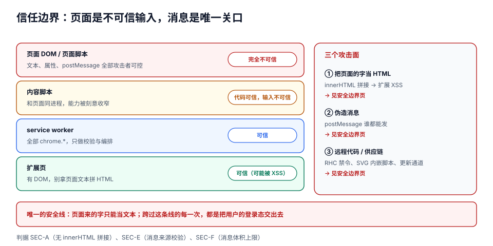

# 安全边界与审核红线

扩展的安全模型和网页**方向相反**。网页的假设是「我的代码是可信的，用户输入是不可信的」；扩展的假设必须是「**我读到的每一个字都来自攻击者**，而我的手能替用户做事」。

原因很直接：内容脚本跑在别人的页面上。它读到的 `textContent`、`dataset`、`postMessage` 里的 `data`，全部由页面控制——而页面可能被 XSS、可能被恶意扩展改过、可能就是攻击者自己写的。**一旦你把这些字当成代码或 HTML 用，就等于把扩展的权限借给了页面。**

::: tip 一句话理解
扩展的安全线只有一条：**页面给的数据只能当「文本」，永远不能当「代码」或「HTML」；跨过这条线的每一次，都是把用户的登录态和所有站点数据交出去。**
:::

## 判据族声明

本页判据族 `SEC-A` ~ `SEC-H`，共 8 条。定义表在第八节。

## 本页不讲什么

- 不讲权限怎么声明与最小化（那是「少要」的问题，这里是「要了之后怎么不被利用」），归 [权限模型](../Permissions/index.md)。
- 不讲 `declarativeNetRequest` 的规则语法，归 [声明式网络规则](../NetworkRules/index.md)。
- 不讲 Web 侧通用安全（XSS / CSRF / CSP 基础），归[前端安全](../../../Frontend/Others/Security/index.md)。
- 不讲依赖漏洞扫描工具链，归[依赖与安全治理](../../DependencyGovernance/index.md)。

## 一、信任边界：四层，三个可以被打穿



| 层 | 谁能控制 | 信任级别 | 被打穿后的后果 |
| --- | --- | --- | --- |
| 页面 DOM / 页面脚本 | 网站作者、任何在该页执行的脚本 | **完全不可信** | 内容脚本被诱导执行任意动作 |
| 内容脚本 | 你（但输入来自上一层） | 代码可信、**输入不可信** | 同上 |
| service worker | 你 | 可信 | 整个扩展失守（能调所有 API） |
| 扩展页（popup / options） | 你 | 可信（但可能被 XSS） | 同上 |

**边界画在「内容脚本 → service worker」这条消息上**。这是唯一由你完全控制的关口，也是唯一能做「来源校验」的地方。

## 二、攻击面一：把页面的字当 HTML

这是最经典、也最容易复发的一条。

```javascript [content.js]
// ❌ 把页面文本拼进 innerHTML
const title = document.querySelector('h1')?.textContent ?? '';
panel.innerHTML = `<div class="title">${title}</div>`;
// 如果 title 是 
// 这段代码就在扩展的上下文里执行了 —— 它能调 chrome.runtime，能读 storage
```

```javascript [content.js]
// ✅ 文本走 textContent，结构由代码建
const title = document.querySelector('h1')?.textContent ?? '';
const div = document.createElement('div');
div.className = 'title';
div.textContent = title;          // 永远不会被解析成 HTML
panel.appendChild(div);
```

::: danger 三个「以为安全」的替代品
1. **`element.innerHTML = escaped(text)`**：只要你有一处忘了转义就全盘失守。转义函数本身也常错（漏 `'`、漏反引号、漏 `&`）。
2. **`DOMParser` 解析后再 `importNode`**：`` 在解析阶段不执行，但**插入文档时会执行**——只是把执行时机推后了。
3. **`<template>` + `innerHTML`**：模板内容仍然是 HTML，`onerror` 照样绑得上。
:::

**唯一的正确姿势**：**内容用 `textContent`，结构用 `createElement`，属性用 `setAttribute` 并在白名单内**。需要渲染富文本时，用成熟的清洗库（并且**在插入前**清洗，不是在渲染后补救）。

## 三、攻击面二：伪造消息

内容脚本和页面共享 DOM，而 `window.postMessage` **谁都能发**。

```javascript [content.js]
// ❌ 只判断 type，任何脚本都能触发
window.addEventListener('message', (e) => {
  if (e.data.type === 'clip:save') {
    chrome.runtime.sendMessage({type: 'clip:save', payload: e.data.payload});
  }
});
// 页面里任何一行脚本都能：window.postMessage({type:'clip:save', payload:{...}}, '*')
// 于是攻击者可以往用户的看板里写任意内容，用的是用户的身份
```

```javascript [content.js]
// ✅ 三道校验，缺一不可
window.addEventListener('message', (e) => {
  if (e.source !== window) return;                    // 1) 必须来自本窗口
  if (e.origin !== location.origin) return;           // 2) 必须同源
  if (e.data?.source !== 'board-app') return;         // 3) 必须带约定标记
  if (typeof e.data.payload?.text !== 'string') return;  // 4) 结构校验
  if (e.data.payload.text.length > 8000) return;         // 5) 体积上限
  chrome.runtime.sendMessage({type: 'clip:save', payload: e.data.payload});
});
```

但请注意：**这五道校验只能挡住「误触发」，挡不住「同源的恶意脚本」**——如果页面本身被 XSS 了，`e.origin` 与 `e.source` 都对得上。所以最后一道防线在 service worker：

```javascript [sw.js]
chrome.runtime.onMessage.addListener((msg, sender, sendResponse) => {
  // sender.id 一定是自己的扩展 ID；sender.tab 一定是内容脚本所在标签页
  if (sender.id !== chrome.runtime.id) return;
  if (!sender.tab) return;                       // 不是来自内容脚本的一律拒绝
  if (!isAllowedOrigin(sender.tab.url)) return;  // 只接受白名单站点的消息
  // ...业务
  return true;
});
```

::: warning 「体积上限」是一条真实的安全判据
本机实测：解析一条 **20,628 KiB**（约 20 MB）的 JSON 消息要 **105.68 ms**，序列化要 **142.95 ms**。也就是说**一个恶意页面只要往内容脚本连发十几条 20 MB 的 `postMessage`，就能让这个标签页的主线程卡顿一两秒**——不需要任何漏洞，只要你不设上限。

所以「消息体积上限」不是性能优化，是 **DoS 防护**（判据 `SEC-F`）。
:::

## 四、攻击面三：远程代码与供应链

### 远程托管代码（RHC）的红线

| 内容 | 允许？ | 说明 |
| --- | --- | --- |
| 远程 API 调用（`fetch`） | ✅ | 数据可以远程，代码不行 |
| 远程 JSON 配置 | ✅ | 阈值、开关、文案 |
| 远程 CSS | ✅ | 样式不是可执行代码 |
| 远程 JS / WASM（`<script src>`、`import()`、`eval`） | ❌ | **包括引用了但不执行的** |
| 沙箱 iframe 里的远程代码 | ✅ | 但拿不到宿主页面 DOM |
| 用远程配置"拼"出脚本再执行 | ❌ | 这就是热更新，明确禁止 |

审核拒绝时的错误码是 `Blue Argon`。**自查方法**：对**编译后的产物**（不是源码）搜 `https://`，确认所有命中都在数据字段里，而不是 `import()` / `new Function` / `eval` 的参数里。

### 供应链：三个真实的失守点

1. **构建时依赖**：你 `npm i` 的某个包在 postinstall 里往 `dist/` 塞了一个远程脚本引用——源码里搜不到，产物里有。
2. **图标与资源**：从搜索结果里「右键另存」的图标可能带 EXIF/脚本载荷（对 PNG 影响小，但 SVG 可以内嵌 `<script>`）。**SVG 一律当代码对待**。
3. **更新通道**：自托管 `update.xml` 与 `.crx` 必须走 HTTPS；清单被篡改意味着用户装的是别人的扩展。

::: danger 一个被忽略的攻击面：`<all_urls>` 等于「所有站点的登录态」
拿到 `host_permissions: ["<all_urls>"]` + `cookies` 的扩展，可以在任意站点以用户身份发请求。所以「权限最小化」在这里有安全含义，不只是转化率问题：**每多一个域名，就多一批可以被利用的会话**。
:::

## 五、CSP：扩展页默认就不许内联脚本

MV3 的扩展页（popup / options / 沙箱页）默认 CSP 是：

```text
script-src 'self'; object-src 'self'
```

含义很直接：**不能有内联 `<script>`、不能 `eval`、不能从 CDN 加载脚本**。这既是安全默认值，也是「远程代码禁令」的执行机制。

```json [manifest.json]
{
  "content_security_policy": {
    "extension_pages": "script-src 'self'; object-src 'self'"
  }
}
```

三条实践：

1. **不要放宽 `extension_pages`**：把 `'unsafe-eval'` 加回来会被审核直接拒（而且很多模板引擎依赖它——换掉模板引擎，别换 CSP）。
2. **`content_security_policy.sandbox`** 是给沙箱页用的，可以放宽，代价是拿不到 `chrome.*`。
3. **内容脚本不受扩展 CSP 约束**，它受**页面的 CSP** 约束——所以「页面禁了内联脚本」时，你注入的脚本仍然能跑（因为内容脚本走的是扩展的注入通道，不是页面的 `<script>`）。

## 六、最小可信内核：三条设计原则

| 原则 | 做法 | 反例 |
| --- | --- | --- |
| **数据不带能力** | 消息里只传数据，不传「动作名 + 参数」这种可组合的指令 | 内容脚本发 `{cmd: 'exec', sql: '...'}` 给 sw 直接执行 |
| **服务端不信任客户端** | 扩展只是客户端，鉴权与校验都在服务端 | 「前端已经校验过了，服务端不再校验」 |
| **默认拒绝** | `onMessageExternal` 默认不处理，`externally_connectable` 默认不写 | 为了「方便调试」放行 `*://*/*` |

```javascript [sw.js]
// 「默认拒绝」的具体写法：白名单 + 显式分支，未知 type 一律不回复
const HANDLERS = {
  'clip:save': saveClip,
  'clip:list': listClips,
};

chrome.runtime.onMessage.addListener((msg, sender, sendResponse) => {
  const fn = HANDLERS[msg?.type];
  if (!fn) return;                     // 未知类型：不回复，也不报错
  fn(msg, sender).then(sendResponse, (e) => sendResponse({ok: false, detail: String(e)}));
  return true;
});
```

## 七、自查：八条能在十分钟内跑完的检查

```shell
# 1) 产物里有没有远程脚本引用（RHC 自查）
grep -rnE "import\(['\"]https://|new Function|eval\(" dist/ | grep -v '\.map' || echo "OK"

# 2) 有没有用 innerHTML 拼接来自页面的值
grep -rn "innerHTML" src/ || echo "OK：无 innerHTML"

# 3) 所有 postMessage 接收端是否都校验了 origin
grep -rn -A3 "addEventListener('message'" src/ | grep -c "origin" 

# 4) 有没有把 SVG 当图片但实际内联进了 DOM
grep -rn "\.svg" src/ | grep -i "innerHTML\|insertAdjacentHTML" || echo "OK"

# 5) externally_connectable 是否只放行自有域名
node -e 'const m=require("./dist/manifest.json");console.log(JSON.stringify(m.externally_connectable))'
```

## 八、判据表

| 判据 | 断言 | 怎么验 |
| --- | --- | --- |
| `SEC-A` | 源码中不存在 `innerHTML` / `insertAdjacentHTML` / `outerHTML` 拼接外部字符串 | `grep -rn "innerHTML\|insertAdjacentHTML\|outerHTML" src/`，命中处全部是常量模板 |
| `SEC-B` | 页面文本一律经 `textContent` / `setAttribute`（白名单）进入 DOM | 构造 `` 作为页面标题，注入后不执行 |
| `SEC-C` | 编译产物中无远程脚本引用（RHC） | 对 `dist/` 跑第七节第 1 条命令，输出 `OK` |
| `SEC-D` | `extension_pages` 的 CSP 未被放宽（无 `'unsafe-eval'` / `'unsafe-inline'`） | 读 manifest 的 `content_security_policy` |
| `SEC-E` | service worker 对每条消息校验 `sender.id` 与 `sender.tab.url` 白名单 | 构造一个非白名单站点的内容脚本发消息，应被丢弃 |
| `SEC-F` | 所有跨上下文消息有体积上限（≤ 256 KB）与结构校验 | 手工发一条 1 MB 的 `postMessage`，内容脚本丢弃且不卡顿 |
| `SEC-G` | `externally_connectable.matches` 不含通配全域；`onMessageExternal` 校验 origin | 读 manifest 与监听器两处对照 |
| `SEC-H` | 依赖与资源有来源记录（lockfile 提交、SVG 自绘或来自官方） | 逐个 SVG 检查是否含 `<script>` / `onload`；`git log` 能追到来源 |

## 参考资料

- 远程托管代码政策：<https://developer.chrome.com/docs/extensions/develop/migrate/remote-hosted-code>
- 扩展安全最佳实践：<https://developer.chrome.com/docs/extensions/develop/security-privacy/stay-secure>
- 扩展页的 CSP：<https://developer.chrome.com/docs/extensions/reference/manifest/content-security-policy>
- `externally_connectable`：<https://developer.chrome.com/docs/extensions/reference/manifest/externally-connectable>
- 商店计划政策（含 RHC 与权限滥用条款）：<https://developer.chrome.com/docs/webstore/program-policies>
