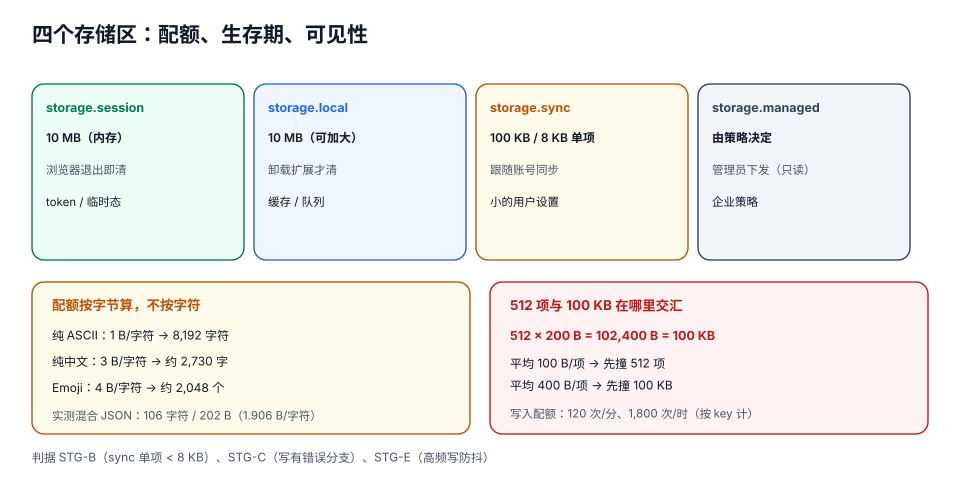

# 存储与配额

这一页要解决的是「**这个值放哪**」和「**写失败了我怎么知道**」两个问题。

先说结论里最反直觉的一条：**`chrome.storage` 的配额是按「字节」算的，而字节不是字符**。同一份设置，中文用户比英文用户多占约 **2 倍**空间——你的 8 KB 单项上限，在中文文案下只剩一半余量，而这个边界**不会在开发机上暴露**，因为你的测试数据是英文的。

::: tip 一句话理解
四个存储区的分工只有一句话：**`session` = 关掉浏览器就该没的、`local` = 明天还要在的、`sync` = 换设备要带走的、`managed` = 老板下发的**。选错区的代价不是「慢一点」，而是「数据在某个时刻突然消失」。
:::

## 判据族声明

本页判据族 `STG-A` ~ `STG-H`，共 8 条。定义表在第八节。

## 本页不讲什么

- 不讲服务端数据库与对象存储，归[文件与对象存储工程](../../../Backend/ObjectStorage/index.md)。
- 不讲 `localStorage` 在网页里的用法，归[浏览器存储](../../../Frontend/Basic/JavaScript/index.md)。
- 不讲 IndexedDB 的事务与索引细节，只讲它和扩展存储的分工。
- 不讲消息怎么传大数据，归 [跨上下文消息](../Messaging/index.md)。

## 一、四个区：能力、配额、可见性



| 区 | 配额 | 持久性 | 内容脚本可见 | 未加密 | 适合 |
| --- | --- | --- | --- | --- | --- |
| `storage.local` | **10 MB**（Chrome 114 起；此前 5 MB），加 `unlimitedStorage` 可超 | 持久，卸载扩展才清 | ✅ | ⚠️ 明文 | 缓存、队列、大量业务数据 |
| `storage.sync` | **100 KB** 总量 / **8 KB** 单项 / **512** 项 | 跟随账号同步 | ✅ | ⚠️ 明文 | 用户设置（主题、开关） |
| `storage.session` | **10 MB**（Chrome 112 起；此前 1 MB） | 内存，浏览器退出即清 | ❌（需 `setAccessLevel`） | ✅ 内存 | token、临时态、worker 跨事件状态 |
| `storage.managed` | 由策略决定 | 管理员下发 | ✅ | ⚠️ | 企业策略配置（只读） |

**选择的三条判据**：

1. **「浏览器关了还要在吗」** → 不在就 `session`，在就往下走；
2. **「换台电脑要不要带过去」** → 要就 `sync`（但只有 100 KB），不要就 `local`；
3. **「是不是管理员统一下发」** → 是就 `managed`。

::: danger 三个「放错区」的真实代价
1. **把 token 放 `local`**：明文落盘。同一台机器上的其他程序、备份、同步盘都能读到。应放 `session`。
2. **把用户内容放 `sync`**：8 KB 单项很快就会撞到，撞到就 `set()` reject；如果没 `await`，界面照样弹「保存成功」。
3. **把大缓存放 `session`**：`session` 是**内存**，10 MB 的图片缓存会一直占着——这是「装了扩展浏览器吃内存」的常见来源。
:::

## 二、配额是字节，不是字符

本机实测（Node 22.22.2，`Buffer.byteLength(JSON.stringify(obj), 'utf8')`），同一份「设置对象」的中英两版：

| 版本 | 字符数 | 字节数 | 字节/字符 | 占 8 KB 单项上限 |
| --- | --- | --- | --- | --- |
| 中文版 | 106 | **202 B** | 1.906 | 2.47% |
| 英文版 | 191 | **191 B** | 1.000 | 2.33% |

看起来「中文版字符少、字节多但也没差多少」——那是因为这个对象里**大部分是 ASCII 的键名和标点**。真正的差距在纯文本值上：

| 内容 | 每字符字节数 | 8,192 B 能放多少 |
| --- | --- | --- |
| 纯 ASCII（英文、数字、标点） | 1 | **8,192 个字符** |
| 纯中文（BMP 汉字） | 3 | **约 2,730 个汉字** |
| Emoji（BMP 外，UTF-8 四字节） | 4 | **约 2,048 个** |

也就是说：**同一个「备注」字段，中文用户的可用长度只有英文用户的三分之一**。如果你的 `sync` 单项里存的是「用户自定义标签列表」，中文标签会把上限提前三倍撞到。

```javascript [sw.js]
// 写 sync 之前先量体积，超了就降级到 local
async function saveSettings(settings) {
  const bytes = new TextEncoder().encode(JSON.stringify(settings)).length;
  if (bytes > 8 * 1024) {
    await chrome.storage.local.set({settings});      // 大设置落本地
    await chrome.storage.sync.set({settingsPointer: 'local'});  // 只同步一个指针
    return {where: 'local', bytes};
  }
  await chrome.storage.sync.set({settings});
  return {where: 'sync', bytes};
}
```

## 三、512 项与 100 KB 在哪里交汇

`sync` 有两个上限同时生效：**512 项**与**100 KB**。它们不是「哪个先到算哪个」这么简单——**平均每项 200 B 时，两个上限恰好同时撞上**：

```
512 项 × 200 B = 102,400 B = 100 KB
```

| 平均每项体积 | 100 KB 允许的项数 | 实际先撞哪个上限 |
| --- | --- | --- |
| 100 B | 1,024 | **512 项** |
| 200 B | 512 | **同时**（刚好相等） |
| 400 B | 256 | **100 KB** |
| 800 B | 128 | **100 KB** |

所以「我有 500 个小设置，肯定放得下」这句话在平均 **200 B** 时就刚好卡在线上——再多一项就失败。

::: warning 项数怎么算的
`chrome.storage.sync` 的「项」是**顶层 key 的数量**，不是嵌套字段数。`{a: {x: 1, y: 2}}` 算 **1 项**。所以「把 500 个设置合并成 1 个对象」能绕开 512 项，但绕不开 8 KB 单项——那 500 个设置加起来必须 < 8 KB。
:::

## 四、写入配额：不是只有空间限制

`sync` 还有**写频率**限制：

| 常量 | 值 | 含义 |
| --- | --- | --- |
| `MAX_WRITE_OPERATIONS_PER_HOUR` | **1,800** | 每小时最多 1,800 次写操作 |
| `MAX_WRITE_OPERATIONS_PER_MINUTE` | **120** | 每分钟最多 120 次 |

「一次写操作」是**每个 key 一次**，不是每次 `set()` 一次：

| 每轮写几个 key | 一分钟最多几轮 | 一小时最多几轮 |
| --- | --- | --- |
| 1 | 120 | 1,800 |
| 5 | 24 | 360 |
| 20 | 6 | 90 |

这就是为什么「监听输入框、每敲一个字就 `sync.set`」一定会失败——一个打字快的人 1 分钟能敲 200 个字符。正确做法是**防抖 + 合并**：

```javascript [options.js]
let timer;
function onInput(settings) {
  clearTimeout(timer);
  timer = setTimeout(async () => {
    try {
      await chrome.storage.sync.set({settings});     // 一次写 1 个 key
    } catch (e) {
      // ⚠️ 必须处理：QUOTA_BYTES_PER_ITEM / MAX_WRITE_OPERATIONS_PER_MINUTE 都会抛
      showError(String(e));
    }
  }, 800);
}
```

## 五、读改写的扇出：为什么「整体读写」会拖慢一切

这是[生命周期](../ManifestLifecycle/index.md)里那条实测的延续：如果为了改一条记录而「整体读出来 → 改 → 整体写回」，搬运量就与**总条数**成正比。

| 场景 | 读 | 写 | 搬运量 |
| --- | --- | --- | --- |
| 一条一 key | 1 条 | 1 条 | ~600 B |
| 整体数组 | 全量 200 KiB | 全量 200 KiB | **400 KiB** |

本机用 1 万条（200 KiB）算：改一条 300 B 的记录，整体读改写要搬 200 KiB，**放大 683 倍**；如果是每分钟一次的定时任务，一天就是 `1,440 × 2 × 6.53 ms ≈ 18.8 秒`的纯解析时间。

**一条一 key 的三个附带好处**：

1. 天然支持「按 key 续跑」（队列场景）；
2. 单条失败不影响其他条；
3. `storage.onChanged` 能精确告诉你是哪一条变了。

**代价**：`get(null)` 会返回所有 key，读全量时反而更慢。所以标准形态是**两级**：`index` 一个 key 存 id 列表，`q:<id>` 每个 key 存一条明细。

## 六、IndexedDB：什么时候必须离开 `storage`

`chrome.storage` 是**键值 + JSON 序列化**，不适合两件事：

| 需求 | `storage` 的问题 | 用 IndexedDB |
| --- | --- | --- |
| 十万条以上、要按字段查询 | 每次读全量、无索引 | ✅ 有索引与游标 |
| 存二进制（截图、音频） | JSON 序列化会变成 `{}` 或 base64（+33% 体积） | ✅ 直接存 `Blob` / `ArrayBuffer` |
| 事务性多表更新 | 无事务 | ✅ 有事务 |

```javascript
// IndexedDB 在 service worker 里可用（`indexedDB` 是 worker 全局）
const db = await new Promise((resolve, reject) => {
  const req = indexedDB.open('clip', 1);
  req.onupgradeneeded = () => {
    const d = req.result;
    const store = d.createObjectStore('shots', {keyPath: 'id'});
    store.createIndex('byCreated', 'createdAt');
  };
  req.onsuccess = () => resolve(req.result);
  req.onerror = () => reject(req.error);
});
```

::: danger `storage` 与 IndexedDB 的三个差别，会直接影响设计
1. **`storage` 有 `onChanged` 事件，IndexedDB 没有**——跨上下文同步要靠自己发消息。
2. **`storage.session` 只存在于扩展上下文**，IndexedDB 在内容脚本里也能用（但按**页面的源**隔离，不同站点各一份）。
3. **`storage` 在浏览器退出后仍保留（`local`）**，IndexedDB 也一样，但**用户清理站点数据时可能连 IndexedDB 一起清掉**（扩展的 IndexedDB 通常不受影响，但 Safari 上行为不同）。
:::

## 七、迁移：存储也会「改 schema」

存储里的数据活得比代码长。加字段、改结构、换 key 命名，都需要**带版本号的迁移**，且必须**幂等**（worker 可能在迁移中途被回收）。

```javascript [sw.js]
const SCHEMA = 3;

async function migrate() {
  const {schema = 0} = await chrome.storage.local.get('schema');
  if (schema >= SCHEMA) return;

  if (schema < 1) {
    // v0 → v1：queue 数组拆成一条一 key
    const {queue = []} = await chrome.storage.local.get('queue');
    const patch = {};
    for (const item of queue) patch[`q:${item.id}`] = item;
    await chrome.storage.local.set(patch);
    await chrome.storage.local.remove('queue');
    await chrome.storage.local.set({schema: 1});   // 每步单独落版本号
  }

  if (schema < 2) {
    // v1 → v2：字段改名
    const all = await chrome.storage.local.get(null);
    const patch = {};
    for (const [k, v] of Object.entries(all)) {
      if (k.startsWith('q:') && v?.text && !v?.content) {
        patch[k] = {...v, content: v.text};
        delete patch[k].text;
      }
    }
    await chrome.storage.local.set(patch);
    await chrome.storage.local.set({schema: 2});
  }

  if (schema < 3) {
    // v2 → v3：建索引
    await rebuildIndex();
    await chrome.storage.local.set({schema: 3});
  }
}

chrome.runtime.onInstalled.addListener(({reason}) => {
  if (reason === 'install' || reason === 'update') void migrate();
});
```

三条纪律：

1. **每步之后单独落版本号**——否则中途被回收，下次会从头再跑一遍（不幂等就会重复插入）。
2. **迁移要在 `onInstalled` 里触发，但也要在「第一次读数据」时兜底**——因为 `onInstalled` 的 worker 可能被回收在迁移完成前。
3. **不要删除旧 key 直到确认新结构可用**——「先写新、再切读、最后删旧」是唯一安全顺序。

## 八、判据表

| 判据 | 断言 | 怎么验 |
| --- | --- | --- |
| `STG-A` | token / 会话类数据放 `session`，不落 `local` | 搜索存储写入点，敏感字段的 key 前缀只在 `session.set` 出现 |
| `STG-B` | `sync` 中的每一项都 < 8 KB，且总项数 < 512 | 造 60 条中文长文本设置，逐项 `byteLength` 打日志 |
| `STG-C` | 所有 `storage.set` 都有 `try/catch` 或 `await` + 错误分支 | `grep -n "storage\.\(local\|sync\)\.set"`，逐处确认有 `await` 或 `.catch` |
| `STG-D` | 撞配额时用户能看到明确提示，而不是「保存成功」 | 手动写一条 9 KB 的 sync 项，界面应报错而非提示成功 |
| `STG-E` | 高频写入有防抖（≥ 500 ms），且单次 `set` 合并多个 key | 在输入框连打 50 字，统计 `set` 调用次数 ≤ 2 |
| `STG-F` | 队列类数据一条一 key，不整体读写 | 读代码：写路径没有 `get(整个数组) → push → set` |
| `STG-G` | 二进制数据走 IndexedDB 或对象存储，不进 `storage` | 搜索 base64 相关代码；确认没有把图片 data URL 存 `storage` |
| `STG-H` | 有 schema 版本号与逐步迁移，每步单独落版本；迁移幂等 | 用旧版数据启动新版，连跑两次迁移，数据不重复不丢失 |

## 参考资料

- `chrome.storage` 参考（四个区与全部配额常量）：<https://developer.chrome.com/docs/extensions/reference/api/storage>
- `storage.sync` 的写入频率限制：<https://developer.chrome.com/docs/extensions/reference/api/storage#storage-and-throttling-limits>
- `unlimitedStorage` 权限：<https://developer.chrome.com/docs/extensions/reference/permissions-list>
- 扩展里的 IndexedDB：<https://developer.chrome.com/docs/extensions/develop/concepts/storage-and-cookies>
