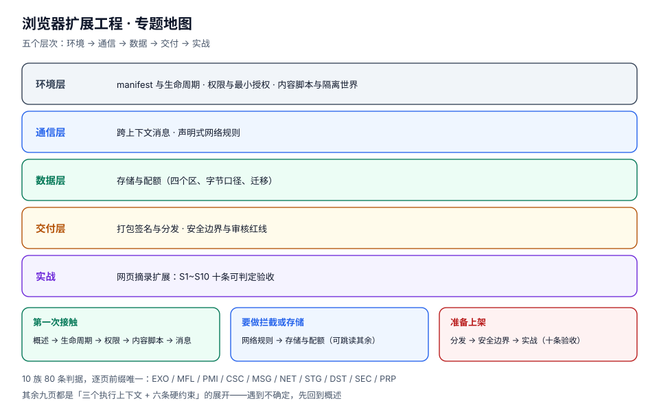

# 浏览器扩展工程

浏览器扩展是这个星球上**部署最快、寿命最长、也最容易被当成玩具**的一类软件：用户点一下「添加至 Chrome」，你的代码就在几秒钟内跑进了几百万个标签页里；而它一旦装上去，你可能三年都收不到一次「用户反馈」——因为它坏了也不报错，只是安静地不动。

本专题讲的是**扩展作为工程问题**的那一面：**它的运行环境没有常驻内存、它的网络能力被改成声明式、它的权限要过用户与审核两道关、它的安装包是不可逆的（扩展 ID 一旦改变，用户的本地数据就找不回来）**。这四条约束不是「最佳实践」，是平台的地基；其余所有设计都长在它们上面。

::: tip 一句话理解
网页的假设是「**页面一直在，随时能改**」；扩展的假设是「**我随时会被杀，醒来时世界已经变了**」——把 MV3 的 service worker 当成**无状态函数**来写，是这一领域唯一必须提前建立的直觉。
:::

## 与相邻专题的分工

| 专题 | 讲什么 | 与本专题的关系 |
| --- | --- | --- |
| 本专题 | **浏览器扩展工程**：执行上下文与生命周期、权限模型、内容脚本、跨上下文消息、声明式网络规则、存储配额、打包签名与分发、安全红线、完整实战 | —— |
| [桌面应用深入](../../Frontend/DesktopApp/index.md) | **桌面壳**：Tauri 2.x 为主线，架构 / IPC / 原生能力 / 安全 / 打包 / 自动更新（10 页） | 那边是「把网页装进安装包」，这边是「把代码塞进别人的浏览器」。**判据完全不同**：桌面应用的难点是签名与升级，扩展的难点是**无常驻内存**与**权限审核**。该不该做桌面端，那边第一页就给结论；结论是「只是为了绕过浏览器限制」时，先回来读本专题的[概述](./Overview/index.md) |
| [PWA 与离线应用](../../Frontend/PWA/index.md) | 浏览器内的离线能力：Service Worker 缓存、安装体验 | PWA 的 Service Worker 服务的是**一个站点**，扩展的 Service Worker 服务的是**所有站点**——两者的生命周期规则同源，但扩展多了一层「事件由浏览器派发、监听器必须同步注册」的硬约束 |
| [前端安全](../../Frontend/Others/Security/index.md) | Web 侧安全：XSS、CSRF、CSP、依赖安全 | 那边假设「渲染环境可能被攻破、防线在服务端」；本专题的[安全边界](./Security/index.md)假设**页面就是攻击者**，防线是「内容脚本能看到什么、能替用户做什么」 |
| [依赖与安全治理](../../Tools/DependencyGovernance/index.md) | SBOM、漏洞扫描、供应链 | 扩展的供应链被放大：**权限会静默扩张**（一次 minor 升级多要 `tabs` 就可能触发重新授权），且用户几乎不会看变更说明 |
| [富文本编辑器工程](../../Frontend/RichTextEditor/index.md) | 文档模型、粘贴清洗 | 扩展往页面里注入内容时，会命中那边的「程序化写入」路径；反过来，扩展从页面里**读**回来的选区 HTML 与那边[粘贴清洗](../../Frontend/RichTextEditor/PasteSanitize/index.md)处理的剪贴板 HTML 是**同一类不可信输入**——`cloneContents()` 连 `onclick` 一起带出来，且没有 schema 兜底 |
| [浏览器调试与测试](../../Frontend/Testing/index.md) | 单元 / 组件 / E2E / 覆盖率 | 扩展的 E2E 要驱动的是**装了扩展的浏览器**（持久化上下文），普通的无痕 `browser.newContext()` 里扩展根本不加载 |
| [可观测驱动开发](../../Tools/ObservabilityDriven/index.md) | 指标先行、埋点、开关、灰度 | 扩展的「线上」是用户的机器：**没有服务端日志可查**，所以那边的埋点规范在这里变成「本地环形日志 + 显式上报」 |
| [CI/CD 与制品](../../Tools/CICD/Artifacts/index.md) | 构建、制品、发布 | 扩展的制品是**带签名的 `.crx`**，密钥一旦丢失就无法再发新版——这一条比容器镜像的「不可变」更硬 |
| [技术写作与文档](../../Others/TechWriting/index.md) | 文档结构与表达 | 商店列表页的权限说明、隐私政策、更新说明，是这个产品**唯一会被审核员和用户逐字读**的文档 |

::: warning 版本组织：本专题不建版本目录
三条理由：

1. **MV2 已经没有第二条线**。2026-08-31，Chrome 应用商店移除了最后一批 MV2 扩展；Chrome 138（2025-07-24）起所有渠道禁用且无法重新启用，Chrome 139 移除了企业策略 `ExtensionManifestV2Availability`，Chrome 150 删掉了恢复开关，Chrome 151 删掉了代码路径。**不存在「两条线并存、都要查」的场景**，所以按 AGENTS 的大版本规则建 `MV2/` `MV3/` 目录只会造一份没人维护的考古层。
2. MV2 → MV3 的差异是**能力模型变了**（常驻后台 → 事件驱动、阻塞式 `webRequest` → 声明式规则），不是「同一套用法换了个参数」。这类差异用 `::: info` 在页内标注「MV2 是这样、MV3 是这样」比拆目录更不容易读错。
3. 真正**并存且都要查**的是**浏览器厂商差异**（Chrome / Edge / Firefox / Safari），这属于**同一份 manifest 的多目标编译**，用页内对照表 + 构建开关解决，也不该建目录。

需要看「按大版本建目录」的范式，参考 [Spring5 / Spring6](../../Backend/Java/Frame/Spring/Spring6/index.md)、[SpringCloud 2020 / 2022](../../Backend/Java/Frame/SpringCloud/SpringCloud2022/index.md)、[Vue2 / Vue3](../../Frontend/Frame/Vue/index.md)、Spring Boot 的 [v2](../../Backend/Java/Frame/SpringBoot/v2/index.md) / [v3](../../Backend/Java/Frame/SpringBoot/v3/index.md) / [v4](../../Backend/Java/Frame/SpringBoot/v4/index.md)。
:::

## 专题地图

共 10 页正文，按「先理解环境 → 再学四个能力面（权限 / 注入 / 消息 / 网络 / 存储）→ 最后照着做一遍」排列。

| 页面 | 内容 | 适合谁读 |
| --- | --- | --- |
| [概述：三个执行上下文与六条硬约束](./Overview/index.md) | 为什么「能跑」和「能交付」差着三个月、五种失败模式、四问决策树、该不该用扩展 | 所有人，先读 |
| [manifest 与生命周期](./ManifestLifecycle/index.md) | 30 秒空闲终止、单事件 5 分钟上限、什么算「活动」、监听器必须同步注册、状态放哪、冷启动的代价 | 写后台逻辑的人 |
| [权限模型与最小授权](./Permissions/index.md) | `permissions` / `host_permissions` / `optional_*` / `activeTab` 四层、匹配模式、安装警告、运行时降权 | 每次加权限前 |
| [内容脚本与隔离世界](./ContentScript/index.md) | 隔离世界能看见什么、注入时机四档、静态 / 动态 / 编程式注入、与页面通信、SPA 导航 | 要改页面的人 |
| [跨上下文消息](./Messaging/index.md) | 四种通道、JSON 序列化成本、`return true`、端口生命周期、原生消息 1 MB / 64 MiB | 把模块接起来的人 |
| [声明式网络规则](./NetworkRules/index.md) | `webRequest` 只剩观察、DNR 三类规则、安全/不安全动作的分界、优先级裁决、30,000 条的账 | 做拦截、改头、重定向的人 |
| [存储与配额](./StorageState/index.md) | 四个存储区、字节口径、8 KB 与 512 项在哪里交汇、写入配额、迁移与版本 | 要存状态的人 |
| [打包、签名与分发](./Distribution/index.md) | 扩展 ID 从哪来、CRX3 头的固定开销、版本比较的坑、更新清单、商店审核与私有分发 | 准备发版的人 |
| [安全边界与审核红线](./Security/index.md) | 远程代码禁令、CSP、内容脚本的 XSS、消息来源校验、`externally_connectable`、供应链 | 上线前必读 |
| [实战：网页摘录扩展](./Practice/index.md) | 从需求到上架的一条完整链路 + S1~S10 验收 + 分诊表 + 上线自查 14 项 | 想照着做一遍的人 |

## 判据族总览

本专题共 **10 族 80 条判据**，每族 8 条，逐页前缀唯一（已用 `judgeidcheck` 核对全库 0 撞号）：

| 页 | 判据族 | 回答的问题 |
| --- | --- | --- |
| 概述 | `EXO-A` ~ `EXO-H` | 这个东西该不该做成扩展？失败时会是哪一种失败？ |
| 生命周期 | `MFL-A` ~ `MFL-H` | 我的代码会被谁唤醒？醒来时哪些假设已经不成立？ |
| 权限 | `PMI-A` ~ `PMI-H` | 这个能力是不是必须现在就要？能不能晚点再要？ |
| 内容脚本 | `CSC-A` ~ `CSC-H` | 我注入的东西会不会和页面打架？重复注入了吗？ |
| 消息 | `MSG-A` ~ `MSG-H` | 这条消息会不会丢？丢了之后谁负责重发？ |
| 网络规则 | `NET-A` ~ `NET-H` | 这条规则会不会把别人的规则盖掉？它算安全动作吗？ |
| 存储 | `STG-A` ~ `STG-H` | 这个值该进哪个区？写失败了我怎么知道？ |
| 分发 | `DST-A` ~ `DST-H` | 这次发版会不会把用户的本地数据弄丢？ |
| 安全 | `SEC-A` ~ `SEC-H` | 页面能不能借我的手干坏事？ |
| 实战 | `PRP-A` ~ `PRP-H` | 从零到上架，每一步的验收是什么？ |

## 事实与版本速览（2026-10 核对）

| 事实 | 当前状态 | 影响 |
| --- | --- | --- |
| Manifest V2 | **2026-08-31 已从 Chrome 应用商店全部移除**；Chrome 138 起禁用、139 移除企业策略、150 移除恢复开关、151 删除代码路径 | 新项目只有一个选择：MV3。看到「MV2 怎么迁移到 MV3」的老教程，先看日期 |
| service worker 空闲终止 | **30 秒**无活动即终止；**单个事件**处理超过 **5 分钟**会被终止 | 任何「后台常驻」的设计都要重写；`setTimeout` / `setInterval` 不算活动 |
| 什么算活动 | 派发事件、调用扩展 API（Chrome 110+）、端口收到消息、WebSocket 收发（Chrome 116+） | 「保活」不是靠 ping，而是靠**别把状态放内存** |
| 原生消息端口 | Chrome 105+ 起，`connectNative` 的端口开着就保活 | 这是唯一「合法」的长连接保活手段，但它要求装一个本地程序 |
| `chrome.alarms` | Chrome 120 起最小 **30 秒**（此前 60 秒）；Chrome 117 起活动闹钟上限 **500** 个；Chrome 150 起名字超过 **1024 字节**被拒 | 定时任务的下限是 30 秒，不是 1 秒——「每秒轮询」在这条路上不存在 |
| `declarativeNetRequest` | 静态规则集 **100** 个可声明 / **50** 个可同时启用；保证 **30,000** 条静态规则；安全动态规则 **30,000**（Chrome 121+）、不安全 **5,000**、会话 **5,000**；正则规则每类 **1,000**；单条编译后 **< 2 KB** | `redirect` 算**不安全**动作——重定向密集的扩展撞的是 5,000，不是 30,000 |
| `storage` 配额 | `local` **10 MB**（Chrome 114 前 5 MB）；`sync` **100 KB** 总量 / **8 KB** 单项 / **512** 项；`session` **10 MB**（Chrome 112 前 1 MB） | 配额按**字节**算，中文比英文多占约 2 倍——同一份设置，中英文的余量不是一回事 |
| 原生消息体积 | host → 扩展 **1 MB**；扩展 → host **64 MiB**；JSON + UTF-8 + 32 位长度前缀 | 「把文件内容塞进消息」在 1 MB 处硬断，且**是 host 侧被断开**，扩展只看到端口关闭 |
| 扩展 ID | 公钥 DER 的 **SHA-256 前 16 字节**，每个半字节映射到 `a`~`p`，共 **32 字符** | ID 与「名字」「版本」「路径」都无关，只与**签名公钥**有关；换密钥 = 换一个扩展 |

## 三条会静默失效、且构建与自测都不会报的坑

::: danger 这三条不报错，只是不对
1. **监听器异步注册**：`chrome.alarms.onAlarm.addListener` 写在 `await init()` 之后。开发期 worker 是热的，一切正常；线上 worker 被回收后，事件在监听器注册前就被派发，**闹钟静默丢失**。判据：`MFL-B`。
2. **`sendResponse` 之后忘了 `return true`**：异步回复永远不到，调用方拿到 `undefined`，控制台只有一句 `The message port closed before a response was received`。判据：`MSG-C`。
3. **`storage.sync` 单项超过 8 KB**：`set()` 直接 reject（`QUOTA_BYTES_PER_ITEM quota exceeded`），而如果调用方没 `await`、也没挂 `runtime.lastError`，你的「保存成功」提示照样会弹出来。判据：`STG-D`。
:::

## 学习路径

1. **先读[概述](./Overview/index.md)**，把「三个执行上下文 + 六条硬约束」记住，其余九页都是它们的展开。
2. 再读[manifest 与生命周期](./ManifestLifecycle/index.md)——**这是 MV3 真正的分水岭**，读不懂这一页，后面每一页都会踩到同一个坑。
3. [权限](./Permissions/index.md) → [内容脚本](./ContentScript/index.md) → [消息](./Messaging/index.md)：这三页是一条链路，按顺序读。
4. [网络规则](./NetworkRules/index.md) 与 [存储](./StorageState/index.md) 按需读：没做拦截、没存状态可以先跳过。
5. [分发](./Distribution/index.md) 与 [安全](./Security/index.md) **上线前必读**，尤其后者——商店因为远程代码拒绝一次，恢复周期以周计。
6. 最后跟[实战](./Practice/index.md)做一遍，十条验收全绿再发版。

## 参考资料

- Chrome 扩展官方文档：<https://developer.chrome.com/docs/extensions>
- Manifest V2 支持时间表：<https://developer.chrome.com/docs/extensions/develop/migrate/mv2-deprecation-timeline>
- service worker 生命周期：<https://developer.chrome.com/docs/extensions/develop/concepts/service-workers/lifecycle>
- `declarativeNetRequest` 参考（含全部限额常量）：<https://developer.chrome.com/docs/extensions/reference/api/declarativeNetRequest>
- `chrome.storage` 参考（含各存储区配额）：<https://developer.chrome.com/docs/extensions/reference/api/storage>
- 原生消息传递（含 1 MB / 64 MiB 限制）：<https://developer.chrome.com/docs/extensions/develop/concepts/native-messaging>
- 远程托管代码（RHC）政策：<https://developer.chrome.com/docs/extensions/develop/migrate/remote-hosted-code>
- Chrome Web Store 开发者计划政策：<https://developer.chrome.com/docs/webstore/program-policies>
- MDN WebExtensions（Firefox / Safari 的差异口径）：<https://developer.mozilla.org/docs/Mozilla/Add-ons/WebExtensions>
