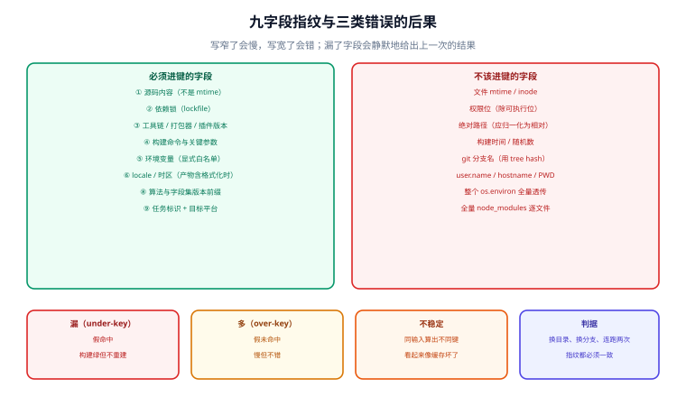

# 指纹：缓存键由哪些字段组成

缓存键（cache key）是这张体系里唯一「写错了不会有任何报错」的东西。写窄了，构建会慢，你会去查；**写宽了或者漏了字段，构建会静默地给出上一次的结果**——它照样绿、照样通过测试、照样部署，只是它编译的不是你刚改的代码。

本页把指纹拆成九个字段，然后按「漏 / 多 / 不稳定」三种错误分别给出后果与识别方法，最后用一组本机实测说明哪些字段是**必须进**、哪些是**绝对不能进**的。



本页判据族 `BCK-A` ~ `BCK-H`，共 8 条，定义在最后一节。

## 一、九个字段

| # | 字段 | 内容 | 漏了会怎样 | 写多了会怎样 |
| --- | --- | --- | --- | --- |
| 1 | **源码** | 参与构建的文件内容（**不是** mtime、不是文件数） | 改代码不重建（最经典的假命中） | 把 `dist/`、日志扫进来 → 永不命中 |
| 2 | **依赖** | lockfile 内容（或解析后的依赖图哈希） | 升级依赖不重建，用旧依赖产物 | 把整个 `node_modules` 逐文件哈希 → 慢到没有收益 |
| 3 | **工具链** | 编译器 / 运行时 / 打包器版本（含插件版本） | 换 Node 20 → 22 后仍用旧产物 | 把整台机器的 `PATH` 打进去 → 换机器即失效 |
| 4 | **构建命令** | 实际执行的命令行与关键参数 | 改 `--minify` 不重建 | 把带随机端口的参数打进去 → 永不命中 |
| 5 | **环境变量** | **显式声明**会影响输出的变量（`NODE_ENV`、`TZ`、feature flag） | 生产构建命中开发构建的产物 | 全量透传 `env` → 其中任何一个漂移就全失效 |
| 6 | **locale / 时区** | 排序规则、日期格式化、数字格式 | 跨区域构建产物不一致（常出现在 i18n 与 `Intl`） | ——（一般不会多算） |
| 7 | **路径前缀** | 归一化后的相对路径（不是绝对路径） | 跨机器/跨目录永远不命中（假未命中） | —— |
| 8 | **算法与格式版本** | 例如 `v2:sha256:<hex>` 这样的前缀 | 改了指纹计算方式后新旧条目互认，读到错的 | —— |
| 9 | **任务标识** | 任务名 + 目标平台（`build:linux-x64`） | 同仓库两个任务互相命中对方的产物 | —— |

::: warning 第 9 条有个反直觉的细节
Gradle 官方文档明确写着：**任务路径（task path）不是缓存键的一部分**——只要执行结果相同，不同路径的任务可以互相复用输出。这是特性不是缺陷。但**目标平台必须进键**：`build:linux-x64` 与 `build:darwin-arm64` 的输出字节不同，把它们混在一个键下就是跨平台假命中。
:::

## 二、三种错误，后果完全不同

| 错误 | 定义 | 症状 | 危险度 |
| --- | --- | --- | --- |
| **漏（under-keying）** | 影响了输出的输入没进键 | **假命中**：改了东西没重建，构建照样绿 | 最高：错得没有声音 |
| **多（over-keying）** | 不影响输出的输入进了键 | 假未命中：命中率上不去，构建慢 | 中：慢但不错 |
| **不稳定（unstable）** | 同一份输入算出不同键 | 假未命中，且**本地远程都不命中**，看起来像「缓存坏了」 | 中高：极难定位 |

三种错误里，「多」是最容易被误当成「正常」的。典型对话：命中率 30%，回答「因为代码一直在改」——但真正的成因常常是把 `.git/` 的 HEAD、构建时间、或者某个每天变的环境变量算进了键。

不稳定的三个最常见来源：

1. **遍历顺序**：文件系统的 `readdir` 顺序不保证稳定（本机实测：同一目录 `scandir` 给出的顺序恰好是升序，于是「不排序」与「升序」得到同一个哈希——**这是运气**，不是保证；换一台机器、换一个文件系统，「不排序」与「降序」的哈希立刻不同）。
2. **mtime / inode / 权限位**：`tar` 默认把 mtime 打进去，于是每次 `git checkout` 都产生新字节（见[可复现构建](../Reproducible/index.md)）。
3. **绝对路径**：同一份代码在 `/home/a/repo` 与 `/build/ws` 下算出两个键。

## 三、本机实测：逐项扰动

用一份九字段的指纹模型（`json.dumps(sort_keys=True, separators=(",", ":"))` 后取 `sha256`），基线指纹 `6439ee06df5c`，逐项改一个字段：

| 扰动 | 哈希是否变化 | 结论 |
| --- | --- | --- |
| 源码内容 | 变（`4273a537`） | 必进 |
| 依赖锁 | 变（`504ddb86`） | 必进 |
| 工具链版本 | 变（`d1747de8`） | 必进 |
| 构建命令 | 变（`3c9d5df3`） | 必进 |
| 环境变量 | 变（`5023502a`） | 必进（**但要显式列，不要全量透传**） |
| `locale=C` → `zh_CN.UTF-8` | 变（`ab404a90`） | 常被漏掉；产物含格式化输出时必进 |
| `TZ=UTC` → `Asia/Shanghai` | 变（`9de3fbfc`） | 常被漏掉；产物含日期时必进 |
| 路径前缀 | 变（`504eb385`） | **不该进**（见第四节） |
| 文件 mtime | 变（`05395dca`） | **不该进**；它进来了，缓存就基本不会命中了 |

这张表的用法是**反向**的：`locale`、`TZ` 两行之所以放在「常被漏掉」，是因为它们在大多数缓存实现里**默认不参与键**——而它们真的会改变输出。把这两行当成一次自查：如果你的产物里有 `Intl.DateTimeFormat`、`toLocaleString`、或者任何按 locale 排序的列表，这两个字段就必须进键。

::: danger 三个「看起来无害」的键字段
1. **`user.name` / `hostname` / `PWD`**：把「谁在哪构建的」写进键，等于宣布「只有我自己的机器能命中」。这类字段常见于自研脚本，因为「顺手把整个 `os.environ` 摊进去了」。
2. **构建时间**：`BUILD_TIME=$(date)` 是产物里的常客，它一旦进键，命中率恒为 0。正确做法是让它只影响**产物内容**（并且这一步本来就要治，见[可复现构建](../Reproducible/index.md)），而不是影响键。
3. **git 分支名**：分支天天变（甚至同一个提交在两个分支上），把分支名进键会让「同一个提交在 main 与 feature 上各算一遍」。要区分的话，进键的应该是**提交内容**（tree hash），不是分支名。
:::

## 四、路径敏感性：跨机器共享的第一道坎

Gradle 的文档把这件事讲得很直白：**输入文件默认按绝对路径识别**，所以缓存默认不能跨机器共享——不同开发者、不同 CI 工作目录，同一个文件是不同路径。

解法是把路径敏感性降级：

```kotlin [build.gradle.kts]
@get:InputFiles
@get:PathSensitive(PathSensitivity.RELATIVE)
abstract val configFiles: ConfigurableFileCollection
```

`PathSensitivity` 的几档差别要记清：

| 档位 | 键里包含什么 | 什么时候用 | 风险 |
| --- | --- | --- | --- |
| `ABSOLUTE`（默认） | 完整绝对路径 | 只有在「路径本身影响输出」时才用 | 跨机器永不命中 |
| `RELATIVE` | 相对输入根的路径 | **绝大多数情况的正解** | 换输入根（如把 `src/` 挪到 `lib/`）会失效，这是对的 |
| `NAME_ONLY` | 只有文件名 | 输出不依赖目录结构时 | 两个同名文件会被当成同一个 → 假命中 |
| `NONE` | 路径完全忽略 | 文件集合的**内容**决定一切（如一组资源） | 顺序/归属信息丢失，慎用 |

::: tip 一条自查
「同一个提交，在 CI 上和在本地，指纹一样吗？」——这句话就是路径敏感性的判据。把本地仓库 clone 到另一个目录再构建一次，如果本地缓存命中率从 80% 掉到 0，就是 `ABSOLUTE` 还在生效。
:::

## 五、环境变量：默认不含，必须显式加

这里有一个**两套生态完全相反**的事实，最容易在迁移时踩到：

| 生态 | 环境变量默认是否进键 | 机制 | 后果 |
| --- | --- | --- | --- |
| **Gradle** | **默认不进** | 需要显式 `inputs.property("env.NODE_ENV", ...)` 之类声明 | 漏声明 = 假命中（生产产物命中开发产物） |
| **Turborepo** | **默认不进**（但要显式声明，且 `env-mode` 会影响解析范围） | 任务级 `env` / `globalEnv` 列表；`--env-mode=strict` 只带声明的变量 | 声明缺失 = 假命中；声明过宽 = 永不命中 |
| **Bazel** | 默认不进，`--action_env` 逐个加 | 显式白名单 | 同 Gradle |

Turborepo 的两段哈希值得单独记：**global hash**（根 `turbo.json`、根 lockfile、`globalDependencies` 列出的文件、`globalEnv` 里变量的值）与 **task hash**（包配置、包的 lockfile 变化、包内受控文件）。任一变则任务未命中。

一条来自官方文档的、容易被忽略的连带效应：**根 `package.json` 依赖的内部包，其源码会进 global hash**——改一下 `packages/tooling/src/index.ts`，全仓库所有可缓存任务一起未命中。这不是 bug，是「根脚本可能用到它」的正确保守估计；但如果你不知道这条，就会觉得「我只改了一个工具包，为什么全部重建」。

```json [turbo.json]
{
  "globalEnv": ["CI", "NODE_ENV"],
  "tasks": {
    "build": {
      "env": ["NEXT_PUBLIC_API_BASE"],
      "inputs": ["src/**", "tsconfig.json", "$TURBO_DEFAULT$"],
      "outputs": ["dist/**"]
    }
  }
}
```

`inputs` 写宽（把 `.env.local` 也扫进来）会让本地开发时频繁失效；写窄（只写 `src/**`）会漏掉 `tsconfig.json`。**这两头的取舍有客观判据：把 `tsconfig.json` 改一行，构建应当重建；把 `README.md` 改一行，构建不应当重建。** 拿这两个动作去试你的配置，一次就能定性。

## 六、算法与版本前缀：让「换代」变成一次整体失效

指纹的格式里必须带版本：

```text
v2:sha256:9f2c...      # v2 = 指纹算法/字段集的版本
```

没有这个前缀会出什么事：你今天给指纹加了 `TZ` 字段，昨天写进缓存的老条目用的是旧算法，两者的键空间**撞在一起**——新算法算出的键恰好等于某个旧条目的键（概率极低，但「老条目被新代码读到」这件事本身不需要哈希碰撞，只要键的格式相同、字段少了几个，就可能重复）。更常见的是反过来的场景：**你以为加了字段就安全了，其实老条目仍然在，只是键变了**——于是缓存库里躺着一批永远不会再被读到的垃圾，占着配额。

所以换代要显式做两件事：

1. **指纹格式带版本前缀**，改字段就升版本；
2. **升级时清理旧版本条目**（或给旧版本设 TTL），别让它们占配额。

关于哈希算法的选择，本机单线程吞吐实测（8 MiB 样本）：

| 算法 | 吞吐 |
| --- | --- |
| `sha256` | 267 MiB/s |
| `sha1` | 678 MiB/s |
| `blake2b` | 312 MiB/s |
| `md5` | 510 MiB/s |

结论是**用 `sha256`，别为了速度换 `md5`**：一次全仓库指纹计算在 GB 量级，267 MiB/s 意味着 1 GB 约 4 秒；而 `md5` 省下的 2 秒，换来的是「内容寻址的键可以被人为构造碰撞」——远程缓存是多方写入的，这不是理论风险。真要更快，走「文件级缓存 + 只算改动文件」的路（Gradle 与 Bazel 都是这么做的），而不是换弱哈希。

## 七、本页判据

| 编号 | 判据 | 不满足时改哪里 |
| --- | --- | --- |
| `BCK-A` | 九个字段逐条写明「进 / 不进」与理由，且能从代码或配置里指出对应实现 | 补一张字段表，落在仓库里 |
| `BCK-B` | 源码进键的是**内容**，不是 mtime / 文件数 / 目录列表 | 换成逐文件哈希 |
| `BCK-C` | 工具链版本（含打包器与插件）进键 | 从 `package.json` / `pom.xml` / 构建脚本读取而非硬编码 |
| `BCK-D` | 路径按 `RELATIVE`（或等价物）归一化，换目录后指纹不变 | 见第四节；本机 clone 到另一目录复测 |
| `BCK-E` | 环境变量走**显式白名单**，且白名单与「真实影响输出的变量」对得上 | 用「改一个变量 → 应否重建」逐条试 |
| `BCK-F` | `locale` / `TZ` 在产物含格式化输出时进键 | 见第三节的两行实测 |
| `BCK-G` | 指纹带算法/字段集版本前缀，换代时旧条目有清理策略 | 加 `v2:` 前缀 + TTL |
| `BCK-H` | 任务标识与目标平台进键；分支名、`user.name`、构建时间**不进键** | 按第 2 与第三节的负面清单清理 |

## 八、验证方式

```shell
# 1) 指纹稳定性：同一份输入连算两次，必须一致
#    自研脚本：把「输入清单 → 排序 → 逐文件 sha256 → 汇总」跑两遍
python build_fingerprint.py --root . --out /tmp/fp1.txt
python build_fingerprint.py --root . --out /tmp/fp2.txt
diff /tmp/fp1.txt /tmp/fp2.txt && echo "指纹稳定"

# 2) 路径无关性：clone 到另一个目录，指纹必须相同
git clone . /tmp/relocated && cd /tmp/relocated
python build_fingerprint.py --root . --out /tmp/fp3.txt
diff /tmp/fp1.txt /tmp/fp3.txt || echo "路径进了指纹（应修 RELATIVE）"

# 3) 敏感性：改一个「应影响输出」的文件，指纹必须变
echo "// probe" >> src/index.ts
python build_fingerprint.py --root . --out /tmp/fp4.txt
diff -q /tmp/fp1.txt /tmp/fp4.txt || echo "源码进键正常"
git checkout src/index.ts
```

**期望结果**：第 1 步无输出（稳定）；第 2 步无输出（路径无关）；第 3 步打印「源码进键正常」（敏感）。**三条同时成立，指纹才算「既不全漏也不全多」**。只做第 3 步是最常见的自欺——它只能证明「源码进了键」，证不了稳定性与路径无关性。

## 与相邻专题的分工

- 三层缓存与指标口径：[概述](../Overview/index.md)
- 指纹算出来之后存在哪、怎么淘汰：[本地缓存](../LocalCache/index.md)
- 键对了但产物字节不一致：[可复现构建](../Reproducible/index.md)
- 各生态的具体配置项：[生态对照](../Platforms/index.md)

## 参考资料

- Gradle 官方：*Build Cache*（缓存键的组成部分、任务路径不进键、`@PathSensitive` 与 relocatability、`@CacheableTask` 不被子类继承）
- Gradle 官方：*Incremental Build*（输入/输出注解与 normalization）
- Turborepo 官方：*Caching*（global hash / task hash、`globalEnv`、`env-mode`）
- Bazel 官方：*Remote Caching* 与 *Environment variables*（`--action_env` 白名单）
