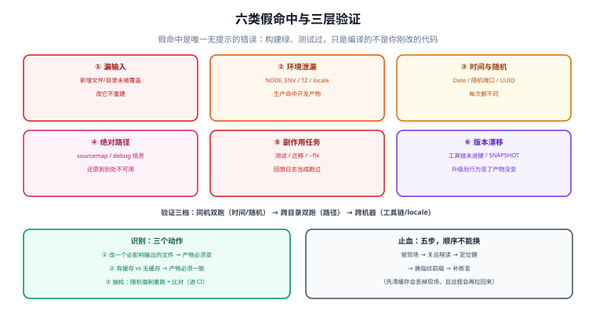

# 正确性：六类假命中与验证模式

**假命中（false hit）** 是缓存体系里唯一「无提示的错误」：构建绿、测试过、部署成功，只是编译的不是你刚改的代码。它比未命中贵得多——未命中只是慢，假命中会把一个已经修好的 bug 悄悄带回来，而且通常是在最不该出问题的时刻（发版前最后一次打包）。

本页把假命中归成六类，给出每一类的**可复现识别方法**，然后给一套能放进 CI 的验证模式（抽检 + 对照构建），最后是止血顺序。



本页判据族 `BCV-A` ~ `BCV-H`，共 8 条，定义在最后一节。

## 一、六类假命中

| # | 类型 | 机制 | 典型症状 | 识别方法 |
| --- | --- | --- | --- | --- |
| 1 | **漏输入** | 影响输出的输入没进键（新增的配置文件、新目录未被 `inputs` 覆盖） | 新加的 `tsconfig` include 不生效、新目录的代码没进包 | 改一个「应该影响输出」的文件，看是否重建 |
| 2 | **环境泄漏** | `NODE_ENV` / `TZ` / `locale` / 本机安装的工具链 | 生产包里有 `console.log`；本地好的 CI 坏 | 同一份源码在两套 env 下构建，比对产物 |
| 3 | **时间与随机** | 产物含 `new Date()`、随机端口、UUID、`Math.random` | 产物每次不同（这是**不可复现**，会伪装成假未命中） | 同输入两次构建，比对哈希 |
| 4 | **绝对路径** | 产物里写死了构建目录（sourcemap 的 `sources`、debug 信息、脚本里的路径） | 缓存还原到别的目录后，栈追踪指向不存在的路径 | `grep` 产物里的构建目录 |
| 5 | **副作用型任务** | 被缓存的任务本该有副作用（迁移、`lint --fix`、代码生成、测试） | 「测试通过了」但其实没跑（缓存回放了上次的日志） | 看日志是**回放**还是**新产生** |
| 6 | **版本漂移** | 工具链/插件的版本没进键，或依赖用了 `SNAPSHOT`/`latest` | 升级 Gradle 后行为变了但产物没变 | 改工具链版本，看指纹是否变 |

其中第 3 类最容易被误分类：产物每次不同，通常表现为**命中率为 0**，于是被当成「缓存不工作」去查缓存，实际上根因是产物不可复现（详见[可复现构建](../Reproducible/index.md)）。

第 5 类最危险，因为它**看起来完全正常**：

```text
> Task :integrationTest FROM-CACHE
> 128 tests completed
BUILD SUCCESSFUL in 1.2s
```

128 个测试「完成了」，但没有一个真的运行——日志是从缓存里回放的。如果这次改动恰好会破坏其中某个测试，你不会知道。**所以「测试、迁移、代码生成、格式化」这四类任务默认不应该被缓存**（或者至少要有明确的「不可缓存」标注）。

::: danger 三类一定要显式排除的任务
1. **有副作用的**：数据库迁移、`--fix` 类格式化、代码生成（产出会被提交的那种）。缓存回放等于「什么都没做」。
2. **依赖外部状态的**：连真实数据库的集成测试、打真实第三方沙箱的用例。外部状态不在指纹里，回放的结果不代表现在的结果。
3. **验证类**：`lint`、`typecheck`、安全扫描。它们**唯一的价值就是「这次真的跑了」**，缓存回放把价值归零。
:::

## 二、识别：三个动作，从粗到细

### 动作 1：改一个「必须影响输出」的文件

这是最便宜的自检。挑一个语义上必然改变输出的改动（加一行 `console.log`、改一个常量、改 `tsconfig`），然后看构建是否重建。

```shell
# 改动前记录产物哈希
find dist -type f -print0 | sort -z | xargs -0 sha256sum > /tmp/before.txt
echo "// probe-$(date +%s)" >> src/index.ts
pnpm build
find dist -type f -print0 | sort -z | xargs -0 sha256sum > /tmp/after.txt
diff /tmp/before.txt /tmp/after.txt || echo "重建正常（产物变了）"
git checkout src/index.ts
```

**判据是「产物变了」**，不是「构建跑了」。有些工具会「跑了但输出相同」——那也是假命中的一种（跑的是旧输入）。

### 动作 2：对照构建（有缓存 vs 无缓存）

```shell
# A：正常（带缓存）
pnpm build && cp -r dist /tmp/dist-cached
# B：禁用缓存
pnpm build --force            # Turborepo：忽略已有缓存
#   Gradle: --no-build-cache --rerun-tasks
cp -r dist /tmp/dist-nocache
# 比对
diff -r /tmp/dist-cached /tmp/dist-nocache && echo "一致"
```

**不一致就意味着：要么有假命中，要么产物不可复现。** 两者都必须修，但修法不同——先看差异文件的类型：如果差异是「内容不同」，多半是假命中；如果差异只是「时间戳/顺序/绝对路径」，是不可复现。

### 动作 3：抽检（放进 CI 的常规动作）

每天（或每个 main 分支构建）随机挑 N 个任务，强制重跑并比对产物：

```shell
# 抽检脚本的骨架：随机挑任务 → 强制重跑 → 比对产物哈希
TASKS=$(pnpm turbo run build --dry=json | jq -r '.tasks[].taskId' | shuf -n 3)
for t in $TASKS; do
  pnpm turbo run "${t%%#*}" --force --filter="${t%%#*}" > /dev/null 2>&1
  # 比对：强制重跑后的产物 vs 缓存里的产物
done
```

抽检的关键不是覆盖率，而是**「不通过时能立刻定位到哪个任务、哪个键」**。所以抽检脚本必须输出：任务名、缓存键、差异文件列表、命中的来源（local/remote）。

::: warning 抽检的两个常见设计错误
1. **只抽「快的任务」**：快的任务假命中代价小，抽它没有意义。要抽的是**产物会被部署的**任务（打包、编译、镜像构建）。
2. **抽检失败只告警不阻断**：假命中一旦出现，说明指纹有结构性缺陷，会持续发生。它应当是**阻断**（至少阻断 main 的发布），而不是一条 Slack 消息。
:::

## 三、验证模式：把「同输入同输出」变成可执行断言

真正稳的做法不是「抽查有没有错」，而是**把「同输入两次构建必须字节一致」变成一条常规断言**（这就是可复现构建的验证模式）。三个档位：

| 档位 | 做法 | 成本 | 能抓什么 |
| --- | --- | --- | --- |
| **V1 同机双跑** | 清缓存后连跑两次，比对产物哈希 | 2× 构建时间 | 时间戳、随机、并行顺序 |
| **V2 跨目录双跑** | 在两个不同路径下各构建一次，比对 | 2× 构建时间 | 绝对路径泄漏 |
| **V3 跨机器/容器双跑** | 两个干净容器里构建，比对（diffoscope 出报告） | 高 | 工具链、locale/TZ、文件系统差异 |

V1 是**最低要求**：一个连「同机两次都不同」的产物，谈缓存命中率是没有意义的（每次都是新键）。

## 四、观测：让假命中可见

假命中无法直接计数，但它的**前置信号**可以：

| 信号 | 采集方式 | 它说明什么 |
| --- | --- | --- |
| 命中来源分布（local / remote / miss） | 构建日志解析或工具原生输出 | 结构是否健康（本地应占多数） |
| 「命中但没有输出变更」的比例 | 对比命中任务的产物哈希 | 高比例意味着「缓存命中的是无效结果」 |
| 命中任务的耗时 | 构建事件流 | 命中却耗时很长 = 还原成本高（条目太大） |
| 缓存条目体积分布 | 后端统计 | 单个巨大条目会让远程命中变慢、`413` 变多 |
| 「强制重跑后产物不一致」次数 | 抽检 | **这就是假命中率** |

Gradle 的 `--info` / build scan、Turborepo 的 `--summarize`（输出 global hash 与 task hash 的全部输入）、Bazel 的 `--explain` 都能给出「为什么这个键是这样」。**调假命中时先用它们看「键里到底有什么」，不要靠猜。**

```shell
# Turborepo：打印本次运行的完整输入与输出摘要（含哈希）
pnpm turbo run build --summarize
# 生成 .turbo/runs/<id>.json，里面能看到每个任务的 hash 与 inputs

# 两次运行的摘要对比，就是「为什么这个键变了」的答案
diff <(jq -S '.tasks' .turbo/runs/A.json) <(jq -S '.tasks' .turbo/runs/B.json)
```

## 五、止血：五步，顺序不能换

发现假命中时，最忌讳的动作是「先清缓存再说」——你会失去现场。正确顺序：

| 步 | 动作 | 目的 |
| --- | --- | --- |
| 1 | **保留现场**：备份缓存目录、导出命中日志、记下出问题的键 | 没有现场就无法定位，只能反复复发 |
| 2 | **关远程读**（不是删远程） | 立刻阻断「全公司继续命中坏条目」，同时保留条目供分析 |
| 3 | **定位键**：从日志找出「该任务命中的键」与「它本该有的键」 | 两者不同 → 键算错了；相同 → 输入没进键 |
| 4 | **换指纹版本前缀**（`v2:` → `v3:`） | 一次性让所有相关条目失效，且可回滚（旧条目还在） |
| 5 | **补一条抽检/断言**，并回填到验证清单 | 同一个坑不踩第二次 |

::: danger 止血时最容易做错的三件事
1. **一上来就 `rm -rf` 缓存目录**：本地清完，下一次构建从远程把同一个坏条目拉回来，问题原样复发——然后你会得出「缓存有 bug」的错误结论。
2. **只清远程的条目，不修指纹**：条目会被下一次构建立刻重新写回去（因为指纹还是错的）。
3. **把「关缓存」当长期方案**：关掉之后构建时间涨 5 倍，一周内一定有人偷偷打开。止血要快，修复要有期限。
:::

## 六、把「不该缓存」写成配置

排除比修复更省事。四个生态的写法：

| 生态 | 排除方式 | 适用 |
| --- | --- | --- |
| **Gradle** | 不加 `@CacheableTask`（自定义任务默认不可缓存）；`outputs.upToDateWhen { false }`；`--no-build-cache` | 副作用任务、验证任务 |
| **Turborepo** | `"cache": false` | 迁移、`--fix`、集成测试 |
| **Bazel** | 测试类加 `--nocache_test_results`；有副作用的目标不要声明为可缓存/远程可写 | 测试、外部依赖用例 |
| **通用** | 把任务从 `outputs` 声明里移除（没有输出 → 无可缓存） | 任何「只产生副作用」的任务 |

```json [turbo.json]
{
  "tasks": {
    "build":   { "outputs": ["dist/**"] },
    "test":    { "cache": false },
    "migrate": { "cache": false },
    "lint":    { "cache": false }
  }
}
```

## 七、本页判据

| 编号 | 判据 | 不满足时改哪里 |
| --- | --- | --- |
| `BCV-A` | 六类假命中逐条对过，且每类的「本仓库是否存在」有书面结论 | 按第一节表逐条试 |
| `BCV-B` | 有「改一个应影响输出的文件 → 产物必须变」的常规自检 | 见第二节动作 1 |
| `BCV-C` | 有「有缓存 vs 无缓存」的对照构建记录，且差异为空 | 见第二节动作 2 |
| `BCV-D` | 抽检进了 CI，抽的是**会被部署的**任务，失败**阻断**而不是告警 | 见第二节动作 3 |
| `BCV-E` | 有 V1（同机双跑）以上的可复现验证 | 见第三节；V1 是最低要求 |
| `BCV-F` | 命中来源（local/remote/miss）与「强制重跑不一致」次数有打点 | 见第四节 |
| `BCV-G` | 止血五步写成 runbook，且演练过（至少演练到第 2 步） | 见第五节 |
| `BCV-H` | 「不该缓存」的任务在配置里显式排除（测试/迁移/`--fix`/lint） | 见第六节 |

## 八、验证方式

```shell
# 1) 对照构建：有缓存 vs 无缓存，产物必须一致
pnpm build && cp -r dist /tmp/d1
pnpm build --force && cp -r dist /tmp/d2      # 或 gradle --no-build-cache --rerun-tasks
diff -r /tmp/d1 /tmp/d2 && echo "一致（无假命中且可复现）"

# 2) 抽检：随机任务强制重跑，比对产物
#    见第二节动作 3 的骨架；期望：不一致数 = 0

# 3) 副作用任务必须真的执行：看日志是「回放」还是「新产生」
pnpm turbo run test --force 2>&1 | grep -E "cache (hit|miss)|replaying"
#    期望：test 任务没有 cache hit（已在 turbo.json 里 cache: false）

# 4) 假命中的最小复现：故意漏一个输入，看能不能被抓到
#    在 inputs 里临时删掉 "tsconfig.json"，改它之后应当**不**重建（复现假命中）
#    抽检脚本必须报红——这是验证「检测手段有效」的反向探针
```

**期望结果**：第 1 步一致；第 3 步 `test` 没有 `cache hit`；第 4 步能复现假命中，并且你的抽检**必须**报出来。第 4 步是这一页最重要的实验——**没验证过「检测手段能抓到假命中」的团队，等于没有检测手段**（这与本库做巡检变异测试是同一条纪律）。

## 与相邻专题的分工

- 键里该有什么：[指纹](../CacheKey/index.md)
- 产物本身就不可复现（伪装成命中率 0）：[可复现构建](../Reproducible/index.md)
- 远程侧的权限与投毒：[远程缓存](../RemoteCache/index.md)
- 落地节奏与看板：[实战](../Practice/index.md)

## 参考资料

- Gradle 官方：*Build Cache*（缺失输入 → 错误命中、缺失输出 → 构建失败、错误声明 → 未命中；`@CacheableTask` 不被子类继承）
- Turborepo 官方：*Caching*（`cache: false`、`--force` 只关读不关写、`--summarize` 与 `--dry`）
- Bazel 官方：*Remote Caching* 与 *Tags*（`no-cache`）
- reproducible-builds.org：*diffoscope*（差异归因工具）
