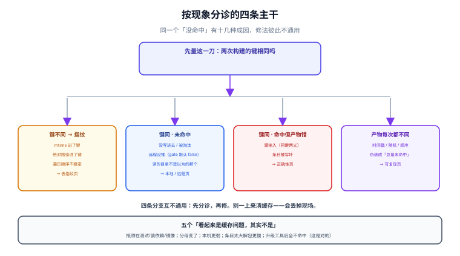

# 常见问题与分诊

缓存问题最难的地方不是修，而是**分诊**：同一个现象（「没命中」）有十几种成因，而它们的修法彼此不通用。这一页按「现象 → 先量什么 → 分支」组织，每一条都能在五分钟内走完第一刀。



本页判据族 `BCF-A` ~ `BCF-H`，共 8 条，定义在最后一节。

## 一、先量这一刀：键同不同

所有缓存问题都能被一句话切开：

> **同一个任务，两次构建算出的键相同吗？**

| 结果 | 含义 | 去哪 |
| --- | --- | --- |
| **键不同** | 指纹不稳定（同输入算出不同键），或输入真的变了 | [指纹](../CacheKey/index.md)第二节「不稳定」 |
| **键相同，但都没命中** | 键相同却没条目 → 没写进去 / 被淘汰 / 远程没推 | [本地缓存](../LocalCache/index.md)、[远程缓存](../RemoteCache/index.md) |
| **键相同，且命中了，但产物不对** | **假命中**：同键两义（漏输入）或条目写坏 | [正确性](../Correctness/index.md) |
| **键相同，命中，产物也不对但每次都不同** | 产物不可复现（伪装成「总是未命中」） | [可复现构建](../Reproducible/index.md) |

```shell
# 通用量法（Turborepo）
pnpm turbo run build --dry=json | jq '.tasks[] | {taskId, hash}' > /tmp/k1.json
# 改一次、再量一次
pnpm turbo run build --dry=json | jq '.tasks[] | {taskId, hash}' > /tmp/k2.json
diff /tmp/k1.json /tmp/k2.json
# Gradle：--info 里有 "Build cache key for task ':x' is <hash>"
```

## 二、十二条高频问题

### Q1：本地命中率一直 0，日志里全是 miss

按顺序量三件事：**① 键稳定吗**（同输入两次是否同键）；**② 有写入吗**（缓存目录体积在涨吗）；**③ 读的是同一个目录吗**（多用户/多容器的 home 不同）。

最常见的是 ①：把 `mtime` 或绝对路径算进了键，于是每次都是新键（[指纹](../CacheKey/index.md)第三节的两行实测）。第二常见的是 ③：CI 容器每次重建，`~/.gradle` 不持久——那就不是缓存坏了，是**没有持久化**。

### Q2：换分支就从 0 开始

`git checkout` 会改文件 mtime。若指纹含 mtime，换分支 = 全部新键。判据：**同一分支 checkout 两次，指纹必须一致**。修法是让指纹只依赖文件内容。

### Q3：CI 上命中率很高，本地几乎不命中

两件事分别查：**① 远程是否可读**（本地只读配置有没有写错、凭证是否过期）；**② 键是否一致**（CI 与本地的工作目录不同 → 若键含绝对路径，两台机器永远不互通）。这正是[指纹](../CacheKey/index.md)第四节讲的路径敏感性。

### Q4：命中了，但构建时间没少多少

三种可能：**① 命中的是短任务**（命中收益按秒算，不按次算）；**② 条目太大**（还原/解包的时间抵掉了节省）；**③ 都是远程命中**（网络成本）。用「命中收益」而不是「命中率」评估（[概述](../Overview/index.md)第三节）。

### Q5：测试通过了，但我怀疑它没真跑

看日志是**回放**还是**新产生**：`FROM-CACHE` / `cache hit, replaying logs` 就是回放。测试、迁移、`--fix`、lint 这类「价值在于真的执行」的任务，必须显式排除缓存（[正确性](../Correctness/index.md)第六节）。

### Q6：远程缓存配了，但没人上传

Gradle 的远程缓存**默认 `push = false`**——配了地址不等于会上传。检查 `isPush`。Turborepo 则是「登录 + link 之后才会推」，检查 `turbo login` 状态与 CI 的 `TURBO_TOKEN`。

### Q7：远程缓存偶尔超时，构建跟着变慢

远程必须是「坏了也不影响正确性」的组件：失败降级为未命中。Gradle 的做法是**重试 3 次后本次构建禁用远程**。如果你自研后端，务必实现「超时 → 当未命中 → 继续」，而不是「超时 → 报错」。

### Q8：缓存目录越来越大，命中率不涨

写放大。两个成因：**① 容量超过工作集**（写了永远不读的条目）；**② 键不稳定**（每轮都写新键，永远读不到旧条目）。判据：连跑三次，体积应当先涨后稳；一直涨 = 键不稳定（[本地缓存](../LocalCache/index.md)第八节）。

### Q9：清了缓存还是命中旧的

三种可能：**① 远程还有**（本地清了，远程拉回来）；**② 守护进程持有内存索引**（`gradle --stop`、`turbo daemon clean`、`sccache --stop-server`）；**③ 清了另一个目录**（`~/.gradle` vs 项目内 `.gradle`；`TURBO_CACHE_DIR` 被环境变量改过）。

### Q10：产物里带了构建目录的绝对路径

这是[可复现构建](../Reproducible/index.md)第三节第 3 类来源。检查点：sourcemap 的 `sources`、Java debug 信息、Go 二进制（`-trimpath`）、脚本里的 `__dirname`。判据：`grep -rl "$(pwd)" dist` 必须无输出。

### Q11：两个平台（amd64 / arm64）互相命中，产物跑不起来

**目标平台必须进键**。跨平台共享缓存是常见的「省小钱赔大钱」：镜像里的二进制、原生模块（`.node`）、Go 交叉编译产物都会错。判据：`build:linux-amd64` 与 `build:linux-arm64` 是两个键。

### Q12：要不要给开发机也开 push

不要。三条理由在[远程缓存](../RemoteCache/index.md)第三节：本机状态会进共享缓存、写入不可审计、写放大挤掉有用条目。要「快」，加本地容量或就近的只读镜像，不要开放写。

## 三、五个「看起来是缓存问题，其实不是」

| 现象 | 真实原因 | 怎么确认 |
| --- | --- | --- |
| 构建慢，但命中率很高 | 瓶颈在测试/装依赖/镜像推送，不在编译 | 看构建阶段耗时分解 |
| 「命中率掉了」 | 分母变了（任务数增加，如新增了 lint 任务） | 同时看绝对命中次数 |
| 「本地比 CI 慢」 | 本地机器更弱 / 在跑别的进程 | 用同一台机器对比「有缓存 vs 无缓存」 |
| 「缓存让构建变慢」 | 条目太大，解包比重新算还慢 | 对比单任务「命中耗时」与「执行耗时」 |
| 「升级工具后全不命中」 | 工具链版本进键了（**这是对的**） | 确认这是预期行为，不是缺陷 |

::: tip 一条通用判断
**缓存只影响「可缓存任务」的耗时**。如果你的构建时间有 60% 花在装依赖、起数据库、跑 E2E 上，那么即使任务缓存 100% 命中，你也只能省下 40% 里的一部分。先做耗时分解，再决定要不要在缓存上投入。
:::

## 四、配置速查（四个生态的最小可用配置）

```properties [gradle.properties]
org.gradle.caching=true
org.gradle.parallel=true
```

```kotlin [settings.gradle.kts]
buildCache {
    local { directory = File(rootDir, ".build-cache") }
    remote<HttpBuildCache> {
        url = uri("https://cache.internal.example.com/cache/")
        isPush = System.getenv().containsKey("CI")
        credentials {
            username = System.getenv("CACHE_USER")
            password = System.getenv("CACHE_PASS")
        }
    }
}
```

```json [turbo.json]
{
  "globalEnv": ["CI", "NODE_ENV"],
  "tasks": {
    "build": { "inputs": ["$TURBO_DEFAULT$", "!**/*.md"], "outputs": ["dist/**"] },
    "test": { "cache": false },
    "migrate": { "cache": false }
  }
}
```

```shell
# Bazel：持久磁盘缓存 + 远程
bazel build //... --disk_cache=~/.cache/bazel-disk --remote_cache=grpc://cache.internal:9092
```

## 五、本页判据

| 编号 | 判据 | 不满足时改哪里 |
| --- | --- | --- |
| `BCF-A` | 遇到缓存问题的第一动作是「量键是否相同」，不是「清缓存」 | 见第一节的命令 |
| `BCF-B` | 团队知道「键不同 / 键同未命中 / 键同假命中」三条分支各自的去处 | 把第一节表贴进 runbook |
| `BCF-C` | 「清了还命中」有固定检查顺序（远程 → 守护进程 → 目录） | 见 Q9 |
| `BCF-D` | 远程失败一定降级为未命中（有超时与重试上限） | 见 Q7 |
| `BCF-E` | 副作用任务显式排除缓存，且日志可区分「回放」与「执行」 | 见 Q5 |
| `BCF-F` | 目标平台进键，跨平台不共享条目 | 见 Q11 |
| `BCF-G` | 评估缓存收益用「命中收益」与耗时分解，不用单个命中率 | 见 Q4 与第三节 |
| `BCF-H` | 已知「看起来像缓存问题但不是」的五种情形有书面记录 | 见第三节表 |

## 六、验证方式

```shell
# 分诊三连：键 / 写入 / 读取位置
pnpm turbo run build --dry=json | jq '.tasks[] | {taskId, hash}'   # ① 键
du -sm .turbo/cache                                                # ② 写入（体积应增长）
grep -n "cacheDir" turbo.json ; ls -d .turbo/cache            # ③ 读的位置（配了 cacheDir 就以它为准）

# 假命中的确认：有缓存 vs 无缓存产物比对
pnpm build && cp -r dist /tmp/a && pnpm build --force && cp -r dist /tmp/b
diff -r /tmp/a /tmp/b && echo "一致"
```

**期望结果**：第 ① 步在「不改任何文件」的两次运行之间哈希稳定；第 ② 步体积增长；第 ③ 步路径与你以为的一致；最后一步 `一致`。**四条同时成立，说明缓存处在健康状态**；任何一条不成立，就按第一节的四分支去对应页面。

## 与相邻专题的分工

- 全貌与指标：[概述](../Overview/index.md)
- 键的设计：[指纹](../CacheKey/index.md)
- 本地与远程机制：[本地缓存](../LocalCache/index.md)、[远程缓存](../RemoteCache/index.md)
- 假命中与止血：[正确性](../Correctness/index.md)
- 字节级一致：[可复现构建](../Reproducible/index.md)
- 各生态差异：[生态对照](../Platforms/index.md)

## 参考资料

- Gradle 官方：*Build Cache*（`isPush` 默认 false、重试 3 次后禁用、`413` 不视为错误）
- Turborepo 官方：*Caching*、*Troubleshooting*（`--dry`、`--summarize`）
- Bazel 官方：*Remote Caching*（`--disk_cache`、`--remote_download_outputs`）
- ccache 官方：*Manual*（`base_dir`、`hash_dir`、`sloppiness`）
