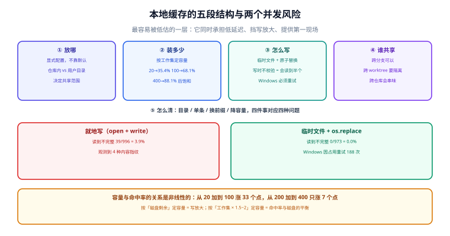

# 本地缓存：布局、淘汰与并发写

本地缓存是整套体系里最容易被低估的一层。它看起来只是「一个目录，存一下就行」，但它同时承担三件事：**给常用条目低延迟**（0.05 s 级 vs 远程 0.6 s 级）、**给远程挡一层写放大**（否则每次构建都在上传）、**给「缓存坏了」提供第一现场**（假命中多数先在这里发生）。

本页按「放哪 → 装多少 → 怎么写 → 谁能共享 → 怎么清」五段讲，每一段都给出可观测的判据，并附两组本机实测：容量与命中率的关系、以及**非原子写到底会坏到什么程度**。



本页判据族 `BCL-A` ~ `BCL-H`，共 8 条，定义在最后一节。

## 一、放哪：五个生态的默认位置

| 生态 | 默认位置 | 是否内容寻址 | 可配置项 | 注意 |
| --- | --- | --- | --- | --- |
| **Gradle**（任务级） | Gradle User Home 下的专用目录（默认 `~/.gradle/caches/build-cache-1`） | 是（键 = 任务指纹） | `buildCache { local { directory = ... } }` | 官方文档只承诺「位于 Gradle User Home」；要固定位置请显式配置 |
| **Turborepo**（任务级） | 仓库内 `.turbo/cache` | 是（键 = 任务哈希） | `cacheDir` | 放在仓库内 → **worktree 之间自动共享**；配了 `cacheDir` 就关掉这个共享 |
| **Bazel**（任务级） | 默认内存/无持久（需显式 `--disk_cache`） | 是 | `--disk_cache=/path` | 不配就是每次冷启，CI 上尤其亏 |
| **ccache / sccache**（编译单元） | `~/.cache/ccache`、`~/.cache/sccache` | 是 | `CCACHE_DIR`、`SCCACHE_DIR` | 大小与上限用 `max_size` / `SCCACHE_CACHE_SIZE` 控制 |
| **npm / pnpm**（依赖级） | `~/.npm/_cacache`、pnpm store | **是**（`_cacache` 按内容哈希分目录） | `--cache`、`store-dir` | 这是「产物级 CAS」在依赖场景的实例，值得当成范本读 |

三条从这张表里能直接读出来的结论：

1. **内容寻址是主流选择**，因为它天然去重、天然幂等、天然可校验。本机实测：200 份产物、30 种内容，按文件名去重是 200（等于没去重），**按内容哈希去重是 30**——存储占比 15%，省 85%。
2. **放仓库内的（Turborepo）与放用户目录的（Gradle / ccache）行为差别很大**：仓库内天然随分支/worktree 共享，也天然会被 `git clean` 干掉；用户目录跨仓库共享，但会有「多仓库串味」的风险（第五节）。
3. **「默认不持久」也是一种设计**（Bazel）。默认不持久意味着「第一次一定冷」，如果你的 CI 每次都是新容器，那就必须显式配持久目录或远程缓存，否则你会得到一个「本地缓存看起来毫无效果」的错觉。

## 二、装多少：容量与命中率是非线性的

本地缓存的命中率对容量非常敏感，因为构建负载的访问分布是长尾的（少数任务被反复跑，多数任务偶尔跑）。用 Zipf 近似（400 个 key、3000 次构建、LRU 淘汰）本机模拟：

| 容量（条目数） | 命中率 |
| --- | --- |
| 20 | 35.4% |
| 50 | 53.5% |
| 100 | 68.1% |
| 200 | 81.0% |
| 400 | 88.1% |

两段斜率完全不同：**从 20 加到 100 涨了 33 个百分点，从 200 加到 400 只涨了 7 个**。这决定了容量该定在哪：

- 容量太小（低于工作集）时，缓存进入**抖动（thrashing）**：每次构建都把刚写进去的条目挤掉，命中率低且**写放大极高**（写了很多、几乎没读到）。
- 容量超过工作集后，收益迅速饱和，纯粹占磁盘。
- 工作集的估算办法：跑 20 次典型构建，记录**去重后的被访问 key 数**，这个数就是工作集下界；容量取它的 1.5~2 倍比较合适。

::: danger 三个容量配置的常见错误
1. **按「磁盘剩余」定容量**：磁盘大就设 50 GB，结果缓存里 90% 是永远不会再被读的条目，而 LRU 的插入与扫描成本照付。容量应当按工作集定，不是按磁盘定。
2. **上限设了但没有淘汰策略**：只限制写入大小、不限总量，磁盘照样会被填满；填满之后的行为（拒绝写入？随机删？）如果没有定义，就会出现「有时命中有时不命中」的玄学。
3. **把缓存目录放在会被 `git clean` / 容器重建清掉的位置**：Turborepo 默认在仓库内 `.turbo/cache`，它会被 `git clean -xdf` 清掉——这不是缺陷，但要写进文档，否则「为什么 CI 上永远冷」会被当成工具问题查一周。
:::

## 三、怎么写：非原子写是真的会坏

缓存写入有一个看起来「太讲究」的要求：**必须先写临时文件，再原子替换**。本机实测（400 KB 条目，一个写线程 + 一个读线程，模拟并发读取）：

| 写入方式 | 读到不完整内容 | 观测到的内容指纹数 | 备注 |
| --- | --- | --- | --- |
| 直接 `open(path, "wb")` 就地写 | **39 / 996 = 3.9%** | **4 种**（说明读到了中间状态） | 写一半 + flush + 写另一半，读者就插进来了 |
| 临时文件 + `os.replace` | **0 / 973 = 0.0%** | **1 种** | 读者要么看到旧内容，要么看到新内容 |

3.9% 不是一个小数字：一天 500 次构建、每次读 40 个条目，就有约 780 次机会读到半个文件。而**读到半个文件的后果不是报错，是「解包失败」或「产物是残缺的」**——如果解包器不校验，你会得到一个能跑但行为奇怪的产物。

同一次实测还抓到一个只在 Windows 上出现的细节：

```text
[原子替换] 读到不一致 0/973 = 0.0%；replace 因占用重试 188 次
```

**`os.replace` 在目标文件被读者打开时会抛 `PermissionError`（Windows 文件锁语义）**。也就是说原子替换在 Windows 上**必须带重试**，否则并发场景下它会随机失败；而失败如果被当成「写缓存失败，忽略」，你就得到了一条「有时不写」的缓存——命中率会莫名其妙地掉。Linux 上 `rename(2)` 没有这个问题（被替换的 inode 由仍持有它的进程继续使用），所以「在 Mac 上好好的」不能推出「Windows/Linux CI 上也好」。

::: warning 缓存条目的写入协议（可直接照抄）
1. 写 `<key>.tmp.<pid>.<rand>`，`flush` + `fsync`（断电安全需要 `fsync`，只是并发安全可以不要）；
2. `os.replace(tmp, final)`，**失败就重试（限次）**，Windows 上必须有这一步；
3. 目录不存在就先 `makedirs(exist_ok=True)`；
4. 读到解包失败时，**删掉该条目**并当作未命中（而不是把异常抛给用户）；
5. 条目内容自带校验和（或文件名即哈希），读时校验，不通过即视为未命中。
:::

## 四、并发：同一个键被两个进程同时写

原子替换解决的是「读者看到半个文件」，不解决「两个写者同时写同一个键」。后者的后果通常是良性的（最后写的赢，两个内容本来就该一样），但有两种情况会出问题：

| 场景 | 后果 | 处置 |
| --- | --- | --- |
| 同一键、同一内容、两个进程 | 最后写的赢，无害 | 无需处理 |
| 同一键、**不同内容**（指纹漏字段的征兆） | 缓存内容随机 | **这是假命中的信号**，去查[指纹](../CacheKey/index.md) |
| 写者持有锁、进程被 kill | 留下 stale lock，后续永远等 | 锁要带租约（TTL）+ 属主 PID，过期可抢占 |
| 多个任务共享一个缓存目录 | 互相淘汰 | 按任务/项目分目录，或干脆共享（它本来就是 LRU） |

一条实践建议：**优先选择「无锁 + 原子替换 + 内容校验」的组合**，而不是「加锁保护写入」。分布式锁在本地缓存这个场景里代价过高，而原子替换已经把最危险的中间态消掉了。真正的锁只在「同一键的重计算代价极高、需要防止重复计算」时才值得（比如 20 分钟的集成测试），那时用「锁文件 + 租约」而不是操作系统文件锁。

## 五、谁能共享：跨项目、跨分支、跨 worktree

| 共享方式 | 收益 | 风险 | 建议 |
| --- | --- | --- | --- |
| 同一仓库、跨分支 | 切分支不用重建 | 分支间产物混淆（若指纹含分支名则不会） | **允许**，这正是缓存的价值 |
| 同一仓库、跨 worktree | 并行开发共享 | 产物里含绝对路径时会写错别的 checkout | Turborepo 默认共享；**产物含绝对路径时必须显式隔离** |
| 跨仓库共享一个目录 | 复用公共库的构建结果 | 依赖版本串味、工具链不同 | 只在「同一套工具链 + 同一份 lockfile 策略」的 monorepo 内做 |
| 本地与 CI 共享（网络盘） | 看上去很美 | 延迟比本地磁盘高一个量级，锁语义不可靠 | **不要做**，用远程缓存替代 |

Turborepo 官方文档里有一段值得单独标注的话：**缓存产物恢复时不改写内容**，所以如果产物里含 worktree 的绝对路径，共享缓存会把「另一个 checkout 的路径」还原回来。它的处置建议是显式设 `cacheDir` 把本地缓存隔离到各 worktree。这条与[可复现构建](../Reproducible/index.md)是同一个病根：**产物里的绝对路径**。

## 六、怎么清：三种清法对应三种问题

| 命令/动作 | 清什么 | 什么时候用 | 代价 |
| --- | --- | --- | --- |
| 清空整个缓存目录 | 全部条目 | 怀疑大范围污染；升级指纹算法后 | 下一次构建全冷 |
| 删单个条目（按 key） | 一个条目 | 已定位到「就是这个任务」 | 极小 |
| 换指纹版本前缀 | 逻辑上全部失效 | 改了指纹字段 | 同「清空」，但可回滚（旧前缀还在） |
| 降容量上限触发 LRU | 最久未用的部分 | 磁盘紧张 | 命中率下降，但可控 |

::: danger 两个「清了也没用」的坑
1. **清了本地，远程还在**：本地清空后第一次构建会从远程拉回**同样的坏条目**。止血必须**同时**处理远程（下线该条目、或临时关闭远程读）。这条在[正确性](../Correctness/index.md)第五节有完整顺序。
2. **清了缓存目录，但条目还在内存里**：Gradle daemon、Turborepo 的常驻进程、sccache 的 server 都可能持有内存索引。清目录后要先停守护进程（`gradle --stop`、`turbo daemon clean`、`sccache --stop-server`），否则你会看到「清了但还命中」。
:::

## 七、本页判据

| 编号 | 判据 | 不满足时改哪里 |
| --- | --- | --- |
| `BCL-A` | 缓存位置是**显式配置**的，不依赖默认值（CI 与本地都写清楚） | 配 `local { directory }` / `cacheDir` / `--disk_cache` |
| `BCL-B` | 容量按**工作集**定（去重 key 数 × 1.5~2），不是按磁盘剩余 | 见第二节的模拟表 |
| `BCL-C` | 有明确的淘汰策略与「写满时的行为」 | LRU + 上限；行为写进文档 |
| `BCL-D` | 写入是「临时文件 + 原子替换 + 重试」，读时校验内容 | 见第三节的写入协议 |
| `BCL-E` | 读到损坏条目时降级为「未命中」并删除，不抛给用户 | 解包失败路径要吞掉并计数 |
| `BCL-F` | 缓存目录与共享范围（跨分支 / 跨 worktree / 跨仓库）有书面决定 | 按第五节表逐项决定 |
| `BCL-G` | 清理动作有清单（含守护进程、含远程） | 见第六节 |
| `BCL-H` | 本地命中与远程命中在日志里**可区分** | 打开工具的缓存日志（`--info` / `--summarize`） |

## 八、验证方式

```shell
# 1) 位置与容量：先看清楚它到底放哪、多大
#    Gradle: ~/.gradle/caches/build-cache-1（或你配的目录）
#    Turborepo: <repo>/.turbo/cache
du -sh ~/.gradle/caches/build-cache-1 2>/dev/null
du -sh .turbo/cache 2>/dev/null

# 2) 抖动检测：连续三次构建的缓存体积与命中数
#    体积涨、命中数不涨 = 写放大（容量不足或在扫 dist）
for i in 1 2 3; do
  pnpm build > /dev/null 2>&1
  echo "round $i: cache=$(du -sm .turbo/cache 2>/dev/null | cut -f1)MB"
done

# 3) 原子性自测：并发读写同一个条目（本机实测脚本的核心逻辑）
python lab_cache6.py       # 期望：就地写 3.9% 不一致，原子替换 0%
```

**期望结果**：第 2 步的体积应当**先涨后稳**（涨到工作集就停），命中数应当持续上升；如果体积一直涨而命中数不涨，说明「写进去的东西没有被读」——通常是键不稳定（每轮都是新键）。第 3 步的两个读数与本文一致（比例会随机器波动，**但「就地写 > 0、原子替换 = 0」这个方向必须成立**）。

## 与相邻专题的分工

- 键怎么算：[指纹](../CacheKey/index.md)
- 共享到团队：[远程缓存](../RemoteCache/index.md)
- 产物字节不一致导致的「命中但不能用」：[可复现构建](../Reproducible/index.md)
- 容器层缓存的位置与清理：[生态对照](../Platforms/index.md)

## 参考资料

- Gradle 官方：*Build Cache*（`DirectoryBuildCache` 位于 Gradle User Home、`local { directory }`、本地默认 `push = true`）
- Turborepo 官方：*Caching*（`.turbo/cache`、worktree 共享与其失效条件、`cacheDir`）
- Bazel 官方：*Remote Caching*（`--disk_cache`）
- npm 官方：*cacache*（内容寻址的目录布局，可作为自研 CAS 的参考实现）
