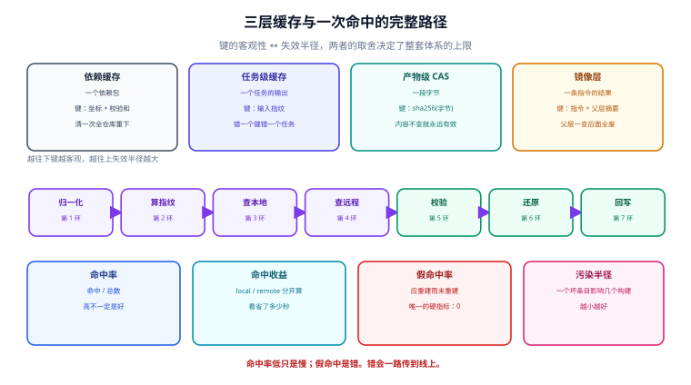

# 概述：三层缓存、四个指标与五档成熟度

构建缓存的全部原理只有一句话：**构建是一次函数求值，缓存就是记住这个函数值**。难的不是这句话，而是这句话成立的前提——「同一份输入」得有一个可以比较的定义。这个定义就是**指纹（fingerprint）**，而指纹写错的方式，比缓存写错的方式多得多。

本页先把「缓存」拆成三层（它们的键、失效半径、治理责任完全不同），再把「命中率」这一个数拆成四个能各自归因的指标，最后给一条从「本地能命中」到「敢让全公司共享一份远程缓存」的五档路线。



本页判据族 `BCO-A` ~ `BCO-H`，共 8 条，定义在最后一节。

## 一、三层缓存，键与失效半径都不一样

「构建缓存」这个词在四五个地方被使用，含义不同。不拆开就会出现这种对话：有人说「命中率 92%」，另一个人说「不可能，我这边一直是 0」——两个人说的是不同层的缓存。

| 层 | 缓存单元 | 键由什么决定 | 典型位置 | 失效半径 | 谁负责 |
| --- | --- | --- | --- | --- | --- |
| **依赖缓存**（dependency cache） | 一个依赖包（`lodash@4.17.21`、`spring-core-6.2.x.jar`） | 坐标 + 校验和（或 lockfile 条目） | `~/.m2/repository`、`~/.gradle/caches/modules-2`、`node_modules/.pnpm`、registry 代理 | **全仓库**：清一次所有项目都要重下 | 平台/基础设施 |
| **任务级缓存**（task cache） | 一个任务的输出集合（compile / test / lint / bundle） | 任务输入指纹（源码 + 依赖 + 工具链 + 命令 + 环境） | `.gradle/caches/build-cache-1`、`.turbo/cache`、Bazel 的 action cache | **单任务 × 单仓库**：错一个键只错一个任务 | 构建工程 |
| **产物级缓存**（CAS，content-addressed storage） | 一段字节（一个文件、一个层、一个 tar） | **内容本身的哈希**（`sha256(bytes)`） | 远程缓存后端、OCI registry、S3 桶 | **一段字节**：内容不变就永远有效 | 平台 |
| **镜像层缓存** | 一条 Dockerfile 指令的结果 | 指令文本 + 父层摘要（+ 构建参数） | 本地 BuildKit、registry | **该指令及其后所有层** | 平台 |

四条要点：

1. **越往下，键越「客观」**。产物级的键是字节的哈希，不存在「漏了某个输入」这种错误；任务级的键是人写出来的，一定会有漏。**所以远程缓存的可靠性上限，取决于任务级指纹写得有多准**——后端再稳也救不了一个漏了环境变量的键。
2. **越往上，失效半径越大**。依赖缓存出问题（比如把 `SNAPSHOT` 当固定版本缓存了），是「所有人同时在用一个错误的包」；任务级出问题，通常只坑一个任务。
3. **镜像层是任务级缓存的一个特例**：`COPY package.json` 单独一行、`COPY . .` 放最后，就是为了让「改业务代码」不影响「装依赖」那一层的键。这不是风格建议，是键的设计。
4. **「构建缓存」这个词在 CI 里常指第二层，在 Docker 语境里指第四层**。看任何命中率数字之前，先问清楚是哪一层。

## 二、一次命中的完整生命周期

缓存不是一个「开关」，是一条有七个环节的路径。**每一环都有各自独有的失效方式**，而所有环节的失败看起来都像同一句话：「这次没命中」。

| # | 环节 | 做什么 | 这一环独有的失效 | 观测点 |
| --- | --- | --- | --- | --- |
| 1 | **归一化输入** | 列出参与指纹的文件集合（源码 + lockfile + 配置） | 漏文件（假命中）；把 `dist/`、`node_modules/` 扫进去（永远不命中） | 指纹日志里的输入清单 |
| 2 | **计算指纹** | 逐文件哈希 → 汇总 → 加算法/版本前缀 | 遍历顺序不稳定、路径含绝对路径、带 mtime | 同输入两次的指纹是否相同 |
| 3 | **查本地** | 按指纹找本地条目 | 条目被淘汰（容量满）、被并发写坏（半个文件） | 命中来源标记 `local` |
| 4 | **查远程** | 未命中本地时按指纹拉远程 | 网络超时、鉴权失败、区域跨洋、条目不存在（正常） | `remote` / `miss` |
| 5 | **校验** | 拉回来的字节要验哈希 | 只信「下载成功」不信内容（把损坏条目当命中） | 校验失败计数 |
| 6 | **还原** | 解包/链接到工作区 | 权限位丢失、符号链接被展开、软链跨盘 | 还原后文件数与字节数 |
| 7 | **回写** | 把本次产物写本地（+ 按策略写远程） | 非原子写（读到半个文件）、覆盖率不足（写了但键不对） | 写入成功率、条目体积 |

::: danger 三个把「路径」当「开关」的错误
1. **只开远程、不修指纹**：把本地缓存当成「反正有远程兜底」。远程只会把错误的键**放大到全公司**——本地假命中坑你一个，远程假命中坑所有人。
2. **只看「有没有命中」，不看「命中的是哪一环」**：`local` 命中与 `remote` 命中的成本差一个数量级（见第四节），混在一起统计会让优化方向完全跑偏。
3. **回写当成「顺手的事」**：回写失败不会让构建失败，所以它可以长期 100% 失效而无人知晓——直到某天所有人都在冷启动。
:::

## 三、四个指标：把「命中率」拆开

一个命中率数字无法归因。至少要四个：

| 指标 | 定义 | 它变差说明什么 | 目标的方向 |
| --- | --- | --- | --- |
| **命中率** | 命中任务数 / 总任务数 | 指纹写宽了（多算输入）、或者输入真的在变 | 不是越高越好，见第四节 |
| **命中收益** | `(未命中耗时 − 命中耗时) × 命中次数`，按 local / remote 分开算 | 命中了但省的很少（任务本身太短） | 只看总耗时省了多少 |
| **假命中率** | 应重建而未重建的次数 / 命中次数 | 指纹漏了输入 | **唯一的硬指标：必须为 0** |
| **污染半径** | 一个错误条目会影响到的构建数（= 共享该缓存的作用域大小） | 共享范围太大、没有隔离 | 尽量小，且可一键失效 |

第三条是这套体系里唯一「不能妥协」的：命中率低只是慢，假命中是错。第四条决定「错一次要修多久」——本地缓存的污染半径是 1（你自己），团队远程缓存是几十人 × 每天若干次，公共镜像层可能是所有下游用户。

::: warning 假命中率为什么通常「测不出来」
它不是一个能直接从日志里数出来的量，因为你**不知道哪些任务本该重建**。可操作的做法是把它变成「抽检率」：每天随机挑 N 个任务，用 `--rerun-tasks`（Gradle）/ `--force`（Turborepo）/ `--nocache_test_results` 强制重跑，比对产物哈希。抽检不通过 = 假命中。具体做法见[正确性](../Correctness/index.md)第三节。
:::

## 四、命中率不是目标：算一遍就知道

下面的表用一组**量级假设**（本地命中 0.05 s、远程命中 0.62 s、未命中 9.5 s）算平均耗时。参数是假设，**结论是结构性的**：命中率提高带来的是线性收益，而「命中来自本地还是远程」带来的是台阶式差异。

| 命中率 | 本地占命中的比例 | 未命中率 | 平均耗时 |
| --- | --- | --- | --- |
| 20% | 45% | 80% | 7.67 s |
| 50% | 45% | 50% | 4.93 s |
| 75% | 45% | 25% | 2.65 s |
| 90% | 45% | 10% | 1.28 s |

再把两种「命中率不同、结构不同」的情形摆在一起：

| 情形 | 本地 | 远程 | 未命中 | 平均耗时 |
| --- | --- | --- | --- | --- |
| A：命中率 **90%**，但 80/90 来自远程 | 10% | 80% | 10% | **1.45 s** |
| B：命中率 **75%**，但 60/75 来自本地 | 60% | 15% | 25% | **2.50 s** |

A 的命中率高 15 个百分点，平均耗时却只比 B 快 1 秒出头——因为**远程命中本身要付网络与解包的钱**。这条推论直接决定优化顺序：

> **先让本地能命中（指纹稳定 + 容量够），再谈远程共享。** 反过来做，你会得到一个「命中率很好看、但每次构建都在等网络」的系统，而且因为本地条目被远程回写填满又立刻被淘汰，本地命中率永远上不去。

## 五、五档成熟度：从「能跑」到「敢共享」

| 档位 | 状态 | 判据（有书面证据才算） | 典型缺口 |
| --- | --- | --- | --- |
| **L0** | 无缓存 | 每次全量构建，有基线耗时记录 | 连「省了多少」都说不清 |
| **L1** | 本地能命中 | 同一份输入连跑两次，第二次接近零耗时；指纹可复算 | 指纹不稳定（mtime/顺序），换分支就失效 |
| **L2** | 本地可信 | 有抽检机制（强制重跑 + 产物哈希比对），假命中率可测且为 0 | 抽检靠人，没人跑就没人知道 |
| **L3** | 远程共享 | 只有 CI 能 push、有租户与配额、有完整性校验、坏条目可一键失效 | 上传策略松（开发机也 push）→ 投毒面 |
| **L4** | 可复现 | 两台机器、两个路径、两次构建，产物字节一致；有 `diffoscope` 级的差异报告 | 产物里带构建时间戳/绝对路径 |

L1 → L2 是**正确性**的门（假命中率要能测），L2 → L3 是**权限**的门（谁能写），L3 → L4 是**证明**的门（怎么让别人信）。三扇门不能跳：跳 L2 直接上 L3，就是你不知道自己的缓存对不对，但已经让全公司一起用它。

::: tip 一条实用判据
问「你的构建缓存几档」，不要听「我们开了」——问三句：**同输入两次构建的产物哈希一致吗**（L1/L4）、**强制重跑的抽检最近一次是什么时候**（L2）、**开发机能不能 push 远程缓存**（L3）。三个问题各对应一扇门。
:::

## 六、本页判据

| 编号 | 判据 | 不满足时改哪里 |
| --- | --- | --- |
| `BCO-A` | 能说出缓存属于哪一层（依赖 / 任务 / 产物 / 镜像层），且命中率指标按层分开统计 | 先统一口径，再谈优化 |
| `BCO-B` | 七个环节（归一化 → 指纹 → 本地 → 远程 → 校验 → 还原 → 回写）都有观测点 | 至少把命中来源打成 `local` / `remote` / `miss` 三态 |
| `BCO-C` | 有「无缓存基线」的耗时记录，命中收益按 local / remote 分开算 | 跑一次全量构建并记账 |
| `BCO-D` | 假命中率有测量机制（抽检或强制重跑），且读数为 0 | 见[正确性](../Correctness/index.md)第三节 |
| `BCO-E` | 污染半径有明确边界（谁能读写哪个作用域），且坏条目可一键失效 | 见[远程缓存](../RemoteCache/index.md)第四节 |
| `BCO-F` | 成熟度档位有书面结论（L0~L4），写明下一档缺什么 | 按第五节表逐条对 |
| `BCO-G` | 优化顺序符合「先本地、后远程」（本地命中率达标后才开远程） | 先修指纹稳定性与容量 |
| `BCO-H` | 有至少一个任务的「同输入两次产物哈希一致」记录 | 见[可复现构建](../Reproducible/index.md) |

## 七、验证方式

本节的三条命令都不依赖具体构建工具，只依赖「你能拿到两次构建的产物」：

```shell
# 1) 同输入连跑两次，取产物哈希：这是 L1 与 L4 的共同入口
#    第一次（清空缓存后）与第二次的哈希必须一致
find build -type f -print0 | sort -z | xargs -0 sha256sum > /tmp/run1.txt
# ... 再构建一次 ...
find build -type f -print0 | sort -z | xargs -0 sha256sum > /tmp/run2.txt

# 2) 差异必须为空；非空时先看差在哪些文件上（经常只有时间戳/绝对路径不同）
diff /tmp/run1.txt /tmp/run2.txt | head -20

# 3) 命中来源必须可分辨：Gradle / Turborepo 都有对应的输出行
#    Gradle: --build-cache --info 时会打印 "from cache" / "up-to-date"
#    Turborepo: 输出里的 "cache hit, replaying logs" / "cache miss"
```

**期望结果**：第 2 步的 `diff` 为空，或差异只落在已知的「不稳定文件」清单里（例如某张生成的 PNG，由渲染器版本决定）；第 3 步能看到三种状态各自的计数。**如果第 2 步非空而第 3 步有命中，那么你已经有假命中或产物不可复现——两者都说明缓存现在不可信**，先去[正确性](../Correctness/index.md)排查。

## 与相邻专题的分工

- 依赖怎么解、生命周期怎么走：[构建和依赖管理工具](../../Build/index.md)
- 缓存打开之后流水线怎么排、并发怎么控：[CI/CD](../../CICD/index.md)
- 产物怎么签名、怎么出 SBOM：[依赖与安全治理](../../DependencyGovernance/index.md)
- 镜像层缓存的具体写法：[容器编排](../../../Ops/ContainerOrchestration/index.md)

## 参考资料

- Gradle 官方：*Build Cache*（`org.gradle.caching` 默认关闭、`@CacheableTask` 需显式声明、任务路径不进缓存键）
- Turborepo 官方：*Caching*（global hash 与 task hash 两段、`cache: false`、`--force` 只关读不关写）
- Bazel 官方：*Remote Caching*（action cache 与 CAS 分离、`--remote_download_outputs`）
- reproducible-builds.org：*SOURCE_DATE_EPOCH* 规范与 *diffoscope*
