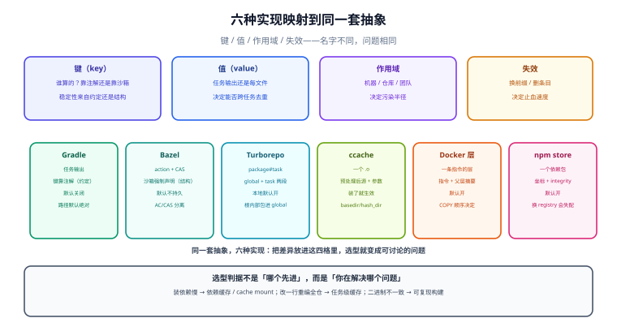

# 生态对照：Gradle、Bazel、Turborepo、sccache 与镜像层

同一个概念在六个生态里有六个名字：Gradle 叫 build cache，Bazel 叫 action cache + CAS，Turborepo 叫 task hash，ccache 叫 direct mode，Docker 叫 layer cache，npm 叫 `_cacache`。名字不同，抽象其实是同一套：**键（key）、值（value）、作用域（scope）、失效（invalidation）**。

本页先给一张横向对照表（六行 × 六个维度），再把六者映射到同一套抽象上，最后给一段选型建议——**不同层级的缓存解决不同问题，混用是设计错误，不是配置问题**。



本页判据族 `BCI-A` ~ `BCI-H`，共 8 条，定义在最后一节。

## 一、横向对照

| 维度 | **Gradle** | **Bazel** | **Turborepo** | **ccache / sccache** | **Docker / BuildKit** | **npm / pnpm store** |
| --- | --- | --- | --- | --- | --- | --- |
| **缓存单元** | 一个任务的输出集合 | 一个 action 的输出（+ CAS 字节） | 一个 `package#task` 的输出 | 一次编译（一个源文件 + 头文件集合） | 一条指令的结果（一个层） | 一个依赖包的 tarball |
| **键的组成** | 任务类型 + classpath + 输入属性名/值 + Gradle 版本 + 构建脚本 | action 的命令行 + 输入文件摘要 + 环境变量白名单 + 工具链 | global hash（根配置/lockfile/`globalEnv`）+ task hash（包配置/依赖/文件） | 编译器 + 编译参数 + 预处理后的源（direct mode 用头文件列表算） | 指令文本 + 父层摘要 + 构建参数 | 包坐标 + 完整性哈希（`integrity`） |
| **本地位置** | Gradle User Home 下的专用目录（默认 `~/.gradle/caches/build-cache-1`） | 默认不持久，需 `--disk_cache` | 仓库内 `.turbo/cache` | `~/.cache/ccache`、`~/.cache/sccache` | 本地 BuildKit 内容存储 | `~/.npm/_cacache`、pnpm store |
| **远程** | `HttpBuildCache`（HTTP GET/PUT） | gRPC remote cache（AC + CAS） | 官方或自建 Remote Cache API | sccache 支持 S3/GCS/Redis 等后端；ccache 需共享目录 | registry（推拉层） | registry + 本地 store |
| **默认开关** | **关闭**（`org.gradle.caching` 或 `--build-cache`） | 关闭（需显式 `--remote_cache` / `--disk_cache`） | **开启**（本地） | 开启（装了就生效） | 开启（层复用），BuildKit 的 `cache mount` 需显式 | 开启 |
| **最易踩的坑** | 输入按**绝对路径**识别 → 跨机器不命中；自定义任务默认不可缓存 | 不配 `--disk_cache` 就每次冷启；沙箱不完整 → 假命中 | 根 `package.json` 依赖的内部包源码进 global hash → 改一处全仓重建 | `CCACHE_BASEDIR` 没设 → 换目录全失效；`hash_dir` 把绝对路径算进键 | `COPY` 顺序不当 → 改代码废掉装依赖层；没 pin digest | 私有 registry 换地址后完整性校验失败 |

## 二、映射到同一套抽象

把六者放到「键 / 值 / 作用域 / 失效」四格里，差异立刻变成可讨论的：

| 抽象 | Gradle | Bazel | Turborepo | ccache | Docker | npm |
| --- | --- | --- | --- | --- | --- | --- |
| **键的稳定性** | 中（依赖注解正确性） | 高（沙箱强制声明） | 中高（声明式 `inputs`/`env`） | 中（预处理后的源） | 高（指令 + 父层摘要） | 高（坐标 + integrity） |
| **值的粒度** | 任务输出（可能很大） | 每文件（CAS） | 任务输出 | 一个 `.o` | 一整层 | 一个包 |
| **作用域** | 项目 / 机器 / 团队（远程） | 仓库 / 团队 | 仓库 / 团队 | 机器 / 团队（共享目录） | 机器 / registry | 机器 / registry |
| **失效手段** | 改指纹字段 / 清目录 / `--no-build-cache` | 换 `--remote_cache` / 删 AC 条目 | `--force` / 删 `.turbo/cache` / 换 hash 版本 | 清目录 / 改 `sloppiness` | 换层键（改指令）/ `--no-cache` | 删 store / `--force` |
| **正确性保证** | 依赖开发者注解 | 沙箱（不声明就取不到） | 依赖声明 + 保守估计 | 编译器参数与头文件 | 指令文本确定性 | 内容哈希 |

两列值得单独看：

- **键的稳定性**这一行，Bazel 和 Docker 是「结构性保证」（Bazel 用沙箱强制你声明输入，不声明就读不到；Docker 的层键是文本 + 摘要，没有「漏字段」的余地），Gradle 与 Turborepo 是「约定性保证」（靠注解/配置写对）。**约定性保证的代价就是：写错了不报错。**
- **值的粒度**这一行解释了为什么 Bazel 的远程缓存能做跨任务去重，而 Gradle 的 HTTP 缓存不能：前者每个文件一个 CAS 键，后者一个任务一个条目。

## 三、五个具体差异，会直接影响你的方案

### 差异 1：Gradle 的任务路径不进键

官方文档写明：任务路径不是缓存键的一部分，**不同路径的任务只要执行结果相同就可以互相复用输出**。这与很多人的直觉相反（以为「`:app:compileJava` 与 `:lib:compileJava` 是两个键」）。好处是复用率高；风险是「两个任务的输出被当成同一个」——只有当它们的输入确实相同时才成立，而这一点由输入注解保证。

### 差异 2：Bazel 的沙箱是缓存正确性的来源

Bazel 的 action 在一个受限沙箱里执行，**没声明的输入根本读不到**。所以「漏输入」在 Bazel 里表现为「构建失败」，而不是「假命中」——这是它比注解式方案更可靠的根本原因。代价是迁移成本高（要写 `BUILD` 文件、要处理不支持沙箱的工具）。

### 差异 3：Turborepo 的两段哈希与「根依赖」连带效应

Turborepo 有 **global hash** 与 **task hash** 两段，任一变则未命中。官方文档给了一个容易被忽略的连带效应：**根 `package.json` 依赖的内部包，其源码会进 global hash**。所以「我只改了 `packages/tooling` 里一行，为什么全部 40 个包都重建」——这是设计使然：根脚本可能用到那个包。

处置有两条：把工具包从根依赖里移出（改用 workspace 脚本调用），或者接受这个保守估计（重建便宜、假命中贵）。

### 差异 4：ccache 的 `basedir` 与 `hash_dir`

ccache 的默认行为会把**编译目录**算进哈希（`hash_dir`），于是「同一个项目换目录编译」全部失效。共享缓存时必须设 `CCACHE_BASEDIR`（把绝对路径重写成相对），并在某些场景下关掉 `hash_dir`（`CCACHE_NOHASHDIR=1`）。这与 Gradle 的 `PathSensitivity.ABSOLUTE` 是同一个病根、不同的开关名。

### 差异 5：镜像层缓存是「前缀式」的

Docker 的层缓存是**链式**的：某一层的键由「指令 + 父层摘要」决定，父层一变，**后面所有层全废**。所以 Dockerfile 的写法直接决定缓存效率：

```dockerfile
# 好：依赖装完才拷源码，改代码不影响依赖层
COPY package.json pnpm-lock.yaml ./
RUN pnpm install --frozen-lockfile
COPY . .
RUN pnpm build

# 差：一上来就 COPY 全量，改任何文件都废掉 install 层
COPY . .
RUN pnpm install && pnpm build
```

BuildKit 的 `cache mount` 是另一个维度：它让「包管理器的下载目录」在多次构建之间保留，**即使层缓存失效也不用重新下载**。

```dockerfile
RUN --mount=type=cache,target=/root/.local/share/pnpm/store \
    pnpm install --frozen-lockfile
```

## 四、选型：按「你在解决哪个问题」选，不要按「哪个更先进」选

| 你的问题 | 该用的层 | 不该用的 |
| --- | --- | --- |
| 每次 CI 都在重装依赖 | 依赖缓存（registry 代理 / store 复用 / `cache mount`） | 任务级缓存（它不管装包） |
| 改一行代码要重新编译全仓库 | 任务级缓存（Gradle / Turborepo / Bazel） | 依赖缓存 |
| 团队每个人都在重复编译同样的模块 | 任务级缓存 + 远程共享 | 只加本地容量 |
| 同一个二进制在不同机器上不一致 | 可复现构建（不是缓存问题） | 换缓存后端 |
| 镜像构建每次都很慢 | 镜像层缓存（`COPY` 顺序 + `cache mount`）+ 固定 digest | 任务级缓存 |
| 跨语言 monorepo（Java + Node + Go） | 分层组合：每语言用各自的工具，用一层编排（如 Bazel 或 Turborepo 统一调度） | 强行统一到一个工具 |

::: warning 一个常见的过度设计
「我们要不要上 Bazel？」——先回答三个问题：**构建是否已经慢到影响交付**（不是「感觉慢」，是有基线数据）、**团队是否能承担迁移成本**（`BUILD` 文件、沙箱不兼容的工具链）、**现有方案的瓶颈是否真的在缓存**（很多时候瓶颈在测试、在镜像、在依赖下载）。三个都答不上来时，把 Gradle/Turborepo 的缓存配对（指纹 + 远程 + 抽检）通常已经能拿到 70% 的收益。
:::

## 五、本页判据

| 编号 | 判据 | 不满足时改哪里 |
| --- | --- | --- |
| `BCI-A` | 能说清当前用的是哪一层缓存（依赖/任务/产物/镜像），且不与另一层混谈 | 按第一节表定位 |
| `BCI-B` | 键的「稳定性来源」有结论：靠注解/配置（约定）还是靠沙箱/内容（结构） | 约定式方案必须配抽检 |
| `BCI-C` | 远程缓存的协议与能力与需求匹配（是否需要跨任务去重决定单键还是双键） | 见第一节「值的粒度」 |
| `BCI-D` | 各工具的默认开关状态被确认（Gradle 默认关、Turborepo 默认开） | 显式写进配置与文档 |
| `BCI-E` | 平台特有的坑有对策（Gradle 路径敏感性、ccache `basedir`、Docker `COPY` 顺序） | 见第三节 |
| `BCI-F` | 镜像构建的 `COPY` 顺序与 `cache mount` 已按层键设计 | 见第三节差异 5 |
| `BCI-G` | 跨语言仓库的缓存编排有明确分工（哪个工具管哪一层） | 见第四节表 |
| `BCI-H` | 选型有书面理由（基线数据 + 迁移成本 + 瓶颈位置），不是「因为先进」 | 见第四节 warning |

## 六、验证方式

```shell
# 1) 确认默认开关：Gradle 默认关闭缓存，必须显式开
grep -n "org.gradle.caching" gradle.properties || echo "未配置（默认关闭）"

# 2) 确认远程是否真的在推（Gradle：isPush 只在 CI 为 true）
grep -n "isPush" settings.gradle.kts

# 3) Turborepo：看每次运行的两段哈希
pnpm turbo run build --dry=json | jq '.tasks[] | {taskId, hash}'

# 4) ccache：确认 basedir 与命中统计
ccache -p | grep -E "base_dir|hash_dir"
ccache -s | grep -E "Hits|Misses|Cache size"

# 5) 镜像层：看每层是否命中缓存（BuildKit 输出里的 CACHED）
docker build --progress=plain . 2>&1 | grep -E "CACHED|RUN|COPY"
```

**期望结果**：第 1、2 步能看到显式配置（而不是「默认值生效」）；第 3 步每个任务有稳定 hash；第 4 步 `base_dir` 是仓库根而不是绝对路径；第 5 步第二次构建时 `RUN pnpm install` 那层显示 `CACHED`。

## 与相邻专题的分工

- 键的通用设计：[指纹](../CacheKey/index.md)
- 本地与远程的通用机制：[本地缓存](../LocalCache/index.md)、[远程缓存](../RemoteCache/index.md)
- 各语言的构建工具本身：[构建和依赖管理工具](../../Build/index.md)
- 镜像与编排：[容器编排](../../../Ops/ContainerOrchestration/index.md)
- 流水线编排：[CI/CD](../../CICD/index.md)

## 参考资料

- Gradle 官方：*Build Cache*（任务路径不进键、`@PathSensitive`、远程 `isPush` 默认 false、本地优先与回写）
- Bazel 官方：*Remote Caching*、*Sandboxing*（沙箱与 action 输入声明的强制关系）
- Turborepo 官方：*Caching*（global hash 与 task hash、根内部包进 global hash、`--summarize`）
- ccache 官方：*Manual*（`base_dir`、`hash_dir`、`sloppiness`）
- Docker 官方：*Build cache*、*Cache mounts*、多平台 manifest
- npm 官方：*cacache*（内容寻址布局）
