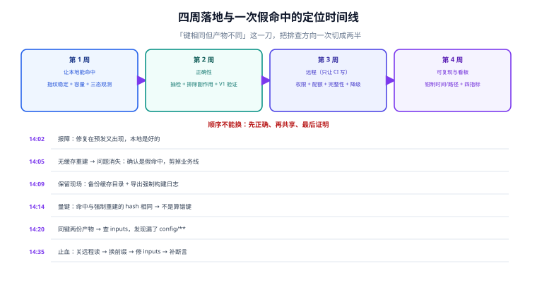

# 实战：四周落地与一次假命中的定位

这一页把前面六页合成一条可执行的路线：**四周，每周只做一件事**，每周都有可验证的收尾。顺序不能换的理由在[概述](../Overview/index.md)第五节讲过：先正确、再共享、最后证明。

第二半是一次真实形态的故障定位——**假命中**从「报障」到「给出根因」的完整过程，每一步都给出可复制的命令。这一段的写法刻意贴着时间线，因为排查假命中时最有价值的信息不是结论，而是**「先做什么、看到什么就该转向」**。



本页判据族 `BCX-A` ~ `BCX-H`，共 8 条，定义在最后一节。

## 一、第 0 步：先量化，不量化就不要开缓存

开缓存之前必须记三个数，否则你永远说不清它到底有没有用：

| 数 | 怎么取 | 用途 |
| --- | --- | --- |
| **全量构建耗时** | 清空所有缓存、干净 clone，跑一次完整构建，记墙钟时间 | 作为「未命中」的成本基线 |
| **任务数与可缓存比例** | 构建日志里统计任务总数，人工判断哪些是「纯函数」（编译/打包） | 决定收益上限：可缓存比例 40%，收益天花板就是 40% |
| **单任务耗时分布** | 从构建日志或 build scan 导出每个任务的耗时，取 p50 / p90 / max | 决定优化顺序：先做**耗时长且稳定**的 |

::: danger 三个「量化」时的自欺
1. **在有缓存的状态下记基线**：这样记出来的是「命中后的耗时」，之后怎么优化都看不出差别。必须先 `--no-build-cache` 或删本地缓存。
2. **只记总时间**：总时间会被一两个巨慢任务主导。没有分布，就不知道「命中哪个任务最值钱」。
3. **拿「CI 上的时间」当基线**：CI 的时间含排队、拉代码、装依赖。缓存只影响其中一段，混在一起会低估收益、也会误判方向。
:::

## 二、第 1 周：让本地能命中（只做这一件事）

目标只有一个：**同一份输入连跑两次，第二次接近零耗时**。做不到这一条，后面全是空中楼阁。

| 天 | 动作 | 收尾判据 |
| --- | --- | --- |
| D1 | 打开缓存开关，跑通一次命中 | 日志里能看到 `FROM-CACHE` / `cache hit` |
| D2 | 修指纹稳定性：排序、去 mtime、去绝对路径 | 同输入两次的指纹一致（[指纹](../CacheKey/index.md)第八节三条命令） |
| D3 | 定容量：按去重 key 数 × 1.5~2 | 连跑三次，缓存体积先涨后稳（[本地缓存](../LocalCache/index.md)第八节） |
| D4 | 打三态观测：`local` / `remote` / `miss` | 日志里三者可分辨、可计数 |
| D5 | 排除「不该缓存」的任务（测试/迁移/`--fix`） | `test` 任务不再出现 `cache hit` |

**这一周最常见的返工点**：D2 只改了「排序」，没改「mtime」。表现是「本地命中率上去了，但一换分支就掉到 0」——因为 `git checkout` 会改 mtime。判据就一条：**`git checkout` 同一分支两次，指纹必须一致**。

## 三、第 2 周：正确性（把「对不对」变成可测）

| 天 | 动作 | 收尾判据 |
| --- | --- | --- |
| D6 | 写抽检脚本：随机挑 3 个「会被部署的」任务，强制重跑 + 产物比对 | 抽检能跑通，输出含任务名/键/差异文件 |
| D7 | 把抽检接进 CI（main 分支每次跑，失败阻断） | 一次人为制造假命中能被抓到（反向探针） |
| D8 | 做 V1 验证（同机双跑字节一致） | `diff` 为空，或差异有书面解释 |
| D9 | 做 V2 验证（跨目录双跑） | 换目录后指纹与产物都不变 |
| D10 | 演练止血（关远程读 → 换指纹前缀） | 五分钟内能完成，且有记录 |

**D7 的反向探针是这一周的关键**：故意把 `tsconfig.json` 从 `inputs` 里删掉，改它之后构建不该重建——如果你的抽检没报红，说明抽检是摆设。这与本库做巡检变异测试是同一条纪律：**没被证伪过的检测手段不算检测手段**。

## 四、第 3 周：远程（只让 CI 写）

| 天 | 动作 | 收尾判据 |
| --- | --- | --- |
| D11 | 搭后端（托管服务或自建 HTTP 缓存） | `GET` 一个不存在的键返回 404，`PUT` 成功 |
| D12 | 配权限：CI 的 service account 可写，开发机只读 | 开发机构建日志里没有上传动作 |
| D13 | 配键空间与配额：`/<tenant>/<repo>/<key>`，总量与限速 | 跨仓库键不碰撞；配额告警接进监控 |
| D14 | 加完整性校验 + 审计日志 | 每次 PUT 能查到「谁/哪个提交/哪个任务」 |
| D15 | 降级演练：把地址改成不存在的域名，构建必须成功 | `rc=0`（[远程缓存](../RemoteCache/index.md)第八节第 4 步） |

**D12 要特别小心 PR**：PR 构建能写 main 的键空间，就等于「任何提交都能往团队缓存里塞产物」。正确做法是 PR 只读、main 才写。

## 五、第 4 周：可复现与看板

| 天 | 动作 | 收尾判据 |
| --- | --- | --- |
| D16 | 钳制时间与顺序（打包链路） | 同目录两次打包哈希一致（[可复现构建](../Reproducible/index.md)第二节） |
| D17 | 去掉产物里的绝对路径 | `grep -rl "$(pwd)" dist` 无输出 |
| D18 | 跨机器/容器双跑（nightly） | 两个容器产物一致，或差异被 `diffoscope` 归因清楚 |
| D19 | 建看板：四个指标（命中率/收益/假命中率/污染半径） | 四个数都能按任务维度下钻 |
| D20 | 写 runbook：命中率骤降、假命中、远程不可用三种场景的处置 | 每种场景有「第一步做什么」 |

## 六、一次假命中的定位（时间线）

**14:02 报障**：「`/api/orders` 的 500 修复在预发又出现了，本地是好的。」

**14:05 第一步：确认是不是缓存。** 不要先怀疑代码。

```shell
# 无缓存重建一次，看问题是否消失
pnpm build --force && pnpm start &   # Turborepo；Gradle 用 --no-build-cache --rerun-tasks
curl -s -o /dev/null -w "%{http_code}\n" http://127.0.0.1:3000/api/orders
# 200 → 代码是对的，是缓存给了旧产物
```

结果 `200`。**结论：假命中，不是代码问题。** 这一步的意义是把「查业务逻辑」这条路整条剪掉——很多团队在这里浪费半天。

**14:09 第二步：保留现场。**

```shell
cp -r .turbo/cache /tmp/cache-snapshot        # 别删！
pnpm build --force 2>&1 | tee /tmp/build-force.log
```

**14:14 第三步：找出「命中的键」与「本该的键」。**

```shell
# 本次（命中）与强制重建（未命中）的哈希对比
pnpm turbo run build --dry=json | jq '.tasks[] | {taskId, hash}' > /tmp/hit.json
pnpm turbo run build --force --dry=json | jq '.tasks[] | {taskId, hash}' > /tmp/miss.json
diff /tmp/hit.json /tmp/miss.json
```

结果两个文件的 `hash` **完全相同**——这一条极其关键：

> **键相同而产物不同，说明不是「键算错了」，而是「同一个键对应了两份不同的产物」在实际发生。**

**14:20 第四步：为什么同一个键会有两份产物？** 顺着这条线查，只有三种可能：

| 可能 | 验证 | 结论 |
| --- | --- | --- |
| **指纹漏了输入**（改的代码不在 `inputs` 里） | `pnpm turbo run build --dry=json \| jq '.tasks[] \| select(.taskId=="api#build") \| .inputs'` | `inputs` 只写了 `src/**`，而这次改的是 `config/routes.ts` → **漏输入** |
| 本地与远程条目不同（写坏了） | 比对本地与远程同一键的内容哈希 | 一致，排除 |
| 同键被两次不同输入写入（并发） | 查审计日志的提交号 | 同一个提交，排除 |

**根因**：`turbo.json` 的 `inputs` 写成 `["src/**"]`，而该服务的路由表在 `config/routes.ts`。改路由 → 键不变 → 命中旧产物。**这就是第一节表格里的第 1 类（漏输入）**。

**14:35 止血（顺序不能换）：**

```shell
# 1) 关远程读（不是删远程）——阻断其他人继续命中坏条目
#    Gradle：注释掉 buildCache.remote 的 url，或本次构建加 --no-build-cache
#    Turborepo：把 TURBO_API / TURBO_TOKEN 置空（退回纯本地），或在服务端把该前缀设为不可读
# 2) 换指纹版本前缀（v2 → v3），让相关条目整体失效
#    3) 修 inputs，把 config/** 加进去
#    4) 补一条抽检断言：改 config/routes.ts 必须重建
```

**14:52 修复上线前的验证：**

```shell
echo "// probe" >> config/routes.ts && pnpm build 2>&1 | grep -E "cache (hit|miss)"
# 期望：cache miss（说明 config 已进键）
git checkout config/routes.ts
```

**次日 补充的长期动作**：把「改 `config/` 必须重建」写成 CI 断言；把 `inputs` 的默认值从「手写白名单」改成「`$TURBO_DEFAULT$` + 显式排除」——**默认全含、显式排除**，比「默认不含、显式包含」更难漏。

::: tip 这次定位真正可复用的东西
不是「要写全 inputs」，而是**「键相同但产物不同」这一句判据**。它把「缓存问题」这个模糊的方向，一刀切成两半：键**不同** → 指纹问题（去[指纹](../CacheKey/index.md)）；键**相同** → 要么漏输入导致同键两义，要么条目本身被写坏（去[本地缓存](../LocalCache/index.md)第三节）。**先量这一刀，再决定查哪边。**
:::

## 七、本机实测脚本与读数汇总

本专题的可复现实验全部在一个脚本里（仓库外运行，只依赖 Python 标准库）：

```python
# lab_cache.py 的七个实验（摘要）
# 1. 指纹字段敏感性：九字段逐项扰动，看哈希是否变
# 2. 内容寻址去重：200 份产物 / 30 种内容 → 按内容去重后占 15%
# 3. 打包可复现：默认两次不同 / 钳制后两次相同 / 只改外层 gzip 仍不同
# 4. 命中的收益模型：命中率 20~90% 的平均耗时
# 5. LRU 容量 vs 命中率（Zipf 负载）
# 6. 并发写：就地写 3.9% 读到半个文件 vs 原子替换 0%
# 7. 哈希算法吞吐：sha256 267 MiB/s、sha1 678 MiB/s、md5 510 MiB/s
```

| 实验 | 关键读数 | 用在哪一页 |
| --- | --- | --- |
| 指纹敏感性 | 9 个字段里 7 个「应当变」，`locale`/`TZ` 常被漏；mtime 不该进 | [指纹](../CacheKey/index.md)第三节 |
| 内容去重 | 200 → 30（**省 85%**） | [本地缓存](../LocalCache/index.md)第一节 |
| 可复现打包 | `95ae1c6b` ≠ `79039b50`；钳制后 `5d0c2b86` = `5d0c2b86` | [可复现构建](../Reproducible/index.md)第二节 |
| 收益模型 | 命中率 90%（远程为主）1.45 s vs 75%（本地为主）2.50 s | [概述](../Overview/index.md)第四节 |
| LRU 容量 | 20 → 35.4%；100 → 68.1%；400 → 88.1% | [本地缓存](../LocalCache/index.md)第二节 |
| 并发写 | 就地 39/996 = **3.9%**；原子 **0/973**；Windows `replace` 重试 **188 次** | [本地缓存](../LocalCache/index.md)第三节 |
| 哈希吞吐 | `sha256` 267 MiB/s（1 GB ≈ 4 s） | [指纹](../CacheKey/index.md)第六节 |

::: warning 这些读数的适用范围
全部在**本机单线程、单盘、Windows 文件系统**上取得。**可以迁移的是方向**（原子写 > 就地写、钳制后 > 未钳制、容量超过工作集后收益饱和）；**不能迁移的是具体数字**（换 Linux/ext4、换 SSD/NFS、换 Python 版本都会变）。引用时请连同环境一起写。
:::

## 八、本页判据

| 编号 | 判据 | 不满足时改哪里 |
| --- | --- | --- |
| `BCX-A` | 开缓存前记录了三个基线数（全量耗时、可缓存比例、单任务分布） | 见第一节 |
| `BCX-B` | 第 1 周收尾：同输入两次构造成「第二次接近零耗时」 | 见第二节 |
| `BCX-C` | `git checkout` 同一分支两次，指纹一致（mtime 不进键） | 见第二节 D2 |
| `BCX-D` | 抽检进 CI 且**失败阻断**，并有「人为造假命中能被抓到」的反向探针记录 | 见第三节 D7 |
| `BCX-E` | 远程只允许 CI 写，PR 不写 main 键空间 | 见第四节 D12 |
| `BCX-F` | 远程降级演练做过：地址不可达时构建仍成功 | 见第四节 D15 |
| `BCX-G` | 可复现两条验证（同机、跨目录）有记录，例外有书面解释 | 见第五节 D16~D18 |
| `BCX-H` | 有 runbook：命中率骤降 / 假命中 / 远程不可用三种场景的第一步动作 | 见第五节 D20 |

## 九、验证方式

```shell
# 1) 基线（无缓存）
pnpm build --force 2>&1 | tail -3        # 记墙钟时间
# 2) 命中态
pnpm build 2>&1 | tail -3                # 期望：时间显著下降，且有 cache hit
# 3) 三态可分辨
pnpm build 2>&1 | grep -cE "cache hit" ; pnpm build 2>&1 | grep -cE "cache miss"
# 4) 抽检（随机 3 个任务强制重跑并比对）
bash scripts/cache-spotcheck.sh          # 期望：不一致 0
# 5) 假命中的反向探针
#    临时把 config/ 从 inputs 去掉 → 抽检必须报红 → 恢复
```

**期望结果**：第 2 步出现 `cache hit` 且耗时下降；第 4 步 `不一致 0`；第 5 步**必须报红**（不报红说明抽检无效）。第 5 步是整条路线上唯一「期望失败」的验证——它的失败恰恰证明你的防线在工作。

## 与相邻专题的分工

- 三层缓存与指标定义：[概述](../Overview/index.md)
- 键与环境变量：[指纹](../CacheKey/index.md)
- 远程权限与投毒：[远程缓存](../RemoteCache/index.md)
- 假命中的六类与止血：[正确性](../Correctness/index.md)
- 各生态配置：[生态对照](../Platforms/index.md)

## 参考资料

- Gradle 官方：*Build Cache*、*Build Scans*（命中来源与键的可视化）
- Turborepo 官方：*Caching*、*`--dry` 与 `--summarize`*（为什么这个键是这样）
- Bazel 官方：*Remote Caching*、*`--explain`*
- reproducible-builds.org：*diffoscope*
