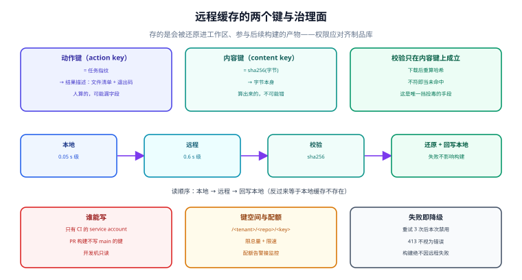

# 远程缓存：内容寻址、上传策略与投毒面

远程缓存把「我算过」变成「我们算过」。收益是线性的（每多一台机器接入，就多一份命中机会），风险也是线性的（每多一个写入者，就多一个污染源）。所以远程缓存的设计问题从来不是「怎么存」，而是三个治理问题：**谁能写、写进去的东西凭什么被信任、坏条目怎么在五分钟内失效**。

本页按「两个键 → 读写顺序 → 上传策略 → 租户与投毒 → 完整性 → 失败模式」讲，最后给出远程缓存上线前必须回答的六个问题。



本页判据族 `BCR-A` ~ `BCR-H`，共 8 条，定义在最后一节。

## 一、两个键，别混成一个

任何可用的远程缓存都至少有两个键空间：

| 键 | 输入 | 指向 | 谁写 | 可变性 |
| --- | --- | --- | --- | --- |
| **动作键（action key）** | 任务指纹（[九字段](../CacheKey/index.md)） | 一份「结果描述」：输出文件列表 + 每个文件的 CAS 键 + 退出码 + 日志 | 执行过该任务的构建 | 同一键可能被多次写（内容应相同） |
| **内容键（content key）** | 字节本身（`sha256(bytes)`） | 字节 | 任何产生该字节的构建 | **不可变**：内容变了键就变了 |

为什么必须分开：

1. **去重只可能发生在内容键上**。同一个 `.js` 产物被三个任务产出，动作键有三个，内容键只有一个——存储只占一份。
2. **校验只可能发生在内容键上**。动作键是人算的（可能漏字段），内容键是字节的哈希（不可能错）。所以「下载后验哈希」这一步，验的是内容键，不是动作键。
3. **失效策略不同**。动作键要按「指纹版本」批量失效；内容键只能按引用计数/GC 回收，**不能按时间随便删**（删了会让引用了它的动作键变成「指向空」）。

Bazel 把这个区分做成了显式概念：**action cache（AC）** 存「动作 → 输出」，**CAS** 存字节；`--remote_download_outputs` 控制「只下载需要的输出」。Gradle 的 HTTP build cache 把两者揉在一个 URL 空间里（`GET/PUT /cache/<key>`），实现简单但失去了跨任务去重——这就是「简单方案」与「可扩展方案」的分界线。

::: tip 自研时的最小设计
如果只是给一个 monorepo 做远程缓存，**单键空间（动作键）+ 每份条目内自带 `sha256` 清单**就够了：读到条目先校验清单，任何一项不符就当未命中。这比双键空间少一半代码，代价是没有跨任务去重（同一个产物会被不同任务各存一份）——在几十 GB 的量级上完全可以接受。
:::

## 二、读的顺序：本地优先，远程命中后回写本地

Gradle 官方文档写得很清楚：**先查本地，再查远程；远程命中后同时写入本地**。这个顺序不是优化，是必需的：

| 顺序 | 效果 |
| --- | --- |
| 本地 → 远程 → 回写本地 | 热条目在本地（0.05 s 级），冷条目付一次网络（0.6 s 级），之后转热 |
| 远程 → 本地（先远程） | 每次都要网络往返；本地缓存形同虚设 |
| 只本地 / 只远程 | 单点：要么不共享，要么每次都慢 |

回写本地这一步如果失败（磁盘满、权限不足），**构建不应该失败**——但要计数。回写失败率长期 100% 的表现是「远程命中率很高，但构建耗时没改善」，因为每次都在付网络。

::: warning 一个容易搞反的默认值
Gradle 的本地缓存默认 `push = true`（写本地），**远程缓存默认 `push = false`**（不写远程）。于是「配了远程地址但从来没人上传」是极常见的现象——每个人都以为「我配了就会上传」，实际上只有显式 `isPush = true` 的构建才写。
:::

## 三、上传策略：只让 CI 写

这是整套体系里最重要的一条纪律：

> **开发机只读，CI 才能写。**

理由不是「怕开发者搞坏」，而是三条结构性的：

1. **开发机的产物可能依赖本机状态**：本地 `.env`、本地安装的工具链、本地改过的配置文件。这些一旦进共享缓存，就是「一台机器的私有状态被当成团队事实」。
2. **开发机的写入不可审计**：CI 的每次写入都能关联到一个提交与一次构建；开发机的写入关联不到任何东西。**缓存投毒最省力的入口就是「一个能写的开发机账号」**。
3. **写放大**：开发者频繁试验性构建（改一行、跑一下、再改），这些中间态条目对别人毫无价值，却会挤掉真正有用的条目（LRU 是全局的）。

对应的配置（Gradle，官方文档给的就是这个形状）：

```kotlin [settings.gradle.kts]
val isCiServer = System.getenv().containsKey("CI")

buildCache {
    remote<HttpBuildCache> {
        url = uri("https://cache.internal.example.com/cache/")
        isPush = isCiServer          // 只有 CI 推
        credentials {
            username = System.getenv("CACHE_USER")
            password = System.getenv("CACHE_PASS")
        }
    }
}
```

Turborepo 的做法是把写权限绑在凭证上：`turbo login` + `turbo link` 之后，本机与 CI 都能推；要限制就**在服务端按 token 分权限**，而不是靠客户端自觉（自建 Remote Cache 时尤其要注意这一点）。Bazel 同理：`--remote_cache` 的写权限由 `--remote_upload_local_results` 与服务端鉴权共同决定。

## 四、租户与投毒面：远程缓存是一个「多方写入的代码执行前置物」

远程缓存里存的是**会被直接还原到工作区、参与后续构建与测试的产物**。这句话的含义是：**能写缓存的人，等于能影响所有读缓存的人的构建结果**。这条链路比大多数人以为的更短：

```text
写一个恶意/错误的 dist 条目
   → 别人的构建命中它，跳过编译
   → 测试跑的是这份产物
   → 打包、发布
```

所以远程缓存的权限模型应当对齐「制品库」而不是「临时存储」：

| 控制点 | 做法 | 不做的后果 |
| --- | --- | --- |
| **写权限** | 只有 CI 的 service account 能写，开发机只读 | 任意一台机器可投毒 |
| **读权限** | 按仓库/租户隔离；公开仓库的 CI 缓存**不要**匿名可读 | 私有代码的产物被外部读到 |
| **命名空间** | `/<tenant>/<repo>/<branch-scope>/<key>`，至少两层前缀 | 跨仓库键碰撞（尤其自研脚本用短哈希时） |
| **配额** | 按租户限总量与限速 | 一个仓库的构建把桶写满，全公司冷启动 |
| **审计** | 每次 PUT 记录「谁、哪个提交、哪个任务」 | 出事无法定位污染源 |
| **失效** | 支持按 key / 按前缀 / 按提交批量删 | 止血靠「清空整个桶」 |

::: danger 三个真实存在的投毒路径（不需要任何漏洞利用）
1. **PR 构建能写主分支缓存**：CI 对 PR 与对 main 用同一套凭证，于是「一个来自 fork 的 PR」就能往团队缓存里塞任意产物。正确做法是 **PR 构建只读、main 构建才写**，或按分支前缀隔离键空间。
2. **缓存键不含仓库身份**：两台不同仓库的自研缓存共用一个桶，而指纹格式相同——键碰撞时读到别人的产物。加仓库前缀是最低成本的修法。
3. **「内容哈希校验」被跳过**：为了省一次 `sha256`，直接信任下载结果。一旦后端（或被劫持的中间层）返回错误内容，你就把任意字节还原进了工作区。
:::

## 五、完整性：三道校验，缺一不可

| 校验 | 验什么 | 成本 | 挡什么 |
| --- | --- | --- | --- |
| **传输完整性** | HTTP `Content-Length` / TLS | 近零 | 截断、代理损坏 |
| **内容哈希** | `sha256(下载到的字节) == 键` | 一次哈希（本机 267 MiB/s，1 GB ≈ 4 s） | 后端存错、投毒、位翻转 |
| **解包后结构** | 文件数、每文件哈希、权限位 | 一次遍历 | 「哈希对但解包器有 bug」这类边缘情况 |

第二道是**唯一能挡住投毒的**，也是最常被省掉的。它成立的前提是「键就是内容哈希」——这正是第一节要区分两个键的原因：如果只有动作键，你没有任何独立依据去验内容。

::: warning 一个常被忽略的细节：缓存里的东西会被「执行」
`postinstall` 脚本、`bin/` 下的可执行文件、`.node` 原生模块——这些东西从缓存还原之后会被直接运行。所以「校验」不只是「内容对不对」，还包括「这个内容该不该被执行」。企业环境里更稳的做法是**缓存只存构建产物、不存依赖安装结果**（依赖走 registry + lockfile 校验），把两套信任模型分开。
:::

## 六、失败模式：远程缓存必须「坏了也不影响正确性」

远程缓存是一个**外部依赖**，它一定会出问题（网络、鉴权、5xx、超时）。设计原则只有一条：**任何远程失败都降级为「未命中」，绝不让构建失败**。Gradle 的实现是这条原则的范本：

| 情形 | 官方语义 | 你应该做什么 |
| --- | --- | --- |
| 读：2xx | 命中 | 校验内容后还原 |
| 读：404 | 未命中（正常） | 继续构建 |
| 读：其他状态 / 网络错误 | 重试（最多 3 次），仍失败则**本次构建剩余部分禁用远程缓存** | 打点计数，别静默 |
| 写：任意 2xx | 成功 | —— |
| 写：`413` | **不视为错误**（条目太大被拒） | 单独计数：413 多说明单条目太大，该拆 |
| 写：其他失败 | 忽略（不影响构建） | 计数；长期 100% 失败 = 远程形同虚设 |

「重试 3 次后本次构建禁用远程」这个设计值得学：它避免了「网络抖动时每次任务都等超时」的雪崩，代价是这一次构建退化成纯本地。

## 七、本页判据

| 编号 | 判据 | 不满足时改哪里 |
| --- | --- | --- |
| `BCR-A` | 动作键与内容键分开（或单键 + 条目内自带哈希清单），读时**按内容校验** | 见第一节 |
| `BCR-B` | 读顺序是「本地 → 远程 → 回写本地」，且回写失败有计数 | 见第二节 |
| `BCR-C` | 只有 CI 能 push，开发机只读；PR 构建不写 main 的键空间 | `isPush = isCiServer` 或服务端分权 |
| `BCR-D` | 键空间有租户/仓库前缀，至少两层 | 见第四节 |
| `BCR-E` | 有配额与限速，且配额告警接进了监控 | 见第四节表 |
| `BCR-F` | 每次 PUT 有审计记录（谁 / 哪个提交 / 哪个任务） | 后端日志或代理层 |
| `BCR-G` | 任何远程失败降级为未命中，绝不使构建失败；`413` 单独计数 | 见第六节 |
| `BCR-H` | 能按 key / 前缀 / 提交批量失效，且演练过 | 止血演练，见[正确性](../Correctness/index.md)第五节 |

## 八、验证方式

```shell
# 1) 读路径：确认「本地优先」。清本地后第一次应 remote，第二次应 local
rm -rf .turbo/cache            # 或对应的本地目录
pnpm build                      # 期望：remote hit（或 miss，若远端没有）
pnpm build                      # 期望：local hit

# 2) 写权限：非 CI 环境下不应该产生上传
unset CI
pnpm build 2>&1 | grep -iE "upload|push|remote" || echo "无上传动作（符合只读）"

# 3) 完整性：任取一个条目，重新算哈希必须与键一致
#    自研后端：GET /<key> 后 sha256 必须等于 key
curl -s https://cache.internal.example.com/cache/<key> -o /tmp/entry.bin
sha256sum /tmp/entry.bin        # 必须等于 <key>（双键空间时等于内容键）

# 4) 失败降级：把地址指到一个不存在的域名，构建必须仍然成功
GRADLE_OPTS="-Dorg.gradle.caching.debug=true" ./gradlew build \
  --build-cache -DcacheUrl=https://nonexistent.invalid/ ; echo "rc=$?"
```

**期望结果**：第 1 步的两行读到 `remote` 然后 `local`；第 2 步只读环境没有任何上传动作；第 3 步哈希一致；第 4 步 `rc=0`（构建成功，只是没有远程命中）。**第 4 步是最容易被跳过、也最该做的一条**——它是「远程缓存坏了会不会阻断交付」的唯一答案。

## 与相邻专题的分工

- 键（动作键）怎么算：[指纹](../CacheKey/index.md)
- 本地缓存的写入与淘汰：[本地缓存](../LocalCache/index.md)
- 假命中怎么发现与止血：[正确性](../Correctness/index.md)
- 各生态的远程缓存配置对照：[生态对照](../Platforms/index.md)
- 制品库与签名的治理视角：[依赖与安全治理](../../DependencyGovernance/index.md)

## 参考资料

- Gradle 官方：*Build Cache*（远程 `HttpBuildCache`、`isPush` 默认 `false`、本地优先与回写、重试 3 次后禁用、`413` 不视为错误）
- Bazel 官方：*Remote Caching*（AC 与 CAS 分离、`--remote_download_outputs`、`--remote_timeout`）
- Turborepo 官方：*Remote Caching*（`turbo login` / `turbo link`、自建缓存 API、`--force` 只关读）
- SLSA / reproducible-builds：缓存内容与制品信任链的关系
